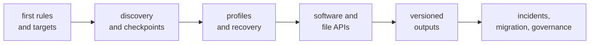
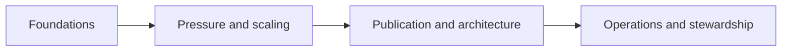

# Course Map
The modules form one continuous workflow story: you begin with one target and finish by
reviewing a repository that other people may execute, trust, extend, and inherit. Each
day introduces a pressure that the previous day’s model cannot yet absorb.

## Course progression



## The ten study days

| Module | Begin with | Finish able to | Classroom-style turning point |
| --- | --- | --- | --- |
| 01 · File contracts and workflow graph truth | one target and one rule | predict jobs and explain rebuilds from evidence | the DAG stops feeling mystical |
| 02 · Dynamic DAGs, discovery, and integrity | a truthful static workflow | use checkpoints and discovery without hiding meaning | dynamic behavior becomes disciplined instead of magical |
| 03 · Production operations and policy boundaries | a truthful local workflow | separate workflow semantics from retries, staging, and profiles | the command layer stops masquerading as workflow meaning |
| 04 · Scaling workflows and interface boundaries | a small coherent workflow | split growing rule sets without hiding ownership | modularity becomes a clarity tool instead of file sprawl |
| 05 · Software boundaries and reproducible rules | shell-heavy rules and ad hoc helpers | move logic into scripts, wrappers, and environments deliberately | helper code gains explicit ownership |
| 06 · Publishing and downstream contracts | useful internal outputs | define a versioned publish surface people can trust | outputs are judged from the consumer side |
| 07 · Workflow architecture and file APIs | a working repository | treat paths, formats, and file trees as APIs | repository structure becomes part of the workflow contract |
| 08 · Operating contexts and execution policy | one local execution context | preserve workflow meaning across laptops, CI, and schedulers | context drift becomes visible policy |
| 09 · Observability, performance, and incident response | a correct but pressured workflow | diagnose slow, flaky, or surprising runs from evidence | logs and summaries replace folklore |
| 10 · Governance, migration, and tool boundaries | an inherited workflow | preserve proof while evolving ownership and scope | stewardship becomes an explicit design decision |

## Arc 1: file contracts and dynamic discovery

Modules 01 and 02 establish the workflow's semantic floor.

- **Module 01** starts with static rules, targets, dry-runs, wildcards, and explicit file
  contracts. You finish with a small workflow whose rebuild behavior you can explain.
- **Module 02** adds configuration-driven discovery and checkpoints. You learn to reserve
  dynamic behavior for facts that cannot be known before execution.

Leave this arc able to explain what the workflow plans to build and how discovery stays
reviewable.

## Arc 2: operations and software boundaries

Modules 03 to 05 turn workflow truth into a maintainable repository.

- **Module 03** separates workflow meaning from profiles, retries, staging, and recovery
  policy. You compare local and shared-compute execution without changing file truth.
- **Module 04** splits a growing workflow into rule families and explicit interfaces.
  You learn when modularity clarifies ownership and when it merely scatters logic.
- **Module 05** moves substantial computation into scripts, wrappers, environments, or
  notebooks with reproducible software and provenance boundaries.

Leave this arc able to separate workflow meaning from execution policy and helper code.

## Arc 3: publish trust and architecture

Modules 06 to 08 scale the repository into a downstream-facing system.

- **Module 06** turns internal results into a versioned, checksummed publish contract that
  downstream users can validate without understanding the working directory.
- **Module 07** treats paths and file formats as APIs. You design repository layers and
  helper boundaries that remain legible as the workflow grows.
- **Module 08** maps resources, storage, latency, retries, and executors through profiles.
  You test whether local, CI, and cluster contexts preserve the same workflow meaning.

Leave this arc able to explain which surfaces are public, internal, or policy-only.

## Arc 4: incidents and governance

Modules 09 to 10 finish with long-lived workflow judgment.

- **Module 09** uses benchmarks, logs, summaries, and run metadata to diagnose performance
  and failures from evidence rather than intuition.
- **Module 10** applies characterization, migration, governance, and tool-boundary
  decisions to a long-lived workflow without discarding trusted behavior.

Leave this arc able to review a real workflow repository and justify what should change next.

## Skills accumulate

Later modules do not replace earlier ones. A publish contract in Module 06 still depends
on the graph truth from Module 01, the discovery discipline from Module 02, and the
policy separation from Module 03.

```mermaid
flowchart LR
  graph["Graph truth"] --> dynamic["Dynamic discipline"]
  graph --> policy["Policy boundaries"]
  dynamic --> publish["Publish trust"]
  policy --> operating["Operating contexts"]
  publish --> architecture["Architecture"]
  operating --> incidents["Incident response"]
  architecture --> stewardship["Stewardship"]
  incidents --> stewardship
```

When a later lesson feels unclear, move backward through the dependency. Do not solve a
weak file contract with a stronger scheduler profile.

## How the course grows in difficulty

The first two modules teach you how Snakemake decides. The next three teach you how that
decision process survives repository growth and software boundaries. The last five teach
you how to publish, operate, review, and govern a workflow that other people depend on.



## Practice commitment

Every technical module contains ten exercises:

- Exercises 1-5 establish and test the local concept.
- Exercises 6-10 apply it through implementation, failure injection, review, or repair.

That makes a hundred exercises across the course. The answer pages explain reasoning and
trade-offs; they are not substitutes for making a prediction and testing it yourself.

## Exercise progression in every module

The ten exercises deliberately change character:

- Exercises 1-2 check vocabulary, observation, and setup honesty.
- Exercises 3-4 ask you to predict behavior before running it.
- Exercises 5-6 ask you to diagnose or repair a broken workflow.
- Exercises 7-8 ask you to design and test a small extension.
- Exercises 9-10 ask you to explain trade-offs and apply the skill to a less familiar case.

Completing only the first half gives you recognition. Completing all ten builds transfer.

## Where the capstone enters

Use the small module examples first. Enter the capstone only when you can state the
question you want it to answer.

| After module | Useful capstone question |
| --- | --- |
| 02 | Which files and checkpoints make discovery honest here? |
| 04 | Which workflow splits improve ownership instead of scattering logic? |
| 06 | Where is the public publish surface and how is it validated? |
| 08 | Which differences across contexts are policy-only? |
| 10 | Which responsibilities should remain in Snakemake at all? |

## Route markers

- Read [First-Contact Map](first-contact-map.md) when you need the smallest honest
  starting route.
- Read [Mid-Course Map](mid-course-map.md) when Modules 01 to 03 already feel stable and
  you need the bridge into scaling, software seams, publish trust, and operating contexts.
- Read [Mastery Map](mastery-map.md) when the pressure is stewardship, migration, or
  long-lived workflow trust review.
