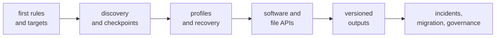

# Course Map

Use this page when you want to see the whole course as one learning journey instead of
as eleven isolated folders. A good course map should do more than list topics. It should
show why the order matters, what pressure each module adds, and what ability you are
supposed to earn before moving on.

## The course in one sentence

Deep Dive Snakemake begins with one requested file and ends with stewardship of a
repository that other people may execute, trust, extend, inherit, and migrate.

That journey works only because each module adds one new pressure that the previous model
could not yet absorb safely.

## The main progression



## The ten learning days

| Module | You begin with... | You finish able to... | The turning point |
| --- | --- | --- | --- |
| 01 File contracts and workflow graph truth | one target and one rule | predict jobs and explain rebuilds from evidence | the DAG stops feeling mystical |
| 02 Dynamic DAGs, discovery, and integrity | a truthful static workflow | use checkpoints and discovery without hiding meaning | dynamic behavior becomes disciplined instead of magical |
| 03 Production operations and policy boundaries | a truthful local workflow | separate workflow semantics from retries, staging, and profiles | the command layer stops masquerading as workflow meaning |
| 04 Scaling workflows and interface boundaries | a small coherent workflow | split growing rule sets without hiding ownership | modularity becomes a clarity tool instead of file sprawl |
| 05 Software boundaries and reproducible rules | shell-heavy rules and ad hoc helpers | move logic into scripts, wrappers, and environments deliberately | helper code gains explicit ownership |
| 06 Publishing and downstream contracts | useful internal outputs | define a versioned publish surface people can trust | outputs are judged from the consumer side |
| 07 Workflow architecture and file APIs | a working repository | treat paths, formats, and file trees as APIs | repository structure becomes part of the workflow contract |
| 08 Operating contexts and execution policy | one local execution context | preserve workflow meaning across laptops, CI, and schedulers | context drift becomes visible policy |
| 09 Observability, performance, and incident response | a correct but pressured workflow | diagnose slow, flaky, or surprising runs from evidence | logs and summaries replace folklore |
| 10 Governance, migration, and tool boundaries | an inherited workflow | preserve proof while evolving ownership and scope | stewardship becomes an explicit design decision |

## Why the order matters

The modules are cumulative on purpose.

### First arc: workflow truth

Modules 01 and 02 teach the semantic floor of the whole course:

- what a workflow claims to build
- how Snakemake decides what to run
- how discovery can change the graph without turning into folklore

If this arc stays weak, every later topic becomes harder than it should be.

### Second arc: production and software boundaries

Modules 03 to 05 ask whether workflow truth can survive real operating pressure:

- profile differences
- retries and recovery
- scaling across files
- helper scripts and software seams

This is where you stop treating the workflow as a toy.

### Third arc: public trust and architecture

Modules 06 to 08 turn the workflow into a downstream-facing system:

- public versus internal outputs
- repository file APIs
- context differences across local, CI, and schedulers

This is where "it runs" stops being enough.

### Fourth arc: incidents and stewardship

Modules 09 and 10 finish the course with long-lived judgment:

- what evidence comes before editing
- what should be repaired, migrated, or handed off
- what Snakemake should stop owning

This is where workflow engineering becomes stewardship.

## Skills accumulate; they do not expire

Later modules do not replace earlier ones. They depend on them.

```mermaid
flowchart LR
  graph["Graph truth"] --> dynamic["Dynamic discipline"]
  graph --> policy["Policy boundaries"]
  dynamic --> publish["Publish trust"]
  policy --> operating["Operating contexts"]
  publish --> architecture["Architecture"]
  operating --> incidents["Incident response"]
  architecture --> stewardship["Stewardship"]
  incidents --> stewardship
```

When a later lesson feels unclear, move backward through the dependency. Do not try to
solve a weak file contract with a stronger profile or a larger proof route.

## How difficulty grows

The course gets harder in a deliberate way:

- early modules teach how Snakemake decides
- middle modules teach how that decision process survives repository growth
- late modules teach how it survives public trust, operational pressure, and change over
  time

That means advanced work here is not "more features." It is better judgment under
pressure.

## What the exercise system is doing

Every technical module contains ten exercises. They are not filler. They change shape on
purpose.

- Exercises 1-2 check setup honesty, observation, and basic vocabulary.
- Exercises 3-4 ask you to predict behavior before running it.
- Exercises 5-6 ask you to diagnose, repair, or explain drift.
- Exercises 7-8 ask you to design or test a small extension.
- Exercises 9-10 ask for transfer, trade-off judgment, or review behavior.

Completing only the first half gives you recognition. Completing all ten builds transfer.

## Where the capstone enters

Use the small module examples first. Enter the capstone only when you can state the
question you need it to answer.

| After module... | Useful capstone question |
| --- | --- |
| 02 | Which files and checkpoints make discovery honest here? |
| 04 | Which workflow splits improve ownership instead of scattering logic? |
| 06 | Where is the public publish surface and how is it validated? |
| 08 | Which differences across contexts are policy-only? |
| 10 | Which responsibilities should remain in Snakemake at all? |

If you cannot yet phrase one of those questions, stay in the smaller module surface.

## Route markers inside Module 00

- Read [First-Contact Map](first-contact-map.md) when you need the smallest honest start.
- Read [Mid-Course Map](mid-course-map.md) when the beginner arc is stable and the next
  pressure is scaling, publish trust, software boundaries, or operating contexts.
- Read [Mastery Map](mastery-map.md) when the pressure is incident review, migration, or
  long-lived stewardship.

## Good stopping point

This page has done its job when you can answer:

1. Why does the course begin with one target instead of with a big repository?
2. What new pressure does the next module add?
3. Which earlier truth would break if you skipped too far ahead?
