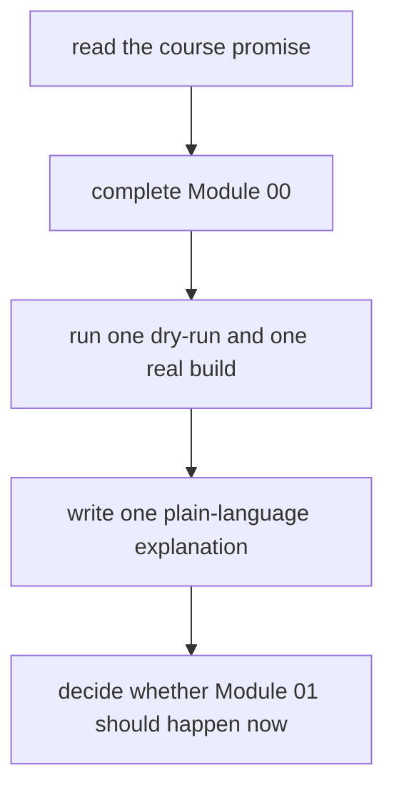

# First-Contact Map

Use this page for your first honest session with the course. The goal is not to cover as
much ground as possible. The goal is to leave the first hour coherent enough that later
choices feel deliberate instead of random.

This page protects the first-contact experience from two common mistakes:

- opening too many course surfaces before one small workflow is clear
- treating the capstone as a substitute for beginner understanding

## The first-session route

## Work this route in order

1. Read [the course home](../index.md) for the overall promise.
2. Read [the orientation module](index.md) for the first small workflow.
3. Complete [Your first workflow](index.md#your-first-workflow).
4. Draw the three-node graph on paper: input, rule, output.
5. Read [Course Map](course-map.md) and choose a realistic study schedule.
6. Open [Module 01](../module-01-file-contracts-workflow-graph-truth/index.md) only
   after the first workflow makes sense in your own words.

Do not open the capstone yet. Its size becomes useful only after the basic graph is
already familiar.

## What the first session is supposed to stabilize

The first session is trying to give you one durable model:

- a target is requested
- Snakemake plans the jobs needed to reach it
- rules are connected by file contracts
- reruns happen only when file truth says they should

If that model is stable, later modules have something solid to build on. If it is weak,
later pages become vocabulary without structure.

## What you should know before Module 01

Before the first technical module, you should be able to say:

- a target is a file you ask Snakemake to produce
- a rule connects declared input files to declared output files
- a dry-run reveals planned work without executing commands
- an up-to-date output does not rerun just because its rule exists
- the capstone is for corroboration after the small model is clear

If one of those still sounds memorized rather than understood, repeat the first workflow
before moving on.

## The first-week rhythm

Use the same rhythm through the opening modules:

1. reproduce the smallest example
2. predict what the dry-run will report
3. change one input, output, or rule at a time
4. explain the behavior in terms of files and dependencies
5. complete the exercises before consulting the answers

This rhythm matters more than speed.

## First-session mistakes to avoid

- treating dry-run as optional
- jumping to the capstone because it looks more advanced
- reading the answer page before making a prediction
- changing multiple workflow facts at once and guessing which one mattered
- mistaking a successful run for a clear explanation

## If the first workflow fails

| Symptom | Inspect first |
| --- | --- |
| `snakemake: command not found` | complete [Platform Setup](../guides/platform-setup.md) and activate the course environment |
| `SyntaxError` or `IndentationError` | compare indentation and punctuation with the orientation `Snakefile` |
| missing `message.txt` | confirm your shell is in `artifacts/snakemake-first-workflow` |
| nothing needs to be done on the first run | remove `results/greeting.txt`, then dry-run again |
| output exists but contains unexpected text | run with `--printshellcmds` and inspect the exact command |

## A strong first-session outcome

Your first session is successful if you can explain all three of these without guessing:

- what target you requested
- why the first run had work to do
- why the second run did not

That may sound small. It is not small. It is the seed of every later topic in the
course.

## When to leave this route

Move to [Mid-Course Map](mid-course-map.md) only once Modules 01 to 03 feel stable and
the main question has shifted from "how does Snakemake decide?" to one of these:

- how should the repository scale
- where should helper logic live
- what is public downstream
- what is policy rather than workflow meaning

## Good stopping point

Leave this page when you can answer:

1. What target did I request?
2. Why did the first run have work to do?
3. Why did the second run stay quiet?
4. Why is the capstone still too large for first contact?
