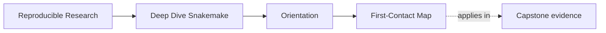

# First-Contact Map

<!-- page-maps:start -->
## Page Maps

<!-- page-maps:end -->

Use this page for your first session when Snakemake is new. You will leave with a working
workflow, not merely a list of pages to read.

## First session route

1. Complete [Your first workflow](index.md#your-first-workflow).
2. Predict the result before each dry-run and execution.
3. Draw the three-node graph on paper: input, rule, output.
4. Read [Course Map](course-map.md) and choose a realistic study schedule.
5. Open [Module 01](../module-01-file-contracts-workflow-graph-truth/index.md).

Do not open the capstone yet. Its size is useful after the basic graph is familiar, but
at first contact it adds repository details that compete with the central idea.

## What you should know before Module 01

Before the first technical module, you should be able to answer:

- a target is a file you ask Snakemake to produce
- a rule connects declared input files to declared output files
- a dry-run reveals the planned graph without executing commands
- an up-to-date output does not run again merely because its rule appears in the file
- the capstone is evidence for concepts learned in smaller examples

## First-week rhythm

Repeat the same rhythm through the first modules:

1. begin by reproducing the smallest example
2. predict what the dry-run will report
3. change one input, output, or rule at a time
4. explain the observed behavior in terms of files and dependencies
5. complete the exercises before consulting their answers

## If the first workflow does not run

| Symptom | Inspect first |
| --- | --- |
| `snakemake: command not found` | complete [Platform Setup](../guides/platform-setup.md) and activate the course environment |
| `SyntaxError` or `IndentationError` | compare indentation and punctuation with the orientation `Snakefile` |
| missing `message.txt` | confirm your shell is in `artifacts/snakemake-first-workflow` |
| nothing needs to be done on the first run | remove `results/greeting.txt`, then dry-run again |
| output exists but contains unexpected text | run with `--printshellcmds` and inspect the exact command |

## When to leave this route

Move to [mid-course-map.md](mid-course-map.md) once Modules 01 to 03 feel stable and the
main question becomes scaling, publish trust, software boundaries, or operating contexts.
