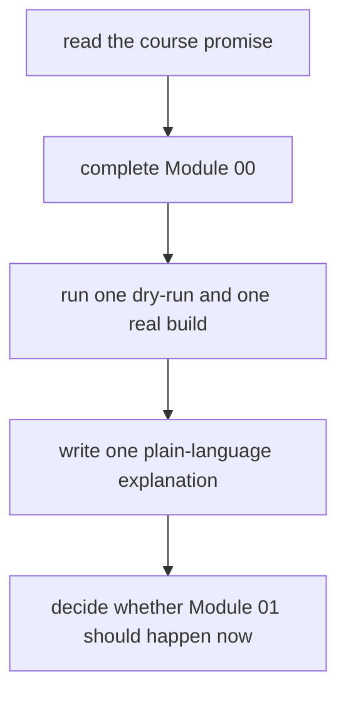

# First-Contact Map

Use this page for your first honest session with the course. The goal is not to cover as
much ground as possible. The goal is to leave the first hour coherent enough that later
choices feel deliberate instead of random.

This page protects the first-contact experience from two common mistakes:

- opening too many course surfaces before one small workflow is clear
- treating the capstone as a substitute for beginner understanding

## If you are learning this without the live class

Read this page in four passes:

1. decide whether this is still your first-contact session
2. complete one bounded first-session route
3. write one plain-language explanation before opening the next module
4. decide whether Module 01 should happen now or after another small repetition

If you skip step 3, the course can feel productive while your explanation stays weak.

## The first-session route

## The first packet you should keep beside you

Keep one tiny first-session packet:

- one requested target
- one dry-run capture
- one first real build
- one explanation of why the second run stayed quiet
- one note on what changing one input proved

If your first packet needs many files or many commands to feel persuasive, the surface is
already too wide.

## Work this route in order

1. Read [the course home](../index.md) for the overall promise.
2. Read [the orientation module](index.md) for the first small workflow.
3. Complete [Your first workflow](index.md#your-first-workflow).
4. Draw the three-node graph on paper: input, rule, output.
5. Read [Course Map](course-map.md) and choose a realistic study schedule.
6. Open [Module 01](../module-01-file-contracts-workflow-graph-truth/index.md) only
   after the first workflow makes sense in your own words.

Do not open the capstone yet. Its size becomes useful only after the basic graph is
already familiar.

## What the first session is supposed to stabilize

The first session is trying to give you one durable model:

- a target is requested
- Snakemake plans the jobs needed to reach it
- rules are connected by file contracts
- reruns happen only when file truth says they should

If that model is stable, later modules have something solid to build on. If it is weak,
later pages become vocabulary without structure.

## A first-session card you should be able to fill quickly

Use a table like this before you continue:

| Question | Short honest answer |
| --- | --- |
| what did I request | one file the workflow owes me |
| what could produce it | one rule with a visible file contract |
| what did the dry-run reveal | what work Snakemake planned before execution |
| what did the first build prove | the graph can create the requested artifact |
| what did the second run prove | the workflow can converge rather than repeat work |
| what did the changed input prove | file dependencies, not vibes, drive rebuilds |

If any row still sounds memorized instead of understood, the first session is not done.

## What you should know before Module 01

Before the first technical module, you should be able to say:

- a target is a file you ask Snakemake to produce
- a rule connects declared input files to declared output files
- a dry-run reveals planned work without executing commands
- an up-to-date output does not rerun just because its rule exists
- the capstone is for corroboration after the small model is clear

If one of those still sounds memorized rather than understood, repeat the first workflow
before moving on.

## The first-week rhythm

Use the same rhythm through the opening modules:

1. reproduce the smallest example
2. predict what the dry-run will report
3. change one input, output, or rule at a time
4. explain the behavior in terms of files and dependencies
5. complete the exercises before consulting the answers

This rhythm matters more than speed.

## First-session mistakes to avoid

- treating dry-run as optional
- jumping to the capstone because it looks more advanced
- reading the answer page before making a prediction
- changing multiple workflow facts at once and guessing which one mattered
- mistaking a successful run for a clear explanation

## What goes wrong when the first session widens too early

Use this card when you feel pulled forward:

| If you are tempted to... | The hidden problem is probably... | Smaller move instead |
| --- | --- | --- |
| open the capstone now | local graph truth is still fuzzy | rerun the tiny workflow and explain the plan again |
| browse many maps and guides at once | orientation anxiety is replacing first understanding | stay with Module 00, First-Contact Map, and one dry-run |
| read answer pages before predicting behavior | recognition is replacing explanation | make one prediction and test it first |
| change many workflow facts at once | the cause of the behavior will blur | change one file contract at a time |

If the smaller move feels repetitive, that usually means it is still doing real teaching work.

## If the first workflow fails

| Symptom | Inspect first |
| --- | --- |
| `snakemake: command not found` | complete [Platform Setup](../guides/platform-setup.md) and activate the course environment |
| `SyntaxError` or `IndentationError` | compare indentation and punctuation with the orientation `Snakefile` |
| missing `message.txt` | confirm your shell is in `artifacts/snakemake-first-workflow` |
| nothing needs to be done on the first run | remove `results/greeting.txt`, then dry-run again |
| output exists but contains unexpected text | run with `--printshellcmds` and inspect the exact command |

## A strong first-session outcome

Your first session is successful if you can explain all three of these without guessing:

- what target you requested
- why the first run had work to do
- why the second run did not

That may sound small. It is not small. It is the seed of every later topic in the
course.

## When to leave this route

Move to [Mid-Course Map](mid-course-map.md) only once Modules 01 to 03 feel stable and
the main question has shifted from "how does Snakemake decide?" to one of these:

- how should the repository scale
- where should helper logic live
- what is public downstream
- what is policy rather than workflow meaning

## A five-line first-session note you should be able to write from memory

If this page has done its job, you should be able to write:

1. what target you requested
2. what rule could build it
3. what the dry-run told you
4. why the second run stayed quiet
5. why the capstone is still too large for first contact

If you cannot do that yet, stay here a little longer.

## Good stopping point

Leave this page when you can answer:

1. What target did I request?
2. Why did the first run have work to do?
3. Why did the second run stay quiet?
4. Why is the capstone still too large for first contact?
