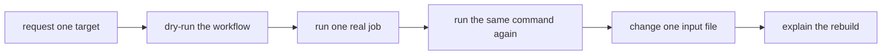
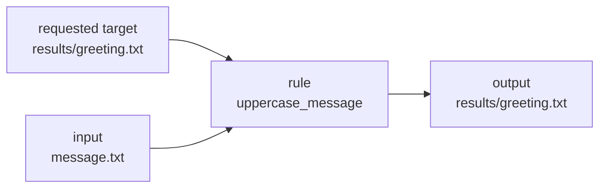

# Module 00: Orientation and Study Practice
You do not need previous workflow, data-engineering, or cluster experience to begin this
course. You need a terminal, a text editor, and enough patience to run one small
workflow twice and explain the difference between the two runs.

This orientation gets you from no Snakemake experience to a working two-rule workflow.
You will create an input file, ask Snakemake what it plans to do, build an output, and
observe why a second run has nothing to do. That small experiment supplies the mental
model used throughout the course: **a workflow describes files and the rules that can
produce them; requested files determine which rules run**.

Snakemake answers one question:

> Which files must be created or refreshed so the requested targets can exist honestly?

It answers that question from rules in a `Snakefile`. This orientation starts with one
input file and one output file. Later modules add discovery, scaling, software
boundaries, publication, operating contexts, and stewardship, but they all depend on the
same first truth: the workflow only makes sense when its file contracts are explicit.

## What this orientation module is for

Module 00 is not a disposable preface. It establishes the study habits that make the
rest of the course work:

- start from one small workflow, not from the capstone
- dry-run before execution so the plan is visible
- explain why a rule ran or did not run using files, not vibes
- treat a no-op second run as evidence that the workflow can converge
- carry one clear question into the next module instead of browsing support pages

If you do that here, later modules feel cumulative. If you skip it, later pages can turn
into syntax and vocabulary without a model underneath them.

## Before the first lesson

Open a terminal and confirm that Snakemake is available:

```console
$ snakemake --version
9.13.3
```

The exact version may differ. If the command fails, stop and use the
[platform setup guide](../guides/platform-setup.md) before continuing.

You should also be comfortable with these shell actions:

```sh
pwd
mkdir -p practice
cd practice
printf 'hello\n' > message.txt
cat message.txt
rm -rf results
```

You do not need to memorize them. You do need to be comfortable reading what they do.

## What you will accomplish

By the end of orientation, you will be able to:

- distinguish an input, an output, a rule, and a target
- read a small workflow as a dependency graph
- use a dry-run before allowing work to execute
- explain why Snakemake rebuilds an output, or correctly leaves it alone
- choose a study route without treating the capstone as a beginner tutorial

## Your first workflow

Work from the repository root. The commands below keep the experiment under
`artifacts/`, where it can be deleted and recreated safely.

```sh
mkdir -p artifacts/snakemake-first-workflow
cd artifacts/snakemake-first-workflow
printf 'reproducible research\n' > message.txt
```

Create a file named `Snakefile` with this content:

```python
rule all:
    input:
        "results/greeting.txt"


rule uppercase_message:
    input:
        "message.txt"
    output:
        "results/greeting.txt"
    shell:
        """
        mkdir -p results
        tr '[:lower:]' '[:upper:]' < {input} > {output}.building
        mv {output}.building {output}
        """
```

The four spaces are meaningful Python indentation. The blank lines are optional, but
they make rule boundaries easier to see.

Ask for a plan before running anything:

```sh
snakemake --dry-run --printshellcmds
```

The dry-run should plan `uppercase_message` because `rule all` requests
`results/greeting.txt`, and that file does not exist. Execute the plan:

```sh
snakemake --cores 1 --printshellcmds
cat results/greeting.txt
```

Run the same command again. Snakemake should report that nothing needs to be done.
Then change the input and dry-run once more:

```sh
printf 'workflows remember dependencies\n' > message.txt
snakemake --dry-run --printshellcmds
```

Snakemake now plans a rebuild because the input is newer than the output. You have just
observed the central behavior of a file-driven workflow without relying on hidden state.

## The first-day demo ladder

Use this sequence before you open Module 01:



Each step adds one idea:

- the request identifies the target the workflow owes you
- the dry-run reveals planned work before any command executes
- the first build turns the graph into a real artifact
- the repeated run tests convergence
- the changed input tests whether the dependency edge is truthful
- your explanation turns command output into understanding

## Read the graph, not the file order



`rule all` is a convenient place to name the final files a complete run should produce.
It does not transform data. Snakemake starts from that requested output, finds a rule
that can create it, and follows that rule's inputs backward. The order of rules in the
file does not define execution order; file dependencies do.

## How one module fills a study day

Each technical module is designed as a complete learning day rather than a short article.
Use this rhythm, changing the timing to fit your circumstances:

| Part of the day | Work |
| --- | --- |
| opening | read the module promise and reproduce the smallest example |
| foundations | study the first lessons and explain each new contract in your own words |
| guided practice | run the worked example, pausing before each command to predict its effect |
| independent practice | complete Exercises 1-5 without the answer page |
| applied practice | complete Exercises 6-10 against a fresh or inherited workflow |
| close | compare answers, record one unresolved question, and meet the module exit standard |

Do not read an answer immediately after getting stuck. First reduce the example, inspect
the dry-run, and state what file contract you expected. That diagnostic habit matters
more than memorizing syntax.

## Start here by question

| If the question is... | Read this first |
| --- | --- |
| what journey does the whole course take | [Course Map](course-map.md) |
| what should my first session look like | [First-Contact Map](first-contact-map.md) |
| how should I bridge from file contracts into scaling, publish trust, and operating contexts | [mid-course-map.md](mid-course-map.md) |
| how should I re-enter the course for stewardship, migration, or trust review | [mastery-map.md](mastery-map.md) |
| which recurring terms matter before Module 01 | [Reference Glossary](../reference/glossary.md) |

## What this course is trying to build

By the end of Deep Dive Snakemake, you should be able to:

- explain workflow behavior as a file-contract question rather than a CLI incantation
- keep checkpoints, profiles, and publish boundaries explicit and reviewable
- separate internal execution state from downstream trust surfaces
- judge when Snakemake still owns a concern and when another boundary should take over

## When the capstone becomes useful

The first workflow above is the right scale for orientation. The capstone is a larger,
production-shaped repository. Enter it after Module 01, when you can already identify
targets, inputs, outputs, and rebuild causes. Start with its bounded walkthrough:

```sh
make PROGRAM=reproducible-research/deep-dive-snakemake capstone-walkthrough
```

If the capstone makes the concept harder to see, return to the small experiment. Larger
is not more advanced when it hides the contract you are trying to learn.

## Keep a short learning journal

At the end of orientation, write four short answers:

1. What did I predict incorrectly?
2. Which command or artifact corrected me?
3. Which file contract explains the behavior now?
4. What would I check first in a real workflow with the same symptom?

That journal becomes more useful as the course gets harder. It captures changes in your
reasoning instead of just preserving command history.

## Orientation check

Before continuing, answer these without looking back:

1. Which file was the requested target?
2. Which rule could produce it?
3. Why did the second execution do no work?
4. Why did editing `message.txt` make the output eligible for rebuilding?
5. What information did the dry-run provide that the shell command alone could not?

If any answer is uncertain, repeat the experiment and use
`snakemake --summary` to inspect the files Snakemake knows about. Continue to Module 01
when you can answer all five in plain language.

## Orientation files in this module

- [course-map.md](course-map.md)
- [first-contact-map.md](first-contact-map.md)
- [mid-course-map.md](mid-course-map.md)
- [mastery-map.md](mastery-map.md)

For stable vocabulary across the wider course, use [Reference Glossary](../reference/glossary.md).
