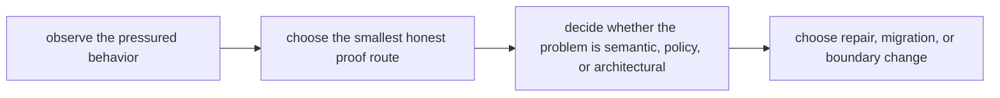

# Mastery Map

Use this page when the course is no longer about first contact or ordinary study rhythm.
The goal here is stewardship: decide what the workflow can still promise honestly, what
must change, and what should move outside Snakemake instead of being hidden inside it.

Mastery in this course does not mean memorizing more features. It means making calmer,
more durable decisions under pressure.

## If you are learning this without the live class

Read this page in four passes:

1. state the late-course pressure in one sentence
2. choose one stewardship route instead of many advanced pages at once
3. keep one proportionate proof surface beside the route
4. stop when you can name the workflow claim, the proof route, and the decision boundary

If you skip step 2, late-course reading quickly turns into advanced browsing instead of stewardship.

## The stewardship route

## What changes at this stage

Earlier in the course, the main question is usually:

> How does this work?

At mastery level, the main question becomes:

> What should still be trusted, changed, rejected, or handed off?

That shift matters because a repository can still run while becoming harder to review,
migrate, or defend.

## The late-course packet you should keep beside you

Keep one small stewardship packet:

- one pressure statement
- one workflow claim under review
- one proportionate proof route
- one decision boundary
- one note on what you would still reject even if the workflow currently runs

If the packet grows into many pages, the route is already broader than the decision needs.

## Return by late-course pressure

| If the pressure is... | Revisit | Keep nearby | First capstone cross-check |
| --- | --- | --- | --- |
| what evidence should come before editing a slow or flaky workflow | Module 09 | [Review Checklist](../reference/review-checklist.md) | [Capstone Review Worksheet](../capstone/capstone-review-worksheet.md) |
| what downstream users are actually allowed to trust | Modules 06 to 09 | [Boundary Review Prompts](../reference/boundary-review-prompts.md) | [Capstone Proof Guide](../capstone/capstone-proof-guide.md) |
| whether policy drift is being mistaken for workflow meaning | Modules 08 to 10 | [Topic Boundaries](../reference/topic-boundaries.md) | [Capstone Architecture Guide](../capstone/capstone-architecture-guide.md) |
| whether Snakemake should keep owning the concern at all | Module 10 | [Anti-Pattern Atlas](../reference/anti-pattern-atlas.md) | [Capstone Review Worksheet](../capstone/capstone-review-worksheet.md) |

## The late-course route in plain language

### Module 09: incident response

Return to Module 09 when the next question is:

- what evidence should I inspect before changing anything
- is this slowness, flakiness, or surprise actually a workflow problem
- which saved artifacts are stronger than memory or terminal folklore

Module 09 is about evidence before intervention.

### Module 10: governance and migration

Return to Module 10 when the next question is:

- what change can be made without losing trusted proof
- what should remain inside the workflow layer
- what concern has outgrown Snakemake and needs a clearer owner

Module 10 is about ownership before convenience.

## A mastery card you should be able to fill before escalating

Use a table like this:

| Pressure | Workflow claim under review | Smallest honest route |
| --- | --- | --- |
| incident | what behavior is surprising and why | Module 09 plus one review surface |
| trust review | what downstream users may still rely on | Modules 06 to 09 plus one proof route |
| migration or ownership | what should change without losing proof | Module 10 plus one stewardship surface |

If you cannot fill the middle column, you are still reacting to pressure without naming the claim.

## What mastery means here

At this point, you should be able to:

- name the exact workflow claim under review
- pick evidence that is proportionate rather than maximal
- reject a change that only makes the repository look more sophisticated
- explain when another tool, service, or layer should own the concern instead
- preserve current trust while still improving the repository

That is stronger than simply being able to run the biggest command.

## What goes wrong when learners treat late-course work as a hunt for the strongest proof

Use this card before you escalate:

| If you are about to... | The likely hidden problem is... | Smaller route |
| --- | --- | --- |
| use the strongest proof route by default | maximal evidence is replacing judgment | choose one proportionate proof route |
| call policy drift semantic drift immediately | the actual contract is still unclear | restate the workflow claim first |
| keep a concern inside Snakemake only because moving it feels hard | convenience is replacing ownership judgment | ask what should still be owned here |
| trust a running repository by default | execution is replacing review | state what would still be rejected |

If the smaller route feels less impressive, that usually means it is closer to real stewardship.

## Late-course mistakes to avoid

- using the strongest proof route because it feels safer than reasoning
- calling policy drift a semantic change without checking the actual contract
- preserving a workflow concern inside Snakemake only because moving it would be
  inconvenient
- treating a running repository as a trustworthy repository by default
- mistaking migration activity for stewardship quality

## What good mastery looks like

You are using this map well when you can answer all three of these:

1. Which workflow claim is under review right now?
2. Which proof route is proportionate instead of theatrical?
3. What would I still reject even if the repository currently runs?

## A five-line mastery note you should be able to write from memory

If this page has done its job, you should be able to write:

1. what late-course pressure you are under
2. which workflow claim is actually under review
3. which proof route is proportionate
4. what boundary the final decision must respect
5. what you would still reject even if the repository runs today

If you cannot do that, the advanced route is still too broad.

## Best re-entry routes from this page

If the late-course pressure is clear but the next page is not, use one of these:

- [Module 09](../module-09-performance-observability-incident-response/index.md) for
  evidence-first incident thinking
- [Module 10](../module-10-governance-migration-tool-boundaries/index.md) for migration,
  governance, and tool-boundary judgment
- [Capstone Review Worksheet](../capstone/capstone-review-worksheet.md) when the module
  concept is clear but the repository review route needs structure
- [Anti-Pattern Atlas](../reference/anti-pattern-atlas.md) when the failure class is
  still vague
