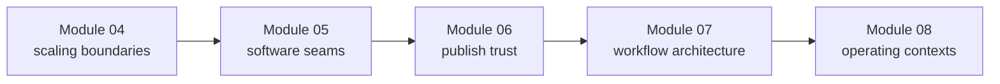

# Mid-Course Map

Use this page when Modules 01 to 03 feel stable and you need a deliberate bridge into
scaling, software boundaries, publish trust, and operating-context review. The middle of
the course is where many learners start confusing workflow meaning, repository
structure, and execution context. This map exists to keep those pressures separate.

## The middle-course progression

## What changes in the middle of the course

Earlier modules ask, "What is this workflow claiming to do?"

Middle modules ask harder follow-up questions:

- Where should the next change belong?
- Which repository splits clarify ownership?
- Which outputs are public versus internal?
- Which differences across contexts are policy-only?

This is where the course stops being only about workflow behavior and starts being about
workflow design under growth.

## Use this map for these pressures

| If the pressure is... | Start with | Keep nearby | First capstone cross-check |
| --- | --- | --- | --- |
| where a structural workflow change belongs | Module 04 | [Boundary Review Prompts](../reference/boundary-review-prompts.md) | [Capstone File Guide](../capstone/capstone-file-guide.md) |
| where workflow orchestration ends and helper software begins | Module 05 | [Review Checklist](../reference/review-checklist.md) | [Capstone Architecture Guide](../capstone/capstone-architecture-guide.md) |
| what downstream users are actually allowed to trust | Modules 06 to 07 | [Proof Matrix](../guides/proof-matrix.md) | [Capstone Review Worksheet](../capstone/capstone-review-worksheet.md) |
| which differences across local, CI, and scheduler contexts are policy-only | Module 08 | [Topic Boundaries](../reference/topic-boundaries.md) | [Capstone Proof Guide](../capstone/capstone-proof-guide.md) |

## Read this middle stretch as three clusters

### Modules 04 to 05: scaling and software seams

Use this cluster when the workflow already feels real, but the repository is starting to
split across files, helper code, validation surfaces, and software boundaries.

- Module 04 teaches scaling, interfaces, and ownership-preserving splits.
- Module 05 teaches the boundary between Snakemake logic and the software it drives.

Leave this cluster able to explain where a change belongs before you edit it.

### Modules 06 to 07: publish trust and architecture

Use this cluster when the workflow is becoming a downstream-facing system rather than a
local internal build script.

- Module 06 teaches versioned publish contracts and downstream trust.
- Module 07 teaches workflow architecture and stable file APIs.

Leave this cluster able to separate internal run state from public outputs.

### Module 08: operating contexts

Use this step when the main pressure is execution context rather than workflow meaning.

- Module 08 teaches how local, CI, and scheduler policy differ without semantic drift.

Leave this step able to explain what changed across contexts and why the workflow promise
did or did not change.

## Questions this map should help you answer

If the course middle is going well, you should be able to form questions like these:

- Is this change about the workflow graph or about helper software?
- Is this value part of output meaning or only execution policy?
- Is this path internal working state or a surface someone else can trust?
- Would another repository file clarify ownership or merely hide it?

If you cannot yet phrase the problem that way, go back to the smaller module example
before widening into a larger repository surface.

## Middle-course mistakes to avoid

- splitting files because the repository feels crowded rather than because ownership is
  clearer
- treating publish directories as a convenience pile instead of as a contract
- using profiles to hide analytical differences
- reading architecture material before the current workflow claim is legible
- treating context review as if it were only an infrastructure concern

## When to leave this route

Move to [Mastery Map](mastery-map.md) when the question changes from design and trust
surfaces to stewardship pressure:

- a workflow incident needs evidence before edits
- migration or governance is now the main concern
- the right answer may be handing a concern off rather than keeping it inside Snakemake

## Best next move after this page

Open exactly one of these before resuming:

- [Module Checkpoints](../guides/module-checkpoints.md) if you need the exit bar
- [Pressure Routes](../guides/pressure-routes.md) if urgency is reshaping the reading
  order
- [Capstone Map](../capstone/capstone-map.md) if the module is clear but the repository
  route is not
