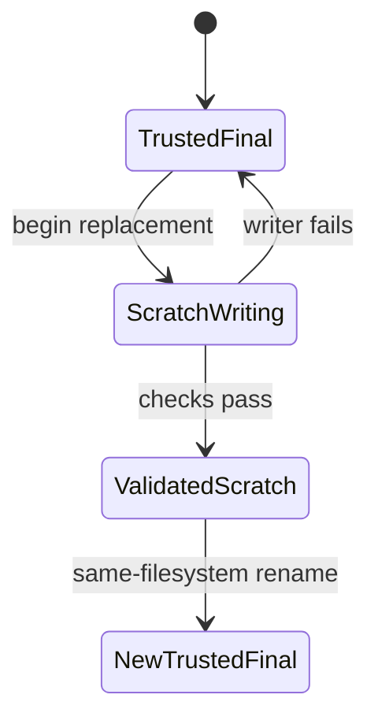

# Atomic Publication, Logs, and Failure Evidence

This page explains how a workflow earns trust after something goes wrong: final outputs are
published safely, and failures leave behind evidence instead of confusion.

## How to read this page

Read this page with failure in mind, not success. The question is not "does the rule
usually work?" The question is "what happens to trust when the rule does not finish
cleanly?"

## The sentence to keep

When a rule publishes a final output, ask:

> if this job fails halfway through, will downstream users see a trustworthy file, no file,
> or a lie?

That is the heart of publication discipline.

## The beginner trap: treating "file exists" as "job succeeded"

Many first workflows write directly to the final output path:

```python
rule report:
    output:
        "results/report.txt"
    shell:
        r"""
        mkdir -p results
        ./scripts/render-report.sh > {output}
        """
```

This can work when everything goes well.

The problem appears when something goes wrong:

- the tool crashes
- the shell exits early
- only part of the output is written
- the final path already exists and now contains truncated or misleading data

At that point the file exists, but the contract is broken.

## Why this belongs in Module 01

Publication discipline is not a late-course luxury. It starts as soon as a workflow
claims that an output file means something trustworthy.

## A published file should be complete or absent

This is one of the simplest and strongest rules in the entire course:

> a final output path should become visible only when the content is ready to be trusted

That principle is why atomic publication matters.

Instead of writing directly to the final path, write to a temporary sibling and rename it
only at the end.

## The basic atomic publish pattern

Example:

```python
rule report:
    output:
        "results/report.txt"
    shell:
        r"""
        set -euo pipefail
        mkdir -p results
        tmp="{output}.tmp"
        ./scripts/render-report.sh > "$tmp"
        mv -f "$tmp" {output}
        """
```

Now there are two clearer states:

- failure before `mv`: final output is absent
- success after `mv`: final output is present and complete

That is much easier to reason about than a half-written final path.

## Poison artifacts are a workflow trust problem

Suppose a rule writes the final path and then fails:

```python
rule poison:
    output:
        "results/poison.txt"
    shell:
        r"""
        mkdir -p results
        echo "partial" > {output}
        exit 1
        """
```

Now `results/poison.txt` exists, but it is not a trustworthy publication.

That file is poison because it can:

- confuse later runs
- mislead downstream rules or humans
- make debugging harder by looking "finished enough"

People often think of this as just an error-handling detail. It is more serious than
that. It is a broken output contract.

## Preserve a trusted final during replacement

“Complete or absent” describes first publication. Replacement has a third safe state:

> the prior complete final remains visible until the replacement is complete

Suppose `results/report.txt` already contains a reviewed report. A new attempt begins.
Writing directly to that path destroys the reviewed content before the replacement is
known to be usable. If the process fails, the path exists but now contains the failed
attempt.

The atomic pattern keeps ownership separate:

```text
results/report.txt      # previously trusted final
results/report.txt.tmp  # current untrusted attempt
```

Only successful promotion changes the final path.



The failure transition returns to `TrustedFinal`; it does not publish the scratch file.

## Engine cleanup and atomic publication solve different problems

Snakemake commonly removes declared outputs after an ordinary command exits nonzero.
That is useful recovery behavior. It is not the same guarantee as avoiding writes to the
final path.

Cleanup happens after failure is observed. Atomic publication controls what readers can
observe during the write.

| Mechanism | When it acts | Main guarantee |
| --- | --- | --- |
| Snakemake failed-output cleanup | after a job reports failure | known failed outputs do not remain as apparently successful products |
| scratch plus rename | before the final path changes | readers see the old complete final or the new complete final |
| content validation | before promotion | complete bytes also satisfy the domain contract |

You need all three when the output matters. Cleanup cannot recover a prior trusted file
that the writer already truncated. Rename cannot prove that complete-looking content is
semantically valid.

## Run the failure boundary

The capstone includes two tiny writers and one audit:

```console
make file-contract-audit
```

The in-place writer starts with:

```text
unsafe-final.txt = trusted
```

It writes `PARTIAL` to that same path and exits with code `13`. The expected finding is:

```text
IN_PLACE_FAILURE_POISONS_FINAL  PASS  REJECT
```

`PASS` means the unsafe contrast was reproduced correctly. `REJECT` is the design
decision.

The atomic writer also starts with a trusted final. It writes `complete` to a sibling
scratch path and exits with code `17` before rename. The audit checks:

```text
atomic-final.txt      = trusted
atomic-final.txt.tmp  = complete
```

The expected finding is:

```text
ATOMIC_FAILURE_PRESERVES_FINAL  PASS  ACCEPT
```

Finally, a successful run promotes scratch:

```text
atomic-final.txt      = complete
atomic-final.txt.tmp  = absent
```

That is `ATOMIC_SUCCESS_PROMOTES_COMPLETE_OUTPUT`.

## Same-directory scratch is part of the claim

The simple rename pattern assumes scratch and final are on the same filesystem. A rename
across filesystems may fail or degrade into copy-like behavior, losing the atomic
visibility guarantee.

Prefer a sibling scratch file when the final is a single file:

```bash
tmp="${output}.tmp"
render > "$tmp"
validate "$tmp"
mv -f "$tmp" "$output"
```

For a directory or multi-file bundle, publish into a versioned directory and promote a
manifest or pointer only after every member is validated. Do not pretend that several
independent renames form one atomic transaction.

## Scratch is evidence, not a result

A failed attempt can leave scratch behind. That does not violate the public contract as
long as downstream rules and humans know that only the final path is publishable.

Scratch still needs policy:

- keep it temporarily when it helps diagnose failure;
- remove it before a clean retry if the writer cannot resume safely;
- never include it in a published manifest;
- make its naming relationship to the final obvious.

The important boundary is not “no temporary files exist.” It is “temporary state cannot
masquerade as accepted output.”

## Logs are part of the contract too

A beginner workflow can fail in two broad ways:

- the output is wrong
- the output is missing and nobody knows why

Logs make the second case much easier to handle.

Per-job logs are especially valuable because they answer:

- which job failed
- what that job tried to do
- what stderr said for that specific output

Example:

```python
rule stage_upper:
    input:
        "data/{sample}.txt"
    output:
        "results/staged/{sample}.upper.txt"
    log:
        "logs/stage/{sample}.log"
    shell:
        r"""
        set -euo pipefail
        mkdir -p results/staged logs/stage
        tmp="{output}.tmp"
        tr '[:lower:]' '[:upper:]' < {input} > "$tmp" 2> {log}
        mv -f "$tmp" {output}
        """
```

Now you have both:

- a safe publication pattern
- a rule-specific failure record

That is a much more teachable workflow.

## A strong beginner habit

For every output you care about, ask two questions:

- how does this file become visible only when it is complete
- where would I look first if the job failed

## Benchmarks are evidence, not decoration

Benchmarks are often introduced later as performance tooling, but even in Module 01 they
teach a useful idea:

workflow artifacts are not only final scientific outputs.

A benchmark file can help answer:

- how long a job took
- whether a new change made it much slower
- which step deserves attention when the workflow feels heavy

You do not need deep performance analysis yet. You do need the habit of leaving behind
structured evidence instead of vague impressions.

## `temp`, `protected`, and `shadow` are representational tools

Beginners sometimes discover these features and start using them as if they were ways to
silence Snakemake or hide reruns.

That is the wrong mindset.

Use them to represent reality more honestly:

- `temp()` for intermediates you do not intend to preserve as durable outputs
- `protected()` for outputs that should not be overwritten casually
- `shadow` when a tool makes a mess and needs isolated working space

These features should clarify the workflow contract, not paper over a confusing one.

## Common bad repair

The bad repair is to hide a messy rule behind more features without fixing the output
contract itself. If the final path can still become visible too early, the workflow is
still lying.

## A small failure scenario

Imagine a report rule that writes directly to `results/report.tsv` and only logs to the
terminal.

If it fails halfway through, you get:

- a final path that may exist but be incomplete
- a mixed terminal log that is hard to connect back to one specific job
- no durable evidence for later review

A better design gives:

- temp-to-final publish semantics
- one job log path
- optional benchmark or audit artifacts

That design is easier to debug and easier to trust.

## The evidence loop for output trust

When a rule fails or an output looks suspicious, inspect:

1. whether the final output path exists
2. whether the corresponding log exists
3. whether the file was published atomically or written in place
4. whether the workflow treats the file as final, temporary, or protected

That review is often more useful than immediately rerunning the workflow.

## A strong explanation sounds like this

Weak explanation:

> the output is weird after failure.

Stronger explanation:

> the rule wrote directly to the final output path before the command completed, so failure
> left behind a poison artifact that looked publishable. The repair is to write to a temp
> path, rename only on success, and keep a per-job log for diagnosis.

That explanation identifies both the contract defect and the repair pattern.

## Failure signatures worth recognizing

### "A final output exists, but its contents are truncated or obviously incomplete"

That is usually a non-atomic publication problem.

### "The workflow failed and now the next run behaves strangely"

That often means a poison artifact survived failure and is being mistaken for a legitimate
final state.

### "We know the job failed, but not which sample or rule caused it"

That usually means logs were not separated per job or preserved as usable evidence.

### "Someone added `temp()` or `shadow` and now nobody knows what the real output contract is"

That means representational helpers are being used without a clear explanation of their role.

## What this page wants you to remember

Trustworthy workflows do not merely create files. They publish files carefully.

A final output should be complete or absent.
A failure should leave evidence.
A log should help a human locate the problem quickly.

That publication discipline is what turns a beginner workflow into one people can actually
work with.
