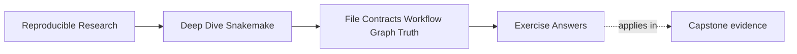

# Exercise Answers


<!-- page-maps:start -->
## Page Maps




<!-- page-maps:end -->

Use this page after you have written your own answers. The value is in comparing reasoning,
not in copying wording.

The answers below are model answers. Your filenames and rule names may differ. What should
stay stable is the shape of the explanation:

- start from the target and file contract
- use one piece of workflow evidence
- explain the repair in terms of truth, ownership, or publication

## Exercise 1: Explain why one rule does not run

A strong answer sounds like this:

> The requested target is `results/final.txt`. That file is produced by `producer`, so
> Snakemake schedules `producer` and `all`. The extra rule `never_called` publishes
> `results/ghost.txt`, but no requested target depends on that file, so it has no place in
> the current DAG. A dry-run proves this because `never_called` does not appear in the job
> list.

Why this is strong:

- it starts from the requested target
- it names the matching output contract
- it treats the missing rule as irrelevant to the target graph, not as a mystery

Weak answers usually say only "Snakemake skipped the rule."

## Exercise 2: Prove convergence and then break it

A strong answer shows both states clearly.

Example answer shape:

- converging state:
  - run `snakemake`
  - then run `snakemake -n`
  - expected evidence: "Nothing to be done."
- broken state:
  - add a changing tracked value such as `time.time()` in `params`
  - rerun `snakemake -n`
  - expected evidence: the rule is planned again
- explanation:
  - "the tracked rule meaning changes each parse because the parameter is not stable"
- repair:
  - "remove the unstable value from the rule meaning or move a stable version of it into
    config"

Why this is strong:

- it proves both behaviors with the same evidence route
- it explains non-convergence as unstable tracked meaning rather than as random behavior

## Exercise 3: Diagnose one wildcard ownership problem

A strong answer names the ownership defect directly.

Example:

> The output pattern `results/{x}.txt` is too broad because both `r1` and `r2` can claim
> `results/test.txt`. The issue is not merely a brace problem; it is ambiguous file
> ownership. I would redesign the paths so the rules publish different artifact families,
> such as `results/report/{x}.txt` and `results/qc/{x}.txt`. A dry-run or rule graph then
> shows one clear owner per output family.

Why this is strong:

- it identifies ambiguity as a file-ownership problem
- it fixes the path design instead of hiding the issue with precedence tricks

## Exercise 4: Separate workflow meaning from execution policy

A strong answer shows one value on each side of the boundary.

Example:

- config value:
  - `samples: [A, B]`
  - reason: changing it changes which outputs the workflow is supposed to build
- profile value:
  - `cores: 4`
  - reason: changing it alters execution behavior, not the meaning of results
- validation example:
  - "a schema would catch a misspelled required key like `samplez` before any job runs"
- review explanation:
  - "the split makes it easier to review whether a change alters workflow meaning or only
    the operating context"

Why this is strong:

- it makes the semantic-versus-policy split explicit
- it shows why early validation is humane, not just formal

## Exercise 5: Repair a poison output

A strong answer contrasts the broken and repaired publication contracts.

Example:

- broken shape:
  - the rule writes directly to `results/report.txt` and then exits with failure
- repaired shape:
  - write to `results/report.txt.tmp`
  - rename to `results/report.txt` only after success
- evidence route:
  - keep a per-job log such as `logs/report.log`
- explanation:
  - "the repaired version is safer because downstream users either see a complete final
    output or no final output at all"

Why this is strong:

- it explains publication trust, not just shell mechanics
- it leaves behind evidence for the next investigation

## Exercise 6: Build a two-sample workflow

A strong solution uses a concrete target list to bind a precise wildcard:

```python
SAMPLES = ["A", "B"]

rule all:
    input:
        expand("results/{sample}.upper.txt", sample=SAMPLES)

rule uppercase:
    input:
        "data/{sample}.txt"
    output:
        "results/{sample}.upper.txt"
    shell:
        "mkdir -p results && tr '[:lower:]' '[:upper:]' < {input} > {output}"
```

The single `uppercase` definition creates two jobs because `rule all` requests two
concrete output paths. Each path binds `{sample}` differently. The rule is reusable
logic; a job is one concrete application of that logic.

## Exercise 7: Compare a plan with execution

After deleting `results/A.upper.txt`, a dry-run should plan only the `uppercase` job for
sample `A` plus the target aggregation. It says what Snakemake *would* do from the current
filesystem state. After execution, `--summary` should report the known outputs as current.
That summary describes file ownership and status; it is not a record that every planned
shell command succeeded in some earlier run.

## Exercise 8: Trace a selective rebuild

Editing `data/B.txt` should schedule the `B` job and leave `results/A.upper.txt`
untouched. The explanation is the edge:

```text
data/B.txt -> uppercase(sample=B) -> results/B.upper.txt
```

The `A` input is not an ancestor of the changed file, so its output has no file-contract
reason to rebuild. Rule order has no bearing on this decision.

## Exercise 9: Investigate a missing input

If the requested target is `results/C.upper.txt`, Snakemake can infer
`sample=C` and then requires `data/C.txt`. The error is useful evidence: the output
pattern matched, but its source contract could not be satisfied. Add the source if `C`
is a legitimate sample, remove `C` from semantic configuration if it is not, or correct
the path contract if the source lives elsewhere. Creating an empty file merely to silence
the error would hide the real defect.

## Exercise 10: Complete a trustworthy tiny project

A strong project has three explicit source records, one wildcard transformation family,
and one summary rule. `rule all` requests the summary and any intermediate files that are
intended deliverables. The summary writes to a sibling temporary path and renames only
after every row is complete. Logs are separate from published data.

Verification should show:

- the first dry-run plans three transformations and one summary
- the first execution creates all expected files
- the next dry-run converges
- changing one source rebuilds its transformation and the dependent summary
- an injected summary failure leaves no final partial file

The final review should classify sample membership and transformation parameters as
workflow meaning, while cores and shell-printing behavior remain execution policy.

## What all ten answers should have in common

The best Module 01 answers usually do five things:

1. they explain behavior from the target surface backward
2. they point to a concrete evidence route such as `-n`, `--summary`, `--rulegraph`, or a
   per-job log
3. they distinguish tracked meaning from hidden or unstable state
4. they treat wildcard problems as ownership problems
5. they treat final outputs as published artifacts that must be trustworthy

If your answers do those five things, you are learning the module in the right direction.
