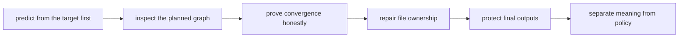

# Exercises
Use these after reading the five core lessons and the worked example. The goal is to make
your file-contract reasoning visible through runnable work, not through vague summaries.

## How to work through this set

Treat the ten exercises as one long lab, not ten disconnected prompts.

Before each answer:

1. write down your prediction
2. run the smallest command that can confirm or falsify it
3. keep the evidence next to the explanation

That pattern matters more than speed. The exercises are trying to build reasoning habits,
not collect polished prose.

Do them in order. The set is designed as one day-long progression:

- Exercises 1-3 establish the basic graph and prediction habit.
- Exercises 4-6 repair common beginner defects.
- Exercises 7-8 make the wildcard and policy boundaries explicit.
- Exercises 9-10 ask you to build and review a tiny trustworthy workflow.

For every answer, keep three things:

- the workflow files or commands you actually ran
- the evidence artifact that proves your explanation
- one short sentence in plain language about why the behavior happened

## Recommended working folder

If you want a clean setup, build the exercise set inside one tiny project tree and keep
adding to it:

```text
module01-lab/
├── Snakefile
├── config/
├── profiles/
├── data/
├── results/
├── logs/
└── artifacts/
```

That layout makes it easier to compare exercises instead of starting from zero every time.

Build one small file-contract review packet as you go:

- one prediction note before each dry-run
- one tiny DAG or rulegraph artifact showing who owns which output
- one convergence check after a successful run
- one wildcard-ownership note showing how a path family became clearer
- one publication-safety note showing where partial outputs stopped being trustworthy
- one short review note distinguishing workflow meaning from execution policy

If those six artifacts are missing, the day usually turns into "Snakemake did something"
instead of "the workflow truth became explainable."



Use that route on purpose. It keeps the day grounded in targets, files, and ownership
instead of command superstition.

## Exercise 1: Explain why one rule does not run

Write a tiny Snakefile with three rules:

- one `rule all`
- one rule whose output is required
- one rule whose output is never requested

Then explain, in plain language, why the extra rule is absent from the current plan.

What to hand in:

- the target requested
- the rule that matches it
- the rule that is absent
- one command, such as `snakemake -n`, that proves your explanation

## Exercise 2: Prove convergence on purpose

Start from a tiny workflow that uppercases one input file into one output file.

Run it, then run `snakemake -n` immediately afterward.

What to hand in:
- the `Snakefile`
- the first successful run
- the second dry-run that shows no work
- one sentence explaining why the workflow settled down
- one sentence explaining what specific tracked facts did not change between the two runs

Study note:
If your dry-run still plans work, do not move on until you can name the specific rerun
cause.

## Exercise 3: Trigger one selective rebuild

Create a two-sample workflow from Exercise 2 by introducing a wildcard rule and two input
files such as `data/A.txt` and `data/B.txt`.

Edit only one input file, predict what should rerun, then verify it.

What to hand in:

- the target set requested by `rule all`
- the dry-run after editing one source
- the output that stayed untouched
- one explanation based on dependency edges rather than rule order

Study note:
If you find yourself saying "it reran because that rule comes next," stop and redraw the
dependency chain instead.

## Exercise 4: Break convergence and repair it

Take a working workflow and introduce one unstable influence, such as a time-based
parameter or another changing tracked value, so the workflow stops converging.

Then repair it.

What to hand in:

- the non-converging version
- the dry-run evidence that shows why it would rerun again
- the repaired version
- one sentence explaining what made the rule meaning unstable

Study note:
This is one of the most important exercises in the module. Many later Snakemake problems
are just harder versions of unstable workflow meaning.

## Exercise 5: Diagnose one wildcard ownership problem

Create either:

- an ambiguous pair of rules that can both claim one output
- or a wildcard pattern that is too loose for the filenames it should own

Then explain the ownership problem and redesign the path shape.

What to hand in:

- the problematic output pattern
- the file that demonstrates the ambiguity or looseness
- the redesigned output pattern
- one command, such as `snakemake -n` or `--rulegraph`, that supports the diagnosis

Study note:
Do not solve this by inventing a verbal excuse for the ambiguity. Solve it by making file
ownership clearer.

## Exercise 6: Repair a poison output

Write a rule that fails after writing to its final output path. Then repair it so the final
output is either complete or absent.

What to hand in:

- the broken rule shape
- the repaired atomic-publication shape
- the log path or evidence route you would keep for diagnosis
- one sentence explaining why the repaired version is safer for downstream rules
- one sentence saying exactly when the final path becomes trustworthy to consume

Study note:
If a downstream rule could accidentally consume the broken file, the repair is not strong
enough yet.

## Exercise 7: Separate workflow meaning from execution policy

Take one setting that affects output meaning and one setting that affects execution policy.
Place each one where it belongs.

What to hand in:

- one config value and why it belongs in config
- one profile value and why it belongs in a profile
- one example of a failure that early config validation would catch
- one sentence explaining why the split makes the workflow easier to review

Study note:
The sentence should explain reviewability, not just personal preference.

## Exercise 8: Compare a plan with execution

Delete one output from a working two-sample workflow. Capture the dry-run, then run the
workflow and capture `snakemake --summary`.

What to hand in:

- your prediction before the dry-run
- the planned job and its wildcard binding
- the summary status after execution
- one distinction between planning evidence and completed-run evidence

Study note:
This is where many learners start seeing the difference between "what would run" and
"what is now true on disk."

## Exercise 9: Investigate a missing input

Request a valid-looking target whose required source file does not exist. Read the full
error before changing the workflow.

What to hand in:

- the requested target and inferred wildcard value
- the missing input Snakemake reports
- whether the defect belongs in the workflow, configuration, or source data
- the smallest honest repair

Study note:
Do not create dummy files just to make the error disappear. The point is to locate the
real contract failure.

## Exercise 10: Complete a trustworthy tiny project

Build a clean project that converts three text files and publishes a tabular line-count
summary. Include:

- explicit targets
- informative output paths
- per-rule logs
- atomic publication for the summary
- one config value that changes output meaning
- one profile value that changes execution policy only

What to hand in:

- the project tree and complete `Snakefile`
- a successful run followed by a converged dry-run
- a DAG or rule graph written under `artifacts/`
- one injected failure and evidence that no partial summary remained
- a short review of which settings are workflow meaning and which are execution policy

## Midday self-check

Before you move into the final tiny project, make sure your packet can already answer all
of these:

- which target you asked for and why one rule did or did not belong in the plan
- which rerun cause you actually observed instead of guessed
- which file family has one clear owner after your wildcard repair
- which final path is trustworthy and which temporary state is not

If you cannot answer those four questions cleanly, return to the earlier exercises and
make the packet more explicit before moving on.

## What weak completion looks like

Do not call the day complete if your answers do any of these:

- explain behavior as "Snakemake was weird" instead of from target and file ownership
- call a workflow converged without a confirming dry-run
- repair wildcard ambiguity with a verbal excuse instead of a clearer path contract
- trust a final output even though the rule can leave poison state behind
- mix workflow meaning and execution policy because both happened to be configurable

## Exit standard for the exercise day

Do not count the day complete unless you can do all of this without the answer page
telling you what to type:

- predict the job plan before a dry-run
- explain one rerun from tracked evidence
- repair one wildcard ownership defect
- justify one config-versus-profile split
- show that one final output is trustworthy to consume

## Mastery standard for this exercise set

Across all ten answers, the module wants the same habits:

- you explain behavior in terms of targets, files, and ownership
- you use dry-run, summary, DAG, or logs as evidence
- you distinguish stable workflow meaning from ambient or accidental state
- you prefer clearer path contracts over clever but vague patterns
- you treat final outputs as publishable artifacts, not scratch files

If an answer says only "Snakemake was weird," keep going.
