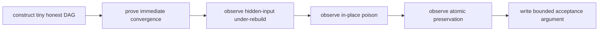
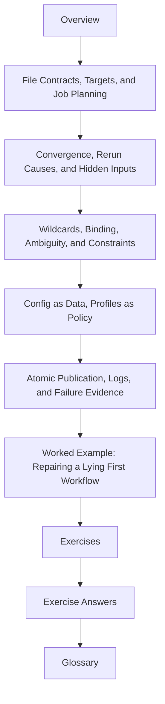

# Module 01: First Principles and the File-DAG Contract
This is the day Snakemake must stop feeling magical.

Module 01 is not about memorizing rule syntax. It is about learning the contract
Snakemake actually enforces:

- targets declare intent
- files define dependency truth
- rules publish outputs that other rules are allowed to trust
- reruns only make sense when the workflow tells the truth about its inputs, outputs, and
  tracked changes

If that model is shaky, every later feature in the course becomes harder to reason about.

## What this day must accomplish

By the end of Module 01, you should be able to do five things without guessing:

- explain a rule as a file contract rather than a vague step
- predict which jobs a requested target will create
- show why a tiny workflow converges after a clean run
- repair one wildcard design that claims too much
- publish one small output safely enough that a second rule could trust it

The advanced boundary language begins here, but it should not dominate the day. Config,
profiles, and publish safety matter in Module 01 only because they protect the first file
contract model from becoming dishonest too early.

## The running lab for the whole day

Use one lab story all day instead of five unrelated snippets:

- two source files under `data/`
- one wildcard rule that transforms each source into `results/staged/{sample}.upper.txt`
- one summary rule that writes `results/summary/counts.tsv`
- one controlled failure so you can see the difference between a complete output and a lie

That lab is intentionally small. It is large enough to teach a DAG, a selective rebuild,
and a real output boundary, but still small enough to redraw on paper.

## The executable pressure lab

The running lab teaches construction. The capstone’s file-contract audit supplies a
fixed adversarial comparison when you need to test your explanation:

```console
cd programs/reproducible-research/deep-dive-snakemake/capstone
make file-contract-audit
```

Use it after reading the convergence and publication pages, not before learning the
basic DAG model.



The route produces six findings. Some intentionally unsafe findings are `PASS / REJECT`.
That means the audit successfully reproduced behavior a real workflow should reject. It
does not mean the unsafe rule passed review.

## Plan for the day

| Session | What you do | Evidence you keep |
| --- | --- | --- |
| morning setup | extend the orientation workflow from one rule to a tiny three-job DAG | annotated dry-run |
| graph reading | trace targets backward through inputs and outputs | hand-drawn DAG |
| convergence | edit, delete, and preserve files while predicting reruns | `--summary` notes |
| wildcard ownership | create two sample-specific jobs from one rule and narrow the path shape | concrete target list |
| safe publication | inject a failure, inspect the damage, then repair the output contract | failed log and repaired output |
| independent practice | complete all ten exercises in order | runnable files and short explanations |

Spend more time predicting than typing. Before each command, state which jobs should
appear and why. A correct prediction demonstrates the model; a surprising result gives
you a precise question to investigate.

## Study route



Read the module in that order the first time.

The route matters. Do not begin with config or atomic publication because those later
pages only make sense once you can already explain the first DAG. Think of the module as
one day with three layers:

- foundations: file contracts, targets, convergence
- scaling within the day: wildcards and path ownership
- guardrails: config boundaries and safe outputs

## The ten files in this module

1. Overview (`index.md`)
2. [File Contracts, Targets, and Job Planning](file-contracts-targets-and-job-planning.md)
3. [Convergence, Rerun Causes, and Hidden Inputs](convergence-rerun-causes-and-hidden-inputs.md)
4. [Wildcards, Binding, Ambiguity, and Constraints](wildcards-binding-ambiguity-and-constraints.md)
5. [Config as Data, Profiles as Policy](config-as-data-profiles-as-policy.md)
6. [Atomic Publication, Logs, and Failure Evidence](atomic-publication-logs-and-failure-evidence.md)
7. [Worked Example: Repairing a Lying First Workflow](worked-example-repairing-a-lying-first-workflow.md)
8. [Exercises](exercises.md)
9. [Exercise Answers](exercise-answers.md)
10. [Glossary](glossary.md)

## How to use the file set

| If you need to... | Start here |
| --- | --- |
| understand why a rule runs, does not run, or is absent from the DAG | [File Contracts, Targets, and Job Planning](file-contracts-targets-and-job-planning.md) |
| explain why a workflow reruns forever or fails to rerun when it should | [Convergence, Rerun Causes, and Hidden Inputs](convergence-rerun-causes-and-hidden-inputs.md) |
| make wildcard patterns precise enough to avoid accidental matches | [Wildcards, Binding, Ambiguity, and Constraints](wildcards-binding-ambiguity-and-constraints.md) |
| keep semantic inputs separate from execution policy | [Config as Data, Profiles as Policy](config-as-data-profiles-as-policy.md) |
| stop partial outputs and improve failure evidence | [Atomic Publication, Logs, and Failure Evidence](atomic-publication-logs-and-failure-evidence.md) |
| see the whole module as one repaired beginner workflow | [Worked Example: Repairing a Lying First Workflow](worked-example-repairing-a-lying-first-workflow.md) |
| test your own understanding | [Exercises](exercises.md) |
| compare your reasoning against a reference | [Exercise Answers](exercise-answers.md) |
| stabilize the module vocabulary | [Glossary](glossary.md) |

## The running question

Carry this question through every page:

> what exact file contract or tracked change explains why Snakemake builds, skips, or reruns
> this output?

Good Module 01 answers usually mention one or more of these:

- a concrete target path
- the rule output pattern that matches it
- the input or parameter that justifies the job
- the evidence route that confirms the explanation, such as dry-run, summary, DAG, or logs
- the publication rule that makes a final output trustworthy

## Commands to keep close

These commands form the evidence loop for Module 01:

```bash
snakemake -n
snakemake --summary
snakemake --dag | dot -Tpdf > dag.pdf
snakemake --rulegraph | dot -Tpdf > rulegraph.pdf
snakemake --lint
make -C programs/reproducible-research/deep-dive-snakemake/capstone file-contract-audit
```

They answer different questions:

- what would run
- who owns which files
- how jobs depend on each other
- how rules relate structurally
- which design smells already exist
- whether one controlled hidden-input and publication contrast behaves as predicted

## What the first-day lab should feel like

If the module is working, you should feel these transitions:

- the second dry-run becomes meaningful instead of ceremonial
- wildcard rules stop feeling magical and start feeling like path ownership
- a missing or extra job becomes a graph question instead of a Snakemake mood
- a partial output stops looking “close enough”
- you know when a setting belongs to workflow meaning and when it belongs somewhere else

## Exit standard

Do not move on until all of these are true:

- you can explain why a small workflow does or does not run a rule
- you can make a tiny workflow converge after a clean run
- you can show one ambiguous wildcard design and repair it
- you can distinguish config data from execution policy clearly
- you can explain why a final output is trustworthy or why it is poison
- you have completed all ten exercises without using the answer page as instructions

When those feel ordinary, Module 01 has done its job.
