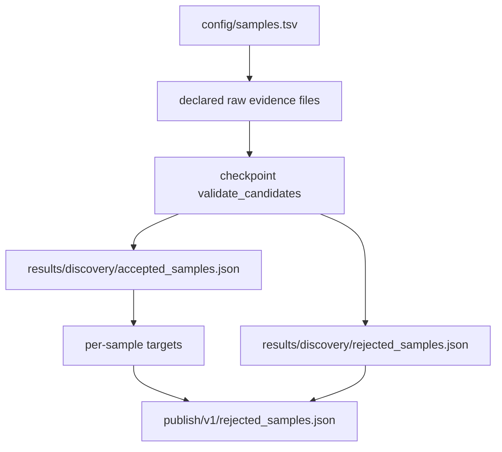

# Checkpoints and Reviewed DAG Changes

Checkpoints are where many Snakemake courses become mystical.

This module takes the opposite approach:

> a checkpoint is acceptable only when it makes a data-dependent change to the DAG more explicit than the alternatives.

If it hides the real target story, it is a bad checkpoint even if the code runs.

## How to study this page

Read this page with one boundary in mind:

> what exact runtime fact becomes knowable only after this step executes?

If you cannot name that fact, you are probably looking at a modeling problem rather than a
checkpoint problem.

## Why this lesson is usually mishandled

Checkpoints look advanced, so they attract too much attention too early.

That causes two teaching failures:

- learners wrap already-knowable target lists in checkpoints and call it sophistication
- learners memorize the API before they understand what new fact the workflow is trying to
  discover

This page is trying to reverse that order.

## Ask these questions before you write one line

Before you write a checkpoint, answer these in plain language:

1. What fact is truly unknown at initial planning time?
2. Which declared input surface will reveal that fact?
3. What file will record the answer?
4. Why is a config file or deterministic scan not enough here?

If you cannot answer all four, stop. The design is probably not ready for a checkpoint.

## A strong beginner habit

Write the four answers in prose before you write the checkpoint code.

That sounds slower, but it usually saves time because it exposes fake checkpoints early.

## What a checkpoint actually does

A normal rule lets Snakemake build the job graph up front.

A checkpoint says:

- build the graph as far as this step
- run the checkpoint
- inspect its declared output
- reevaluate downstream job construction using that new fact

That is all. A checkpoint is not "dynamic magic." It is controlled graph reevaluation.

## When a checkpoint is justified

Use a checkpoint when downstream targets genuinely cannot be known until some declared
input has been inspected or produced.

Good examples:

- deciding which declared candidates remain usable after validation
- splitting one input into a data-dependent set of shards
- enumerating outputs from a tool whose count depends on validated input content

In all three cases, the checkpoint exists because the workflow learns a real new fact.

## The contrast that matters

The real contrast is not:

- simple workflow
- advanced workflow

The real contrast is:

- already knowable target set
- genuinely runtime-discovered target set

## When a checkpoint is a smell

Do not use a checkpoint for problems that are really about weak workflow design:

- you could have read the sample list from config instead
- the target list was already known but nobody modeled it cleanly
- multiple rules keep rescanning the filesystem and disagreeing about what exists
- the rule wants to hide side effects that should have been explicit outputs

Those are not checkpoint problems. They are modeling problems.

## The checkpoint contract

A healthy checkpoint has four properties:

1. one clear discovery question
2. one owned output that records the answer
3. deterministic behavior for fixed declared inputs
4. downstream fanout that reads the recorded answer instead of rediscovering it

If any of those are missing, the checkpoint usually leaves the workflow harder to review.

## The beginner-safe mental model

Treat a checkpoint as a two-part promise:

- first promise: this step will discover one new fact and write it down
- second promise: later jobs will read that written fact instead of rediscovering it

That is a much safer mental model than “Snakemake reruns the DAG somehow.”

## What a learner should notice in the code

The important line in a healthy checkpoint design is rarely the `checkpoint` keyword
itself.

The important lines are usually:

- the output that records the discovery result
- the downstream function that rereads that exact output
- the absence of a second hidden scan somewhere else

## A good shape



This picture matters because the discovery step leaves behind durable accepted and
rejected records. The checkpoint is not trusted because it is dynamic. It is trusted
because its result is reviewable.

## Minimal checkpoint pattern

```python
checkpoint validate_candidates:
    input:
        lambda wildcards: [SOURCE_BY_SAMPLE[sample] for sample in SAMPLES]
    output:
        directory("results/discovery")
    run:
        import json
        from pathlib import Path

        outdir = Path(output[0])
        outdir.mkdir(parents=True, exist_ok=True)
        accepted = []
        rejected = []

        for sample, source in sorted(SOURCE_BY_SAMPLE.items()):
            size = Path(source).stat().st_size
            if size > 0:
                accepted.append({"sample": sample, "path": source})
            else:
                rejected.append(
                    {
                        "sample": sample,
                        "path": source,
                        "reason": "empty input file",
                    }
                )

        (outdir / "accepted_samples.json").write_text(
            json.dumps({"samples": accepted}, indent=2) + "\n",
            encoding="utf-8",
        )
        (outdir / "rejected_samples.json").write_text(
            json.dumps({"samples": rejected}, indent=2) + "\n",
            encoding="utf-8",
        )


def discovered_qc_targets(_wildcards):
    import json
    from pathlib import Path

    checkpoint_job = checkpoints.validate_candidates.get()
    registry = Path(checkpoint_job.output[0]) / "accepted_samples.json"
    samples = [row["sample"] for row in json.loads(registry.read_text(encoding="utf-8"))["samples"]]
    return expand("results/{sample}/qc.json", sample=samples)


rule all:
    input:
        discovered_qc_targets
```

Three parts matter here:

- the checkpoint writes an accepted registry and a rejection record
- downstream expansion reads the accepted registry, not the raw directory again
- the rejected candidates stay visible instead of disappearing from the story

That is the core Module 02 pattern.

## The common bad repair

A common bad repair looks like this:

- add a checkpoint
- then let downstream helper code rescan `data/raw/`
- leave the checkpoint registry unused or decorative

That is worse than no checkpoint at all because it creates the appearance of explicit
discovery without actually making the DAG reviewable.

## What the checkpoint must never hide

A checkpoint must never be used to smuggle in these facts:

- undeclared input files
- random or time-based discovery
- side effects that later rules depend on but cannot name
- a second private discovery pass inside downstream helper code

If the downstream DAG changes, the workflow should be able to point to one declared input
surface and concrete checkpoint outputs that explain why.

## Determinism matters more than dynamism

The hardest checkpoint bug to debug is often not code failure. It is discovery drift.

Example bad shape:

```python
import random

checkpoint discover_samples:
    output:
        directory("results/discovery")
    run:
        import json
        from pathlib import Path

        outdir = Path(output[0])
        outdir.mkdir(parents=True, exist_ok=True)
        samples = [f"sample{random.randint(1, 99)}" for _ in range(2)]
        (outdir / "accepted_samples.json").write_text(
            json.dumps({"samples": samples})
        )
        (outdir / "rejected_samples.json").write_text(
            json.dumps({"samples": []})
        )
```

This code proves the point:

- the checkpoint output is not a fact about declared inputs
- reruns can change the discovered set without any honest cause
- even the accepted and rejected records become theater instead of evidence
- downstream results become impossible to defend

The fix is never "dynamic DAGs are flaky." The fix is "discovery must be a deterministic
function of declared inputs."

## A good review checklist

When you review a checkpoint, ask:

- what exact question is this checkpoint answering
- which accepted and rejected records capture the answer
- could I inspect those files after the run and understand the discovered set
- do downstream rules read the accepted registry or perform their own fresh discovery
- would the same declared inputs produce the same answer again

If those questions are easy to answer, the checkpoint is probably healthy.

## A short checkpoint before moving on

Pause here and say one sentence like this:

> The checkpoint exists because validation execution decides which declared candidates are
> usable, and it records that answer in accepted and rejected discovery records that
> downstream rules reuse.

If that sentence feels hard to produce, revisit the discovery ladder before using more
checkpoint code.

## The explanation a reviewer trusts

Strong explanation:

> the checkpoint exists because validation execution decides which declared candidates are
> usable, it writes `results/discovery/accepted_samples.json` and
> `results/discovery/rejected_samples.json`, and all downstream fanout reads the accepted
> registry, so the dynamic change to the DAG is explicit and reproducible.

Weak explanation:

> we needed a checkpoint because Snakemake could not figure it out otherwise.

The first sentence explains the contract. The second sentence hides it.

## End-of-page checkpoint

Before leaving this page, you should be able to:

- explain a checkpoint as controlled DAG reevaluation
- name one case where a checkpoint is justified
- name one case where a checkpoint is really covering for weak target design
- describe the durable output a healthy checkpoint should leave behind
