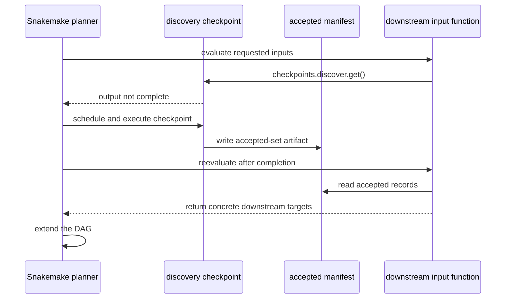
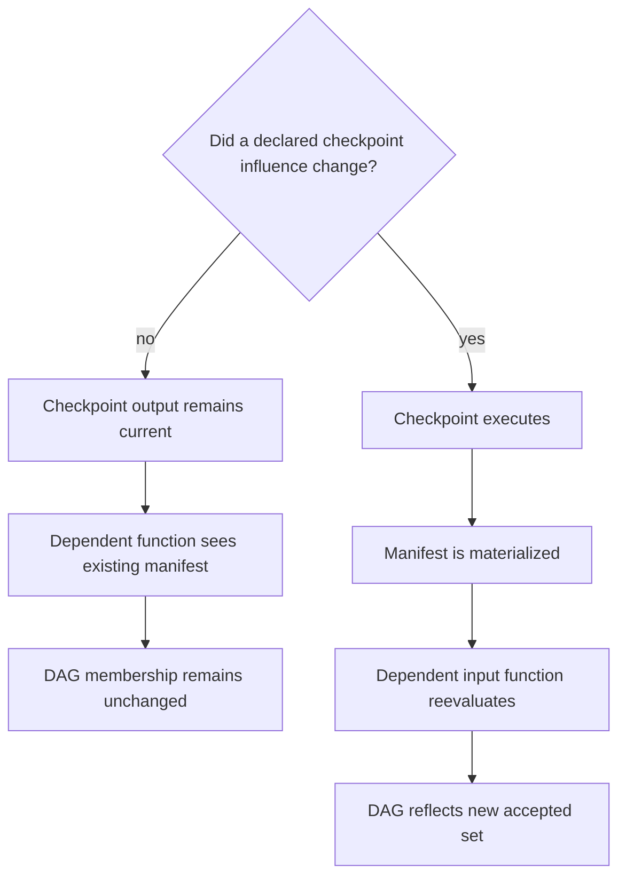

# Checkpoints and Reviewed DAG Changes

A checkpoint is justified when an executed job reveals information needed to construct
later jobs. It is not justified merely because a file list varies or because the workflow
author wants to use a more sophisticated feature.

This lesson follows one checkpoint through planning, execution, reevaluation, and review.
It also separates the checkpoint’s special behavior from ordinary invalidation rules.

## What a checkpoint changes

An ordinary rule can produce a file whose path is already known. A checkpoint also
produces known output, but downstream input functions may wait for that output, inspect
it, and then return inputs whose identities were not knowable earlier.



The checkpoint does not return jobs. It writes evidence. A dependent input function turns
that evidence into concrete paths.

## A minimal, reviewable pattern

The checkpoint:

```python
checkpoint validate_delivery:
    input:
        registry="data/arrivals.tsv"
    output:
        manifest="results/accepted.json"
    script:
        "workflow/scripts/validate_delivery.py"
```

The dependent function:

```python
import json


def accepted_outputs(_wildcards):
    manifest = checkpoints.validate_delivery.get().output.manifest
    with open(manifest, encoding="utf-8") as handle:
        payload = json.load(handle)
    samples = sorted(payload["accepted"])
    return expand("results/{sample}/qc.json", sample=samples)
```

The target:

```python
rule all:
    input:
        accepted_outputs
```

This division makes three responsibilities visible:

| Surface | Responsibility |
| --- | --- |
| checkpoint rule | declare influences and materialize the runtime fact |
| manifest schema | preserve accepted and rejected discovery evidence |
| input function | project accepted records into concrete downstream paths |

Do not hide validation, directory scanning, and path projection in one large input
function.

## The checkpoint output must be worth rereading

A plain list can be enough for a teaching specimen:

```text
alpha
beta
```

A production discovery artifact usually needs:

- schema version;
- governing registry path and digest;
- discovery policy or tool identity;
- accepted records with stable IDs and source paths;
- rejected candidates with reasons;
- canonical ordering;
- enough metadata to explain pairing or grouping.

The artifact should answer “why did these jobs exist?” without reconstructing a transient
directory state.

## Checkpoint reevaluation is not input invalidation

Two mechanisms are involved:

1. **Invalidation** decides whether the checkpoint must run.
2. **Reevaluation** lets dependent input functions run again after it completes.



Calling a rule a checkpoint only provides the lower half of this story. If a directory
read is hidden and no declared input changes, the upper half never triggers.

## Observe the distinction

Run:

```bash
cd programs/reproducible-research/deep-dive-snakemake/capstone
make discovery-integrity-audit
```

The governed specimen declares `data/arrivals.tsv`. After `beta` is registered, its
dry-run schedules `discover`, normal execution builds `alpha` and `beta`, and unregistered
`gamma` remains outside scope.

The ambient specimen declares no checkpoint input. After `beta` and `gamma` appear:

- its dry-run reports nothing to do;
- normal execution still contains only `alpha`;
- forced checkpoint execution reveals `alpha`, `beta`, and `gamma`.

The forced result proves that the scanner works. The normal result proves that the
workflow contract does not know when to use it.

## A justified checkpoint

Suppose an intake registry names candidate archives. A validation job must:

- open each archive;
- verify its checksum;
- inspect contained metadata;
- reject incomplete sample pairs;
- assign a stable sample ID;
- write accepted and rejected records.

The final accepted set is genuinely unavailable until the validation job executes. A
checkpoint is justified because runtime work reveals a fact needed for downstream job
construction.

The review argument should be:

> The arrival registry is the declared invalidation event. The checkpoint validates
> registered candidates and writes the accepted-set manifest. Downstream input functions
> read only that manifest, so DAG growth is attributable to a preserved runtime fact.

## Three fake justifications

### “The sample list changes between projects”

Variation between invocations does not require runtime reevaluation. A validated sample
sheet read at parse time is sufficient when it already names the final set.

### “The filenames are discovered with a glob”

A glob can run during parsing. The question is whether an executed job must reveal the
set, not whether Python can calculate it.

### “Checkpoint sounds safer for future growth”

Unused dynamism adds a second planning state and harder failure modes. Model current truth
and refactor when a real runtime fact appears.

## Directory outputs require a different inspection pattern

Sometimes a checkpoint produces an unknown set of files inside a directory:

```python
checkpoint split:
    input:
        "data/bundle.tar"
    output:
        directory("results/chunks")
    shell:
        "extract-and-validate {input} {output}"
```

A downstream function can inspect the completed directory:

```python
def chunk_outputs(_wildcards):
    chunk_dir = checkpoints.split.get().output[0]
    chunks = sorted(glob_wildcards(os.path.join(chunk_dir, "{chunk}.txt")).chunk)
    return expand("results/checked/{chunk}.json", chunk=chunks)
```

The directory is declared checkpoint output, so its completed contents belong to the
checkpoint artifact. This differs from scanning an unrelated ambient input directory.

Prefer a manifest even here when rejection reasons, ordering, or identities matter. A
directory listing alone rarely preserves enough review context.

## Predict the DAG in two states

Before the checkpoint completes, the planner knows:

- the requested aggregate target;
- the checkpoint job;
- the checkpoint’s declared input and output;
- that a dependent input function must be revisited.

After completion, it additionally knows:

- the accepted sample IDs;
- concrete per-sample paths returned by the input function;
- downstream jobs and edges for those paths.

Do not compare diagrams without labeling the state. A pre-checkpoint partial DAG and a
post-checkpoint realized DAG answer different questions.

| Review view | Question |
| --- | --- |
| initial dry-run | what can be planned before runtime discovery? |
| checkpoint manifest | what fact did execution reveal? |
| reevaluated dry-run or run log | which jobs were added from that fact? |
| final DAG or summary | what realized job structure completed? |

## Failure behavior is part of the contract

If discovery validation fails, the checkpoint should not leave a trustworthy-looking
accepted manifest. Use atomic publication:

1. write a candidate file beside the final;
2. fully validate and flush it;
3. rename the candidate to the declared output;
4. retain rejection evidence in a separate governed location when appropriate.

A half-written JSON file can be more dangerous than no file because later tools may parse
some fields and treat stale or partial membership as authoritative.

## Cache consciously

The capstone helper caches its loaded discovery payload:

```python
@lru_cache(maxsize=1)
def discovery_payload():
    checkpoint_output = checkpoints.discover_samples.get().output.json
    with open(checkpoint_output, encoding="utf-8") as handle:
        return json.load(handle)
```

This is safe within one planning process after checkpoint completion because the manifest
is immutable for that planning state. It would be unsafe for a long-lived process that
expects the file to change again without restarting or clearing the cache.

State the lifetime assumption when caching dynamic evidence.

## Diagnostic table

| Symptom | Likely cause | Evidence to inspect |
| --- | --- | --- |
| checkpoint never reruns after arrivals | membership event is undeclared | change dry-run and checkpoint inputs |
| checkpoint reruns but no new job appears | manifest or input projection omitted the record | manifest diff and returned target list |
| checkpoint reruns every invocation | output or input is unstable | timestamps, upstream producers, manifest bytes |
| downstream jobs use a different sample set | second discovery authority exists | all globs and sample-list helpers |
| forced run repairs the plan | hidden invalidation dependency | normal versus forced traces |
| malformed discovery output poisons planning | publication is not atomic or schema is weak | candidate residue and parser errors |

## A checkpoint review packet

For one proposed checkpoint, collect:

- the rule with its declared inputs and output;
- a sentence naming the runtime fact;
- the output schema;
- one baseline dry-run;
- one change dry-run after the governing event changes;
- the completed manifest;
- the expected target list;
- the realized downstream job list;
- one rejection or failure receipt.

If the packet cannot distinguish a changed registry from a merely changed ambient
directory, the invalidation model is incomplete.

## Review checklist

- [ ] Execution truly reveals information unavailable during parsing.
- [ ] A declared input names the event that can change that information.
- [ ] The checkpoint writes one durable, validated discovery artifact.
- [ ] Downstream input functions call `checkpoints.<name>.get()`.
- [ ] Downstream target membership comes only from the checkpoint artifact.
- [ ] Expected fanout is calculated before execution.
- [ ] Pre- and post-checkpoint DAG views are labeled.
- [ ] Failure cannot leave a plausible partial final.
- [ ] Forced execution is used for diagnosis, not routine correctness.
- [ ] The same behavior would not be clearer as static config or a sample sheet.

## What you should carry forward

A checkpoint is accountable when its invalidation event, runtime fact, artifact, and DAG
projection form one visible chain. The next lesson asks which parts of that chain remain
internal and which must cross the publication boundary for later review.
