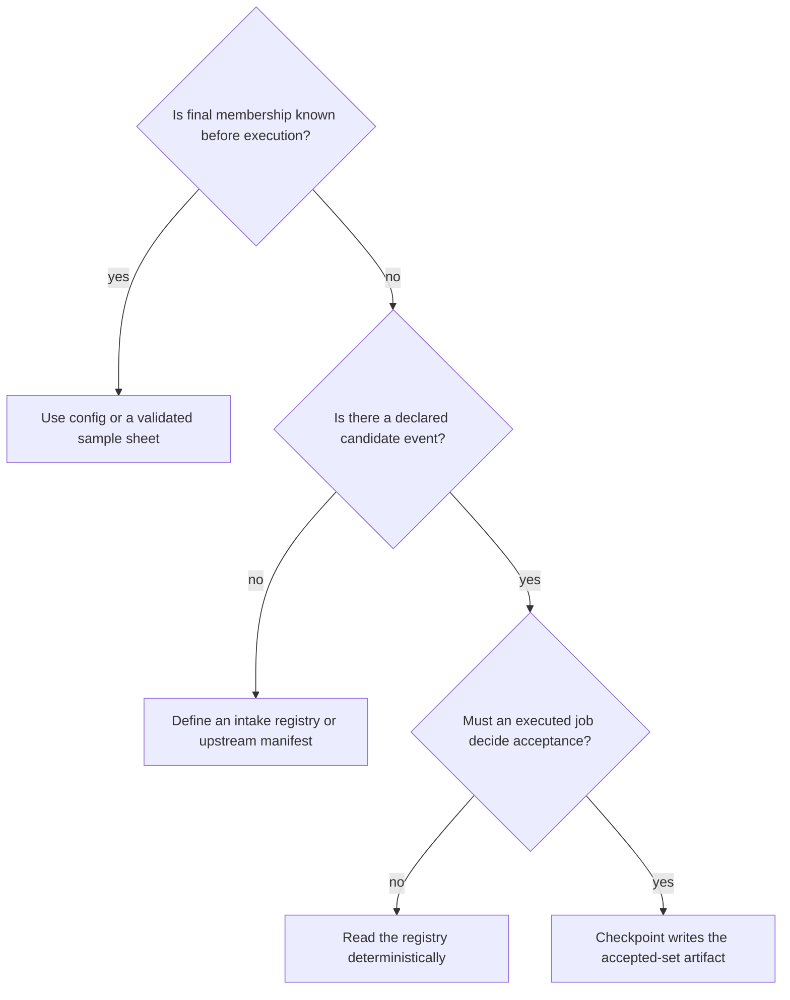
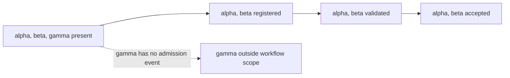

# Deterministic Target Lists and Sample Discovery

A workflow cannot be more reproducible than the process that decides what work exists.
Before learning checkpoints, make sample membership explicit enough to review, validate,
and invalidate.

This lesson builds that contract from a governed arrival registry. It also shows when a
sorted directory scan is sufficient and when “deterministic” is being used too loosely.

## Start with the membership question

Imagine these files:

```text
data/raw/
├── alpha.fastq.gz
├── beta.fastq.gz
└── notes.fastq.gz
```

A glob can report three matching paths. It cannot tell you whether `notes.fastq.gz` is a
sample, whether `beta` was approved for this run, or whether the directory changed after
the previous discovery job completed.

Discovery therefore needs two contracts:

1. a **membership contract**: what event admits a candidate;
2. an **identity contract**: how an admitted path becomes a stable sample ID.

Sorting belongs after those decisions. It stabilizes representation; it does not make the
decisions.

## Compare four discovery surfaces

| Surface | Membership known | Invalidation event | Typical use |
| --- | --- | --- | --- |
| config mapping | before parsing | config changes | small, stable sample set |
| checked sample sheet | before parsing | sheet changes | rich metadata and explicit approval |
| parse-time directory scan | at parsing | a new invocation observes a snapshot | exploratory or tightly controlled landing area |
| checkpoint manifest | after an executed job | a declared checkpoint input changes | validation or tool output reveals accepted membership |

The last two are often confused. A checkpoint does not turn an undeclared directory scan
into a watched input.



## A governed arrival registry

The capstone uses a one-column TSV:

```text
path
sampleA.fastq.gz
sampleB.fastq.gz
```

The file is intentionally modest. Its job is not to duplicate every sample annotation.
It declares which raw paths have entered workflow scope.

The corresponding checkpoint contract is:

```python
checkpoint discover_samples:
    input:
        registry=config["arrival_registry"]
    output:
        json=f"{RESULTS_DIR}/discovered_samples.json"
    params:
        raw_dir=config["params"]["raw_dir"],
        raw_glob=config["params"]["raw_glob"],
    shell:
        """
        python3 -m capstone.discover_samples \
            --raw-dir "{params.raw_dir}" \
            --glob "{params.raw_glob}" \
            --arrival-registry "{input.registry}" \
            --out-json "{output.json}"
        """
```

The key line is not `checkpoint`. It is `input.registry`. That edge gives Snakemake a
declared reason to rebuild discovery.

## Validate before deriving targets

The capstone rejects a registry when:

- the header is not exactly `path`;
- a row is empty;
- a path is absolute or escapes through `..`;
- a path is duplicated;
- a registered file does not exist;
- a path violates the governed FASTQ pattern;
- two names collapse to the same sample and mate;
- paired-end membership is incomplete or forbidden.

Each rejection protects a different invariant:

| Validation | Invariant protected |
| --- | --- |
| exact header | schema is not inferred from position or spelling guesses |
| relative contained path | the registry cannot silently widen trust outside raw storage |
| uniqueness | one arrival has one registry identity |
| existence | admitted membership refers to usable evidence |
| pattern match | file type stays within the declared domain |
| sample/mate collision check | one logical input role has one source |
| complete pair check | downstream jobs do not receive half a biological unit |

A “helpful” parser that silently skips bad rows weakens discovery. Rejected candidates
should produce explicit evidence, not disappear.

## Deterministic representation

After validation, derive a canonical representation:

```python
def read_arrival_registry(registry: Path) -> list[Path]:
    entries = parse_and_validate(registry)
    return sorted(entries, key=lambda path: path.as_posix())
```

Then derive sample records in stable sample order:

```json
{
  "schema_version": 2,
  "arrival_registry": "data/raw-arrivals.tsv",
  "arrival_registry_sha256": "…",
  "samples": {
    "sampleA": {
      "mode": "SE",
      "reads": {"SE": "data/raw/sampleA.fastq.gz"}
    }
  }
}
```

Determinism here means that the same registry bytes, validation policy, and raw inputs
produce the same logical records and ordering. It does not mean every later directory
change is automatically noticed.

## Presence is not membership

Suppose the registry lists `alpha` and `beta`, while the directory also contains
`gamma`.



Ignoring `gamma` is not missed discovery under this contract. It is correct scope
enforcement. To admit `gamma`, update the registry through the governed intake process.

This makes a useful review question possible:

> Which tracked event authorized this sample to enter the DAG?

“Its file was nearby” is rarely a sufficient answer.

## Static use of the same registry

If every registry row is already valid and no executed job needs to decide acceptance,
you do not need a checkpoint:

```python
from pathlib import Path


def registered_samples(path):
    return sorted(
        line.strip()
        for line in Path(path).read_text(encoding="utf-8").splitlines()
        if line.strip()
    )


SAMPLES = registered_samples("config/samples.txt")


rule all:
    input:
        expand("results/{sample}.txt", sample=SAMPLES)
```

This is a static DAG built from a declared, versioned source. Add schema validation and
path checks before using it in production. Do not introduce a checkpoint merely because
the sample count can vary between runs.

## Parse-time scanning and its boundary

A parse-time scan can be reasonable for a disposable exploration:

```python
SAMPLES, = glob_wildcards("data/raw/{sample}.fastq.gz")
SAMPLES = sorted(SAMPLES)
```

Its contract is: “the current invocation plans from the directory snapshot visible while
the Snakefile is parsed.” That may be enough when:

- a human launches a fresh process for every delivery;
- the landing directory is immutable during a run;
- every matching filename is in scope;
- pairing and identity rules are simple and validated elsewhere.

It is inadequate when the directory is noisy, long-lived, mutable, or subject to partial
uploads. In those settings, create a governed event rather than adding more glob tricks.

## The stale-checkpoint experiment

The capstone audit makes the hidden invalidation defect observable:

```bash
cd programs/reproducible-research/deep-dive-snakemake/capstone
make discovery-integrity-audit
```

Read the two change dry-runs. Both specimens receive new raw files. Only the governed
model changes a declared checkpoint input.

Expected evidence:

```text
governed-registry  planned_after_arrival=true   normal_samples=alpha,beta
ambient-scan       planned_after_arrival=false  normal_samples=alpha
```

Then inspect forced outputs:

```text
governed-registry  forced_samples=alpha,beta
ambient-scan       forced_samples=alpha,beta,gamma
```

The ambient scanner is deterministic when invoked: it sorts the same visible files the
same way. It is still not correctly invalidated.

## A prediction lab

Create this table before running the audit:

| Change | Governed model prediction | Ambient model prediction |
| --- | --- | --- |
| add raw `beta` only | no new sample | no new sample |
| add `beta` to registry | discovery and beta planned | not applicable |
| add unregistered raw `gamma` | gamma excluded | checkpoint stays stale |
| force discovery | alpha and beta | alpha, beta, gamma |

After execution, replace each prediction with a receipt path and one sentence of
interpretation. If a result differs, explain the missing or extra dependency edge before
changing code.

## Failure patterns and repairs

### Unsorted output

Symptom: manifests differ only in order.

Repair: canonicalize after validation. Do not compare unordered domain data as raw text
unless ordering is part of the public contract.

### Duplicate logical identities

Symptom: two filenames map to the same sample or mate.

Repair: reject the discovery artifact. Choosing the first path makes results dependent on
incidental ordering.

### Partial arrival

Symptom: a registry row exists before its raw file is complete.

Repair: make intake publish the registry entry only after an atomic delivery check, or
make validation reject incomplete candidates with retained evidence.

### Ambient scope creep

Symptom: unrelated matching files become jobs.

Repair: separate present files from registered candidates. Tightening the glob may reduce
noise but does not create an admission record.

### Hidden invalidation

Symptom: forcing discovery reveals new samples that normal execution missed.

Repair: declare the governed membership event as an input. Do not document “use
`--forcerun` after deliveries” as the operational contract.

## Review checklist

Before downstream fanout, verify:

- [ ] The event that changes candidate membership is named.
- [ ] That event is a declared input when an existing discovery output must become stale.
- [ ] Paths are contained, unique, present, and domain-valid.
- [ ] Sample identity and mate parsing rules reject collisions.
- [ ] Ordering is canonical only after membership and identity are validated.
- [ ] Unregistered ambient files cannot enter the accepted set.
- [ ] The discovery artifact records its schema and governing registry digest.
- [ ] A dry-run demonstrates the intended invalidation behavior.

## What you should carry forward

A target list is trustworthy when another person can reconstruct:

1. which candidates were admitted;
2. which validation policy was applied;
3. which candidates were accepted or rejected;
4. what event caused discovery to rerun;
5. how the accepted records became target names.

The next lesson takes that accepted set and prevents wildcard expansion from inventing
combinations that the domain never contained.
