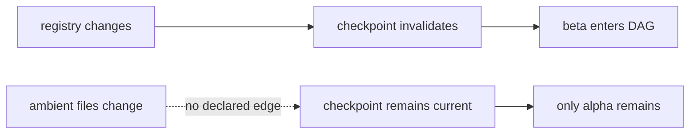
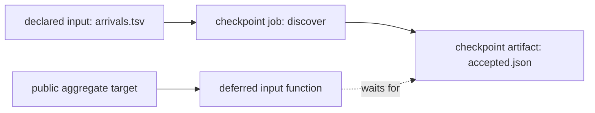
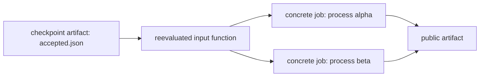
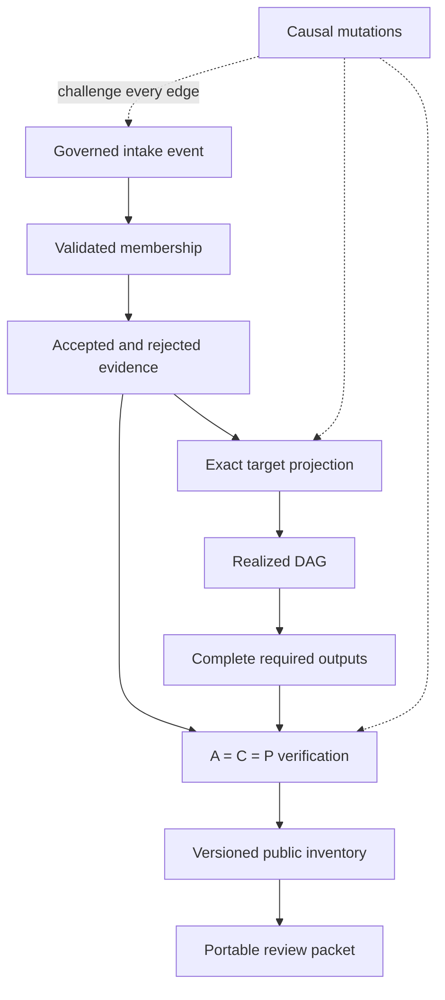

# Exercise Answers

These are reference reasoning routes, not the only acceptable implementations. Compare
your prediction and evidence before comparing code. If your result differs, locate the
first dependency or invariant where the two routes diverge.

## Exercise 1: Predict the arrival experiment

Reference prediction:

| Model | Discovery planned? | Normal outputs | Forced outputs |
| --- | --- | --- | --- |
| governed registry | yes | `alpha,beta` | `alpha,beta` |
| ambient scan | no | `alpha` | `alpha,beta,gamma` |

The governed registry changes from `alpha` to `alpha,beta`. Because it is a checkpoint
input, discovery becomes stale. The manifest changes, the dependent input function is
reevaluated, and beta enters the DAG. Gamma is not a registry member.

The ambient model receives only filesystem changes that are hidden from Snakemake. Its
existing manifest remains current. Forcing discovery proves the code can see all three
files, but normal scheduling still lacks a causal edge.



A good correction names the mistaken mechanism. For example: “I predicted the ambient
model would run because I confused checkpoint reevaluation with checkpoint invalidation.”

## Exercise 2: Validate a governed arrival registry

A reference shape:

```python
import csv
from pathlib import Path


def read_registry(registry: Path, raw_dir: Path) -> list[Path]:
    with registry.open(encoding="utf-8", newline="") as handle:
        reader = csv.DictReader(handle, delimiter="\t")
        if reader.fieldnames != ["path"]:
            raise ValueError("registry header must be exactly: path")

        entries = []
        for line_number, row in enumerate(reader, start=2):
            value = row["path"].strip()
            if not value:
                raise ValueError(f"line {line_number}: empty path")
            relative = Path(value)
            if relative.is_absolute() or ".." in relative.parts:
                raise ValueError(f"line {line_number}: path escapes raw directory")
            if not relative.match("*.fastq.gz"):
                raise ValueError(f"line {line_number}: not a governed FASTQ path")
            if not (raw_dir / relative).is_file():
                raise ValueError(f"line {line_number}: registered file is missing")
            entries.append(relative)

    if not entries:
        raise ValueError("registry must contain at least one path")
    if len(entries) != len(set(entries)):
        raise ValueError("registry contains a duplicate path")
    return sorted(entries, key=lambda path: path.as_posix())
```

Important reasoning:

| Check | Prevented defect |
| --- | --- |
| exact header | accidental schema guessing |
| non-empty row and registry | empty membership disguised as success |
| contained relative path | trust expansion outside raw storage |
| governed pattern | unexpected file domain |
| existence | admitted identity without source evidence |
| uniqueness | ambiguous repeated arrival |
| canonical sort | representation drift after validation |

Sorting must not silently deduplicate. A duplicate is an intake defect and should be
rejected before canonicalization.

## Exercise 3: Project accepted records without false combinations

The Cartesian expression has:

```text
2 samples × 2 lanes × 2 mates = 8 targets
```

Only four relationships exist. A faithful implementation:

```python
def qc_targets(records):
    targets = {
        f"qc/{record['sample']}/{record['lane']}/{mate}.json"
        for record in records
        for mate in record["mates"]
    }
    expected = sum(len(record["mates"]) for record in records)
    if len(targets) != expected:
        raise ValueError("accepted records collapse to duplicate QC targets")
    return sorted(targets)
```

Reference result:

```text
qc/alpha/L001/R1.json
qc/alpha/L001/R2.json
qc/beta/L002/R1.json
qc/beta/L002/R2.json
```

`expand(..., zip, ...)` is safe when the lists are equal-length projections of the same
validated records and no nested one-to-many relationship is lost. Records are clearer
when each sample carries several mates or panels.

## Exercise 4: Choose static or runtime discovery

| Case | Decision | Invalidation and evidence |
| --- | --- | --- |
| final versioned sheet | checked sample sheet | sheet change invalidates planning; validated sheet is evidence |
| immutable teaching folder | sorted parse-time scan | a fresh invocation observes the declared snapshot; target list should be saved for review |
| archives need executed inspection | checkpoint with declared candidate registry | registry invalidates validation; checkpoint manifest records accepted and rejected candidates |
| asynchronous folder and inputless checkpoint | reject and redesign intake | no governed invalidation exists; introduce registry or upstream delivery manifest |
| config plus pure validation | validated config or checked sheet | config change invalidates planning; checkpoint would add runtime state without a runtime fact |

The teaching-folder scan is acceptable only because the operating assumptions are
explicit: immutable during an invocation and every match is in scope. If either changes,
the model must change.

A dynamic mechanism is not inherently more future-proof. It creates an additional
planning state and evidence burden.

## Exercise 5: Build declared checkpoint invalidation

Reference core:

```python
from pathlib import Path


checkpoint discover:
    input:
        registry="data/arrivals.tsv"
    output:
        manifest="state/accepted.txt"
    run:
        samples = sorted(
            line.strip()
            for line in Path(input.registry).read_text(encoding="utf-8").splitlines()
            if line.strip()
        )
        Path(output.manifest).parent.mkdir(parents=True, exist_ok=True)
        Path(output.manifest).write_text(
            "\n".join(samples) + "\n",
            encoding="utf-8",
        )


def accepted_outputs(_wildcards):
    manifest = checkpoints.discover.get().output.manifest
    samples = Path(manifest).read_text(encoding="utf-8").splitlines()
    return expand("build/{sample}.txt", sample=samples)


rule materialize:
    input:
        "data/raw/{sample}.fastq"
    output:
        "build/{sample}.txt"
    shell:
        "cp {input} {output}"


rule all:
    input:
        accepted_outputs
    default_target: True
```

After registering beta:

```text
data/arrivals.tsv changed
    -> discover is stale
    -> state/accepted.txt becomes alpha,beta
    -> accepted_outputs is reevaluated
    -> build/beta.txt is requested
```

Normal and forced output lists should both be `alpha,beta`. Gamma remains absent because
raw-file presence is not the membership event.

If forcing adds gamma, the discovery implementation still reads ambient membership and
the registry is acting only as a timestamp trigger. That does not satisfy the exercise.

## Exercise 6: Preserve rejection evidence atomically

Either stated policy can be correct. A fail-closed reference:

```python
def atomic_json(path, payload):
    candidate = path.with_suffix(path.suffix + ".candidate")
    candidate.write_text(
        json.dumps(payload, indent=2, sort_keys=True) + "\n",
        encoding="utf-8",
    )
    candidate.replace(path)
```

Validation first accumulates structured rejection records:

```json
[
  {"path": "beta.fastq.gz", "reason": "registered file is missing"},
  {"path": "../gamma.fastq.gz", "reason": "path escapes raw directory"},
  {"path": "alpha.fastq.gz", "reason": "duplicate registry path"}
]
```

Under fail-closed policy:

1. write and preserve the rejection receipt in the governed evidence location;
2. do not promote a new accepted candidate;
3. exit nonzero;
4. ensure no downstream targets can read a partial new accepted artifact.

If an earlier trusted `accepted.json` remains, label it as belonging to the earlier
registry digest. Preserving an old file without identity can make stale acceptance look
current.

The complete-with-rejections policy is suitable only when downstream fanout explicitly
uses accepted records and the publish contract permits a partial intake.

## Exercise 7: Explain the DAG before and after discovery

Before completion:



After completion:



The initial diagram is not merely a lower-resolution final DAG. It answers what can be
planned before runtime evidence exists. The realized diagram answers what jobs were
constructed from that evidence.

After registering another valid sample, the new dry-run should first show discovery as
stale. A final DAG alone cannot prove which changed input caused reevaluation.

## Exercise 8: Enforce discovery-publication equality

For the invalid case:

```python
accepted = {"alpha", "beta"}
complete = {"alpha"}
published = {"alpha", "gamma"}
present_outputs = {"alpha", "gamma"}

diagnosis = {
    "accepted_but_incomplete": sorted(accepted - complete),
    "present_but_unaccepted": sorted(present_outputs - accepted),
    "published_but_unaccepted": sorted(published - accepted),
    "accepted_but_unpublished": sorted(accepted - published),
}
```

Expected:

```json
{
  "accepted_but_incomplete": ["beta"],
  "present_but_unaccepted": ["gamma"],
  "published_but_unaccepted": ["gamma"],
  "accepted_but_unpublished": ["beta"]
}
```

Deleting gamma removes stale contamination but does not complete beta. Full publication
must still fail.

For the valid case, sort relative paths before hashing:

```python
files = []
for path in sorted(public_paths, key=lambda item: item.as_posix()):
    files.append(
        {
            "path": path.relative_to(publish_root).as_posix(),
            "sha256": hashlib.sha256(path.read_bytes()).hexdigest(),
        }
    )
```

If partial publication is allowed, preserve excluded accepted IDs and reasons and make
the policy visible in the public schema. “Publish whatever completed” is not a policy.

## Exercise 9: Damage the discovery evidence gate

Expected mutation effects:

| Mutation | Observation that must change | Required rejection |
| --- | --- | --- |
| remove registry input | change dry-run no longer schedules discovery | declared invalidation finding fails |
| scan ambient directory | forced governed set includes gamma | governed scope finding fails |
| keep manifest unchanged | beta absent after normal execution | registered beta finding fails |
| admit gamma to target list | normal or forced governed set contains gamma | unregistered exclusion finding fails |
| inspect only forced run | ambient defect becomes invisible | audit design test must reject missing normal comparison |

Several mutations can still produce plausible outputs:

- a stale workflow can publish alpha successfully;
- an ambient scanner can publish alpha, beta, gamma successfully;
- a frozen manifest can parse and hash correctly.

That is why the gate must inspect the changed cause, normal plan, normal result, and forced
diagnostic separately.

Restore specimens between mutations. Otherwise, removing the registry input may prevent
a later manifest mutation from being exercised at all.

## Exercise 10: Submit a discovery integrity packet

A suitable `README.md` claim boundary:

> This packet shows that changing the governed arrival registry invalidated discovery,
> that accepted records projected exactly to downstream targets, and that accepted,
> complete, and published sample sets agreed for this run. It does not prove the upstream
> delivery process authorized the registry correctly or that the workflow is portable to
> every executor.

Recommended review order:

1. registry and its identity;
2. change dry-run;
3. accepted and rejected discovery evidence;
4. literal target list;
5. execution receipt;
6. publication inventory;
7. packet bundle manifest.

The integrity test should:

1. calculate hashes after the packet is complete;
2. alter one copied receipt;
3. report a mismatch for that exact relative path;
4. restore the file;
5. regenerate or reverify the original manifest successfully.

Good review questions ask whether the evidence supports causal claims. “Are all files
present?” is necessary but too weak.

## A reasoning map for the whole set



## Completion diagnosis

If your work differs from the reference, classify the difference:

- **alternative but equivalent**: different code, same declared event, invariants, and
  evidence;
- **policy choice**: different accepted/rejected or partial-publication policy, stated and
  tested;
- **missing proof**: the behavior may be correct but no receipt demonstrates it;
- **contract defect**: membership, fanout, invalidation, or publication differs;
- **claim overreach**: the evidence supports a narrower conclusion than the prose.

Revise the claim as readily as the code. Honest scope is part of reproducibility.
