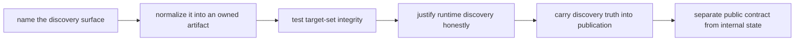

# Exercises

Use these after reading the five core lessons and the worked example. The goal is to make
your discovery reasoning visible through runnable artifacts, not through checkpoint
folklore.

## How to work through this set

Treat the ten exercises as one long lab on discovery honesty.

Before each answer:

1. name the discovery surface you are trusting
2. predict which artifact will carry the truth forward
3. run the smallest command that proves the design really behaves that way

If you skip the artifact question, the day turns into syntax practice and misses the real
lesson.

Do them in order. The set is one day-long progression:

- Exercises 1-3 establish the discovery ladder.
- Exercises 4-6 turn discovery into durable artifacts.
- Exercises 7-8 justify or reject checkpoints.
- Exercises 9-10 test whether dynamic behavior survives review and publication.

For every answer, keep three things:

- the workflow files or command sequence you actually used
- the artifact that proves what the workflow discovered
- one short sentence explaining why the design is honest

## Recommended working layout

If you want one project that can support the whole day, build the exercises in a tiny lab
tree like this:

```text
module02-lab/
├── Snakefile
├── config/
├── data/
├── results/
├── publish/
├── logs/
└── artifacts/
```

That structure makes it easier to compare static discovery, runtime discovery, and publish
integrity without rebuilding the whole project for every prompt.

Build one small discovery-integrity packet as you go:

- one note naming the source of truth for each discovery design
- one normalized target-list or registry artifact
- one fanout check showing how the target set changed after a repair
- one checkpoint-justification note that names the runtime fact being learned
- one rejection or validation record for a bad candidate
- one publish note distinguishing public discovery artifacts from internal engine state

If those six artifacts are missing, the day usually turns into "dynamic Snakemake magic"
instead of "reviewable discovery design."



Use that route on purpose. It keeps the day centered on artifacts that carry truth rather
than on checkpoint mystique.

## What a strong day packet looks like

By the time you finish all ten exercises, your work should leave behind one small,
reviewable packet instead of ten disconnected answers:

- one declared candidate surface such as a sample sheet or normalized scan output
- one target-list artifact that proves the fanout you intended
- one example of accidental fanout and its repaired design
- one justified-checkpoint note naming the runtime fact being learned
- one accepted registry and one rejection record
- one publish tree with public discovery artifacts separated from internal state
- one checksum or manifest command showing how a consumer can verify the published bundle

If you cannot point to those artifacts, the exercise day is still too abstract.

## Exercise 1: Compare two discovery surfaces

Model the same three-sample workflow in two ways:

- one with a versioned sample sheet
- one with a deterministic directory scan

What to hand in:

- both discovery shapes
- one reason to prefer each in a real project
- one command that proves they generate the same target list
- one sentence naming the declared source of truth in each design

Study note:
Do not answer this as a style preference question. The point is to make the source of
truth explicit in both designs.

## Exercise 2: Turn ambient discovery into a declared contract

Start from a tiny workflow that scans `data/raw/` directly at parse time and relies on
whatever filenames happen to be present.

Repair it so the workflow has one named discovery surface and one normalization point.

What to hand in:

- the original discovery shape and why it was weak
- the repaired discovery rule or helper
- the normalized sample list it produces
- one sentence explaining why another reviewer could trust the new design more

Study note:
If the repaired version still requires another person to rescan the raw directory to know
what happened, the contract is still weak.

## Exercise 3: Prevent one accidental fanout explosion

Design a small example where `expand()` creates more targets than the real domain calls
for.

Then repair it so the target list comes from one validated record structure instead of two
independent lists.

What to hand in:

- the buggy expansion
- the unintended targets it creates
- the repaired target-list design
- one command, such as `snakemake -n`, that would make the difference obvious

Study note:
Wrong fanout is usually a domain-modeling defect before it is a Snakemake defect.

## Exercise 4: Design the integrity trail for a dynamic run

Assume a workflow discovers samples and publishes a versioned bundle.

Describe the minimum artifact set that would let a downstream reviewer answer:

- which samples were discovered
- which files are part of the public boundary
- what run identity produced that boundary

What to hand in:

- one accepted-registry path
- one rejection-record path
- one provenance artifact path
- one manifest or inventory artifact path
- one short explanation of what each artifact proves

Study note:
Treat this as a trust design exercise. A directory tree without explained artifact roles
is not enough, and a dynamic run that publishes only accepted outputs is still hiding part
of its decision trail.

## Exercise 5: Improve performance without weakening truth

Start from a workflow shape that is operationally clumsy, for example:

- too many tiny per-fragment jobs
- too many almost-identical environment files

Repair it without hiding required artifacts or changing the meaning of the publish
boundary.

What to hand in:

- the original smell
- the repaired environment or job-boundary design
- one sentence explaining why the repair lowers overhead
- one sentence explaining why workflow truth stayed intact

Study note:
If the repair works by hiding files a reviewer actually needs, it is not a legitimate
performance improvement.

## Exercise 6: Build a validated candidate registry

Create a tabular manifest with at least three sample identifiers and source paths. Load it
once, reject duplicate identifiers and missing files, sort it, and use it to build
concrete QC targets without a checkpoint.

What to hand in:

- the manifest and validation code
- the deterministic target list
- one deliberately invalid record and its early error
- an explanation of why static planning is sufficient
- one sentence explaining why a checkpoint here would hide already knowable facts

Study note:
This exercise should make you comfortable rejecting a checkpoint, not just implementing
one.

## Exercise 7: Justify one checkpoint and reject one fake one

Write two short design sketches:

- one workflow shape where a checkpoint is justified
- one workflow shape where a checkpoint would only hide weak modeling

What to hand in:

- the discovery question each sketch is trying to answer
- the output artifact of the justified checkpoint
- the cleaner alternative for the unjustified checkpoint
- one sentence explaining the difference between the two cases

Study note:
The important contrast is not "advanced" versus "simple." It is "runtime fact" versus
"already knowable fact."

## Exercise 8: Implement a justified checkpoint

Start from a declared candidate set, then make a validation checkpoint publish a registry
containing usable candidates and a rejection record for excluded ones. Fan out one
downstream job per accepted identifier.

What to hand in:

- the checkpoint output contract
- the input function that reads it through `checkpoints.<name>.get()`
- evidence from before and after checkpoint completion
- the rejection record and what made one candidate fail
- an explanation of the runtime fact that could not be known during initial planning

## Midday self-check

Before you move into testing discovery changes and publishing the result, make sure your
packet can already answer all of these:

- which artifact is the actual source of truth for the discovered set
- where rejected candidates stay visible instead of disappearing from the story
- whether your target fanout comes from validated records instead of accidental cross-products
- why a checkpoint is justified or unjustified in this exact case
- which discovery artifacts a downstream reviewer will need to see later

If you cannot answer those four questions cleanly, return to the earlier exercises and
make the packet more explicit before moving on.

Study note:
If the workflow could have learned the same set from declared config before execution,
this is the wrong place to use a checkpoint.

## When you get stuck, diagnose the missing artifact first

Use this table before you start rewriting rules at random:

| If you are stuck on... | Check whether you are missing... | Typical repair |
| --- | --- | --- |
| Exercise 2 or 6 | one declared candidate surface | replace ambient discovery with a versioned manifest or one normalized scan |
| Exercise 3 | one record structure that owns the fanout | stop expanding independent lists and build targets from validated records |
| Exercise 7 or 8 | one sentence naming the runtime fact | write the justification before you touch `checkpoint` code |
| Exercise 9 or 10 | one durable registry or publish artifact | keep the accepted, rejected, and published sets visible instead of inferred |

Most failed answers are not short on syntax. They are short on owned artifacts.

## Exercise 9: Test discovery integrity under change

Run the checkpoint workflow, then add one candidate, remove one candidate, and corrupt one
candidate in separate trials. Predict the registry and downstream target changes before
each run.

What to hand in:

- the three predictions
- registry diffs for each trial
- dry-run evidence for affected downstream jobs
- the rejection evidence retained for the corrupt candidate

Study note:
This is where discovery becomes operationally real. The workflow must show what changed,
not just quietly produce a new set of files.

## Exercise 10: Publish a reviewable dynamic result

Publish a versioned bundle for the checkpoint workflow. Include the accepted registry,
rejection record, results, resolved configuration, provenance, and a manifest with
checksums.

What to hand in:

- the public directory tree
- a machine-readable inventory and checksum verification command
- a short consumer procedure that does not depend on internal working paths
- an explanation of which artifacts are public contracts and which remain internal state

## What weak completion looks like

Do not call the day complete if your answers do any of these:

- describe discovery as if the engine "just knows" the sample set
- use a checkpoint where the facts were already available in static validated data
- accept fanout growth without tracing which records created it
- publish a dynamic result without exposing the accepted and rejected discovery artifacts
- blur checkpoint internals and public review surfaces into one undifferentiated bundle

## Exit standard for the exercise day

Do not count the day complete unless you can do all of this without leaning on the answer
page as a set of instructions:

- explain why one discovery surface is trustworthy
- reject one unnecessary checkpoint with confidence
- defend one justified checkpoint by naming the runtime fact it reveals
- show one registry, one provenance artifact, and one manifest that make the run reviewable
- distinguish public contract files from internal workflow state

## Mastery standard for this exercise set

Across all ten answers, Module 02 wants the same habits:

- you name the artifact or boundary that carries the truth
- you explain dynamic behavior without using mystical language
- you show which command or file would let another person verify the claim

If your answer says only "Snakemake will handle it," keep going.
