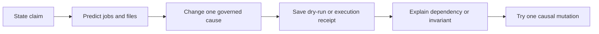
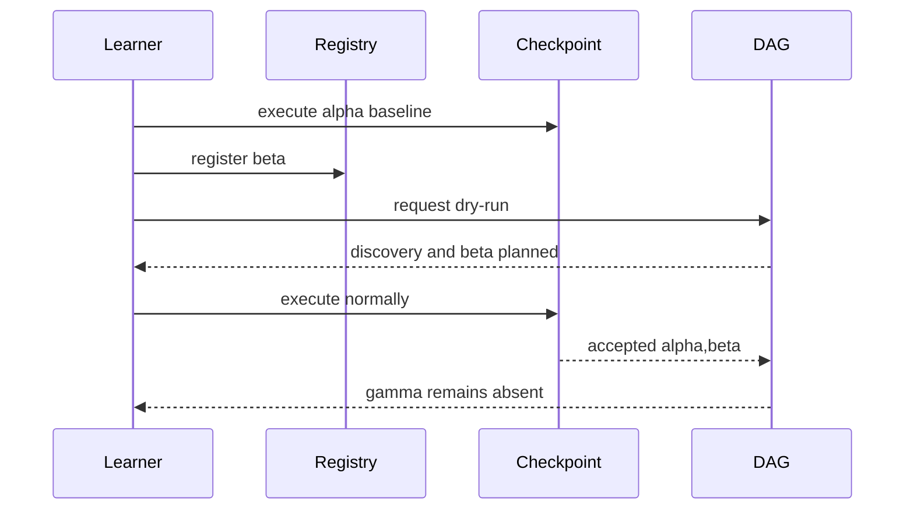

# Exercises

These ten exercises form one cumulative investigation. You begin by predicting an
existing discovery experiment, then build and damage your own governed workflow, and
finish by reviewing its public evidence.

Do the work in an artifact workspace or a separate learner repository. Do not edit the
tracked capstone specimens while experimenting.

## Working rules

For every exercise, keep:

- the claim you are testing;
- the exact changed event;
- a prediction written before execution;
- the command or inspection route;
- the smallest relevant observation;
- an interpretation that names a dependency or invariant;
- any revision after the evidence disagrees.

“It passed” and “it failed” are observations without reasoning.



## Exercise 1: Predict the arrival experiment

Read only these files:

```text
capstone/repro/discovery-integrity/governed-registry/Snakefile
capstone/repro/discovery-integrity/ambient-scan/Snakefile
```

Both start with `alpha.fastq`. The experiment later adds `beta.fastq` and `gamma.fastq`;
only the governed registry is updated to include `beta`.

Before running anything, predict:

| Model | Will the change dry-run schedule discovery? | Normal sample outputs | Forced sample outputs |
| --- | --- | --- | --- |
| governed registry |  |  |  |
| ambient scan |  |  |  |

Then run:

```bash
cd programs/reproducible-research/deep-dive-snakemake/capstone
make discovery-integrity-audit
```

Deliver:

- the completed prediction table;
- `summary.tsv`;
- one corrected prediction, if needed;
- a paragraph explaining why the forced ambient result does not repair normal
  invalidation.

Do not inspect the audit runner until after comparing your prediction with the summary.

## Exercise 2: Validate a governed arrival registry

Implement a parser for:

```text
path
alpha.fastq.gz
beta.fastq.gz
```

It must return sorted relative paths and reject:

- a header other than exactly `path`;
- an empty registry;
- an empty row;
- an absolute path;
- any path containing `..`;
- duplicate paths;
- a registered path that does not exist below the raw directory;
- a path outside the governed `*.fastq.gz` pattern.

Write at least one passing test and one focused test for each rejection family. Error
messages must identify the broken invariant closely enough for a learner to diagnose the
row.

Deliver:

- parser and tests;
- test receipt;
- a table mapping each validation to the ambiguity or trust expansion it prevents.

Do not add recovery behavior that silently drops invalid rows.

## Exercise 3: Project accepted records without false combinations

Use:

```python
records = [
    {"sample": "alpha", "lane": "L001", "mates": ["R1", "R2"]},
    {"sample": "beta", "lane": "L002", "mates": ["R1", "R2"]},
]
```

Required targets:

```text
qc/alpha/L001/R1.json
qc/alpha/L001/R2.json
qc/beta/L002/R1.json
qc/beta/L002/R2.json
```

First calculate how many targets a three-list Cartesian expansion would create. Then
implement a projection that returns exactly the four valid paths in canonical order.

Add tests that fail if:

- `alpha/L002` or `beta/L001` appears;
- any mate is missing;
- record order changes the returned target order;
- duplicate records create duplicate targets.

Deliver the expected set, implementation, tests, and a one-sentence rule for when
`expand(..., zip, ...)` is safe.

## Exercise 4: Choose static or runtime discovery

For each case, choose one mechanism:

- validated config mapping;
- checked sample sheet read at parse time;
- sorted parse-time scan;
- checkpoint with a declared registry or upstream manifest;
- reject and redesign the intake boundary.

Cases:

1. A versioned sample sheet already names final IDs and FASTQ paths.
2. A controlled teaching folder is immutable during each invocation, and every matching
   file is in scope.
3. Candidate archives are registered, but an executed validator must inspect their
   contents before accepted sample IDs are known.
4. A long-lived landing folder changes asynchronously; a checkpoint scans it but has no
   input that records arrivals.
5. A config file names candidates, and a pure Python validation function can decide
   acceptance during parsing without external work.

For every decision, state:

- what is knowable before execution;
- the invalidation event;
- the durable evidence;
- why a more dynamic mechanism would not improve the model.

Deliver a decision table. Code is not required.

## Exercise 5: Build declared checkpoint invalidation

Construct a small workflow with:

- `data/raw/alpha.fastq`;
- `data/arrivals.tsv` containing `alpha`;
- a discovery checkpoint that declares the registry;
- `state/accepted.txt`;
- one `build/{sample}.txt` output per accepted sample;
- a default aggregate target driven by a checkpoint-dependent input function.

Execute the baseline. Then:

1. add raw `beta` and raw `gamma`;
2. add only `beta` to the registry;
3. save a dry-run;
4. execute normally;
5. list outputs;
6. force the checkpoint;
7. list outputs again.



Deliver:

- Snakefile and input data;
- baseline and change receipts;
- normal and forced output lists;
- a dependency chain from registry change to beta job;
- an explanation of why gamma’s presence is insufficient for membership.

## Exercise 6: Preserve rejection evidence atomically

Extend Exercise 5 so the registry contains paths rather than sample IDs. The discovery
program must publish:

```text
state/accepted.json
state/rejected.json
```

Use these candidates:

- complete `alpha.fastq.gz`;
- registered but missing `beta.fastq.gz`;
- escaping path `../gamma.fastq.gz`;
- duplicate `alpha.fastq.gz`.

Choose and document one policy:

- fail the entire discovery job and retain a protected rejection candidate; or
- complete discovery with separate accepted and rejected artifacts.

Requirements:

- final JSON is written atomically;
- every rejection has a machine-readable reason;
- a failed run cannot leave a plausible new `accepted.json`;
- the previous trusted accepted artifact, if any, is either preserved unchanged or
  removed according to a stated policy;
- no rejected sample creates downstream jobs.

Deliver implementation, failure receipt, filesystem listing after failure, JSON evidence,
and a review of the atomic-publication behavior.

## Exercise 7: Explain the DAG before and after discovery

Using Exercise 5 or 6, save:

- an initial dry-run from a clean workspace;
- the completed discovery artifact;
- a realized DAG or job list after discovery;
- a second dry-run after registering one new valid sample.

Draw two diagrams:

1. what the planner knows before the checkpoint completes;
2. the downstream jobs known after the manifest is read.

Label every node as one of:

- declared input;
- checkpoint job;
- checkpoint artifact;
- reevaluated input function;
- concrete downstream job;
- public artifact.

Deliver both diagrams and a paragraph explaining why the first is not an incomplete
version of the same evidence question: it represents a different planning state.

## Exercise 8: Enforce discovery-publication equality

Create a verifier for:

```text
accepted A = {alpha, beta}
complete outputs C = {alpha}
existing stale output = gamma
summary units P = {alpha, gamma}
```

The verifier must reject publication and report:

- accepted but incomplete: `beta`;
- present but outside accepted scope: `gamma`;
- published but unaccepted: `gamma`;
- accepted but unpublished: `beta`.

Then create a valid case where `A = C = P = {alpha, beta}`. Write a public inventory with
canonical relative paths and SHA-256 digests.

Deliver:

- verifier and tests;
- rejected receipt;
- valid inventory;
- a decision on whether partial publication is allowed and what evidence that policy
  would require.

Do not repair the invalid case by deleting `gamma` alone; `beta` remains incomplete.

## Exercise 9: Damage the discovery evidence gate

Run:

```bash
make discovery-integrity-selftest
```

Then copy the governed specimen into your artifact workspace and apply these mutations
one at a time:

1. remove the registry from the checkpoint `input`;
2. keep the input but make discovery read the ambient directory instead;
3. leave the manifest unchanged when the registry adds beta;
4. let unregistered gamma enter the target list;
5. change the audit to inspect only forced execution.

For each mutation, state:

- which observation should change;
- which finding must fail;
- whether ordinary workflow output could still look plausible;
- why a final-output-only test might miss the defect.

Implement automated rejection tests for at least three mutations. Restore a clean copy
between cases so one mutation does not mask another.

## Exercise 10: Submit a discovery integrity packet

Build a review packet for your repaired workflow. It must contain:

```text
review/
├── README.md
├── accepted.json
├── arrival-registry.tsv
├── change-dryrun.txt
├── rejection-receipt.txt
├── publish-inventory.json
├── review-questions.md
├── run-receipt.txt
└── target-list.txt
```

`README.md` must state:

- the membership contract;
- the checkpoint justification;
- the invalidation event;
- the accepted-set schema;
- the fanout rule;
- the publication equality;
- the limit of the evidence.

`review-questions.md` must ask a reviewer to verify causes, not merely file presence.
Include at least:

- Which declared change scheduled discovery?
- Does the target list exactly project accepted records?
- Are rejected candidates unable to create jobs?
- Do accepted, complete, and published sample sets agree?
- Would forcing the checkpoint reveal any undeclared membership?

Add a bundle manifest over the packet itself. Deliberately alter one copied evidence file
and show that bundle verification fails, then restore it.

Deliver the complete packet and a one-page review that identifies one remaining limitation
instead of claiming universal reproducibility.

## Completion check

Before reading the answers, confirm that your work contains:

- ten written predictions or decisions;
- normal and forced discovery evidence;
- at least one deliberately rejected registry;
- an exact target-set calculation;
- a pre/post-checkpoint DAG explanation;
- a publication equality test;
- at least three causal mutation tests;
- a portable review packet with integrity verification.

If an exercise produced only prose, ask whether a runnable or inspectable artifact could
make its claim reviewable. If it produced only files, add the reasoning that connects
them to the contract.
