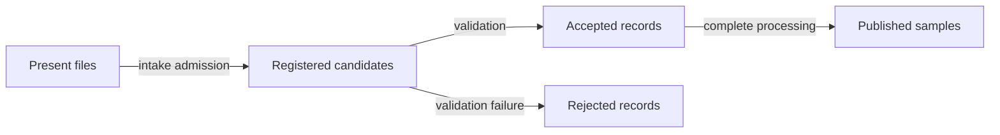
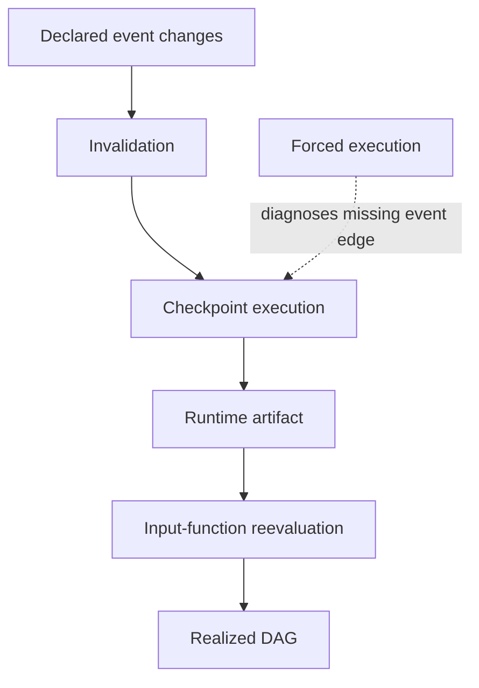

# Glossary

Use this glossary to repair a specific explanation. Do not memorize isolated definitions.
For each term, point to its concrete file, set, rule, or receipt in the Module 02 worked
example.

## Membership and discovery

### Present set

Files currently visible in a storage location. Presence does not imply registration,
acceptance, or permission to process.

In the arrival experiment, `gamma.fastq` is present but unregistered.

### Arrival registry

A governed artifact that admits candidate paths to workflow consideration. Changing it is
the capstone checkpoint’s declared membership event.

It is not necessarily the final sample sheet: validation can still reject registered
candidates.

### Registered set

Candidates named by the arrival registry. Registered membership is narrower than ambient
presence and may be broader than accepted membership.

### Accepted set

Validated records authorized to create downstream jobs. The discovery manifest is the
authority for this set.

### Rejected set

Registered candidates that failed a named validation rule. Rejection should be observable
through structured evidence or a fail-closed receipt; silently skipped rows do not form a
reviewable rejected set.

### Discovery

The governed process that turns candidate evidence into accepted and rejected records.
Directory listing can be one operation inside discovery, but a listing alone does not
define admission, identity, or invalidation.

### Discovery authority

The single artifact from which downstream membership is derived. In this module, it is
the checkpoint manifest. A second downstream directory scan creates competing
authorities.



## Planning and change

### Invalidation

The decision that an existing output is stale because a declared influence changed.

For governed discovery:

```text
arrival registry changed -> checkpoint invalidated
```

### Reevaluation

Snakemake’s re-execution of a dependent input function after a checkpoint completes.
Reevaluation turns the new checkpoint artifact into concrete downstream paths.

Invalidation gets the checkpoint to run. Reevaluation uses what it learned.

### Checkpoint

A Snakemake job whose completion may reveal information used by dependent input functions
to revise the DAG. A checkpoint does not automatically watch hidden filesystem reads.

### Runtime fact

Information unavailable until an executed job completes, such as the accepted members
inside a validated delivery archive. Variation between config files is not by itself a
runtime fact.

### Partial DAG

The jobs and dependencies knowable before checkpoint output exists. It should be labeled
as a planning state, not treated as a defective final DAG.

### Realized DAG

The job graph after checkpoint-dependent inputs have been evaluated from completed
runtime evidence.

### Forced execution

An operator request to rerun a job regardless of ordinary staleness. It is useful for
diagnosing hidden invalidation: if a forced checkpoint finds membership that normal
execution missed, the dependency model is incomplete.

It is not a routine repair for an undeclared input.



## Target-domain terms

### Wildcard domain

The set of valid values a wildcard may represent under the workflow contract. A regular
expression can narrow syntax but does not establish accepted membership.

### Target projection

A transformation from accepted records to concrete output paths. A faithful projection
preserves record relationships and creates no unauthorized combinations.

### Cartesian product

Every combination across independent value lists. For two samples, two lanes, and two
mates, the product contains eight triples.

Use it only when all combinations are valid.

### Paired expansion

Position-wise combination of equal-length lists, such as `expand(..., zip, ...)`. It is
safe only when the lists came from the same validated records and ordering preserves
their relationship.

### Fanout

The downstream jobs or targets created from a domain. Expected fanout should be
calculated from accepted records before execution.

### Cardinality

The number of records, targets, or jobs in a set. Comparing expected and actual
cardinality can expose accidental products before scheduler tuning begins.

## Evidence and publication

### Discovery manifest

A durable checkpoint artifact containing accepted membership and enough governing
identity to explain the result. A strong schema may also include rejected records and
policy identity.

### Registry digest

A content hash of the arrival registry recorded by discovery. It binds the manifest to
specific registry bytes but does not certify that the registry was authorized or correct.

### Provenance

Governed run identity: code revision, materialized configuration, software versions,
reference identities, and related execution context. Provenance should record relevant
influences deliberately rather than dumping the entire host environment.

### Publish boundary

The versioned set of files promised to downstream consumers. Internal results and logs do
not become supported public interfaces merely because they exist.

### Publish manifest

A canonical inventory of public relative paths and their digests. It answers what belongs
to the bundle and whether copied bytes changed.

### Membership equality

For a full successful publication:

```text
published samples P = accepted samples A = complete samples C
```

A partial-publication policy may relax equality only by explicitly recording exclusions
and reasons.

### Atomic publication

Writing and validating a candidate artifact before renaming or promoting it to the trusted
final path. It prevents failure from leaving plausible partial evidence.

### Evidence ledger

A compact record of claim, changed cause, prediction, command, observation,
interpretation, and next challenge. It keeps final success from erasing the causal route.

### Causal mutation

A deliberate change that removes or corrupts the property an audit claims to test—for
example, removing the registry from checkpoint inputs. A discriminating audit must reject
the mutation.

## Operational terms

### Useful computation

Time spent performing the intended analytical transformation, separated conceptually
from queue delay, environment setup, staging, and process startup.

### Scheduler overhead

Time and coordination cost incurred by submission, queueing, startup, status handling,
and related executor operations. It should be measured before grouping or batching.

### Grouping

Submitting related DAG jobs together while retaining their rule contracts. Executor
resource aggregation and failure behavior still require review.

### Batching

Changing a rule so one job processes several domain records. Batching can reduce startup
cost but changes failure isolation and often publication logic.

### Semantic invariant

A fact that must remain unchanged during an operational comparison, such as accepted
membership, validation policy, output meaning, or publish requirements.

## Confusion pairs

| Terms | Distinction |
| --- | --- |
| present / registered | storage visibility versus intake admission |
| registered / accepted | admitted candidate versus validated downstream member |
| accepted / published | authorized job membership versus supported public result |
| invalidation / reevaluation | why the checkpoint reruns versus how its result revises inputs |
| checkpoint / directory watcher | dynamic DAG mechanism versus a capability Snakemake does not provide implicitly |
| sorted / reproducible | stable order versus complete causal and semantic determinism |
| glob / membership policy | filename matching versus authorization and validation |
| constraint / accepted domain | syntactic eligibility versus run-specific membership |
| normal run / forced run | contract behavior versus diagnostic override |
| grouping / batching | executor submission strategy versus changed job granularity |
| digest / validation | byte identity versus domain correctness |
| result file / public contract | existing artifact versus supported downstream interface |

## Self-check traces

Complete each sentence with a concrete artifact:

1. `beta` entered the DAG because ___ changed, which invalidated ___.
2. After ___ completed, Snakemake reevaluated ___ and returned ___.
3. `gamma` stayed outside scope because it was present but not ___.
4. The publish verifier compared set ___ with sets ___ and ___.
5. The forced ambient run is diagnostic because the normal dry-run showed ___.
6. The audit is discriminating because removing ___ makes finding ___ fail.

Reference concepts:

1. arrival registry; discovery checkpoint;
2. checkpoint manifest; dependent input function; concrete sample targets;
3. registered;
4. `P`; `A`; `C`;
5. no scheduled discovery;
6. registry input edge; declared discovery invalidation.

## Vocabulary standard

By the end of the module, your explanations should be precise enough to say:

> The arrival registry is the declared membership event. Its change invalidates the
> checkpoint. The checkpoint validates registered candidates and writes the accepted-set
> manifest. A dependent input function is then reevaluated and projects accepted records
> into concrete targets. Publication verifies that accepted, complete, and public sample
> sets agree.

If you replace any sentence with “Snakemake finds the samples automatically,” the missing
term points to the missing contract.
