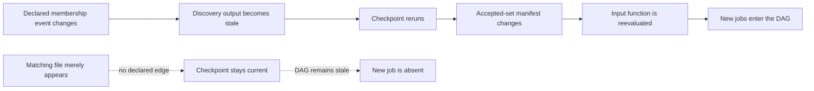
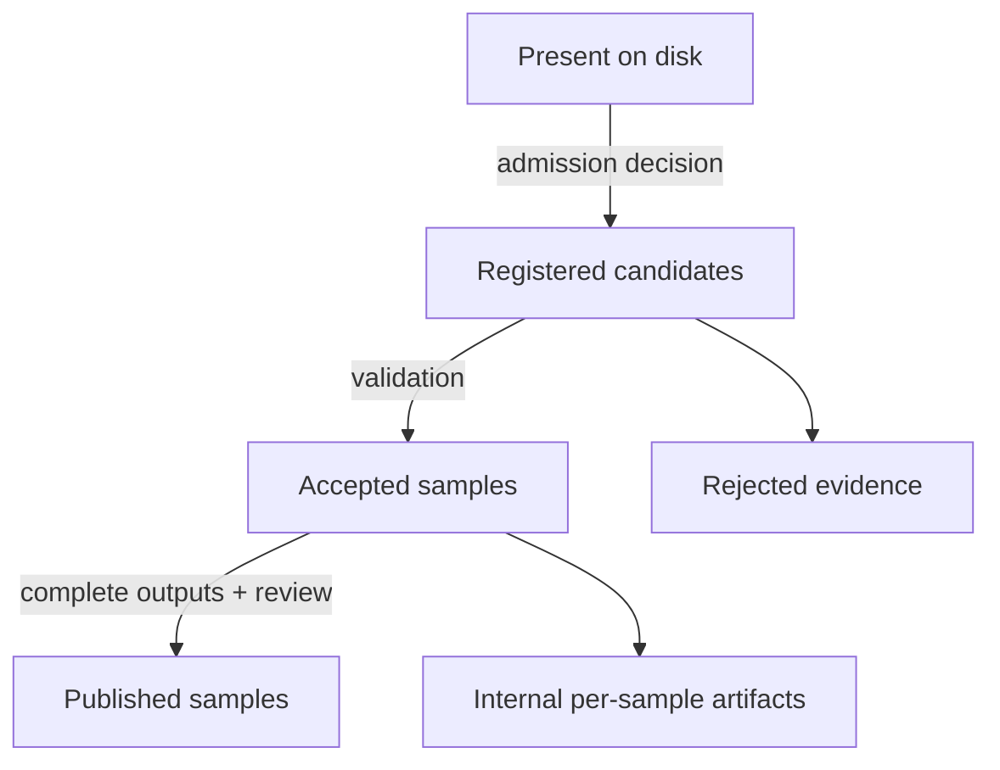

# Module 02: Dynamic DAGs, Discovery, and Integrity

Module 01 assumed that the requested files were knowable when Snakemake parsed the
workflow. This module removes that convenience. A delivery can change, validation can
reject candidates, and an executed job can reveal the only trustworthy list of samples.

The difficult part is not writing a checkpoint. It is naming the event that changes
membership and preserving enough evidence to explain the resulting DAG.

## The problem this module solves

Suppose `alpha.fastq` has already been processed. Later, `beta.fastq` appears beside it.
A Python function inside a checkpoint scans the directory, but the checkpoint declares
no input.

Will `snakemake -n` schedule discovery again?

No. Snakemake knows about declared file relationships, not every filesystem read hidden
inside Python or shell code. The checkpoint can discover `beta` if forced to run, yet
ordinary scheduling has no reason to invoke it.

That distinction drives the whole module:



## Learning outcomes you must demonstrate

By the end, you should be able to:

- choose config, a checked registry, parse-time discovery, or a checkpoint for a stated
  arrival problem;
- identify the declared input whose change invalidates discovery;
- preserve pairing and domain constraints while turning accepted records into targets;
- predict the DAG before and after a checkpoint completes;
- separate files present on disk from files admitted to workflow scope;
- publish the discovered set and its governing evidence without exposing unstable
  internal state;
- diagnose scheduler overhead without weakening the discovery contract.

These are observable abilities. “I understand dynamic workflows” is not an exit claim.

## Prerequisites and setup

Before starting, you should be comfortable reading a rule’s `input`, `output`, and
wildcards, and you should be able to run a dry-run. If those actions are still slow,
return briefly to Module 01’s file-contract lesson.

For the executable route, enter the capstone directory and use its supported toolchain:

```bash
cd programs/reproducible-research/deep-dive-snakemake/capstone
make info
make discovery-integrity-audit
```

The audit writes only under the repository `artifacts/` tree. It does not mutate the
tracked specimen. Read the generated `route.txt` before opening `report.json`.

If you cannot execute the capstone, the worked example includes the decisive dry-run and
sample-set observations. Mark your answers as predictions rather than executed evidence.

## The running case

The module uses one delivery story throughout:

- raw FASTQ files live under `data/raw/`;
- `data/raw/arrivals.tsv` declares candidate arrivals;
- discovery validates registry paths and derives sample identities;
- a checkpoint writes `results/discovered_samples.json`;
- downstream input functions fan out over the accepted sample set;
- publication carries discovery evidence beside summaries and provenance.

The registry does not list final outputs. It records the event that admits a raw file to
consideration. Validation can still reject an arrival, and a later checkpoint output can
still determine the downstream DAG.

## Four sets that must not be conflated

Dynamic-workflow bugs often begin when one word—“samples”—is used for four different
sets:

| Set | Meaning | Owner |
| --- | --- | --- |
| present | matching files currently visible in a directory | storage environment |
| registered | arrivals admitted for consideration | delivery or intake process |
| accepted | registered arrivals that pass validation | discovery checkpoint |
| published | accepted samples represented at the public boundary | publish rules |

The sets may be equal in a tiny demo. They are not interchangeable contracts.



When a learner says “the workflow found three samples,” ask: present, registered,
accepted, or published?

## Choose the least dynamic honest model

Use this decision table before writing checkpoint syntax:

| What is knowable before execution? | Suitable mechanism | Why |
| --- | --- | --- |
| final sample IDs and paths | validated config or sample sheet | no runtime fact is missing |
| candidate membership, with deterministic parse-time use | checked registry read once | the DAG is static and reviewable |
| directory snapshot accepted as an operating assumption | sorted parse-time scan | simple, but the snapshot boundary must be explicit |
| accepted membership only after an executed validation job | checkpoint plus durable manifest | execution reveals a fact needed to plan later jobs |
| membership depends on an undeclared ambient scan | redesign the event boundary | the workflow cannot know when discovery is stale |

“Dynamic” is not a quality level. A static model is preferable whenever it states the
truth.

## Reading and lab route

Allow one serious session of roughly five to seven hours, including exercises:

| Block | Read or do | Evidence to keep |
| --- | --- | --- |
| membership | deterministic discovery lesson | a four-set classification for the running case |
| target domain | wildcard and fanout lesson | expected target list before `expand()` |
| reevaluation | checkpoint lesson and audit | paired change dry-runs |
| trust boundary | provenance and publication lesson | artifact-role table |
| operations | software and scheduler-cost lesson | one truth-preserving performance diagnosis |
| integration | worked example | completed evidence ledger |
| practice | ten exercises, then answers | predictions, commands, observations, revisions |

Read the pages in this order:

1. [Deterministic Target Lists and Sample Discovery](deterministic-target-lists-and-sample-discovery.md)
2. [Wildcard Domains and Fanout Control](wildcard-domains-and-fanout-control.md)
3. [Checkpoints and Reviewed DAG Changes](checkpoints-and-reviewed-dag-changes.md)
4. [Provenance, Manifests, and Publish Boundaries](provenance-manifests-and-publish-boundaries.md)
5. [Software Stacks and Scheduler Cost](software-stacks-and-scheduler-cost.md)
6. [Worked Example: Making Checkpoint Discovery Reviewable](worked-example-making-checkpoint-discovery-reviewable.md)
7. [Exercises](exercises.md)
8. [Exercise Answers](exercise-answers.md)
9. [Glossary](glossary.md)

Do not open the answers while an exercise prediction is still blank. The prediction is
what makes later evidence diagnostic.

## The executable proof route

`make discovery-integrity-audit` compares two small workflows:

- `governed-registry` declares the arrival registry as a checkpoint input;
- `ambient-scan` reads a directory inside the checkpoint but declares no input.

The audit runs a baseline, adds `beta` and `gamma`, registers only `beta` in the governed
model, and compares normal with forced execution.

Expected summary:

| Model | Planned after arrivals | Normal outputs | Forced outputs |
| --- | --- | --- | --- |
| governed registry | yes | `alpha,beta` | `alpha,beta` |
| ambient scan | no | `alpha` | `alpha,beta,gamma` |

The forced ambient result proves capability, not correct invalidation. Keep that sentence
near every checkpoint review.

## How to record evidence

Use a small ledger for every lab change:

| Field | What to write |
| --- | --- |
| claim | one behavior you expect |
| changed event | the exact file or governed value changed |
| prediction | jobs and target set expected before running |
| command | the exact dry-run or execution command |
| observation | the relevant receipt, not “it worked” |
| interpretation | why the observation supports or contradicts the claim |
| next check | the smallest test that could disprove your interpretation |

This format prevents a successful final file from erasing the causal story.

## Common wrong turns

### “A checkpoint watches the directory”

It does not. A checkpoint reruns for the same kinds of declared reasons as other jobs.
Its special behavior is that Snakemake reevaluates dependent input functions after the
checkpoint completes.

### “Sorting makes discovery reproducible”

Sorting makes ordering stable. It does not define admission, detect stale discovery, or
prove that two runs saw the same candidate set.

### “Everything matching the glob is a sample”

A glob expresses a filename pattern. It does not express delivery approval, pairing
completeness, sample identity rules, or publication readiness.

### “A forced run repairs invalidation”

A forced run is a diagnostic. Requiring an operator to remember it leaves the dependency
hidden.

## Commands and the questions they answer

```bash
snakemake -n -p
snakemake --summary
snakemake --dag
make discovery-integrity-audit
make discovery-integrity-selftest
```

| Command | Question |
| --- | --- |
| `snakemake -n -p` | does the declared change alter the plan? |
| `snakemake --summary` | which owned files are present, missing, or stale? |
| `snakemake --dag` | what jobs and edges exist in the current planning state? |
| audit target | does declared invalidation differ observably from ambient scanning? |
| self-test target | does the audit fail when its causal distinctions are damaged? |

## Exit proof

You are ready for Module 03 when you can produce all of the following without instructor
help:

- a decision explaining why a given case needs config, a registry, or a checkpoint;
- a dry-run showing the declared arrival event schedules discovery;
- a target-domain calculation that avoids an accidental Cartesian product;
- an accepted-set manifest and a separate rejection record;
- a before/after DAG explanation grounded in checkpoint output;
- a publish review showing that public samples equal accepted complete samples;
- a performance recommendation that retains the same membership and validation truth;
- completed answers to all ten exercises, including corrections to wrong predictions.

If you can show only the final outputs, the dynamic behavior is still under-explained.
