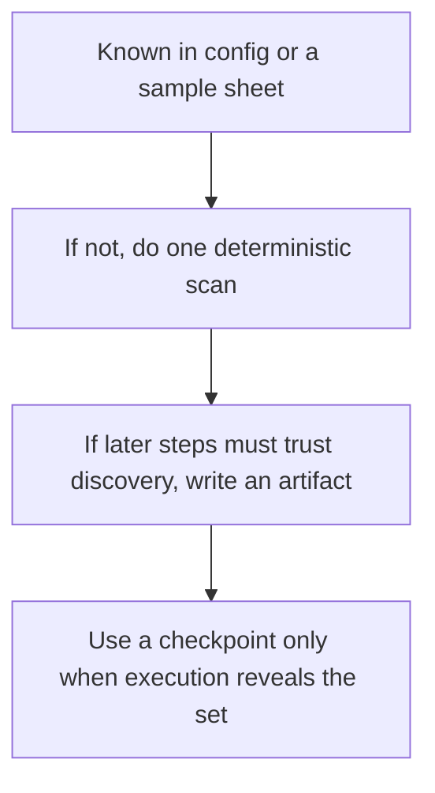
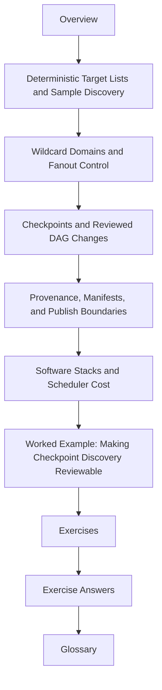

# Module 02: Dynamic DAGs, Discovery, and Integrity

Module 01 taught you how Snakemake plans work from explicit file contracts. Module 02
asks the harder question:

> what happens when the set of jobs is not fully known until the workflow starts looking at data?

This module is about making that situation reviewable instead of magical.

Dynamic behavior is not the enemy. Hidden discovery is.

## What this day must accomplish

By the end of Module 02, you should be able to do five things without mystical language:

- explain which exact surface decides what targets exist
- turn a changing sample set into a deterministic target list
- reject a checkpoint when static modeling is already enough
- justify a checkpoint only when runtime work reveals a real new fact
- preserve the discovered set as evidence that another person can inspect later

## The decision ladder for the whole module

Keep this order in front of you all day:



If you skip straight to checkpoints, you usually hide a modeling problem. If you follow
the ladder, dynamic behavior stays explainable.

## The running lab for the whole day

Use one lab story all day instead of several disconnected discovery tricks:

- raw FASTQ files appear in `data/raw/`
- a candidate registry gives each sample one stable identity
- a validation step decides which candidates are usable
- per-sample QC jobs fan out from the accepted set
- the publish boundary carries the accepted and rejected sets forward

That lab is small enough to run and redraw, but rich enough to teach discovery, fanout,
dynamic reevaluation, and downstream integrity.

## Plan for the day

| Session | What you do | Evidence you keep |
| --- | --- | --- |
| static baseline | replace an ambient directory scan with a sorted, validated candidate manifest | manifest diff and dry-run |
| domain design | model paired values without accidental Cartesian products | expected and actual target lists |
| runtime discovery | implement a checkpoint for a usable subset known only after validation | checkpoint registry |
| DAG review | compare the graph before and after checkpoint completion | two DAG renderings |
| integrity | carry discovery, provenance, and inventory into a publish boundary | reviewable bundle |
| independent practice | complete all ten exercises | implementation and design notes |

The important progression is **static first, dynamic only when earned**. If configuration
or a manifest already knows the targets, use it directly. A checkpoint is appropriate
only when execution reveals a fact that planning could not know.

## Study route



Read the module in that order the first time through.

The route matters:

- begin with deterministic discovery before you touch checkpoints
- treat wildcard fanout as a domain-modeling problem, not only a syntax problem
- treat provenance and publication as part of discovery honesty, not as an afterthought

## The ten files in this module

1. Overview (`index.md`)
2. [Deterministic Target Lists and Sample Discovery](deterministic-target-lists-and-sample-discovery.md)
3. [Wildcard Domains and Fanout Control](wildcard-domains-and-fanout-control.md)
4. [Checkpoints and Reviewed DAG Changes](checkpoints-and-reviewed-dag-changes.md)
5. [Provenance, Manifests, and Publish Boundaries](provenance-manifests-and-publish-boundaries.md)
6. [Software Stacks and Scheduler Cost](software-stacks-and-scheduler-cost.md)
7. [Worked Example: Making Checkpoint Discovery Reviewable](worked-example-making-checkpoint-discovery-reviewable.md)
8. [Exercises](exercises.md)
9. [Exercise Answers](exercise-answers.md)
10. [Glossary](glossary.md)

## How to use the file set

| If you need to... | Start here |
| --- | --- |
| stop discovery from drifting with directory noise or unordered scans | [Deterministic Target Lists and Sample Discovery](deterministic-target-lists-and-sample-discovery.md) |
| prevent wildcards and `expand()` from creating nonsense work | [Wildcard Domains and Fanout Control](wildcard-domains-and-fanout-control.md) |
| decide whether a checkpoint is the right tool or a design smell | [Checkpoints and Reviewed DAG Changes](checkpoints-and-reviewed-dag-changes.md) |
| make dynamic behavior visible to reviewers and downstream consumers | [Provenance, Manifests, and Publish Boundaries](provenance-manifests-and-publish-boundaries.md) |
| keep environments and job granularity from turning correctness into slowness | [Software Stacks and Scheduler Cost](software-stacks-and-scheduler-cost.md) |
| see the module as one repaired workflow rather than five isolated rules | [Worked Example: Making Checkpoint Discovery Reviewable](worked-example-making-checkpoint-discovery-reviewable.md) |
| test your own understanding | [Exercises](exercises.md) |
| compare your reasoning against a reference answer | [Exercise Answers](exercise-answers.md) |
| stabilize the module vocabulary | [Glossary](glossary.md) |

## The running question

Carry this question through every page:

> if discovery changes the DAG, what exact artifact lets another person review that change later?

Good Module 02 answers usually mention one or more of these:

- a concrete discovered-set file
- a validated target list
- a wildcard boundary that limits what can be claimed
- a checkpoint output that is durable enough to reread
- a publish or provenance artifact that preserves the run story

## What the module should change in your head

If the day is working, you should feel these transitions:

- a directory scan stops looking self-explanatory
- `expand()` stops feeling harmless when it loses pairings or grows a Cartesian product
- a checkpoint stops looking advanced and starts looking accountable
- a discovered-set file becomes part of the workflow contract, not side documentation
- dynamic DAGs stop being “magic Snakemake behavior” and become reviewable cause and effect

## Commands to keep close

These commands form the evidence loop for Module 02:

```bash
snakemake -n
snakemake --summary
snakemake --dag | dot -Tpdf > artifacts/dag.pdf
snakemake --lint
snakemake --list-changes params input code
```

They answer different questions:

- what would run
- which files Snakemake believes it owns
- how the current jobs relate
- which design smells are already visible
- which tracked changes justify reruns

## Exit standard

Do not move on until all of these are true:

- you can explain one discovery route without saying "Snakemake just figures it out"
- you can show where the discovered set is recorded and why that location matters
- you can describe one checkpoint that is justified and one that is really a smell
- you can say which artifacts are internal execution state and which are safe to publish
- you can explain one performance repair without weakening workflow truth
- you have completed all ten exercises and can defend each use or rejection of a checkpoint

When those become ordinary, Module 02 has done its job.
