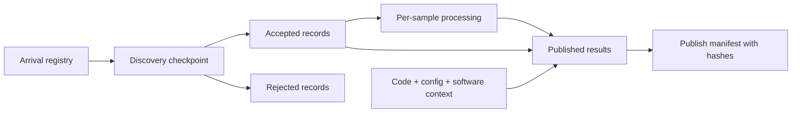
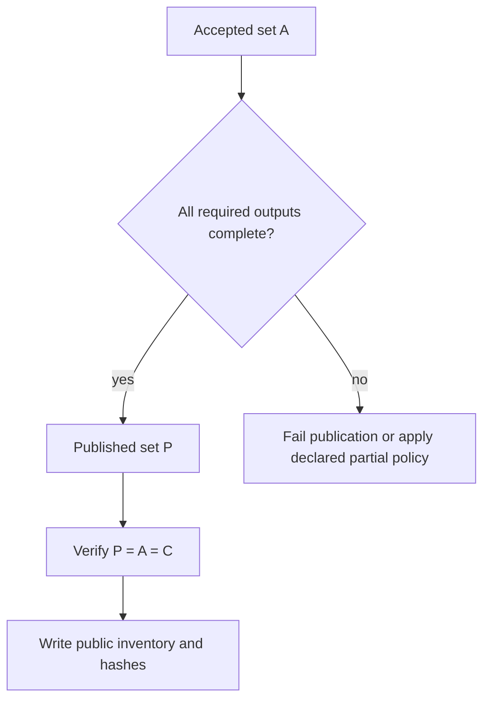

# Provenance, Manifests, and Publish Boundaries

Dynamic discovery changes which jobs exist. If the discovered set disappears after the
run, a reviewer can see results but cannot explain why those samples—and not others—were
processed.

This lesson assigns distinct roles to intake, discovery, provenance, and publication
artifacts. The goal is a compact public packet that preserves membership truth without
publishing every internal file.

## Four artifacts, four questions

| Artifact | Question answered |
| --- | --- |
| arrival registry | which raw paths were admitted for consideration? |
| discovery manifest | which candidates were accepted or rejected, and why? |
| provenance record | under which code, configuration, and software context did the run occur? |
| publish manifest | which files form the supported downstream contract? |

Combining these into one “manifest” creates an overloaded schema. Keeping them separate
lets each evolve under a clear owner.



## Internal state is not automatically public evidence

Snakemake metadata, temporary files, benchmarks, and logs are valuable during diagnosis.
They are not all stable downstream interfaces.

Classify every artifact:

| Role | Examples | Retention and compatibility |
| --- | --- | --- |
| workflow input | registry, raw FASTQ, reference | governed by intake or data ownership |
| internal state | intermediate BAM, temporary chunk list, `.snakemake/` | may change with implementation |
| review evidence | discovery manifest, rejection ledger, logs, benchmarks | retained to support stated claims |
| publish contract | summary, report, discovered samples, provenance, inventory | versioned and verified for consumers |

A file may serve more than one role, but the role must be named. “It is in `results/`”
does not define trust.

## Preserve the discovery decision

A useful discovery manifest might contain:

```json
{
  "schema_version": 2,
  "arrival_registry": "data/raw-arrivals.tsv",
  "arrival_registry_sha256": "…",
  "accepted": {
    "alpha": {
      "mode": "SE",
      "reads": {"SE": "data/raw/alpha.fastq.gz"}
    }
  },
  "rejected": [
    {
      "path": "beta_R1.fastq.gz",
      "reason": "missing R2 mate"
    }
  ]
}
```

The capstone’s current published discovery schema records accepted samples and fails
closed on invalid candidates. In a production intake system where rejection review is
required, add a governed rejection ledger rather than relying only on stderr.

The important boundary is that rejection is observable. Silently skipping bad candidates
makes the accepted set impossible to audit.

## Record the governing event, not only the result

Two runs can produce the same accepted samples from different intake evidence. Record the
arrival registry path and digest:

```python
registry_digest = hashlib.sha256(registry.read_bytes()).hexdigest()
```

A digest does not prove that the registry was correct. It binds the discovery artifact to
specific registry bytes so a reviewer can detect substitution.

Use digests for:

- registry and sample-sheet identity;
- immutable raw inputs when policy requires it;
- published-file inventories;
- model or reference bundles.

Do not use a digest as a replacement for schema validation or domain review.

## The publication equality to enforce

Let:

- `A` be accepted sample IDs from discovery;
- `C` be samples with complete required outputs;
- `P` be samples represented by the public summary.

For an ordinary successful full publication:

```text
P = A = C
```

If partial publication is allowed, encode the policy explicitly and preserve the excluded
set with reasons. Never let a reporting script quietly summarize whichever files happen
to exist.



The capstone verification checks that summary units match
`discovered_samples.json`. That turns membership alignment into an executable contract.

## Build publication from named inputs

A publish rule should list its inputs:

```python
rule publish_manifest:
    input:
        discovery="publish/v1/discovered_samples.json",
        summary="publish/v1/summary.json",
        table="publish/v1/summary.tsv",
        report="publish/v1/report/index.html",
        provenance="publish/v1/provenance.json",
    output:
        inventory="publish/v1/manifest.json"
    script:
        "workflow/scripts/write_publish_manifest.py"
```

The script should verify required files, calculate hashes, and write atomically. Globbing
the publish directory while writing its manifest risks including stale or unintended
files.

## A public inventory is a contract

Example:

```json
{
  "schema_version": 2,
  "files": [
    {"path": "discovered_samples.json", "sha256": "…"},
    {"path": "summary.json", "sha256": "…"},
    {"path": "summary.tsv", "sha256": "…"},
    {"path": "report/index.html", "sha256": "…"},
    {"path": "provenance.json", "sha256": "…"}
  ]
}
```

Canonical path order prevents incidental filesystem ordering from changing the manifest.
Relative paths keep the bundle movable. A schema version marks semantic compatibility,
not merely JSON syntax.

## Provenance should explain identity, not narrate everything

Useful provenance fields include:

- repository commit;
- Snakemake and Python versions;
- materialized workflow configuration;
- reference and environment identities;
- execution timestamp, clearly labeled as non-deterministic;
- discovery-registry identity;
- publish schema version.

Avoid dumping all environment variables. That can leak secrets, host-specific noise, and
irrelevant state. Record governed influences with deliberate names.

Separate reproducible identity from run occurrence:

| Field | Stable identity? | Why retain it |
| --- | --- | --- |
| git commit | yes for a source state | connects results to workflow code |
| config values | yes for a run definition | exposes semantic and policy choices |
| registry digest | yes for intake bytes | binds membership evidence |
| timestamp | no | locates the execution event |
| hostname | usually no | can aid operations but rarely defines analytical meaning |

## Review the capstone packet

Run:

```bash
cd programs/reproducible-research/deep-dive-snakemake/capstone
make verify-report
```

Read in this order:

1. `route.txt`;
2. `verify.json`;
3. `discovered_samples.json`;
4. `summary.json`;
5. `provenance.json`;
6. `manifest.json`;
7. `bundle-manifest.json`.

Ask:

- Do discovery and summary contain the same sample IDs?
- Does provenance identify the governing configuration?
- Does the manifest list the exact supported public paths?
- Do hashes match the copied bundle?
- Can a reviewer distinguish publish files from supporting guide files?

The route matters. Opening the HTML report first encourages visual plausibility before
membership verification.

## Accepted and rejected evidence

Rejection evidence needs care because it may contain sensitive filenames, validation
details, or upstream identifiers. Choose among:

| Policy | Public surface | Internal surface |
| --- | --- | --- |
| full transparent intake | accepted and rejected records | raw logs |
| privacy-constrained intake | accepted records and rejection counts/categories | protected detailed ledger |
| fail-closed batch | no publication on rejection | complete rejection report |
| declared partial publication | accepted public records plus excluded IDs/reasons allowed by policy | detailed validation evidence |

The policy must be chosen, not inferred from what a script happened to emit.

## Failure patterns

### Publish whichever files exist

This can omit failed accepted samples and retain stale removed samples. Build publication
from accepted membership and named required outputs.

### Copy discovery without its governing identity

The sample list is visible, but the intake event cannot be tied to it. Preserve registry
path and digest.

### Treat logs as the rejection contract

Logs are optimized for diagnosis, can change format, and may be incomplete. Use a
structured rejection artifact when rejection review is a supported claim.

### Hash after publishing in place

Consumers may observe a mixture of old and new files. Assemble a candidate bundle,
verify it, then promote atomically or under a versioned immutable path.

### Publish every internal file for “transparency”

This makes unstable implementation details look supported. Publish the smallest set that
proves the downstream contract; retain richer evidence separately.

## A publish-boundary exercise

Given:

```text
accepted: alpha, beta
complete outputs: alpha
existing old output: gamma
```

A directory glob finds `alpha` and `gamma`. It is wrong to publish either that pair or
only `alpha` without a declared partial policy.

Your review should conclude:

- `beta` is accepted but incomplete;
- `gamma` is stale and outside the accepted set;
- full publication must fail;
- partial publication needs an explicit policy and exclusion evidence;
- cleanup of `gamma` is necessary but does not solve `beta`.

This reasoning is more important than the specific reporting command.

## Review checklist

- [ ] Arrival, discovery, provenance, and publish artifacts have distinct roles.
- [ ] The discovery artifact identifies its governing registry bytes.
- [ ] Accepted and rejected decisions are observable under the chosen policy.
- [ ] Public samples are compared with accepted and complete samples.
- [ ] Publish inputs are named rather than discovered from ambient output state.
- [ ] Public paths are relative, canonical, and hashed.
- [ ] Schema versions reflect semantic compatibility.
- [ ] Provenance records governed influences without dumping secrets.
- [ ] Candidate publication is verified before promotion.
- [ ] Internal implementation files are not accidentally promised as public API.

## What you should carry forward

Dynamic integrity survives publication when another person can connect a public result to
its accepted membership, governing arrival evidence, run identity, and exact file
inventory. The next lesson keeps that truth intact while diagnosing software setup and
scheduler overhead.
