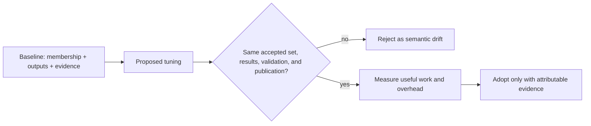
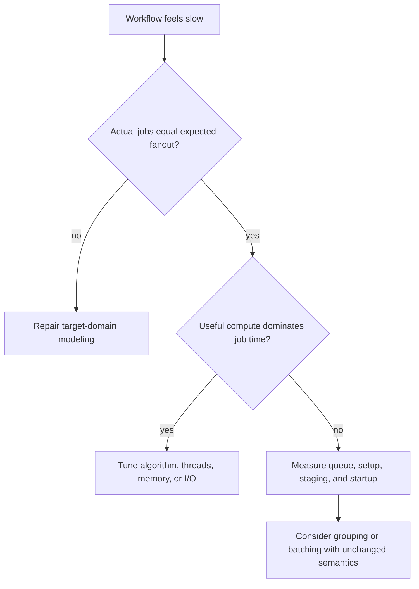

# Software Stacks and Scheduler Cost

A dynamic workflow can be logically correct and operationally unusable. Hundreds of tiny
jobs may spend more time in environment setup and scheduler transitions than in useful
work. The dangerous response is to remove validation, collapse evidence, or bypass the
discovery boundary until the run becomes fast.

This lesson shows how to diagnose overhead while preserving membership, software, and
publication truth.

## Keep semantics fixed during a performance comparison

Before tuning, name the invariants:

- the same arrival registry;
- the same accepted and rejected sets;
- the same per-sample transformation;
- the same validation policy;
- the same required public artifacts;
- the same software identities or an explicitly tested replacement.

If a proposed optimization changes one of these, it is not a performance comparison. It
is a semantic experiment.



## Where dynamic workflows pay overhead

For each job, wall time can be approximated as:

```text
job wall time =
    queue delay
  + environment preparation
  + input staging
  + process startup
  + useful computation
  + validation and publication
```

This is not a universal performance formula; it is a diagnostic decomposition. Measure
the terms available in your environment.

When useful computation takes 0.2 seconds and startup takes 4 seconds, doubling CPU does
not solve the dominant cost.

## Environment identity belongs to workflow meaning

A rule’s software affects its result:

```python
rule classify:
    input:
        "results/{sample}/clean.fastq.gz"
    output:
        "results/{sample}/classification.json"
    conda:
        "workflow/envs/classify.yaml"
    shell:
        "classify-tool --input {input} --output {output}"
```

The environment file is a declared software source. Pin versions closely enough for the
claim being made, retain lock or container identities where policy requires them, and
record the executed environment in provenance.

An environment per rule is not necessarily an environment per job. Snakemake can reuse
an identical environment definition across many jobs. Unnecessary near-duplicate YAML
files fragment caches and obscure which rules actually share a stack.

## Group by software responsibility

Use separate environments when tools have distinct or conflicting dependencies. Reuse an
environment when rules genuinely share one software responsibility.

| Situation | Environment choice |
| --- | --- |
| discovery parser uses Python standard library | small workflow Python environment |
| QC and trimming use the same pinned package set | one shared preprocessing environment |
| reporting needs a large plotting stack | separate report environment |
| two tools require conflicting library versions | separate environments |
| files differ only by copied comments or ordering | consolidate to one canonical definition |

Do not merge environments solely to reduce a count. The software boundary must remain
legible.

## Count jobs from the accepted domain

Let:

- `S` = accepted samples;
- `R` = per-sample rule count;
- `G` = fixed global jobs;
- `C` = checkpoint and discovery jobs.

A simple expected job count is:

```text
J = S × R + G + C
```

If paired records or nested panels vary, calculate from records rather than this shortcut.
The purpose is to detect a domain explosion before blaming the scheduler.

Example:

- 100 accepted samples;
- four per-sample rules;
- three global jobs;
- one discovery checkpoint.

Expected jobs: `100 × 4 + 3 + 1 = 404`.

If the dry-run shows 804 jobs, investigate fanout. Performance tuning an accidental
Cartesian product preserves the wrong DAG faster.



## Measure before grouping

Collect:

- dry-run job counts by rule;
- benchmark rows for representative jobs;
- scheduler queue and execution timestamps;
- environment creation or cache-hit evidence;
- file counts and sizes;
- accepted sample count;
- output and manifest comparisons across configurations.

A benchmark only inside the job process may omit queue delay and environment setup.
Combine Snakemake benchmarks with scheduler or wrapper receipts when diagnosing
orchestration cost.

## Grouping and batching are different

**Grouping** asks the executor to submit related jobs together while retaining their rule
contracts in the DAG.

**Batching** changes a rule so one job processes multiple domain records.

Grouping can reduce scheduler transitions. Batching can reduce process startup but changes
failure isolation, resource shape, and output-publication logic.

| Choice | Benefit | Review risk |
| --- | --- | --- |
| executor grouping | fewer submissions | group resource aggregation must be correct |
| batch several samples per job | fewer processes | one failure can affect several samples |
| fuse adjacent transformations | less intermediate I/O | removes inspectable boundaries |
| long-lived service | amortized startup | software and state isolation become harder |

Choose the smallest change that addresses the measured cost.

## Preserve checkpoint and manifest boundaries

Discovery is usually a poor place to hide performance shortcuts. Avoid:

- scanning the ambient directory once and reusing it forever;
- skipping validation for “known good” deliveries;
- reading only the first matching file to reduce work;
- omitting rejection evidence;
- having downstream rules rescan instead of reading the manifest.

The discovery job is normally small relative to per-sample processing. Its value is
causal clarity.

Safe optimizations might include:

- parsing the registry once inside the checkpoint;
- hashing the registry once and recording the digest;
- using stable streaming validation for large registries;
- caching immutable reference metadata by declared identity;
- keeping the discovery environment small and reusable.

## A truth-preserving batching example

Baseline:

```text
accepted samples: alpha, beta, gamma, delta
one 0.4-second validation-report job per sample
startup per job: about 3 seconds
```

Proposal: one job writes all four validation reports.

Before accepting, require:

- the same four per-sample report paths;
- identical report content;
- atomic publication so a batch failure does not leave plausible partial finals;
- explicit per-sample failure attribution;
- unchanged accepted membership;
- evidence that startup, not computation, dominated baseline time.

If the batch writes one combined report instead, that may be a valid design, but it
changes the file contract and downstream API. Review it as a semantic change.

## Scheduler resources follow the work

Resource declarations should describe job needs:

```python
rule qc:
    input:
        "data/raw/{sample}.fastq.gz"
    output:
        "results/{sample}/qc.json"
    threads: 2
    resources:
        mem_mb=2048,
        runtime=10
```

Profiles translate those declarations into executor policy. Do not let a profile change
the sample set, discovery registry, validation threshold, or publish destination simply
to make a cluster run fit.

If grouped jobs aggregate resources, verify the executor’s grouping semantics rather than
assuming memory and runtime add in the way you expect.

## Compare evidence, not impressions

Use a table:

| Field | Baseline | Candidate | Must remain equal? |
| --- | --- | --- | --- |
| registry digest | `…` | `…` | yes |
| accepted IDs | `alpha,beta` | `alpha,beta` | yes |
| rejected records | none | none | yes |
| summary hash | `…` | `…` | yes unless formatting is the stated change |
| job count | 12 | 7 | no |
| scheduler submissions | 12 | 4 | no |
| median useful compute | 0.5 s | 0.5 s | diagnostic |
| wall time | 48 s | 21 s | expected to improve |

If the candidate is faster because it processed fewer accepted samples, the comparison
fails before timing is considered.

## Use the capstone diagnostics

The capstone separates two questions:

```bash
make performance-diagnostics-audit
make scheduler-policy-audit
```

The performance audit compares honest tuning with validation loss and repeated work. The
scheduler audit checks resource translation without contacting a real scheduler. For
Module 02, read those results through the discovery invariants:

- Did candidate membership remain fixed?
- Did validation remain enabled?
- Did the output and evidence sets remain equivalent?
- Was the measured cost actually scheduler or setup overhead?

Do not run the broad proof route when one focused audit answers the question.

## Failure patterns

### More cores make the run slower

Possible cause: more concurrent tiny jobs increase setup, filesystem, or scheduler
contention. Inspect per-rule timing and submission counts.

### Reused environments still rebuild

Possible cause: environment definitions differ, caches live on ephemeral storage, or
the executor cannot see the same cache. Compare actual environment identities and paths.

### Batching is faster but harder to trust

Possible cause: partial failure and per-sample evidence were lost. Compare file contracts
and failure receipts before accepting wall-time improvement.

### Cluster profile “fixes” workload size

Possible cause: semantic configuration leaked into executor policy. Restore the same
registry and accepted set across profiles.

### Checkpoint appears expensive

Possible cause: the real cost is downstream fanout or repeated invalidation. Separate
checkpoint runtime from the jobs it reveals.

## Review checklist

- [ ] The accepted and rejected sets are fixed across the comparison.
- [ ] Expected fanout is calculated before scheduler diagnosis.
- [ ] Useful computation is separated from queue, setup, staging, and startup.
- [ ] Environment reuse follows software responsibility.
- [ ] Software identities remain declared and reviewable.
- [ ] Grouping and batching are not treated as synonyms.
- [ ] Batched publication remains atomic and attributable.
- [ ] Profiles change operating policy, not workflow meaning.
- [ ] Discovery validation and evidence remain intact.
- [ ] The claimed improvement is supported by comparable receipts.

## What you should carry forward

Operational efficiency is trustworthy when it removes attributable overhead while
preserving membership, validation, outputs, and evidence. The worked example now combines
that discipline with governed discovery, checkpoint reevaluation, fanout, and publication
in one repair sequence.
