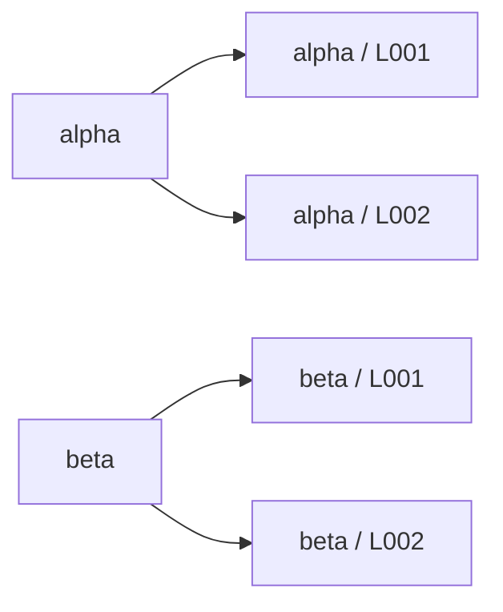
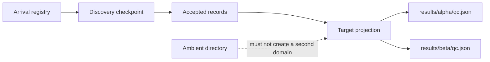

# Wildcard Domains and Fanout Control

Discovery gives you records. Fanout turns those records into jobs. The transformation is
safe only when the target pattern preserves the relationships already present in the
records.

This lesson treats wildcards as a domain model. You will calculate target sets before
calling `expand()`, distinguish products from pairings, and keep checkpoint output from
creating nonsense combinations.

## A wildcard names a valid substitution domain

In this output:

```python
"results/{sample}/qc.json"
```

`sample` is not merely a convenient string slot. It claims that each substituted value
is a valid sample identity and that the resulting path has one stable meaning.

If accepted discovery contains `alpha` and `beta`, the domain is:

```text
sample ∈ {alpha, beta}
```

The expected target set is:

```text
results/alpha/qc.json
results/beta/qc.json
```

Write that set down before writing `expand()`. It is your smallest fanout oracle.

## Products, pairings, and records

Consider two lists:

```python
SAMPLES = ["alpha", "beta"]
LANES = ["L001", "L002"]
```

This expression creates a Cartesian product:

```python
expand(
    "results/{sample}/{lane}.txt",
    sample=SAMPLES,
    lane=LANES,
)
```

It produces four targets. That is correct only if every sample has every lane.



If discovery instead returned the observed pairs `(alpha, L001)` and `(beta, L002)`,
the product invents two relationships.

Use paired expansion:

```python
expand(
    "results/{sample}/{lane}.txt",
    zip,
    sample=["alpha", "beta"],
    lane=["L001", "L002"],
)
```

Better still, retain records until the final path projection:

```python
accepted = [
    {"sample": "alpha", "lane": "L001"},
    {"sample": "beta", "lane": "L002"},
]

targets = [
    f"results/{record['sample']}/{record['lane']}.txt"
    for record in accepted
]
```

Records make it harder to lose relationships while passing lists between helpers.

## Count before you execute

For independent review, calculate cardinality:

- product: `|samples| × |lanes|`;
- paired rows: number of accepted records;
- nested repeat structure: sum of repeats per sample;
- filtered product: count only combinations satisfying the predicate.

Suppose discovery reports:

```text
alpha  L001
alpha  L002
beta   L001
```

The record count is three. A two-by-two product is four. The extra target
`beta/L002` is evidence of a modeling error, not harmless empty work.

## Preserve identity across the checkpoint boundary

A checkpoint manifest should carry enough structure to reconstruct valid targets without
guessing:

```json
{
  "samples": {
    "alpha": {
      "mode": "SE",
      "reads": {"SE": "data/raw/alpha.fastq.gz"}
    },
    "beta": {
      "mode": "SE",
      "reads": {"SE": "data/raw/beta.fastq.gz"}
    }
  }
}
```

The downstream input function reads the completed checkpoint output:

```python
def accepted_qc_targets(_wildcards):
    manifest = checkpoints.discover_samples.get().output.json
    with open(manifest, encoding="utf-8") as handle:
        payload = json.load(handle)
    samples = sorted(payload["samples"])
    return expand("results/{sample}/qc.json", sample=samples)
```

Three details matter:

- `checkpoints.discover_samples.get()` creates the reevaluation relationship;
- target membership comes from the checkpoint artifact, not a second directory scan;
- sorting stabilizes the target list after the accepted domain is known.



If downstream code scans the directory again, the workflow has two discovery authorities.
They can disagree.

## One wildcard should carry one idea

This pattern looks compact:

```python
"results/{unit}.txt"
```

where `unit` is sometimes `alpha`, sometimes `alpha_L001`, and sometimes
`alpha_L001_R1`. It forces downstream code to reverse-engineer structure from one string.

Prefer explicit fields:

```python
"results/{sample}/{lane}/{mate}.txt"
```

when sample, lane, and mate vary independently and are all part of file identity.

However, explicit wildcards do not authorize a Cartesian product. The accepted records
still define which triples exist.

## Pairing is a validation problem

Paired-end reads illustrate why filename expansion cannot replace domain validation:

```text
alpha_R1.fastq.gz
alpha_R2.fastq.gz
beta_R1.fastq.gz
```

The valid pair set contains `alpha`. `beta` is incomplete. A robust discovery job should
reject or quarantine `beta`; it should not emit an R2 target and wait for Snakemake to
fail later.

| Observed files | Discovery decision | Downstream fanout |
| --- | --- | --- |
| `alpha_R1`, `alpha_R2` | accept paired sample | jobs may use both mates |
| `beta_R1` only | reject incomplete sample | no beta processing jobs |
| `gamma.fastq`, `gamma_R1` | reject mixed identity | no gamma processing jobs |
| duplicate `delta_R1` identities | reject collision | no arbitrary first-file choice |

The discovered-set artifact should preserve accepted and rejected decisions separately.

## Constraints narrow syntax, not truth

Wildcard constraints can prevent paths from matching malformed values:

```python
wildcard_constraints:
    sample="[A-Za-z0-9][A-Za-z0-9._-]*"
```

This is useful, but it does not prove that a syntactically valid sample was registered or
accepted. A constraint answers “could this string be a sample ID?” The manifest answers
“is this sample in this run?”

Keep those questions separate.

## Avoid domain reconstruction from outputs

A tempting shortcut is:

```python
SAMPLES, = glob_wildcards("results/{sample}/qc.json")
```

This reconstructs intended work from whatever outputs happen to exist. Missing outputs
remove samples from the domain, and stale outputs can add samples that are no longer
accepted.

The direction of authority should remain:

```text
governed arrival -> accepted manifest -> requested outputs
```

Never:

```text
currently existing outputs -> inferred accepted membership
```

## A worked fanout calculation

Discovery produces:

```json
{
  "accepted": [
    {"sample": "alpha", "panels": ["host", "vector"]},
    {"sample": "beta", "panels": ["host"]}
  ]
}
```

Required targets:

```text
results/alpha/host.json
results/alpha/vector.json
results/beta/host.json
```

This is a sum of per-record panel counts: `2 + 1 = 3`.

The following is wrong:

```python
expand(
    "results/{sample}/{panel}.json",
    sample=["alpha", "beta"],
    panel=["host", "vector"],
)
```

It creates `results/beta/vector.json`, which discovery never authorized.

A faithful projection is:

```python
def panel_targets(records):
    return [
        f"results/{record['sample']}/{panel}.json"
        for record in records
        for panel in record["panels"]
    ]
```

## Diagnose fanout from evidence

Use three views together:

1. the accepted records;
2. the literal expected target list;
3. the dry-run or DAG.

If the dry-run has too many jobs, compare target sets before tuning resources. Scheduler
pressure may be a domain explosion disguised as a performance problem.

| Symptom | Likely cause | First check |
| --- | --- | --- |
| job count equals product of unrelated list lengths | accidental Cartesian expansion | calculate expected cardinality |
| jobs appear for rejected samples | fanout reads the wrong authority | trace target source to checkpoint manifest |
| a valid pair creates one fused wildcard | overloaded identity string | separate record fields |
| stale samples remain planned | targets inferred from old outputs | remove output-based discovery |
| constraints pass but membership is wrong | syntax treated as admission | compare against accepted set |

## Hands-on prediction

Use this accepted set:

```python
records = [
    {"sample": "alpha", "lane": "L001", "mates": ["R1", "R2"]},
    {"sample": "beta", "lane": "L002", "mates": ["R1", "R2"]},
]
```

Before coding, write the four expected raw-QC targets. Then evaluate:

```python
expand(
    "qc/{sample}/{lane}/{mate}.json",
    sample=["alpha", "beta"],
    lane=["L001", "L002"],
    mate=["R1", "R2"],
)
```

It creates eight targets, twice the valid count. Repair it by projecting each record’s
mates while retaining the sample-lane relationship. Confirm the dry-run contains exactly
four QC jobs.

## Review checklist

- [ ] Every wildcard has one domain meaning.
- [ ] I can state the accepted records that authorize each target.
- [ ] I calculated the expected target count before expanding.
- [ ] Products are used only when every combination is valid.
- [ ] Pairings and nested relationships remain attached to records.
- [ ] Rejected or incomplete records produce no downstream jobs.
- [ ] Downstream fanout reads the checkpoint artifact, not the ambient directory.
- [ ] Wildcard constraints are not being mistaken for membership validation.
- [ ] Existing outputs are not used to reconstruct intended scope.

## What you should carry forward

Dynamic fanout is controlled when the target set is a transparent projection of accepted
records. The next lesson examines the checkpoint itself: when reevaluation occurs, what
Snakemake knows before and after execution, and which evidence proves that the DAG changed
for a declared reason.
