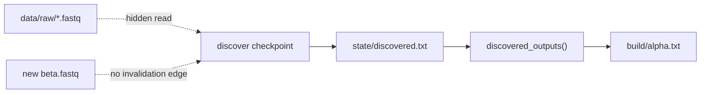
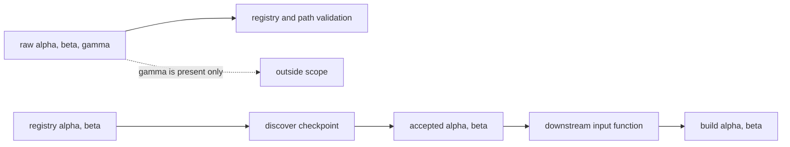

# Worked Example: Making Checkpoint Discovery Reviewable

This example begins with a checkpoint that appears to work. It finds `alpha`, creates an
output, and reruns when forced. The defect appears only when a later arrival should change
the DAG under ordinary scheduling.

You will repair the workflow by introducing a governed arrival event, validating
membership, projecting accepted records, and carrying discovery truth into publication.
Every repair has a prediction and a receipt.

## The scenario

A sequencing intake directory initially contains:

```text
data/raw/
└── alpha.fastq
```

After the baseline completes, two more files arrive:

```text
data/raw/
├── alpha.fastq
├── beta.fastq
└── gamma.fastq
```

`beta` is approved for processing. `gamma` is present but not yet admitted. The required
public result should therefore contain `alpha` and `beta`, not `gamma`.

## The evidence ledger

Create this ledger before changing code:

| Claim | Changed event | Prediction | Receipt | Interpretation |
| --- | --- | --- | --- | --- |
| baseline discovers alpha | clean execution | alpha output exists | baseline run | pending |
| approved beta changes plan | arrival admission | discovery and beta are scheduled | change dry-run | pending |
| gamma stays out of scope | only beta admitted | no gamma job | change run | pending |
| publication matches acceptance | accepted set is alpha,beta | public units are alpha,beta | publish verification | pending |

Do not fill “interpretation” with “passed.” Explain the dependency or equality the receipt
demonstrates.

## The weak workflow

The checkpoint scans an ambient directory:

```python
from pathlib import Path


checkpoint discover:
    output:
        manifest="state/discovered.txt"
    run:
        raw_dir = Path("data/raw")
        samples = sorted(path.stem for path in raw_dir.glob("*.fastq"))
        Path(output.manifest).parent.mkdir(parents=True, exist_ok=True)
        Path(output.manifest).write_text(
            "\n".join(samples) + "\n",
            encoding="utf-8",
        )
```

The downstream function is structurally correct:

```python
def discovered_outputs(_wildcards):
    manifest = checkpoints.discover.get().output.manifest
    samples = Path(manifest).read_text(encoding="utf-8").splitlines()
    return expand("build/{sample}.txt", sample=samples)
```

It waits for the checkpoint and derives targets from its output. Yet the checkpoint has
no declared input. Its Python code reads `data/raw`, but Snakemake cannot see that
relationship.



## Establish the baseline

With only `alpha.fastq`, run:

```bash
snakemake --cores 1 -p
```

Expected:

```text
state/discovered.txt
build/alpha.txt
```

This successful baseline proves only that the checkpoint and projection can execute. It
does not test whether future membership changes invalidate discovery.

## Expose the hidden dependency

Add `beta.fastq` and `gamma.fastq`, then predict the dry-run.

A common prediction is: “The checkpoint scans the directory, so it will see both.” That
describes what happens *if the checkpoint runs*. The dry-run first asks whether it needs
to run.

```bash
snakemake --cores 1 -n -p
```

Observed:

```text
Nothing to be done (all requested files are present and up to date).
```

Normal execution also leaves only `build/alpha.txt`.

Now force the checkpoint:

```bash
snakemake --cores 1 --forcerun discover
```

The realized outputs become:

```text
build/alpha.txt
build/beta.txt
build/gamma.txt
```

This comparison isolates the defect:

| Receipt | What it proves |
| --- | --- |
| normal dry-run is empty | no declared influence made discovery stale |
| normal execution stays at alpha | ordinary workflow use misses new membership |
| forced run finds all three | scanning code has capability but no valid admission or invalidation contract |

## Define the admission event

Add:

```text
data/arrivals.tsv
```

Initial contents:

```text
alpha
```

After `beta` is approved:

```text
alpha
beta
```

`gamma` remains on disk but absent from the registry. This turns “which files should enter
scope?” into a governed decision.

The repaired checkpoint declares the registry:

```python
checkpoint discover:
    input:
        registry="data/arrivals.tsv"
    output:
        manifest="state/discovered.txt"
    run:
        lines = Path(input.registry).read_text(encoding="utf-8").splitlines()
        samples = sorted(line.strip() for line in lines if line.strip())
        Path(output.manifest).parent.mkdir(parents=True, exist_ok=True)
        Path(output.manifest).write_text(
            "\n".join(samples) + "\n",
            encoding="utf-8",
        )
```



## Predict the repaired change

After the baseline, add the two raw files and change the registry from `alpha` to
`alpha,beta`.

Prediction:

- the registry timestamp and content change;
- the checkpoint becomes stale;
- the dry-run schedules discovery;
- after checkpoint completion, the input function is reevaluated;
- `build/beta.txt` enters the DAG;
- `build/gamma.txt` remains absent.

Run:

```bash
snakemake --cores 1 -n -p
snakemake --cores 1 -p
```

The expected normal output set is:

```text
build/alpha.txt
build/beta.txt
```

The causal chain is now visible:

```text
registry change
    -> checkpoint invalidation
    -> accepted manifest change
    -> downstream reevaluation
    -> beta job
```

## Replace the toy registry with the capstone contract

The capstone registry has a header and relative paths:

```text
path
sampleA.fastq.gz
sampleB.fastq.gz
```

Its discovery program validates:

- exact schema;
- non-empty and unique entries;
- paths contained inside the raw directory;
- governed filename pattern;
- file existence;
- sample and mate identity;
- pairing completeness.

It writes:

```json
{
  "schema_version": 2,
  "arrival_registry": "data/raw-arrivals.tsv",
  "arrival_registry_sha256": "…",
  "n_files": 2,
  "samples": {
    "sampleA": {
      "mode": "SE",
      "reads": {"SE": "data/raw/sampleA.fastq.gz"}
    },
    "sampleB": {
      "mode": "SE",
      "reads": {"SE": "data/raw/sampleB.fastq.gz"}
    }
  }
}
```

The digest binds the accepted-set artifact to exact registry bytes. It does not certify
that the intake decision was correct; it makes substitution detectable.

## Keep fanout faithful

The capstone helper reads only the checkpoint output:

```python
@lru_cache(maxsize=1)
def discovery_payload():
    path = checkpoints.discover_samples.get().output.json
    with open(path, encoding="utf-8") as handle:
        return json.load(handle)


def get_samples():
    data = discovery_payload()
    return [
        sample
        for sample, info in data["samples"].items()
        if info["mode"] == "SE"
    ]
```

It does not glob `data/raw` again. The manifest remains the single authority for
downstream membership.

For richer records, project valid combinations directly. Do not split samples, lanes, and
mates into independent lists and accidentally construct a Cartesian product.

## Carry discovery into publication

The capstone publishes:

```text
publish/v1/
├── discovered_samples.json
├── manifest.json
├── provenance.json
├── report/
│   └── index.html
├── summary.json
└── summary.tsv
```

Verification checks:

- the discovery schema version;
- a non-empty accepted sample set;
- summary units equal discovery units;
- the publish manifest lists the exact supported paths;
- published files are parseable and hashed.

For the scenario:

```text
accepted A = {alpha, beta}
complete C = {alpha, beta}
published P = {alpha, beta}
```

The required equality `P = A = C` holds. `gamma` is not omitted accidentally; it never
entered registered or accepted scope.

## Run the packaged comparison

The capstone contains both tiny workflows and an audit runner:

```bash
cd programs/reproducible-research/deep-dive-snakemake/capstone
make discovery-integrity-audit
```

Read:

```text
artifacts/audit/reproducible-research/deep-dive-snakemake/discovery-integrity/
├── route.txt
├── summary.tsv
├── report.json
├── traces/
├── specimens/
└── workspace/
```

The exact repository-relative prefix may depend on where you invoke `make`; the target
prints the resolved path. Begin with `route.txt`.

Expected `summary.tsv`:

```text
model              planned_after_arrival  normal_samples  forced_samples
governed-registry  true                   alpha,beta      alpha,beta
ambient-scan       false                  alpha           alpha,beta,gamma
```

Both rows report PASS because one preserves the accepted contract and the other honestly
reproduces the named failure. Always read `finding` with `result`.

## Prove that the audit can fail

Run:

```bash
make discovery-integrity-selftest
```

The self-test:

- confirms the paired experiment;
- removes the governed checkpoint’s registry input;
- damages the ambient scanner so forcing it cannot reveal new arrivals.

The audit must reject both mutations. A report that stays green when its causal edge is
removed is documentation, not a discriminating test.

## Repair the evidence ledger

The completed ledger should resemble:

| Claim | Changed event | Observation | Interpretation |
| --- | --- | --- | --- |
| baseline discovers alpha | clean execution | `baseline_samples=["alpha"]` | both models can execute initial discovery |
| approved beta changes plan | registry changes | governed dry-run includes checkpoint | declared registry input invalidates discovery |
| gamma stays out of scope | gamma unregistered | governed normal and forced samples omit gamma | registry defines membership, not directory proximity |
| ambient model is stale | only files appear | normal plan empty; forced set adds beta,gamma | hidden scan has capability without invalidation |
| audit is discriminating | contract mutations | self-test returns expected rejections | findings depend on causal source properties |

This is reviewable because each interpretation names the dependency being tested.

## Consider performance only after truth

Suppose the repaired workflow creates thousands of short jobs. Before grouping:

1. calculate expected jobs from accepted records;
2. confirm no accidental Cartesian product;
3. measure queue, environment, and useful compute time;
4. preserve the same accepted set and validation;
5. compare outputs and publish manifests;
6. document any change to failure isolation.

Do not remove the registry, skip discovery validation, or make downstream jobs rescan the
directory to reduce overhead. Those changes make the workflow answer a different
membership question.

## Independent reproduction

Without reading the audit runner, reproduce the experiment in a separate artifact
workspace:

1. copy the two specimen directories;
2. execute both baselines;
3. add `beta` and `gamma`;
4. register only `beta` in the governed model;
5. save normal dry-runs;
6. execute normally and list outputs;
7. force each checkpoint and list outputs again;
8. explain every difference from declared edges.

Success is not matching the expected table from memory. Success is predicting the table
from the two Snakefiles.

## Review questions

Answer without vague references to Snakemake “figuring it out”:

1. What precise event invalidates the governed checkpoint?
2. Why does the ambient checkpoint stay current after files arrive?
3. What special checkpoint behavior occurs only after execution?
4. Why is forced execution diagnostic rather than corrective?
5. Why does `gamma` remain outside governed scope?
6. Where is the accepted sample set preserved?
7. How does downstream fanout avoid a second discovery authority?
8. Which equality protects publication completeness?
9. What mutation proves the audit is discriminating?
10. Which performance changes could retain all membership invariants?

## Completion standard

You have completed the example when you can show:

- paired normal dry-runs;
- normal and forced sample sets;
- the registry-to-checkpoint dependency edge;
- the accepted manifest and its registry identity;
- the literal downstream target set;
- publish membership equality;
- a causal self-test rejection;
- one truth-preserving performance hypothesis.

A final `beta` output alone is insufficient. The point is to explain why it entered the
DAG and why `gamma` did not.
