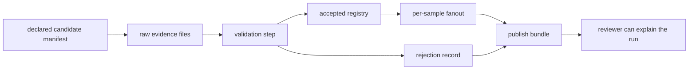

# Worked Example: Making Checkpoint Discovery Reviewable

This file pulls the whole module together around one realistic question:

> how do you let a workflow discover samples from `data/raw/` without turning the DAG into a moving target?

The example stays small on purpose. The point is to make the design visible and to show
why a checkpoint is usually the fourth move, not the first.

## How to use this worked example

Treat this page as a lab bench, not as a story you only read once.

For each repair step:

1. name the discovery fact you are trying to make visible
2. predict which file or boundary should preserve that fact
3. run the smallest command that proves the workflow now behaves that way

If you skip the artifact question, the example becomes a checkpoint demo instead of a
lesson about reviewable workflow truth.

## If you are learning this without the live class

Use the example in four passes instead of trying to absorb everything at once:

1. read only the weak draft and name what it hides
2. stop after the declared candidate set repair and run `snakemake -n`
3. add the checkpoint only after you can explain why static planning is no longer enough
4. finish by checking whether the publish boundary preserves the discovered set

If you cannot explain the workflow after pass 2, do not move to pass 3. The checkpoint
is a later repair, not the foundation of the lesson.

## The one-day teaching goal

By the end of this example, a learner should be able to rebuild a tiny dynamic workflow
and explain:

- why ambient directory scans are weak sources of truth
- why a declared candidate set usually comes before a checkpoint
- why a checkpoint must publish one durable registry
- why discovery must remain legible at the publish boundary

That is the educational point. The checkpoint keyword is not the point.

## The lab route

Work through the example in this order:

1. inspect the weak draft and name the hidden discovery assumptions
2. repair the workflow with a declared candidate set first
3. narrow the output family before you add more dynamism
4. introduce a checkpoint only when runtime validation really changes the usable set
5. carry the accepted set into the publish boundary

## What to keep beside you while you work

Keep these four surfaces visible while you move through the example:

- the current `Snakefile`
- the discovered or accepted registry on disk
- `snakemake -n`
- the eventual publish tree

Those four views are enough to explain whether the design is honest.

## The evidence packet you should build as you go

By the end of the example, keep one small packet that contains:

- the candidate source of truth such as `config/samples.tsv`
- one dry-run capture showing the current target set
- the accepted-sample registry written by the checkpoint
- one note naming why the checkpoint is justified here
- one publish tree snapshot showing which discovery artifacts cross the public boundary

If one of those pieces is missing, the design may still run, but it is not yet a strong
self-study answer.

## The scenario

Assume a workflow that should:

1. inspect `data/raw/` for FASTQ files
2. discover which samples exist
3. run one QC job per sample
4. publish a reviewed boundary that keeps the discovered set visible

That sounds ordinary. It still creates most of the mistakes people make with dynamic
Snakemake workflows.

Use one tiny lab tree so every repair is visible in the same place:

```text
module02-lab/
├── Snakefile
├── config/
│   └── samples.tsv
├── data/
│   └── raw/
├── results/
│   ├── discovery/
│   └── samples/
├── publish/
└── artifacts/
```

The point of the tree is not aesthetics. Each directory owns one kind of truth:

- `config/` declares candidate intent
- `data/raw/` holds the evidence files the intent points to
- `results/discovery/` records what runtime validation learned
- `results/samples/` holds per-sample work products
- `publish/` exposes only the public review contract

## The repair loop for the whole example

Keep this table beside the code while you work:

| Repair step | Hidden question | Owned artifact | Small proof command |
| --- | --- | --- | --- |
| weak draft | who decided the sample set | none | `snakemake -n` |
| declared candidates | which candidates are even in scope | `config/samples.tsv` | `snakemake -n` |
| narrow output family | where one sample's artifacts belong | `results/samples/{sample}/qc.json` | `snakemake --summary` |
| runtime validation | which declared candidates were actually usable | `results/discovery/accepted_samples.json` and `results/discovery/rejected_samples.json` | `find results/discovery -maxdepth 1 -type f | sort` |
| publish boundary | what a downstream reviewer can verify without engine state | `publish/<release>/manifest.json` plus copied discovery registries | `tree publish` |

If you cannot point to the owned artifact in the current row, stop there before adding
more workflow machinery.

## The weak first draft

```python
from pathlib import Path

SAMPLES = [path.stem for path in Path("data/raw").glob("*.fastq.gz")]

rule all:
    input:
        expand("results/{sample}.json", sample=SAMPLES)

rule qc:
    input:
        "data/raw/{sample}.fastq.gz"
    output:
        "results/{sample}.json"
    shell:
        "python scripts/qc.py --input {input} --output {output}"
```

This draft is small, but it already teaches four bad lessons:

- discovery is an implicit parse-time scan with weak normalization
- output naming is too broad to carry more artifact families safely
- nothing records the discovered sample set for review
- the publish boundary has not been separated from internal execution state

The code works only if you avoid asking serious questions.

## What goes wrong when a learner trusts the weak draft

Use this as a diagnostic card before you repair anything:

| If you notice... | The weak draft is hiding... | Smallest proof command |
| --- | --- | --- |
| the job set changes after files are renamed or reordered | discovery is tied to ambient directory state instead of a declared contract | `snakemake -n` before and after the rename |
| you cannot explain why one sample has output and another does not | there is no durable discovered-set artifact | `find results -maxdepth 2 -type f | sort` |
| you are tempted to add more wildcard JSON outputs beside `results/{sample}.json` | the artifact family is too broad to grow safely | `snakemake --summary` |
| a reviewer must rescan `data/raw/` to understand the run | the workflow never published its discovery decision | `tree publish` after a publish step exists |

If you can match the symptom to the hidden defect, the repair usually becomes easier to
defend.

## Prefer a declared candidate set

The first repair is not a checkpoint. The first repair is to replace ambient directory
state with a declared candidate set. A small `config/samples.tsv` can say:

```text
sample	path
A	data/raw/A.fastq.gz
B	data/raw/B.fastq.gz
```

Load, validate, and sort those records once near the top of the Snakefile. The concrete
input paths can then drive ordinary static expansion:

```python
import csv

with open("config/samples.tsv", encoding="utf-8", newline="") as handle:
    RECORDS = sorted(csv.DictReader(handle, delimiter="\t"), key=lambda row: row["sample"])

SAMPLES = [record["sample"] for record in RECORDS]
SOURCE_BY_SAMPLE = {record["sample"]: record["path"] for record in RECORDS}
```

This changes the conversation immediately.

Now the workflow can answer:

- which samples were candidates
- which path belongs to each sample
- which version-controlled record defines the target set
- which raw files are evidence for those candidate claims

If that is all the workflow needs, stop here. Adding a checkpoint would make a known
target set harder to reason about.

That pause matters. More dynamic is not automatically more advanced.

Use this sentence precisely:

> `config/samples.tsv` is the declared candidate surface, and `data/raw/` contains the
> evidence files those candidate claims refer to.

That distinction matters because many weak Module 02 answers call the raw directory the
source of truth even after the workflow has already moved to a declared manifest.

## Why this pause matters educationally

This is the moment many learners miss. They jump to checkpoints because checkpoints look
like the "real" advanced feature.

Module 02 needs the opposite instinct:

- first ask whether the target set is already knowable
- then ask whether one declared artifact could make it reviewable
- only then ask whether runtime execution truly reveals a new fact

## Narrow the artifact family

The original output shape was:

```python
"results/{sample}.json"
```

That path does not teach enough. It will become confusing the moment you add another JSON
artifact family.

A better shape is:

```python
"results/{sample}/qc.json"
```

Now the workflow has:

- one place for sample identity
- one place for artifact identity
- room to grow into `kmer.json`, `screen.json`, or `summary.json` later

That is Core 2 in action: the wildcard owns a narrow, reviewable domain.

## Introduce a checkpoint only when execution reveals a new fact

Suppose a validation tool must read each candidate file and only non-empty, structurally
valid samples may continue. The usable subset cannot be known until that tool executes.
Now a checkpoint earns its place because runtime work reveals a new target domain.

```python
checkpoint validate_candidates:
    input:
        lambda wildcards: [SOURCE_BY_SAMPLE[sample] for sample in SAMPLES]
    output:
        directory("results/discovery")
    run:
        import json
        from pathlib import Path

        outdir = Path(output[0])
        outdir.mkdir(parents=True, exist_ok=True)
        accepted = []
        rejected = []

        for sample, source in sorted(SOURCE_BY_SAMPLE.items()):
            size = Path(source).stat().st_size
            if size > 0:
                accepted.append({"sample": sample, "path": source})
            else:
                rejected.append(
                    {
                        "sample": sample,
                        "path": source,
                        "reason": "empty input file",
                    }
                )

        (outdir / "accepted_samples.json").write_text(
            json.dumps({"samples": accepted}, indent=2) + "\n",
            encoding="utf-8",
        )
        (outdir / "rejected_samples.json").write_text(
            json.dumps({"samples": rejected}, indent=2) + "\n",
            encoding="utf-8",
        )


def qc_targets(_wildcards):
    import json
    from pathlib import Path

    checkpoint_job = checkpoints.validate_candidates.get()
    registry = Path(checkpoint_job.output[0]) / "accepted_samples.json"
    samples = [row["sample"] for row in json.loads(registry.read_text(encoding="utf-8"))["samples"]]
    return expand("results/{sample}/qc.json", sample=samples)


rule all:
    input:
        qc_targets
```

The checkpoint is justified here because the downstream target set genuinely depends on
the validation result. In a real workflow, replace the non-empty-file demonstration with
a domain validator and keep the same ownership shape: one accepted registry and one
rejection record.

The important part is not the keyword `checkpoint`. The important part is that the
discovered set is written once and reused.

The example is stronger now because it can answer both sides of the question:

- which candidates advanced
- which candidates were rejected and why

Without the rejection record, a learner often mistakes "not present downstream" for
"never existed," which weakens both debugging and publication.

## The proof loop after the checkpoint lands

Run these in order and read them literally:

```bash
snakemake -n
snakemake results/discovery/accepted_samples.json
cat results/discovery/accepted_samples.json
cat results/discovery/rejected_samples.json
snakemake -n
```

What you should be able to explain after that sequence:

- the first dry-run stops at validation because the accepted set is not yet known
- the checkpoint materializes accepted and rejected discovery evidence
- the second dry-run shows downstream QC targets derived from the accepted registry

If the second dry-run still behaves like a raw-directory scan, the checkpoint contract is
not yet owning the truth.

## The checkpoint audit before you celebrate

Before you call the checkpoint version correct, inspect it against this audit:

| Question | Healthy answer |
| --- | --- |
| What exact runtime fact was learned? | which declared candidates were usable after validation |
| Where was the answer written? | one accepted registry and one rejection record under `results/discovery/` |
| What reads the answer later? | one downstream function that rereads the registry |
| What does not happen anymore? | no downstream rescan of `data/raw/` |

If you cannot fill in all four cells from the files in front of you, keep repairing.

## A short checkpoint before you continue

Pause here and say the justification in one sentence.

Strong sentence:

> The checkpoint is justified because validation execution determines which declared
> candidates are usable.

Weak sentence:

> We used a checkpoint because the workflow is dynamic.

## What to check before moving on

After the checkpoint version works, confirm all of these:

- the declared candidate set is still visible
- the accepted registry is a deterministic function of declared inputs
- downstream fanout reads the registry instead of the raw directory
- a rejected candidate leaves reviewable evidence instead of disappearing silently

## Keep discovery visible at the publish boundary

Now imagine the workflow publishes a versioned result bundle.

Weak shape:

- publish only the per-sample QC outputs
- drop the discovery registry entirely

That leaves a downstream reviewer asking:

- why do these exact sample outputs exist
- which sample set drove the DAG
- whether the run discovered something different from yesterday

Stronger shape:

```text
publish/v1/
  accepted_samples.json
  rejected_samples.json
  summary.json
  provenance.json
  manifest.json
```

This is Core 4: discovery should remain legible when the workflow crosses into public
contract space.

## What the learner should notice now

The final bundle is not just "results plus metadata."

It is the place where a future reviewer answers:

- why these exact sample outputs exist
- which candidates were rejected
- what semantic configuration and discovery route produced the final set

If the publish boundary cannot answer those questions, the workflow is still hiding part
of its dynamic behavior.

## Avoid accidental operational drag

Even a correct design can become awkward if it creates too much setup cost.

Two easy repairs help here:

- keep one shared environment for the QC and summary rules if they truly use the same toolchain
- process one sample per job instead of splitting into many trivial fragment jobs without a real need

That is Core 5: improve speed by repairing boundaries and granularity, not by hiding
truth.

## The repaired module story

By the end of the repairs, the workflow can be described cleanly:

1. `config/samples.tsv` declares which candidates are in scope
2. `data/raw/` provides the evidence files those candidates point to
3. runtime validation writes accepted and rejected discovery records
4. downstream fanout reads the accepted registry instead of rescanning raw inputs
5. per-sample outputs live under narrow, predictable paths
6. the publish boundary carries forward discovery and provenance needed for review

That is what Module 02 means by a dynamic DAG you can trust.



Read that diagram literally. If your workflow skips the registries or publish step, the
review surface is still incomplete.

## Review questions for the repaired design

When you inspect a workflow shaped like this, ask:

1. where is the discovered set recorded
2. which downstream rule reads that exact record
3. which paths belong to the public boundary
4. what part of the workflow proves the sample set was deterministic
5. what environment or job-shape choices keep the workflow practical to run

If those answers are visible, the workflow is no longer relying on magic.

## If your result still feels mysterious

Do this recovery loop in order:

1. print the candidate set you think the workflow starts from
2. print the accepted registry the checkpoint actually wrote
3. compare the downstream targets against that registry
4. inspect the publish tree and ask whether another person could explain the run from it

Most Module 02 confusion is not about Snakemake syntax. It is about losing track of which
artifact currently owns the truth.
