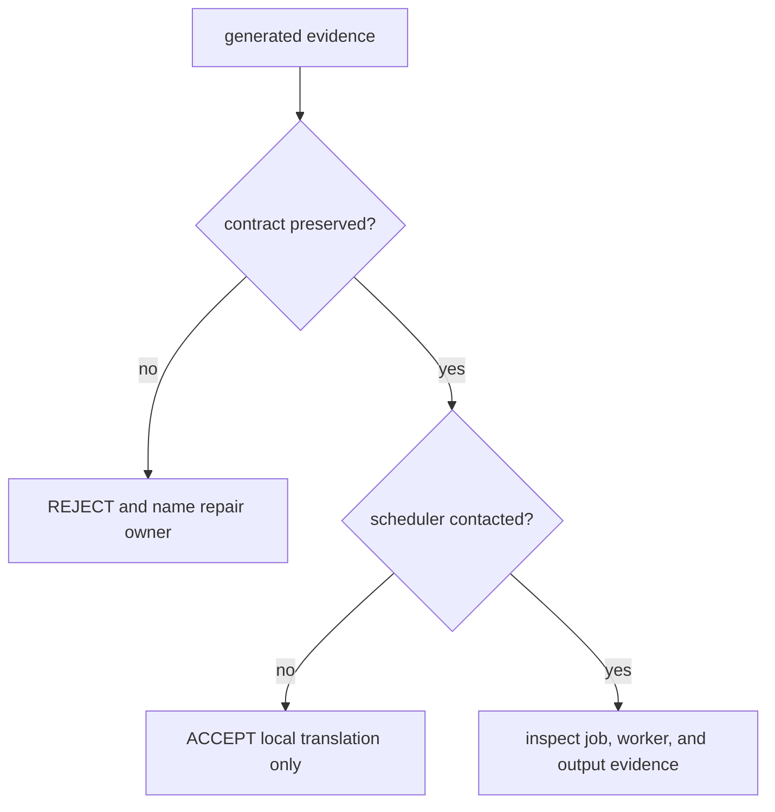
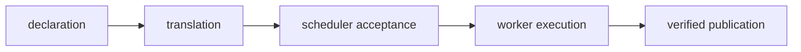

# Exercise Answers

Use this page after you have written your own answers. The point is comparison, not
copying.

## How to use the answer page well

Do not read a model answer first and then retrofit your exercise around it.

A better rhythm is:

1. complete the exercise with your own repository state and commands
2. write one plain-language explanation of the boundary you are reviewing
3. compare that explanation with the model answer
4. revise where the model answer exposes a missing proof route or a blurred policy line

The goal is not identical wording. The goal is disciplined operational reasoning.

The strongest Module 03 answers usually do four things:

- they name the owning operational boundary
- they explain why the current shape is safe or unsafe
- they choose one proportionate proof route
- they describe the repair in terms of repository discipline, not heroics

The strongest self-study packets also leave behind six concrete artifacts:

- a profile comparison table
- one paired dry-run comparison
- one failure-class matrix
- one storage lifecycle sketch
- one proof ladder
- one short maintainer review note

If your packet contains only commands and verdicts, go back and make the reasoning more
visible.

## Exercise 1: Separate policy from workflow meaning

A strong answer sounds like this:

> `latency-wait` and `show-failed-logs` belong in a profile because they change runtime
> behavior without changing the intended outputs. A sample list and publish version do not
> belong in a profile because they change target meaning and downstream contract surfaces.
> If those semantic values moved into a profile, local and CI contexts could appear to be
> harmless policy differences while actually changing what the workflow means.

Why this is strong:

- it gives two good policy examples and two bad ones
- it explains the review risk, not only the placement rule

## Exercise 2: Compare the same target across two profiles

A strong comparison keeps targets, semantic config, and publish paths identical. Local may
use more cores and shorter latency patience; CI may serialize work, show failed logs, and
wait longer for filesystem visibility. The paired dry-runs should resolve the same jobs
and dependencies for the same requested target. A line-by-line table prevents a harmless
operational difference from concealing semantic drift.

A compact model table might look like this:

| Surface | Local | CI | Safe difference? |
| --- | --- | --- | --- |
| target | `publish/v1/manifest.json` | `publish/v1/manifest.json` | must stay the same |
| cores | 4 | 1 | yes |
| latency wait | 5 | 20 | yes |
| publish root | `publish/v1/` | `publish/v1/` | must stay the same |

Why this is strong:

- it checks the boundary with the same target surface
- it treats profile differences as reviewable lines, not intuition

## Exercise 3: Choose the smallest honest proof route

A strong answer matches the route to the question:

- planning difference between local and CI:
  - compare dry-runs
- visible profile differences for review:
  - `make profile-audit`
- strongest repository confidence:
  - `make confirm`

The strongest answers also explain why the routes are not interchangeable:

- `confirm` is too heavy for a simple planning question
- dry-run is too weak for the strongest clean-room claim
- profile-audit is better than intuition for context-comparison review

## Exercise 4: Write a small failure policy

A strong answer distinguishes failure classes cleanly.

Example answer shape:

- retryable:
  - transient infrastructure or storage hiccup
- fail-fast:
  - wrong config value or invalid sample contract
- rerun-incomplete:
  - partial output left behind after a crashed job
- logs:
  - per-job logs help determine whether the failure was transient, semantic, or
    partial-publication related

A compact model matrix might look like this:

| Failure class | Evidence surface | Response |
| --- | --- | --- |
| transient infrastructure issue | failed log plus external service or storage symptom | bounded retry |
| semantic defect | config value, rule contract, or deterministic traceback | fail fast |
| interrupted output | incomplete file plus interrupted execution evidence | rerun incomplete state deliberately |

Why this is strong:

- it makes retry, fail-fast, and rerun-incomplete different on purpose
- it treats logs as evidence for the decision, not as decoration

## Exercise 5: Review one staging or locality assumption

A strong answer sounds like this:

> The workflow may use a different scratch or staging location on shared infrastructure,
> but the declared final output paths and publish boundary must stay semantically stable.
> If the team confuses scratch placement with final output meaning, reviewers can no longer
> tell which paths are temporary and which are part of the contract.

Why this is strong:

- it allows context variation honestly
- it protects the stable trust surface

## Exercise 6: Review one operational diff like a maintainer

A strong answer begins with the owning boundary:

- first inspect the changed profile file
- then inspect the changed proof route or target
- ask:
  - does this change execution context only, or workflow meaning too
  - what claim is stronger or weaker after the proof-route edit

Why this is strong:

- it reviews in boundary order
- it does not let a policy diff drift into vague trust language

## Exercise 7: Inject and classify failures

The generated summary should read:

```text
SCHEDULER_MAPPING_RECORDED         PASS  ACCEPT
MISSING_MEMORY_REJECTED            PASS  REJECT
UNDERPROVISIONING_REJECTED         PASS  REJECT
SEMANTIC_PROFILE_LEAK_REJECTED     PASS  REJECT
```

The correct reasoning is:

| Profile | Invariant | Owner | Response |
| --- | --- | --- | --- |
| accepted | declared resources survive translation | profile maintainer | accept local translation |
| missing memory | every required resource reaches request | rule/profile maintainer | restore `mem_mb` |
| under-provisioned | request is not smaller than declaration | profile maintainer | remove `memory_scale: 0.5` |
| semantic leak | profile changes operation, not meaning | workflow owner | move threshold to semantic config |

None of the rejected requests is transient. Repetition does not add a missing
field, increase memory, or move a threshold to its proper owner.

The accepted receipt contains `"executed": false`. Therefore the supported
conclusion is:

> The adapter rendered an acceptable Slurm request from the declared resources.

The unsupported conclusion is:

> Slurm accepted and ran the job.

PASS and ACCEPT answer different questions. PASS says the audit observed its
expected condition. ACCEPT says the profile is suitable for the bounded local
translation claim.

## Exercise 8: Design a staging route

A strong route has these transitions:

1. submit the accepted resource request;
2. capture the scheduler job ID;
3. allocate job-specific scratch;
4. prove `data/records.tsv` is readable from the worker;
5. compute a temporary result in scratch;
6. validate header, row membership, and threshold behavior;
7. atomically publish to `results/summary.tsv`;
8. verify the published result from the orchestrator;
9. remove job-specific scratch.

Evidence should include:

| Transition | Evidence |
| --- | --- |
| request to allocation | submission receipt and job ID |
| allocation to readable input | worker path probe or staging log |
| execution | command log and exit status |
| validation | semantic assertions |
| publication | atomic rename record and checksum |
| downstream trust | Snakemake sees the declared final path |

On failure, preserve the worker log and scheduler state. Remove only the current
job's temporary output. Never rename an unvalidated scratch artifact into the
final path.

The diagram is not complete unless it marks where trust starts. A reviewer should be able
to point to one step and say, "before this, execution state is provisional; after this,
the declared output may be trusted."

## Exercise 9: Prove a clean-room run

Two representative mutation tests are:

- `test_missing_memory_case_must_remove_memory` edits the profile so it no
  longer removes `mem_mb`. The adapter accepts it, making
  `adapter_rejected=false`; the audit exits nonzero because the promised
  rejection is no longer demonstrated.
- `test_semantic_leak_case_must_change_workflow_meaning` removes the semantic
  override. Again, acceptance is correct, so the rejection finding must fail.

The suite also creates:

```text
workspace/stale-receipt.json
```

and reruns the audit. The file must disappear because the audit removes its
workspace before collecting new evidence. Otherwise an old rejection could be
mistaken for the current run.

Static fixture comparison would show only that checked-in files have expected
text. Mutation proves that the decision changes when its cause changes.

## Exercise 10: Review a production policy change

One defensible review is:

| Change | Decision | Reason and required proof |
| --- | --- | --- |
| threads 4 to 8 | needs evidence | update declaration and show adapter preserves 8 |
| memory 8,000 to 6,000 in adapter | reject | request under-provisions declared need |
| threshold 10 to 30 in profile | reject | semantic field belongs in workflow config |
| latency 30 to 90 | needs evidence | show delayed visibility rather than another failure |
| retries 0 to 3 globally | reject | no eligible transient class or stop condition |
| shared to node-local scratch | needs evidence | prove staging, cleanup, and unchanged final path |

The replacement retry policy might be:

```text
Eligible: transient object-store timeout only
Attempts: two retries
Backoff: 30 seconds, then 120 seconds
Preserve: job ID, attempt log, exit status
Stop: repeated identical exit status or any validation failure
Publish: only after semantic validation
```

The final contract remains:

```text
results/summary.tsv
```

Local evidence can approve deterministic translation and reject boundary leaks.
It cannot approve the node-local scratch change for a real site. That decision
needs a scheduler job ID, worker path evidence, publication evidence, and output
verification.

A strong review also shows a stable order:

1. inspect the changed profile keys
2. classify each line as capacity, visibility, recovery, storage, or semantics
3. reject any semantic leak before debating convenience
4. run the scheduler-policy audit for local translation
5. require site integration only for claims that cross the scheduler boundary

## What all ten answers should have in common





The best Module 03 answers usually:

1. distinguish policy from semantics clearly
2. explain recovery as a contract rather than a habit
3. treat proof routes as proportionate tools instead of ritual commands
4. describe operational governance as something the repository should teach

Weak answer pattern:

- "production is complicated, so more retries and more confirmation should be fine"

That sentence hides every boundary the module is trying to teach. If your answers still
sound like that, keep revising.

If your answers do those four things, the module is landing in the right way.
