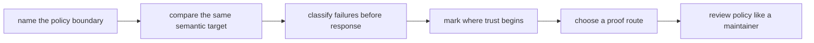

# Exercises

Use these after reading the five core lessons and the worked example. The goal is to make
your operational reasoning visible through concrete runs, failure evidence, and policy
reviews, not through a pile of flags.

## How to work through this set

Treat the ten exercises as one long repository-hardening lab.

Before each answer:

1. name the boundary you are reviewing
2. choose the smallest honest proof route for that boundary
3. keep the concrete evidence next to your explanation

If you skip the boundary question, the work turns into command collection instead of
production reasoning.

Do them in order. The set is one day-long progression:

- Exercises 1-3 establish the policy boundary.
- Exercises 4-6 compare contexts and proof routes.
- Exercises 7-8 classify and repair failures.
- Exercises 9-10 treat production policy as a review surface.

For every answer, keep three things:

- the setting, artifact, or failure class you are naming
- the evidence route you actually used
- one short sentence explaining why the decision belongs to policy or to workflow meaning

## Recommended working layout

If you want one small repository to support the whole day, use a lab tree like this:

```text
module03-lab/
├── Snakefile
├── config/
├── profiles/
├── data/
├── results/
├── publish/
├── logs/
└── artifacts/
```

That layout makes it easier to compare policy surfaces, failure evidence, and proof routes
without rebuilding the project from scratch for every prompt.

Build one small production review packet as you go:

- one table comparing local, CI, and scheduler-facing profile intent
- one paired dry-run comparison for the same semantic target
- one failure-class note that distinguishes retry, fail-fast, and rerun-incomplete cases
- one storage lifecycle sketch that marks where trust begins
- one short proof ladder showing which route answers which operational question
- one maintainer-style review note for a policy diff

If those six artifacts are scattered or missing, the day usually turns into command
memory instead of production reasoning.



Use that sequence on purpose. It keeps the day anchored in boundary judgment instead of
letting isolated commands impersonate understanding.

## What a strong day packet looks like

By the time you finish all ten exercises, your work should leave behind one small,
reviewable packet instead of ten disconnected command traces:

- one profile comparison for the same semantic target
- one invariant sentence naming what must not change across contexts
- one failure table mapping evidence to retry, fail-fast, or rerun-incomplete decisions
- one storage sketch marking where trust begins
- one proof ladder that matches claims to routes proportionately
- one maintainer-style review note for a production policy diff

If you cannot point to those artifacts, the exercise day is still too dependent on tacit
classroom guidance.

## Exercise 1: Separate policy from workflow meaning

Take a small workflow and propose four settings:

- two that belong in a profile
- two that do not belong in a profile

What to hand in:

- the four settings
- one sentence per setting explaining why it belongs where you placed it
- one short explanation of what would go wrong if a semantic setting were moved into a profile

Study note:
This is not a placement quiz. It is a reviewability quiz.

## Exercise 2: Compare the same target across two profiles

Create minimal local and CI profiles for the same small workflow. Vary only operational
settings such as cores, failed-log display, and latency handling.

What to hand in:

- both profile files
- paired dry-runs against the same target
- a table classifying every differing setting
- evidence that the target graph is semantically unchanged
- one plain-language invariant sentence such as "the requested target, sample set, and
  publish meaning did not change"

Study note:
If the job graph changes for the same semantic inputs, treat that as a boundary defect
until you can explain it honestly.

## Exercise 3: Choose the smallest honest proof route

For each of these questions, choose the smallest honest route:

- how does the workflow plan differ between local and CI contexts
- does the repository still prove itself under its strongest built-in check
- which profile differences are visible to a reviewer

What to hand in:

- the command or route for each question
- one sentence per route explaining why a stronger or weaker route would be less appropriate

Study note:
The best answer is not always the strongest route. It is the narrowest route that proves
the claim cleanly.

## Exercise 4: Write a small failure policy

Choose one workflow step and describe:

- one transient failure that may be retried
- one failure that must fail fast
- one incomplete-output situation that must rerun instead of being trusted

What to hand in:

- the three situations
- the response for each one
- one small classification table with columns for failure class, evidence surface, and
  justified response
- one sentence explaining how logs help the reviewer tell them apart

Study note:
If two failure classes get the same response for no stated reason, the policy is probably
too vague.

## Exercise 5: Review one staging or locality assumption

Describe a workflow that runs locally and on shared infrastructure.

Explain one operational difference that should remain policy and one path or artifact fact
that must stay semantically stable.

What to hand in:

- the operational difference
- the semantically stable path or boundary
- one sentence explaining why confusing the two would create review problems

Study note:
This exercise is about holding the final contract still while the execution context moves.

## Exercise 6: Review one operational diff like a maintainer

Imagine a pull request that changes a CI profile and a confirmation target.

Describe the order you would review it in and what questions you would ask first.

What to hand in:

- the first file or surface you would inspect
- the second proof route or artifact you would check
- two review questions you would ask before approving the change

Study note:
Review order matters. Good maintainers do not start from intuition when a named boundary
already exists.

## Midday self-check

Before you move into failure injection and clean-room proof, make sure your packet can
already answer all of these:

- which settings are operational policy and which are semantic leaks
- which comparison route proves that local and CI still mean the same workflow
- which proof route is smaller than `make confirm` but still honest for a bounded claim
- which path or output is trusted and which path is only staging or scratch

If you cannot answer those four questions cleanly, do not rush into later exercises.
Return to the earlier comparisons and make the packet more explicit.

## When you get stuck, diagnose the missing boundary first

Use this table before you start adding more commands:

| If you are stuck on... | Check whether you are missing... | Typical repair |
| --- | --- | --- |
| Exercise 1 or 2 | one clear distinction between policy and meaning | rewrite the invariant sentence before editing the profile |
| Exercise 3 or 6 | one claim matched to one proportionate proof route | choose the bounded question first, then the route |
| Exercise 4 or 7 | one named failure class with evidence | inspect the log or partial state before deciding on retries |
| Exercise 8, 9, or 10 | one trusted-output boundary | mark scratch, final outputs, and review surfaces separately |

Most weak Module 03 answers are not short on commands. They are short on named
boundaries.

## Exercise 7: Inject and classify failures

Run:

```console
cd programs/reproducible-research/deep-dive-snakemake/capstone
gmake scheduler-policy-audit
```

Before reading `summary.tsv`, inspect the four profile documents and classify
each as accepted, retryable, or deterministic rejection. Then compare your
predictions with the generated decisions.

What to hand in:

- a four-row prediction-versus-observation table
- the exact invariant violated by each rejected profile
- the owner who must repair each violation
- an explanation of why none of the three rejections is retryable unchanged
- the accepted receipt field that prevents a false cluster-execution claim

Study note:
`result=PASS` on a rejected finding means the audit observed the intended
rejection. Do not confuse audit result with policy decision.

## Exercise 8: Design a staging route

Extend the accepted scheduler request with a site-neutral staging design. The
rule reads `data/records.tsv`, computes in worker scratch, and publishes
`results/summary.tsv`.

What to hand in:

- a sequence diagram from submission through verified publication
- one evidence artifact for every transition
- cleanup behavior after success and failure
- the worker path probe that distinguishes missing input from scheduler failure
- the atomic publication operation
- the invariant that remains identical in local, CI, and scheduler contexts
- a visible mark where downstream trust begins

Study note:
The recording adapter proves no storage claim. Your design must say which
evidence a real site integration would add.

## Exercise 9: Prove a clean-room run

Run the scheduler-policy adversarial suite:

```console
gmake scheduler-policy-selftest
```

Choose two mutation tests and explain why removing the intended cause must make
the corresponding audit finding fail.

What to hand in:

- the exact mutation each test performs
- the check expected to become false
- the resulting audit exit behavior
- the stale-evidence path the suite proves is removed
- a short argument for why static fixture comparison would be weaker

Study note:
An adversarial selftest asks whether evidence responds to cause. A happy-path
rerun asks only whether the current files still agree with themselves.

## Exercise 10: Review a production policy change

Review this proposed deployment change:

```text
threads: 4 -> 8
mem_mb: 8000 -> 6000 in the scheduler adapter
minimum_score: 10 -> 30 in the Slurm profile
latency_wait: 30 -> 90
retries: 0 -> 3 for every failure
scratch: shared project path -> node-local allocation
```

Treat every line independently. Do not accept or reject the whole block by
intuition.

What to hand in:

- `ACCEPT`, `REJECT`, or `NEEDS EVIDENCE` for every line
- the owning repository surface for each accepted change
- the specific proof route required for each decision
- a bounded retry policy replacing the indiscriminate retry line
- evidence that `results/summary.tsv` remains the final contract path
- a final review statement that distinguishes local translation from site proof

Study note:
The resource increase is not automatically safe, and the latency increase is
not automatically harmless. Ask what evidence and ownership make each change
reviewable.

## What weak completion looks like

Do not call the day complete if your answers do any of these:

- treat "works locally" as proof that policy is honest
- discuss retries without naming a failure class first
- trust scratch or interrupted outputs because bytes were visible
- jump straight to the strongest route when a smaller one would prove the claim more clearly
- approve a production diff without showing a stable review order

## Exit standard for the exercise day

Do not count the day complete unless you can do all of this without leaning on the answer
page as a command script:

- separate profile policy from workflow meaning confidently
- match a failure class to a recovery decision with evidence
- explain one staging design without confusing scratch and final trust surfaces
- choose one proportionate proof route for one bounded claim
- review one production diff in a stable order

## Mastery standard for this exercise set

Across all ten answers, Module 03 wants the same habits:

- you name the policy boundary directly
- you distinguish context changes from meaning changes
- you choose proof routes proportionately instead of ritualistically

If your answer says only "production is complicated," keep going.
