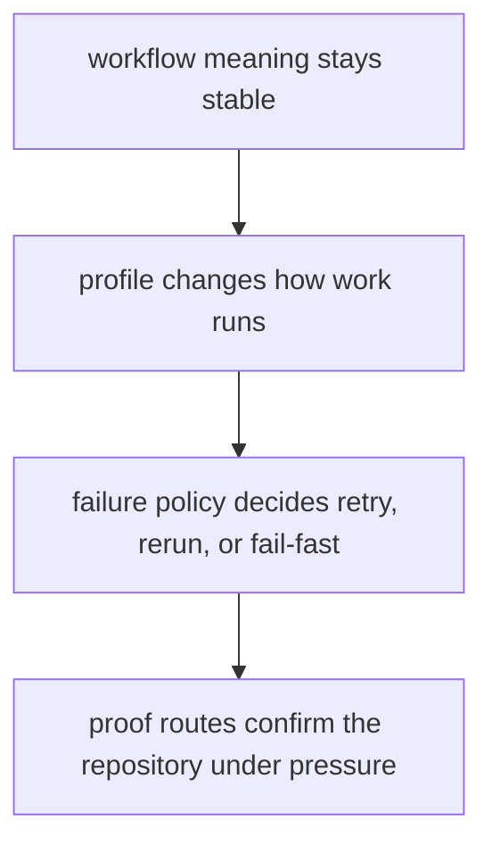
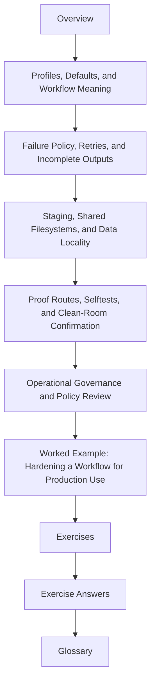

# Module 03: Production Operations and Policy Boundaries

Modules 01 and 02 teach workflow truth and disciplined dynamic behavior. Module 03 asks
the next practical question:

> how do you run that workflow under real pressure without letting operational convenience change its meaning?

This module is about making production operation explicit. Profiles, retries, staging,
logs, and confirmation routes are useful only when they stay on the policy side of the
line instead of leaking into workflow semantics.

## What this day must accomplish

By the end of Module 03, you should be able to do five things without blurring policy and
meaning:

- explain what belongs in a profile and what belongs in workflow meaning
- classify failures before deciding to retry anything
- show where an incomplete output stops being trustworthy
- compare local and CI contexts without semantic drift
- choose a stronger production proof route than dry-run when the claim requires it

## The policy ladder for the whole module

Keep this order in front of you all day:



If a profile line changes outputs, sample membership, or published meaning, it has
crossed the boundary. If a retry hides a semantic defect, the failure policy is lying.

## The running lab for the whole day

Use one repository story all day instead of several unrelated operational anecdotes:

- the same workflow runs locally and in CI
- profiles differ in cores, log visibility, and latency patience
- one rule fails in a controlled way so you can classify the failure
- one clean-room route proves the repository without relying on previous state
- one policy review asks which changes are safe and which are semantic leaks

## Plan for the day

| Session | What you do | Evidence you keep |
| --- | --- | --- |
| policy baseline | run the same targets through local and CI profiles | paired dry-runs |
| failure classes | separate transient, semantic, and incomplete-output failures | written response table |
| failure injection | crash a rule after writing temporary state and recover it | log plus filesystem inspection |
| storage contexts | model local disk, shared storage, and node-local scratch | data-movement diagram |
| clean-room proof | reproduce a small run without relying on previous outputs | confirmation record |
| independent practice | complete all ten exercises | profile diffs and operational review |

The day is successful when changing a profile changes *how* jobs run but not *which
scientific outputs* define success.

## Study route



Read the module in that order the first time.

The route matters:

- start with profile boundaries before you talk about retries
- classify failures before you tune policy
- use the clean-room route after you can already explain the smaller proof surfaces

## The ten files in this module

1. Overview (`index.md`)
2. [Profiles, Defaults, and Workflow Meaning](profiles-defaults-and-workflow-meaning.md)
3. [Failure Policy, Retries, and Incomplete Outputs](failure-policy-retries-and-incomplete-outputs.md)
4. [Staging, Shared Filesystems, and Data Locality](staging-shared-filesystems-and-data-locality.md)
5. [Proof Routes, Selftests, and Clean-Room Confirmation](proof-routes-selftests-and-clean-room-confirmation.md)
6. [Operational Governance and Policy Review](operational-governance-and-policy-review.md)
7. [Worked Example: Hardening a Workflow for Production Use](worked-example-hardening-a-workflow-for-production-use.md)
8. [Exercises](exercises.md)
9. [Exercise Answers](exercise-answers.md)
10. [Glossary](glossary.md)

## How to use the file set

| If you need to... | Start here |
| --- | --- |
| separate profile settings from workflow meaning | [Profiles, Defaults, and Workflow Meaning](profiles-defaults-and-workflow-meaning.md) |
| decide when to retry, rerun, or fail fast | [Failure Policy, Retries, and Incomplete Outputs](failure-policy-retries-and-incomplete-outputs.md) |
| reason about latency, scratch space, and shared-storage assumptions | [Staging, Shared Filesystems, and Data Locality](staging-shared-filesystems-and-data-locality.md) |
| choose the smallest honest production proof route | [Proof Routes, Selftests, and Clean-Room Confirmation](proof-routes-selftests-and-clean-room-confirmation.md) |
| review policy drift and operational ownership over time | [Operational Governance and Policy Review](operational-governance-and-policy-review.md) |
| see the whole module as one repaired production workflow | [Worked Example: Hardening a Workflow for Production Use](worked-example-hardening-a-workflow-for-production-use.md) |
| test your own understanding | [Exercises](exercises.md) |
| compare your reasoning against a reference answer | [Exercise Answers](exercise-answers.md) |
| stabilize the module vocabulary | [Glossary](glossary.md) |

## The running question

Carry this question through every page:

> if the execution context changes tomorrow, what exact boundary proves the workflow meaning did not?

Good Module 03 answers usually mention one or more of these:

- a profile setting that is clearly operational
- a failure policy that keeps poison outputs from being trusted
- a staging or latency assumption that is declared instead of implied
- a selftest or confirmation route that compares runs honestly
- a governance rule that keeps policy drift reviewable

## What the module should change in your head

If the day is working, you should feel these transitions:

- “works in CI” stops sounding like a workflow property by itself
- retries stop looking harmless when the failure class is unknown
- scratch and latency stop sounding like semantics
- a clean-room confirmation route stops feeling excessive once the repository matters to others
- profile review becomes a boundary question instead of a flag checklist

## Commands to keep close

These commands form the evidence loop for Module 03:

```bash
snakemake --profile profiles/local -n
snakemake --profile profiles/ci -n
snakemake --lint
make profile-audit
make confirm
```

They answer different questions:

- what the workflow plans under one local policy surface
- what changes under a second policy surface
- whether the workflow already shows contract problems
- how the repository packages profile differences for review
- whether the strongest built-in confirmation path still passes

## Exit standard

Do not move on until all of these are true:

- you can explain one profile change that is safe and one that would be semantic drift
- you can describe one failure that should be retried and one that should fail fast
- you can say where a partial output becomes safe to trust or must be rerun
- you can name one proof route stronger than dry-run and one reason it matters
- you can explain how another maintainer should review a policy change later
- you have completed all ten exercises, including failure injection and clean-room proof

When those become ordinary, Module 03 has done its job.
