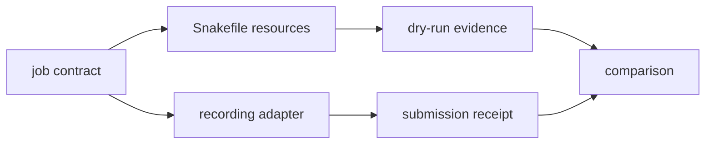
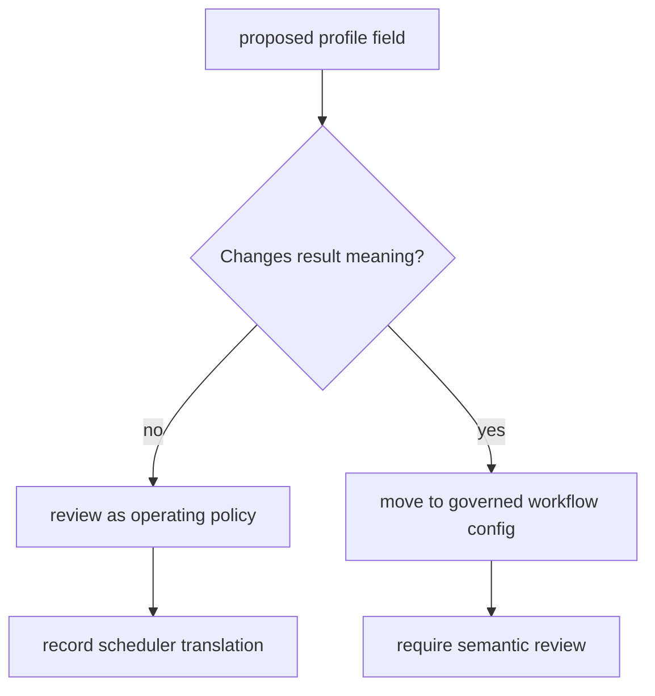

# Profiles, Defaults, and Workflow Meaning

Module 03 begins with the boundary that most production confusion grows out of:

> a profile may change how the workflow runs, but it must not change what the workflow means.

If that sentence is fuzzy, every later operational decision becomes harder to review.

## How to read this page

Read this page with one review question in front of you:

> if this setting changed tomorrow, would a downstream reader say the workflow means
> something different?

If the answer is yes, the setting does not belong in a profile. That one question will
save a lot of confusion later in the course.

## Why this lesson comes first

Production policy gets messy fast if the first boundary is weak.

Once profiles start carrying semantic choices, every later operational discussion becomes
harder:

- CI and local runs appear to differ only in context while actually building different
  things
- profile review looks harmless even when it should trigger semantic review
- maintainers stop knowing which file owns workflow meaning

That is why Module 03 begins here.

## Profiles are for operating context

Profiles are where a repository records run policy such as:

- whether incomplete work should rerun
- whether shell commands should be printed
- how long to wait for filesystem latency
- which executor or scheduler-facing defaults apply

Those settings matter. They still do not define the analytical meaning of the workflow.

The workflow meaning should still come from:

- declared inputs
- config that changes the intended outputs
- rule code and helper code
- published contract surfaces

That is the boundary this page is defending.

## A strong beginner habit

When you add a profile setting, write one short sentence that starts with:

> This changes how the workflow runs by...

If you cannot finish that sentence without talking about target membership, publish
contracts, or analytical meaning, the setting belongs somewhere else.

## Why this split matters in practice

When profiles and workflow meaning blur together, several bad things happen at once:

- a local convenience file quietly changes what gets built
- CI and local runs produce different intended results without anyone naming the reason
- a profile review sounds operational even though it is hiding a semantic change
- later maintainers cannot tell whether a diff needs scientific review or only runtime review

Strong production workflows make that distinction reviewable before the incident happens.

## A quick self-check before you keep reading

Take one setting you have seen in another workflow and ask:

- does this affect scheduler patience, log visibility, or resource policy
- or does it affect sample identity, output meaning, or publish versioning

That distinction is the whole page in miniature.

## A healthy profile example

From the capstone, a local profile contains settings like:

```yaml
rerun-incomplete: true
printshellcmds: true
show-failed-logs: true
latency-wait: 30
```

Those are strong policy examples because they answer operational questions:

- how much run detail should be shown
- how patient should the run be with filesystem lag
- what should happen after an incomplete output is detected

None of those settings says which samples exist or what the publish bundle is supposed to
mean.

## A weak profile example

This would be a bad profile boundary:

```yaml
samples:
  - sampleA
  - sampleB
publish_version: v2
```

Why it is bad:

- `samples` changes the target set
- `publish_version` changes a public contract surface
- both settings alter workflow meaning, not just runtime context

Those values belong in workflow config or in explicit repository code, not in a
machine-facing profile.

## Defaults are not a loophole

Learners sometimes understand the profile rule and then break it through defaults inside
the workflow:

- hidden environment-variable fallbacks
- local-path shortcuts that only one maintainer knows
- runtime branches based on hostnames or current shells

Those are not cleaner than bad profiles. They are just harder to review.

Healthy defaults should be:

- visible in `Snakefile` or config
- stable across contexts unless deliberately overridden
- harmless when the operating profile changes

## The common beginner mistake

People sometimes agree that semantic settings should stay out of profiles, then quietly
reintroduce the same leak through environment variables or hidden local defaults.

That is not cleaner. It is just harder to review.

## One useful review table

| Question | If yes, it belongs closer to... |
| --- | --- |
| does this change which outputs the workflow is supposed to produce | workflow config or code |
| does this change scheduling, visibility, or failure handling only | profile policy |
| would a downstream contract need to change if this changed | workflow meaning |
| could local, CI, and SLURM all vary this safely | profile policy |

This table is not perfect. It is still a strong habit for human review.

## The capstone pattern worth copying

The capstone keeps three profile directories:

- `profiles/local/`
- `profiles/ci/`
- `profiles/slurm/`

That design teaches an important lesson:

- the workflow meaning is one thing
- the operating contexts are several
- the repository is allowed to represent that difference openly

Profiles are not a hack here. They are the formal place where context variation lives.

## What a good explanation sounds like

Strong:

> Local, CI, and SLURM may disagree about patience and visibility, but they should not
> disagree about what the workflow is supposed to build.

Weak:

> The profile is where we keep the stuff we did not want to hardcode.

## A good audit question

When a profile changes, do not ask only:

> does the workflow still run?

Ask:

> would this diff require semantic review if it were moved into config or rule code?

If the answer is yes, the boundary is probably wrong already.

## Prove the boundary with the scheduler-policy specimen

The capstone now contains a smaller specimen for this exact question:

```text
capstone/repro/scheduler-policy/
├── job-contract.json
├── Snakefile
├── config/
└── scripts/record_submission.py
```

Run its audit:

```console
cd programs/reproducible-research/deep-dive-snakemake/capstone
gmake scheduler-policy-audit
```

Then open:

```text
../../../../artifacts/audit/reproducible-research/deep-dive-snakemake/
└── scheduler-policy/
    ├── summary.tsv
    ├── report.json
    └── workspace/
```

Do not start with the generated `sbatch` command. Start with
`job-contract.json`. It says that `summarize_records` needs four threads,
8,000 MB of memory, and 30 minutes. It also owns `minimum_score: 10`, which
changes the result set.



The accepted profile produces a receipt with these arguments:

```text
--cpus-per-task=4
--mem=8000M
--time=30
```

This is translation, not invention. The profile selects how a declaration is
expressed to Slurm. It does not decide the declaration's meaning.

## Follow one semantic leak to its consequence

Now inspect `config/semantic-leak.yaml`. It tries to set:

```json
{
  "semantic_overrides": {
    "minimum_score": 30
  }
}
```

That is rejected even though it is syntactically valid. A score threshold
changes which records appear in `results/summary.tsv`; putting it in a cluster
profile would make local and scheduler runs answer different questions.



Use the rejection as a reasoning exercise:

1. Name the output whose membership would change.
2. Name the profile contexts that could now disagree.
3. Move the threshold to one governed semantic config.
4. Leave only executor and resource translation in the profile.

## A receipt is evidence, not cluster proof

The accepted receipt contains `"executed": false`. That line is essential.
The audit proves that the repository can render a reviewable request. It does
not prove that a Slurm controller accepted it, that a worker mounted the same
filesystem, or that cancellation and retries work at a deployment site.

Use separate claims:

| Claim | Evidence needed |
| --- | --- |
| rule declares resources | Snakemake dry-run |
| adapter preserves declarations | recorded request plus audit |
| scheduler accepts request | scheduler job ID and state |
| worker executes correctly | worker log, exit status, verified output |
| result meaning is context-invariant | semantic output comparison |

This separation prevents a common operational overclaim: treating a plausible
submission command as evidence that a real cluster run succeeded.

## Common failure modes

| Failure mode | What it looks like | Better repair |
| --- | --- | --- |
| sample or reference data appears in a profile | local and CI differ in target meaning | move semantic inputs into config |
| hidden shell defaults choose a workflow branch | the run depends on who launched it | promote the choice into explicit config or code |
| profile names are vague | nobody can explain why two profiles exist | name them by operating context, such as `local`, `ci`, or `slurm` |
| profile diffs are reviewed casually | semantic drift sneaks in under operational language | review profile changes against the policy-versus-meaning boundary explicitly |
| command-line flags are the only real policy record | the repository cannot explain how it was normally run | version the stable flags in profiles |

## The explanation a reviewer trusts

Strong explanation:

> `profiles/local` and `profiles/ci` differ in operational settings like log visibility and
> latency handling, but the sample set, publish version, and rule logic stay in workflow
> config and code, so changing profiles alters context without altering meaning.

Weak explanation:

> profiles are where we put the stuff that is easier not to hardcode.

The first explanation gives a boundary. The second gives a convenience excuse.

## End-of-page checkpoint

Before leaving this page, you should be able to:

- name three settings that belong in a profile
- name two settings that do not belong in a profile
- explain why local, CI, and SLURM profiles can differ safely
- describe one review question that catches policy leaking into workflow meaning
