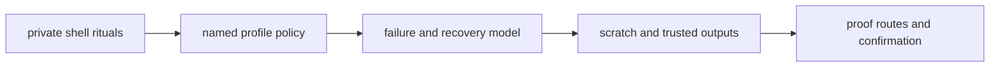
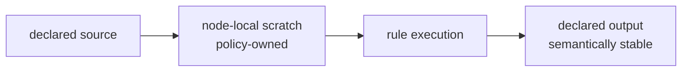
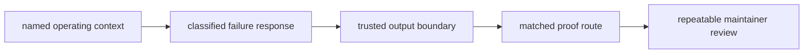

# Worked Example: Hardening a Workflow for Production Use

This file ties the whole module together around one realistic problem:

> a workflow runs locally, but the team now wants to run it in CI and review it like a production repository.

The question is not "how do we add more flags?" The question is how to make the workflow
operable without blurring its meaning.

## How to use this worked example

Treat this page like a production lab, not like a retrospective you admire after the fact.

For each repair step:

1. name the operational boundary being introduced
2. predict what evidence should prove that boundary stayed operational
3. run the smallest route that confirms the prediction

If you skip the boundary question, the example turns into command accumulation instead of
production discipline.

## If you are learning this without the live class

Use the example in five passes instead of trying to absorb production policy in one read:

1. name the private shell rituals before you change any files
2. stop after the profile repair and compare the same target in two contexts
3. classify one controlled failure before you add or discuss retries
4. sketch scratch and trusted-output boundaries before you talk about cluster behavior
5. finish by matching one claim to one proof route

If you cannot explain the profile boundary after pass 2, do not move to retries yet. Most
Module 03 confusion starts when learners skip the policy boundary and jump straight to
"production flags."

## The one-day teaching goal

By the end of this example, a learner should be able to rebuild a small repository so
that:

- profiles replace private shell rituals
- failure handling is explained before retries are raised
- scratch and latency assumptions stay operational
- stronger proof routes are named instead of improvised

That is the real outcome. The command count is not the outcome.

## The lab route

Work through the example in this order:

1. name which current habits are private shell rituals rather than repository policy
2. move stable operating defaults into profiles
3. classify one controlled failure before choosing any retry policy
4. separate scratch behavior from semantically stable outputs
5. finish by proving the repository through a stronger confirmation route

Keep a small production packet as you go:

- one note comparing local, CI, and scheduler-facing profile intent
- one note classifying failures before retries are discussed
- one sketch separating scratch handling from trusted output identity
- one short ladder showing which proof route answers which question
- one final summary in language the next maintainer could repeat without you

That packet is not extra paperwork. It is the thing that turns "I can run this" into
"another maintainer can review this."

## What to keep beside you while you work

Keep these four surfaces visible while you move through the example:

- the current profiles
- one failing or recovering run artifact
- the final output or publish boundary
- the proof route you are using at each step

Those four surfaces are enough to explain whether the repository is becoming more
reviewable or just noisier.

## The evidence packet you should keep visible

By the end of the example, keep one small packet that contains:

- one local-versus-CI profile comparison for the same semantic target
- one failure note naming the class before the response
- one log or interrupted-output artifact from a controlled failure
- one scratch-versus-final-boundary sketch
- one proof ladder showing why you chose one route instead of a stronger ritual route

If one of those pieces is missing, the repository may look more operational, but the
learner still cannot defend the design.

## The starting situation

Assume the repository already has:

- truthful rule contracts
- explicit dynamic discovery from Module 02
- a stable publish boundary

What it does not yet have is a clean production story.

The maintainers currently do this:

- one person runs `snakemake -p --rerun-incomplete`
- another person adds extra flags in CI
- partial failures are handled ad hoc
- no one can explain which settings are policy and which would change workflow meaning

That is a good Module 03 starting point because it is common and fixable.

## What goes wrong when a learner trusts the starting situation

Use this card before you repair anything:

| If you notice... | The repository is hiding... | Smallest proof route |
| --- | --- | --- |
| each maintainer uses a different favorite command | unnamed operating contexts | compare two current command lines against one declared target |
| retries are discussed before anyone names the failure class | policy is reacting to stress instead of evidence | inspect one log and classify the failure first |
| scratch paths feel more important than final output paths | temporary execution context is being confused with trusted contract space | draw the storage route and mark where trust begins |
| `make confirm` is used for every tiny question | proof routes are not being matched to claims proportionately | list the smaller route that would answer the bounded question |

If you can name the hidden defect first, the repair stops feeling like folklore.



That sequence matters. If the team has not named operating contexts first, later debates
about retries, scratch, or confirmation turn into arguments about private command-line
taste rather than repository policy.

## Move stable run policy into profiles

The first repair is not a scheduler change. It is naming the operating contexts.

So introduce:

```text
profiles/
  local/config.yaml
  ci/config.yaml
  slurm/config.yaml
```

Now the repository can answer:

- what local runs normally do
- what CI runs normally do
- what scheduler-oriented policy looks like

This is Core 1 becoming concrete. The team stops relying on private shell habits.

That first move matters because production discipline begins with named operating contexts,
not with bigger commands.

## Why this first move matters educationally

Many learners try to solve production readiness by adding more flags to one favorite
command line. That creates folklore, not governance.

Module 03 needs the opposite instinct:

- name the context
- version the defaults
- compare contexts against the same workflow meaning

Start with profiles whose differences are easy to explain:

**`profiles/local/config.yaml`**

```yaml
cores: 2
printshellcmds: true
rerun-incomplete: true
latency-wait: 5
```

**`profiles/ci/config.yaml`**

```yaml
cores: 1
printshellcmds: true
show-failed-logs: true
rerun-incomplete: true
latency-wait: 20
```

Compare them against the same target:

```sh
snakemake --profile profiles/local --dry-run
snakemake --profile profiles/ci --dry-run
```

The job dependencies and requested outputs should agree. Core count and latency patience
may differ because those settings describe an operating context. If a profile changes
sample membership, algorithm choice, or publish version, it has crossed the boundary.

Use a quick audit table while you compare:

| Surface | Local | CI | Meaning should change? |
| --- | --- | --- | --- |
| target set | same declared target | same declared target | no |
| cores | tuned for interactive work | tuned for shared automation | no |
| latency patience | short feedback loop | more patient for slower visibility | no |
| publish destination semantics | same publish contract | same publish contract | no |

The point is not to make the profiles identical. The point is to make their
differences obviously operational instead of semantically dangerous.

## The profile audit before you celebrate

Before you call the profile repair complete, make sure you can answer all four of these:

| Question | Healthy answer |
| --- | --- |
| What stayed identical? | requested targets, workflow meaning, and publish contract |
| What changed safely? | cores, latency patience, logging visibility, or other operating context details |
| What would have crossed the boundary? | algorithm choice, sample membership, or publish semantics |
| What evidence proves the difference is operational only? | paired dry-runs or another bounded comparison for the same target |

If any row stays vague, keep auditing. The profile may still be carrying semantic drift.

## Give failures a small honest policy

The team then reviews how failed runs behave.

Weak current behavior:

- retry until it passes
- inspect the terminal if something looks wrong
- trust whatever files are left behind

The repair is to state a failure policy:

- transient failure may be retried
- incomplete outputs are rerun deliberately
- logs remain available for review
- semantic errors fail fast instead of hiding under retries

This is Core 2: recovery becomes a contract, not a mood.

Make the contract reviewable with a tiny matrix:

| Failure class | Retry? | Keep evidence? | Why |
| --- | --- | --- | --- |
| transient infrastructure issue | yes, deliberately | yes | repetition may succeed without changing workflow meaning |
| semantic workflow defect | no, fail fast | yes | retrying hides a real design or data problem |
| publication or poison-output risk | only after cleanup plan | yes | trust in final outputs matters more than speed |

## The question every retry must answer

Before raising retries, ask:

- is this failure transient, semantic, or publication-related
- what evidence would distinguish those classes
- what state is safe to keep and what state must be discarded

If those answers are missing, the retry policy is guessing.

## A short checkpoint before you continue

Pause here and say one sentence like this:

> Retrying is justified only when the failure class suggests repetition can change the
> outcome without hiding a semantic defect.

If that sentence feels hard to defend, the policy is not ready yet.

Practice the distinction by injecting a deterministic failure into a disposable rule:

```python
rule demonstrate_atomic_failure:
    input:
        "data/A.txt"
    output:
        "artifacts/failure-demo/A.txt"
    log:
        "artifacts/failure-demo/A.log"
    shell:
        """
        mkdir -p artifacts/failure-demo
        tr '[:lower:]' '[:upper:]' < {input} > {output}.building
        printf 'intentional semantic failure\n' > {log}
        false
        mv {output}.building {output}
        """
```

After the failure, the final output must be absent, the `.building` file shows interrupted
work, and the log explains why retrying the identical command cannot help. Remove the
deliberate `false`, rerun, and verify that publication occurs only after success.

## Make storage assumptions explicit

Next, the team notices that local runs and CI runs do not feel the same:

- CI sometimes needs more patience for output visibility
- a scheduler-oriented run may use different scratch or staging assumptions

The weak reaction would be to patch the workflow code for each context.

The stronger reaction is:

- keep the final output and publish paths semantically stable
- place latency and staging assumptions in operating policy
- review scratch behavior as context, not as workflow meaning

This is Core 3: data locality changes how the workflow runs, not what the workflow means.



The diagram permits scratch placement to change by environment. It does not permit the
declared input or final output identity to drift.

State the distinction plainly:

- scratch placement may vary by operating context
- trusted output identity must not vary by operating context

## What the learner should notice now

The workflow is not becoming "less reproducible" when scratch changes by context.

It becomes less reproducible only if the repository stops teaching:

- which paths are temporary
- which paths are final contracts
- which settings own staging behavior

## Connect operation to proof routes

At this point the repository has profiles and a failure story, but the team still needs a
review route.

So define a proof ladder:

- dry-run for planning
- `make profile-audit` for policy comparison
- `make verify` for executed workflow confidence
- `make confirm` for the strongest clean-room repository proof

This is Core 4: production trust grows by named routes, not by one giant ritual command.

Write the ladder down in reviewable form:

| Route | What it answers |
| --- | --- |
| `snakemake -n` | what does the engine plan to build from this state |
| `make profile-audit` | do profile differences remain operational rather than semantic |
| `make verify` | does the workflow execute correctly with evidence worth inspecting |
| `make confirm` | can a fresh maintainer rebuild trust from a clean starting point |

## The proof-route audit before you move on

Do not just memorize the ladder. Test whether you can justify route choice:

| Claim | Smallest honest route |
| --- | --- |
| the target graph stays stable across two profiles | paired dry-runs or `make profile-audit` |
| a recent policy edit did not hide execution failure evidence | one executed verification route with logs |
| the repository still rebuilds trust from scratch | `make confirm` |

If you always reach for the strongest route first, the learner never practices bounded
operational judgment.

## What to check before moving on

After the production version works, confirm all of these:

- profiles change execution behavior without changing target meaning
- failed runs leave logs and untrusted intermediate state rather than poison outputs
- scratch or latency assumptions are visible as policy
- the strongest confirmation route still passes from a fresh state

## Make policy review survivable for the next maintainer

The last repair is governance.

The repository should make it obvious that:

- profile changes are reviewed first as policy diffs
- semantic workflow changes belong elsewhere
- proof-route changes should explain which claim got stronger or weaker

This is Core 5: the repository teaches its own review order instead of leaving it to
memory.

## What a strong summary sounds like

Strong:

> The repository names its operating contexts, classifies failures before choosing
> recovery, keeps scratch separate from final trust surfaces, and matches stronger claims
> with stronger proof routes.

Weak:

> We hardened it with a bunch of production flags.

## The repaired production story

By the end of these repairs, the workflow can be described cleanly:

1. workflow meaning stays in rule code, config, and publish contracts
2. profiles encode operating context only
3. failures leave rerunnable or reviewable state instead of ambiguous poison
4. storage and latency assumptions are explicit
5. proof routes scale from dry-run to clean-room confirmation

That is what it means to harden a workflow for production use without turning it into a
different workflow.



Read that diagram literally. If one step is missing, the repository may still run, but
the production story is not yet teachable.

## Review questions for the repaired design

When you inspect a repository shaped like this, ask:

1. which profile settings are context only
2. how does the repository distinguish retryable from fail-fast conditions
3. where are staging and latency assumptions recorded
4. which proof route answers the current operational question
5. how would the next maintainer review a profile diff without guesswork

If those answers are visible, the module’s production story has landed.

## If the module still feels abstract

Do this recovery loop in order:

1. print the two profile surfaces you think should differ safely
2. point to one failure log and classify it before naming a response
3. mark the exact path where downstream trust begins
4. choose the smallest proof route that answers one concrete question
5. restate the review order as if you were handing the repository to a new maintainer

Most Module 03 confusion is not about infrastructure. It is about losing track of which
boundary owns which decision.

Before leaving the module, make sure you can say all five of these out loud:

1. profiles exist to name operating contexts, not to change workflow meaning
2. retries follow failure classification, not impatience
3. scratch policy may move, but trusted outputs keep the same identity
4. proof routes answer different questions and should stay distinct
5. production review is strong only when the next maintainer can repeat the story unaided
