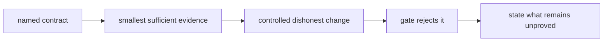
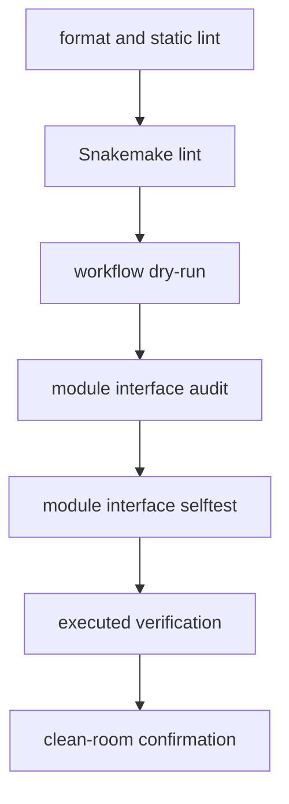

# CI Gates, Drift Control, and Review Surfaces

A repository does not become safer because its CI file has more jobs. It becomes safer
when each gate can name:

- the contract it protects
- the evidence it inspects
- the dishonest change it rejects
- the stronger claim it intentionally does not make

This lesson turns the module interface from the previous lesson into a reviewable gate. It
also shows why a successful lint or dry-run cannot prove that an abstraction is honest.

## Start from one falsifiable claim

Use this claim:

> The normalization module receives a narrow config subtree, while the caller binds input,
> output, and policy at the `use rule` site.

The claim is falsifiable. A reviewer can reject it by finding:

- `config: config` in the explicit caller
- a missing input, output, or parameter override
- a private module read that changes artifact meaning
- a runtime artifact that disagrees with the caller-selected policy

Compare that with:

> The workflow is modular and CI passes.

No specific observation can settle the second statement. It is not yet a gateable claim.

## Build the claim-to-gate matrix

Do not start with a CI vendor configuration. Start with this matrix:

| Claim | Smallest evidence | Dishonest change | Gate |
| --- | --- | --- | --- |
| imported rules remain visible | `--list-rules` | expected local rule disappears | module interface audit |
| caller paths remain bound | caller source plus dry-run | output moves or binding vanishes | module interface audit |
| config scope stays narrow | module declaration | broad config replaces owned subtree | module interface selftest |
| caller owns policy | `use rule` params plus artifact | private module config changes meaning | audit plus selftest |
| public file schema stays compatible | schema and fixtures | required field changes | focused contract validator |
| complete workflow still executes | clean workflow run | integration behavior fails | `confirm` |

The matrix prevents two bad habits:

- using an expensive end-to-end route for every narrow structural question
- claiming a narrow source check proves runtime behavior



## Run the narrow module gate

From the course directory:

```bash
make capstone-module-interface-audit
```

The command runs two copied workflows under the repository `artifacts/` directory. It
captures:

- caller and module source observations
- visible rule names
- dry-run plans
- executed traces
- artifact content
- candidate publication residue

The resulting summary is:

```text
model              result  finding
explicit-contract  PASS    EXPLICIT_MODULE_CONTRACT_PRESERVED
hidden-coupling    PASS    HIDDEN_MODULE_COUPLING_REPRODUCED
```

This is not a two-model approval table. The finding defines the meaning of each pass.

## Make pass semantics reviewable

Every gate needs a sentence that explains its green state.

For the explicit model:

> PASS means narrow config, caller-owned input/output/policy bindings, expected graph
> visibility, matching artifact meaning, and no publication residue were all observed.

For the hidden model:

> PASS means broad config, an absent caller policy binding, a private module policy read,
> and the resulting hidden policy value were all reproduced.

If a dashboard displays only green or red, preserve the finding in a review bundle or job
summary. Without the finding, a deliberately reproduced defect looks approved.

## Prove the gate can fail

Run:

```bash
make capstone-module-interface-selftest
```

The rejection suite uses disposable copies. One mutation changes:

```python
config: config["normalize"]
```

to:

```python
config: config
```

The workflow can still parse and run. The gate must fail because the contract became
broader.

Another mutation removes the caller's parameter binding but preserves the same artifact
text with a literal. Runtime bytes still match. The gate fails because policy ownership
has moved out of the declared interface.

This is why golden output alone is insufficient for an architecture gate. Two designs can
produce identical bytes while exposing different change risk.

## Distinguish acceptance tests from rejection tests

Acceptance tests ask:

> Does honest evidence pass?

Rejection tests ask:

> Does a controlled lie fail for the promised reason?

You need both.

| Test type | Example | Failure it catches |
| --- | --- | --- |
| acceptance | explicit caller passes narrow config | gate that rejects valid reuse |
| acceptance | hidden model reproduces private policy | counterexample that no longer demonstrates the defect |
| rejection | explicit caller passes broad config | gate that checks only execution |
| rejection | output binding changes | gate that ignores caller path ownership |
| rejection | hidden policy becomes visible | stale defect finding after the specimen was repaired |
| isolation | stale workspace is removed | evidence contaminated by earlier output |

A gate with only acceptance cases may be permanently green. A gate with only rejection
cases may reject useful designs without proving the control works.

## Use a gate ladder, not one giant job

The capstone exposes several routes:



Each route answers a different question:

| Route | Primary question |
| --- | --- |
| `make capstone-check` | are code, unit tests, lint, and planning healthy |
| `make capstone-module-interface-audit` | do paired module models exhibit their contracts |
| `make capstone-module-interface-selftest` | does that audit reject dishonest evidence |
| `make capstone-verify-report` | does the executed publish boundary satisfy its contract |
| `make capstone-confirm` | does the complete repository survive clean-room pressure |

Do not claim `capstone-check` proves interface ownership. Do not require
`capstone-confirm` when the only open question is a changed `use rule` binding.

## Review drift at the right representation

Structural drift can appear in several representations:

- source declaration
- imported rule surface
- planned jobs and files
- artifact semantics
- public schema

Choose the representation closest to the claim.

If a change broadens module config, source inspection is decisive. If a change renames an
imported rule, rule listing is useful. If a changed binding selects another file, dry-run
shows the planned path. If policy affects output meaning, inspect the artifact.

Do not substitute a prettier representation for a stronger one. A rulegraph can make
dependency drift visible, but it cannot reveal a private config read.

## Design a useful CI failure

A useful failure tells the reviewer:

- which model failed
- which contract observation was absent
- where the source and runtime traces live
- whether the failure affected the control or counterexample

For example:

```text
FAIL: explicit-contract
missing: module receives narrow config
evidence: report.json and traces/explicit-contract-dryrun.txt
```

That message supports repair. A generic "architecture job failed" sends the learner back
into undirected browsing.

The module audit writes failure names into `report.json` even when its command exits
nonzero. Preserving failed evidence is part of reviewability.

## Keep generated evidence outside the source tree

Audit workspaces, traces, and reports belong under `artifacts/`, not beside the specimen
Snakefiles.

This separation matters because:

- specimens remain stable teaching inputs
- generated outputs cannot masquerade as tracked source
- stale output can be removed before every run
- failed workspaces can be preserved for inspection

The selftest explicitly seeds stale output and checks that the audit replaces it. A gate
that reuses unclean evidence can pass for the wrong reason.

## Add the gate to CI by ownership

The smallest CI job for this contract needs:

1. the supported Python/Snakemake toolchain
2. `make capstone-module-interface-audit`
3. `make capstone-module-interface-selftest`
4. preservation of the module-interface bundle on failure

It does not need:

- a production scheduler
- the complete capstone workflow run
- remote data
- performance benchmarking

Those would widen cost without strengthening this claim.

If the same pull request changes publish schema or profile behavior, add the corresponding
focused routes. Escalate because the claim expanded, not because the diff feels large.

## Review a structural pull request

Use this order:

1. Read the stated interface claim.
2. Inspect the module declaration and config scope.
3. Inspect every changed `use rule` binding.
4. Compare imported rule names.
5. Compare dry-run paths.
6. Inspect artifacts whose meaning depends on changed policy.
7. Read mutation-test results.
8. State remaining limits.

Record findings before a summary. A useful review packet contains:

| Surface | Evidence | Judgment |
| --- | --- | --- |
| config ownership | narrow or broad module declaration | accept, repair, or reject |
| path ownership | caller input/output overrides | accept, repair, or reject |
| policy ownership | caller params and module config reads | accept, repair, or reject |
| graph visibility | rule listing and dry-run | stable or changed |
| runtime meaning | artifact lines and publication residue | matched or drifted |
| gate discrimination | controlled mutation results | trustworthy or ceremonial |

## Avoid brittle structural snapshots

Do not fail CI merely because the complete rulegraph image changed. A legitimate new
caller should change the graph.

Prefer semantic assertions:

- required imported rules remain present
- caller bindings match documented path families
- module config stays within an owned subtree
- private config reads do not select consumer-visible policy
- public artifacts satisfy their schema

Snapshots are useful review aids. They become bad gates when any change is treated as a
defect.

## State the gate's limits

The module interface gate does not prove:

- remote module version compatibility
- scientific correctness of the transformation
- executor equivalence
- performance stability
- downstream schema compatibility beyond the sample artifact

A limit is not a weakness to hide. It tells the reviewer which next route is needed when a
claim expands.

## Independent practice

Add a second explicit caller to a disposable specimen. Before editing, write these
expected observations:

- rule listing gains one local rule
- dry-run gains one job and one artifact
- the original caller bindings remain unchanged
- the module still receives only the `normalize` config subtree
- both artifacts record their caller-selected prefix

Then add one rejection mutation that removes the second caller's output override. The gate
must reject the incomplete interface even if the original caller still succeeds.

## Exit standard

Do not leave this lesson until you can:

- convert one structural claim into a claim/evidence/mutation/gate row
- explain why both audit findings are green without approving hidden coupling
- distinguish acceptance, rejection, and isolation tests
- choose the smallest capstone route for an interface-only change
- explain why dry-run, rulegraph, and artifact bytes each have limits
- write a CI failure that directs a learner to preserved evidence
