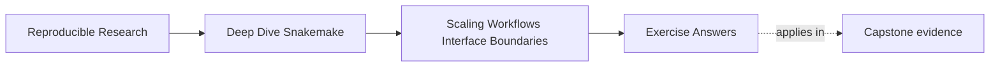

# Exercise Answers

<!-- page-maps:start -->
## Page Maps

<!-- page-maps:end -->

Use this page after you have written your own answers. The point is comparison, not
copying.

The strongest Module 04 answers usually do four things:

- they name the owning boundary directly
- they explain why the proposed split or contract is strong or weak
- they choose one proportionate review surface
- they describe the repair in terms of repository clarity, not architecture fashion

## Exercise 1: Choose one healthy rule-family split

A strong answer sounds like this:

> the workflow should split its publish logic into `workflow/rules/publish.smk` because that
> file can own one clear concern: promotion of reviewed internal results into the public
> boundary. This improves named ownership while keeping the top-level orchestration visible.
> It is not yet a module because the repository still owns one visible graph and the split
> is about internal organization rather than reusable external interface.

Why this is strong:

- it names one real concern
- it distinguishes an include-level split from a module-level split

## Exercise 2: Decide whether a boundary should become a module

A strong answer asks interface questions first.

Example answer shape:

- candidate boundary:
  - a reusable QC bundle
- interface questions:
  - what inputs does it consume
  - what outputs does it promise
  - can the top-level workflow still explain the graph after the split
- decision:
  - promote it to a module only if those answers are explicit
- opposite sign:
  - if the call site still depends on hidden globals or private path conventions, keep it as an include for now

Why this is strong:

- it makes interface clarity the criterion
- it avoids promoting a split just because the folder looks cleaner

## Exercise 3: Write a small file contract

A strong answer sounds like this:

> `publish/v1/summary.json` is a stable public output describing the run-level summary,
> while `results/sampleA/qc_raw.tsv` remains internal workflow state. A change to the
> published summary keys or semantics would require explicit interface review because it
> affects downstream trust, not just internal orchestration.

Why this is strong:

- it distinguishes public from internal paths clearly
- it explains what kind of change becomes an interface event

## Exercise 4: Choose the right scaling gate

A strong answer matches each question to the smallest honest surface:

- visible workflow surface after a split:
  - `--list-rules` or rulegraph
- public contract alignment:
  - targeted verification route or publish review surface
- same high-level plan:
  - dry-run

The strongest answers also explain why the routes are different:

- a rulegraph is better than a full confirm run for a structural visibility question
- dry-run is too weak for public contract trust
- verification is stronger than lint when the question is boundary alignment

## Exercise 5: Review one resource or executor-facing assumption

A strong answer sounds like this:

> per-sample processing is the heavier concern, so the workflow should make that rule family
> visibly distinct at the rule boundary. The workflow can explain that this family needs
> more resources, while the exact scheduler adaptation remains operating policy. That keeps
> the design executor-proof without pretending resource differences do not exist.

Why this is strong:

- it keeps resource distinctions visible in the workflow
- it still leaves executor adaptation in the right layer

## Exercise 6: Refactor one Snakefile into rule families

A strong split groups rules by owned concern such as preprocessing, analysis, and
publication. The entrypoint retains configuration, include order where relevant, and the
final target. Before/after rule lists and dry-runs agree on visible rules and planned
outputs. A rejected split might isolate one tiny rule with no distinct ownership; that
would increase navigation cost without clarifying the graph.

## Exercise 7: Specify a module interface

The interface names what the reusable boundary consumes and promises without relying on
caller globals. Path mappings are explicit at the call site, software assumptions are
owned by the module, and a focused consumer test requests the mapped output. If callers
must know private intermediate paths, the interface remains incomplete.

## Exercise 8: Break and defend a file API

The valid fixture passes a schema that describes required fields, types, and allowed
values. Renaming a required field fails the targeted contract check even when the file is
valid JSON. That failure is correct: parseability is weaker than compatibility, and a
consumer-visible field change requires deliberate versioning or migration.

## Exercise 9: Keep resource declarations portable

Rules declare abstract needs such as threads, memory, and runtime. A local profile maps
them to bounded workstation execution; a cluster profile maps the same needs to scheduler
resources. Neither rule contains a queue name or submission command. The invariant is
that resource policy can change without changing target paths, algorithms, or output
semantics.

## Exercise 10: Review a complete scaling change

A strong review checks ownership before accepting new files, explicit interfaces before
accepting a module, and consumer semantics before accepting a schema change. It compares
the rule graph and validates public fixtures. Redundant wrappers or modules with hidden
globals should be removed. Future gates should separately defend syntax/lint, planned
graph shape, and the public file contract rather than rerunning unrelated heavy suites.

## What all ten answers should have in common

The best Module 04 answers usually:

1. split by named ownership rather than by file length
2. promote boundaries into modules only when the interface is explicit
3. distinguish internal workflow state from public file contracts
4. choose proof routes that defend the actual scaling boundary under review

If your answers do those four things, the module is landing in the right direction.
