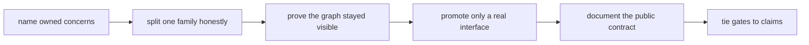
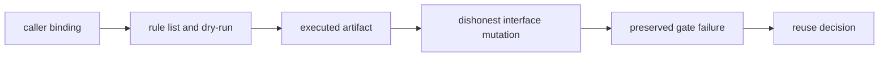

# Exercises

Use these after reading the five core lessons and the worked example. The goal is to make
your scaling decisions visible through ownership maps, interface notes, and review
evidence, not through a bigger folder tree.

## How to work through this set

Treat the ten exercises as one long repository-growth lab.

Before each answer:

1. name the boundary you are protecting
2. choose the smallest review surface that proves the claim
3. keep the concrete evidence next to the structural decision

If you skip the ownership question, the work turns into file-shuffling instead of
educational scaling practice.

Do them in order. The set is one day-long progression:

- Exercises 1-3 establish ownership and graph visibility.
- Exercises 4-6 decide interfaces and public contracts.
- Exercises 7-8 defend schemas and resources.
- Exercises 9-10 review the whole structural change like a maintainer.

For every answer, keep three things:

- the boundary you are protecting
- the evidence route you actually used
- one short sentence explaining why the split improves understanding instead of only moving files

## Recommended working layout

If you want one repository shape that can support the whole day, use a small lab like
this:

```text
module04-lab/
├── Snakefile
├── workflow/
│   ├── rules/
│   └── modules/
├── config/
├── publish/
├── results/
├── tests/
└── artifacts/
```

That layout makes it easier to compare ownership, interfaces, public contracts, and gates
without rebuilding the example from scratch for every prompt.

Build one small scaling review packet as you go:

- one ownership map that groups every current rule family
- one before-and-after entrypoint view
- one executable caller/module pair with an override matrix
- one short public file contract excerpt
- one gate table that ties each check to a structural claim
- one rejected hidden-coupling mutation with its preserved failure evidence

If those six artifacts are missing, the day usually turns into folder movement instead of
reviewable repository design.



Use that route deliberately. It keeps the growth story readable instead of rewarding the
largest diff.

For the module exercises, use this evidence loop:



The loop prevents a successful dry-run from becoming the only evidence for interface
quality.

## What a strong day packet looks like

By the time you finish all ten exercises, your work should leave behind one small,
reviewable packet instead of ten disconnected refactor fragments:

- one ownership map for the current workflow
- one before-and-after entrypoint comparison
- one executable module with two caller bindings and an override matrix
- one public file-contract excerpt plus one clearly internal path family
- one gate table matching checks to structural claims
- one hidden-coupling rejection with source, plan, artifact, and mutation evidence

If you cannot point to those artifacts, the exercise day is still too dependent on tacit
classroom guidance.

## Exercise 1: Name the current ownership problem

Take a working workflow with at least six rules and no existing structure plan. Classify
every rule into one owned concern such as preprocessing, summarization, publication, or
quality control.

What to hand in:

- the rule list
- one sentence of ownership for each group
- one place where the current file arrangement hides that ownership
- one reason the workflow is still one graph despite several concerns

Study note:
This is not a file-count exercise. It is an ownership-clarity exercise.

## Exercise 2: Choose one healthy include split

Move one coherent rule family into `workflow/rules/` while keeping the entrypoint short
and readable.

What to hand in:

- the before and after tree
- the top-level `Snakefile`
- before and after `--list-rules` output
- one split you deliberately did not make yet and why
- one sentence explaining what the entrypoint still teaches after the split

Study note:
If the entrypoint becomes harder to explain after the split, the split is not healthy yet.

## Exercise 3: Prove the graph stayed visible

Render the rule graph before and after the include split. Compare what a reviewer can
learn from both versions.

What to hand in:

- both graph artifacts
- one paragraph explaining what remained stable
- one paragraph explaining what became easier to review
- one signal that would tell you the split hid too much

Study note:
The point is not only that the graph still exists. The point is that a reviewer can still
learn from it quickly.

## Exercise 4: Decide whether a boundary is a module

Start from the capstone's `explicit-contract` module-interface specimen. Add a second
caller named `normalize_control` with:

- input `data/control.txt`
- output `build/control.txt`
- prefix `control-reviewed`

Do not edit the module implementation. Run the module interface audit route from a
disposable copy or reproduce its evidence commands directly.

What to hand in:

- both `use rule` bindings
- an override matrix for input, output, parameter, implementation, and publication
- rule-list and dry-run evidence showing both imported local rules
- both artifacts and the caller-selected prefixes they record
- one mutation that removes the control caller's policy or output binding
- the preserved rejection result
- your include-versus-module decision and one limit the evidence does not settle

Study note:
If the second caller requires private module edits, identify the missing interface surface
instead of forcing the promotion.

## Exercise 5: Write a public file contract

Choose one output family and document it as a consumer-facing contract while marking
related internal paths as internal.

What to hand in:

- the public path or path family
- the meaning of that path
- one internal path family that should never be consumed directly
- one change that would require explicit interface review

Study note:
This is where many scaling refactors fail. Paths look tidy, but nobody can say which ones
are safe for consumers.

## Midday self-check

Before you move into schema defense and full structural review, make sure your packet can
already answer all of these:

- which owned concerns exist even before you split files
- whether the entrypoint still explains the workflow quickly
- whether your candidate boundary has a real interface or only feels reusable
- which paths are public contracts and which remain rebuildable internal state

If you cannot answer those four questions cleanly, return to the earlier exercises and
make the packet more explicit before moving on.

## When you get stuck, diagnose the missing boundary first

Use this table before you start splitting more files:

| If you are stuck on... | Check whether you are missing... | Typical repair |
| --- | --- | --- |
| Exercise 1 or 2 | one ownership sentence per rule family | rewrite the ownership map before moving code |
| Exercise 3 or 6 | one explanation of what the entrypoint still teaches | compare the before-and-after entrypoint directly |
| Exercise 4 or 7 | one real interface note or contract boundary | name inputs, outputs, assumptions, or schema first |
| Exercise 8, 9, or 10 | one gate tied to one structural claim | choose the claim first, then the proof surface |

Most weak Module 04 answers are not short on files. They are short on named boundaries.

## Exercise 6: Review one abstraction you should reject

Run:

```bash
make capstone-module-interface-audit
```

Review the `hidden-coupling` specimen as if it were proposed in a pull request. It runs
successfully, lists the expected rules, and publishes an artifact. Decide whether that is
enough to accept it.

What to hand in:

- the `HIDDEN_MODULE_COUPLING_REPRODUCED` summary row
- the broad module config observation
- the absent caller policy binding
- the private module config read
- the artifact line selected by hidden policy
- a repair that narrows config and moves policy ownership to the caller
- one reason the rule list and dry-run could not diagnose the defect alone

Study note:
Do not report only that the row passed. Explain what defect the passing finding reproduced.

## Exercise 7: Break and defend a schema boundary

Define a public JSON or TSV contract with a schema, then introduce one incompatible change
and make the validation fail.

What to hand in:

- the documented contract path
- the schema or validation rule
- valid and invalid examples
- an explanation of why the failure protects a public boundary rather than an internal preference
- one note describing what kind of downstream consumer would break if the invalid change passed

Study note:
This exercise should make interface drift feel concrete rather than theoretical.

## Exercise 8: Keep resources portable while scaling

Pick two rule families with meaningfully different CPU, memory, or runtime needs. Declare
those needs without embedding scheduler-specific commands in the rules.

What to hand in:

- the workflow-side resource declarations
- two policy mappings such as local and cluster-oriented contexts
- paired dry-runs or review evidence
- the invariant that makes the workflow executor-independent
- one place where scheduler folklore was deliberately kept out of the rule surface

Study note:
If the rule contains scheduler folklore, the scaling cleanup has introduced a new problem.

## Exercise 9: Review a full structural pull request

Review a change that adds includes, promotes one module, introduces a file contract, and
adds a validation gate.

What to hand in:

- findings ordered by trust impact
- one graph comparison
- the module-interface summary and relevant source observations
- one controlled module-interface rejection result
- one contract validation result
- any boundary that should be simplified, postponed, or removed
- one gate you would add only after explaining exactly which structural claim it defends

Study note:
Separate acceptance evidence from rejection evidence. A green audit without a mutation
route does not prove the gate can discriminate.

## Exercise 10: Rehearse the next month of growth

Imagine the repository will gain one more assay, one more report, or one more publish
artifact next month. Decide where each change would land if your current structure is
healthy.

What to hand in:

- the predicted landing place for each new concern
- the boundary that absorbs it
- the proof route you would rerun afterward
- one sign that your current structure would need another redesign

Study note:
This is a future-maintainership exercise, not a praise-the-current-structure exercise. If
every new concern would reopen the whole tree, the current design is not ready yet.

## What weak completion looks like

Do not call the day complete if your answers do any of these:

- split files without naming owned concerns first
- promote a module because the file was long, not because the interface is real
- approve a module from rule listing and dry-run without inspecting config or caller policy
- describe public outputs without naming any internal state that must stay private
- add gates without saying which structural promise they defend
- praise "modularity" without showing where next month’s growth should land

## Exit standard for the exercise day

Do not count the day complete unless you can do all of this without leaning on the answer
page as a restructuring script:

- explain one split in terms of named ownership
- prove one module with two caller bindings without editing private implementation
- reject one hidden-coupling abstraction using source, runtime, and mutation evidence
- defend one public file contract and one internal path family clearly
- choose one gate that protects one specific structural claim
- predict where the next month of growth should land

## Mastery standard for this exercise set

Across all ten answers, Module 04 wants the same habits:

- you split by named ownership rather than by file length
- you promote modules only when the interface is real
- you treat public paths and schemas as contracts
- you choose proof routes that defend the exact structural claim under review

If your answer says only "the repo should be more modular," keep going.
