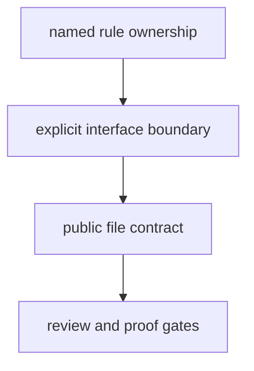
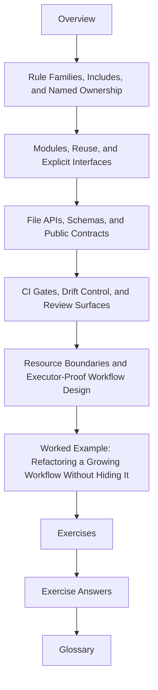

# Module 04: Scaling Workflows and Interface Boundaries

Modules 01 to 03 teach truthful workflow contracts, disciplined dynamic behavior, and
operational policy. Module 04 asks the next growth question:

> how do you make the repository larger without making the workflow harder to trust, review, or teach?

This module is about scaling through named boundaries. Includes, modules, file APIs,
schemas, and review gates matter only when they keep growth legible to another human.

## What this day must accomplish

By the end of Module 04, you should be able to do five things without hiding the graph:

- split a large workflow by owned concerns instead of by file length
- choose between `include:` and `module` for an interface reason, not an aesthetics reason
- explain which paths are public contracts and which remain internal execution detail
- defend one schema or validation boundary that fails early when an interface drifts
- choose a gate that proves the repository stayed understandable after the split

## The scaling ladder for the whole module

Keep this order in front of you all day:



If a split does not improve ownership, it is noise. If a module does not expose an
interface, it is camouflage. If a gate does not defend a named boundary, it is ceremony.

## The running lab for the whole day

Use one repository story all day instead of several unrelated refactors:

- one top-level `Snakefile` has grown beyond comfortable review
- two rule families clearly belong under `workflow/rules/`
- one candidate sub-workflow might deserve `workflow/modules/`
- one publish-facing path family must be documented as public
- one schema and one gate prove the refactor preserved trust

Every page should help you answer one concrete review question about that repository.

## Plan for the day

| Session | What you do | Evidence you keep |
| --- | --- | --- |
| ownership baseline | map the current rule graph and who owns each concern | ownership table and rule list |
| include split | move one coherent concern into `workflow/rules/` | short entrypoint plus before/after graph |
| interface decision | decide whether one boundary stays an include or becomes a module | interface decision record |
| file contract | document public paths and internal paths separately | file contract note plus schema |
| review gates | choose the smallest honest proof route for the new structure | gate table and validation output |
| independent practice | complete all ten exercises | refactored repository and review packet |

The day is successful when the workflow is easier to explain after the split than before
it, even to someone who did not watch you make the change.

## Study route



Read the module in that order the first time.

The route matters:

- start with ownership before you talk about modules
- document the public contract before you design the gate
- review resource boundaries after the structural split is already clear

## The ten files in this module

1. Overview (`index.md`)
2. [Rule Families, Includes, and Named Ownership](rule-families-includes-and-named-ownership.md)
3. [Modules, Reuse, and Explicit Interfaces](modules-reuse-and-explicit-interfaces.md)
4. [File APIs, Schemas, and Public Contracts](file-apis-schemas-and-public-contracts.md)
5. [CI Gates, Drift Control, and Review Surfaces](ci-gates-drift-control-and-review-surfaces.md)
6. [Resource Boundaries and Executor-Proof Workflow Design](resource-boundaries-and-executor-proof-workflow-design.md)
7. [Worked Example: Refactoring a Growing Workflow Without Hiding It](worked-example-refactoring-a-growing-workflow-without-hiding-it.md)
8. [Exercises](exercises.md)
9. [Exercise Answers](exercise-answers.md)
10. [Glossary](glossary.md)

## How to use the file set

| If you need to... | Start here |
| --- | --- |
| split a crowded workflow into named concerns without losing the visible graph | [Rule Families, Includes, and Named Ownership](rule-families-includes-and-named-ownership.md) |
| decide whether a boundary is a real reusable module or only a rule-family split | [Modules, Reuse, and Explicit Interfaces](modules-reuse-and-explicit-interfaces.md) |
| mark which paths are safe for consumers and which remain internal | [File APIs, Schemas, and Public Contracts](file-apis-schemas-and-public-contracts.md) |
| choose validation and CI surfaces that defend the refactor honestly | [CI Gates, Drift Control, and Review Surfaces](ci-gates-drift-control-and-review-surfaces.md) |
| keep resource declarations portable while the repository grows | [Resource Boundaries and Executor-Proof Workflow Design](resource-boundaries-and-executor-proof-workflow-design.md) |
| see the whole module as one repository repair | [Worked Example: Refactoring a Growing Workflow Without Hiding It](worked-example-refactoring-a-growing-workflow-without-hiding-it.md) |
| test your own understanding | [Exercises](exercises.md) |
| compare your reasoning against a reference answer | [Exercise Answers](exercise-answers.md) |
| stabilize the module vocabulary | [Glossary](glossary.md) |

## The running question

Carry this question through every page:

> if the repository grows again next month, which exact boundary should absorb the change so the workflow stays explainable?

Good Module 04 answers usually mention one or more of these:

- a rule-family split with one sentence of ownership
- a module interface with named inputs, outputs, and assumptions
- a file contract that separates public from internal paths
- a schema or validation route that catches drift early
- a review gate that proves the structural claim you just made

## What the module should change in your head

If the day is working, you should feel these transitions:

- “modular” stops meaning “many files” and starts meaning “clear ownership”
- `include:` stops sounding weaker than `module`
- file paths stop looking like mere folder choices and start looking like contracts
- lint and CI stop feeling generic once they are tied to a named boundary
- repository growth stops sounding scary when the next split already has a place to go

## Commands to keep close

These commands form the evidence loop for Module 04:

```bash
snakemake --list-rules
snakemake --rulegraph mermaid-js > rulegraph.mmd
snakemake -n
snakemake --lint
make capstone-tour
```

They answer different questions:

- which rule surfaces are visible right now
- whether the structural split changed the graph you intended to preserve
- whether the planning surface still matches the contract
- whether obvious design smells are already exposed
- how the capstone expresses boundaries through a complete walkthrough

## Exit standard

Do not move on until all of these are true:

- you can explain one split that belongs in `workflow/rules/` and one that deserves `workflow/modules/`
- you can name one public path family and one internal path family without hesitation
- you can describe one schema or validation check that protects a real interface
- you can say which gate should fail first if the structural refactor quietly breaks trust
- you can explain one resource declaration as a portable workflow claim rather than scheduler folklore
- you have completed all ten exercises and preserved behavior through at least one structural split

When those become ordinary, Module 04 has done its job.
