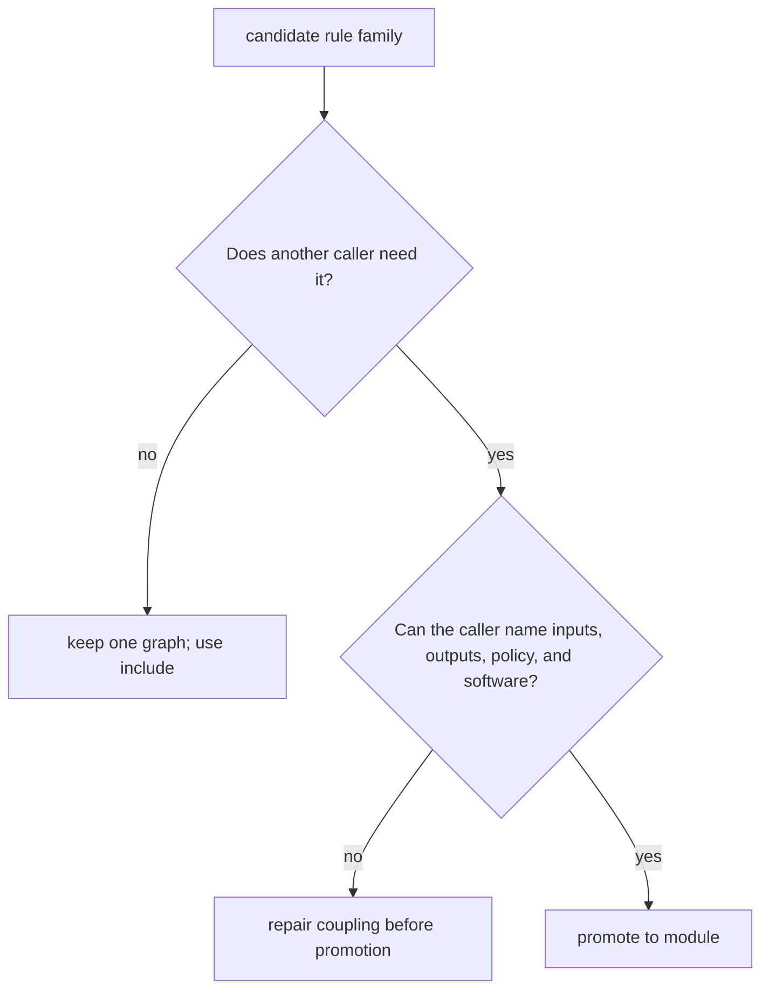
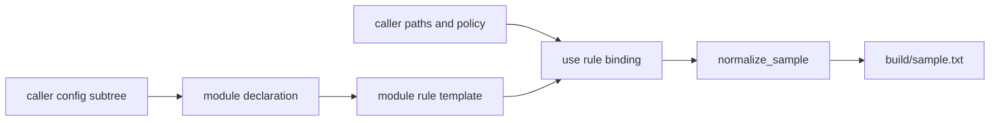
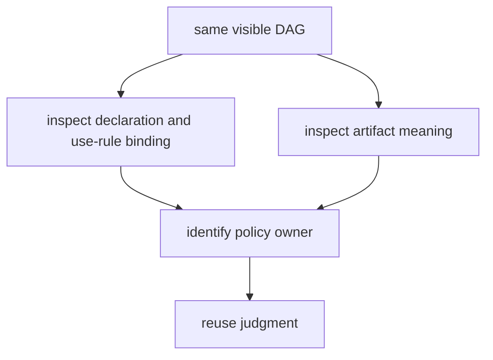

# Modules, Reuse, and Explicit Interfaces

An include and a module both move rules out of the top-level `Snakefile`. That visual
similarity causes a common design error: treating `module` as a more advanced spelling of
`include`.

They solve different problems.

- An include gives one workflow graph clearer internal ownership.
- A module gives a caller a reusable rule bundle with an explicit binding boundary.

This lesson teaches that boundary through two workflows that plan and run successfully.
Only one is suitable for reuse.

## Start with the decision, not the directory

Before writing syntax, complete this sentence:

> Another caller needs this rule bundle because ...

If the answer is only "the main Snakefile is long," use an include. File length can reveal
an ownership problem, but it does not create a reusable interface.

Use this first decision table:

| Situation | Better boundary | Reason |
| --- | --- | --- |
| several rules serve one repository-owned graph | `include:` | the split names internal ownership |
| a rule template needs different caller-owned paths | `module` plus `use rule` | the caller must bind a reusable interface |
| code is long but depends on many shared globals | include, then reduce coupling | moving it would hide rather than remove coupling |
| an independently released workflow is consumed at a stable version | versioned module | reuse and compatibility are real concerns |

The choice is about ownership, not prestige.



## What `include:` actually promises

An include parses another file into the current workflow:

```python
include: "workflow/rules/publish.smk"
```

The included rules share the current workflow's configuration, helpers, and naming
context. That is reasonable when the file owns one concern inside one graph.

For example, the course capstone keeps publication rules in:

```text
workflow/rules/publish.smk
```

Those rules are not pretending to be reusable by an unrelated workflow. They participate
in the capstone's one publish contract. The include makes ownership easier to inspect
without inventing a caller interface.

Do not describe an include as "less modular." It may be the more honest boundary.

## A module has two separate surfaces

Snakemake module use has two important surfaces:

1. the module declaration selects a Snakefile and the config it may see
2. `use rule` imports a rule and binds it into the caller's graph

Here is the explicit specimen:

```python
configfile: "config.yaml"

module normalize:
    snakefile: "module/Snakefile"
    config: config["normalize"]

use rule normalize from normalize as normalize_sample with:
    input:
        source="data/sample.txt"
    output:
        artifact="build/sample.txt"
    params:
        prefix=config["normalize"]["prefix"]
```

Read it from top to bottom:

- `module normalize` names the imported workflow bundle.
- `snakefile` locates the module implementation.
- `config: config["normalize"]` passes one owned subtree, not all caller state.
- `use rule normalize` selects one rule from the module.
- `as normalize_sample` gives it a local graph name.
- `with` binds caller-owned input, output, and policy.

The module owns how normalization happens. The caller owns where it happens and which
policy gives the artifact meaning.



## Read the module implementation as a template

The paired module file contains:

```python
rule normalize:
    input:
        source="unbound.txt"
    output:
        artifact="unbound.txt"
    params:
        prefix="UNBOUND"
    shell:
        """
        mkdir -p "$(dirname {output.artifact})"
        printf '%s\n' '{params.prefix}' > '{output.artifact}.candidate'
        cat '{input.source}' >> '{output.artifact}.candidate'
        mv '{output.artifact}.candidate' '{output.artifact}'
        """
```

The placeholder values make the rule's required shape visible. The caller replaces them.
The shell body can change without changing the caller contract as long as it preserves:

- one source input
- one published artifact
- one caller-selected prefix
- atomic publication through candidate and rename

That list is a usable interface statement. "The module normalizes data" is not.

## Build an override matrix before promotion

Write an override matrix for every imported rule:

| Surface | Module default | Caller binding | Owner after import |
| --- | --- | --- | --- |
| input | `unbound.txt` | `data/sample.txt` | caller |
| output | `unbound.txt` | `build/sample.txt` | caller |
| parameter | `UNBOUND` | `config["normalize"]["prefix"]` | caller |
| shell implementation | private command | unchanged | module |
| publication method | candidate then rename | unchanged | module |

This matrix prevents a misleading interface note that lists inputs and outputs but ignores
policy or publication.

For a real scientific rule, add:

- threads and abstract resources
- environment or container ownership
- log and benchmark paths
- wildcard constraints
- schema assumptions for public artifacts

Do not force every surface into the caller. The goal is deliberate ownership, not maximum
override count.

## Compare the hidden-coupling model

The counterexample looks reasonable:

```python
module normalize:
    snakefile: "module/Snakefile"
    config: config

use rule normalize from normalize as normalize_sample with:
    input:
        source="data/sample.txt"
    output:
        artifact="build/sample.txt"
```

The imported module privately reads:

```python
params:
    prefix=config["private"]["prefix"]
```

This workflow runs successfully. Its artifact begins with `inherited`. The caller cannot
explain that value without opening private module code and searching every config access.

The defect is not "modules may never read config." The defect is that caller-visible
artifact meaning depends on policy the interface does not name.

Broad config passing causes several review problems:

- a new private read can change behavior without changing the call site
- the module's real configuration contract is discovered by search, not declaration
- callers cannot tell which config keys are compatibility-sensitive
- tests may cover one caller while another supplies a different broad config shape

Narrow config is not a magic cure. A poorly named subtree can still hide too much. It is a
boundary that makes review possible.

## Run the paired audit

From the course directory:

```bash
make capstone-module-interface-audit
```

Then read:

```text
artifacts/audit/reproducible-research/deep-dive-snakemake/module-interfaces/
```

Use this order:

1. `route.txt`
2. `MODULE_INTERFACE_AUDIT_GUIDE.md`
3. `summary.tsv`
4. both caller `Snakefile` files
5. both module `Snakefile` files
6. list-rules and dry-run traces
7. execution traces and artifact observations

The expected findings are:

```text
EXPLICIT_MODULE_CONTRACT_PRESERVED
HIDDEN_MODULE_COUPLING_REPRODUCED
```

Both rows say `PASS`. The second pass means the audit successfully observed the defect.

## Why dry-run cannot settle the review

Both specimens expose:

```text
all
normalize_sample
```

Both dry-runs plan the same dependency shape. Both executions produce an artifact. Graph
visibility proves that the imported rule participates in the intended plan. It does not
prove that configuration ownership is explicit.



A serious review combines:

- source-level interface observations
- rule listing
- dry-run
- executed artifact meaning
- rejection tests

## Inspect the capstone's real QC boundary

The capstone uses a QC module in `workflow/rules/preprocess.smk`:

```python
module qc:
    snakefile: "../modules/qc_module/Snakefile"
    config: config

use rule qc from qc as qc_raw with:
    input:
        fastq=lambda wc: get_raw_fastq(wc)
    output:
        json=f"{RESULTS}/{{sample}}/qc_raw.json",
        tsv=f"{RESULTS}/{{sample}}/qc_raw.tsv",
```

This is more explicit than importing a rule unchanged: the caller binds data paths, output
paths, logs, benchmarks, and resources. It is less narrow than the control specimen
because the module receives the complete capstone config.

Do not force a binary verdict. Record the remaining coupling:

- the module reads `_env_python`
- the module reads `benchmarks_dir`
- it derives `PYTHONPATH` from `workflow.basedir`

Then ask whether those values are implementation assumptions or caller-owned policy. A
future refactor could pass a dedicated module config subtree, but only after deciding who
should own those values. Replacing `config` mechanically would not be a reasoned repair.

## Import only the public rules you need

`use rule` also defines graph surface.

Prefer:

```python
use rule qc from qc as qc_raw with:
    ...
```

over importing a broad rule set merely because it is available. Each imported rule becomes
part of the caller's review burden. A reusable module can contain private supporting rules,
but the caller should import only the surface it intends to own locally.

When importing several rules, document:

- which imported rules are caller entrypoints
- which outputs cross back into the caller graph
- whether rule names are renamed to prevent collisions
- which relationships must remain inside the module

## Test that the audit can reject dishonesty

Run:

```bash
make capstone-module-interface-selftest
```

The tests mutate disposable copies. They reject:

- broad config in the explicit control
- a missing caller policy binding
- a changed caller output binding
- exposed policy in the hidden-coupling model
- removal of the hidden module's private policy read

That last pair matters. A defect specimen that has been accidentally repaired should fail
its promised finding rather than continue producing a ceremonial green row.

## Decide what remains private

An interface is useful partly because it says what callers must not rely on.

Private module details may include:

- command decomposition
- candidate publication filenames
- internal helper rules
- log message wording
- implementation-specific intermediate paths

Caller-visible contracts usually include:

- imported local rule names
- caller-bound input and output shapes
- parameters that affect artifact meaning
- environment compatibility assumptions
- public artifact schema or semantics

If every implementation detail becomes public, the module cannot evolve. If nothing is
public, callers cannot trust it.

## Version remote modules deliberately

Local modules teach the boundary without adding distribution concerns. Remote modules add
another contract:

- source identity
- release or commit pin
- compatibility policy
- upgrade evidence

Do not point a production workflow at a moving branch and call the result reusable. The
caller needs an attributable module version and a review route for upgrades.

This lesson's audit does not prove remote compatibility. It proves the local binding shape
that versioned reuse would still need.

## Review checklist

Before approving a module boundary, answer:

- Is there a real second caller or a credible independent reuse case?
- Is the module config narrower than the caller's complete state?
- Does each `use rule` binding name caller-owned paths?
- Are policy values that affect artifact meaning visible at the call site?
- Can module implementation change without surprising callers?
- Are imported rule names and public outputs collision-safe?
- Does dry-run preserve the intended graph?
- Does execution preserve artifact meaning and atomic publication?
- Do rejection tests fail when the contract becomes broad or incomplete?

One unexplained answer is enough to postpone promotion.

## Independent practice

Extend the explicit specimen with a second imported rule named `normalize_control`.

Give it:

- `data/control.txt`
- `build/control.txt`
- a `control-reviewed` prefix

Do not edit the module implementation. Capture the call sites, rule listing, dry-run, and
both artifacts. If adding a second caller requires private module changes, write down which
missing interface surface caused the failure.

## Exit standard

Do not leave this lesson until you can:

- explain why an include can be stronger than a premature module
- trace module declaration, rule import, and caller binding as separate surfaces
- identify broad config and private policy reads in the hidden-coupling specimen
- explain why two identical visible DAGs can have different interface quality
- evaluate the capstone QC module without forcing a simplistic pass/fail verdict
- run both the audit and its rejection tests
