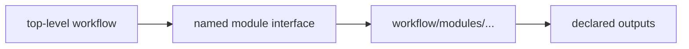

# Modules, Reuse, and Explicit Interfaces

Once rule-family splits are working, the next scaling question appears:

> is this still one workflow graph with clearer organization, or is one part becoming a reusable workflow boundary of its own?

That is where modules enter.

## How to read this page

Read this page with one boundary test in mind:

> could another caller understand this interface without learning the private repository
> story first?

If the answer is no, you probably do not have a real module yet. You only have moved code.

## Why this lesson comes after includes

Modules are easier to misuse than includes because they sound more advanced.

Module 04 puts them second on purpose:

- first clarify ownership inside one graph
- then ask whether one boundary has become stable enough to reuse
- only then promote that boundary into a module

## A module is not just a smaller file

A workflow module should exist for a stronger reason than convenience.

It should answer a real boundary question:

- can this workflow bundle be named as one thing
- does it have explicit inputs and outputs
- can another reader understand the main graph without reading every implementation detail first

If those answers are weak, the repository probably needs clearer includes, not a module.

## A strong beginner habit

Before promoting a module, write four short answers:

1. what does it consume
2. what does it produce
3. what assumptions belong to the interface
4. what stays private implementation detail

If any of those answers are fuzzy, keep the boundary as an include for now.

## What a healthy module buys you

A healthy module can help when:

- a sub-workflow has a stable contract
- the same bundle is reused in more than one context
- the top-level workflow stays easier to read after the boundary is introduced

This is why the capstone keeps reusable bundles under `workflow/modules/` for rule groups
such as QC or screen logic.

The module is useful because it has a named interface, not because the word sounds
architectural.

## The common beginner mistake

People often promote a boundary to `workflow/modules/` because:

- the file is long
- the folder looks cleaner
- the repository wants to feel "more architectural"

None of those is a sufficient interface reason.

## What a module must make explicit

When a boundary becomes a real module, the reader should be able to answer:

- what does this module consume
- what does it produce
- which paths or parameters belong to its interface
- what remains private implementation detail

If the answers live only in the author's head, the module boundary is too weak.

## A quick self-check before you keep reading

Take one candidate boundary and ask:

- do callers know the promised outputs
- or do they still depend on hidden globals, path conventions, or shared helper trivia

That contrast is the real module test.

## One healthy mental model

This matters because the main graph should still be explainable:

- the top-level workflow names the boundary
- the module owns its internal implementation
- the interface is what another rule family is allowed to depend on

That is a stronger contract than "the code happens to live elsewhere."

## A weak module smell

Weak module shape:

- the top-level workflow imports a module
- the module reads hidden globals or path conventions from many places
- the reader still needs to inspect private files before understanding the main graph

This does not create a reusable boundary. It only moves confusion.

## A stronger module shape

Stronger module shape:

- the top-level workflow names what the module is for
- the interface paths or parameters are visible at the call site
- the module produces a stable artifact family that other code can reason about

That is the kind of boundary worth introducing.

## Modules and file APIs belong together

Once you have a true module boundary, file-interface thinking becomes important fast.

The reader should know:

- which module outputs are safe for the rest of the workflow to depend on
- which outputs are internal staging or helper state
- whether a change to those outputs is a local refactor or an interface break

That is why this page leads directly into file APIs and schema validation.

## What a good explanation sounds like

Strong:

> This became a module because the interface is explicit enough that callers can name the
> inputs, outputs, and assumptions without opening implementation files.

Weak:

> This became a module because it looked reusable.

## Common failure modes

| Failure mode | What it looks like | Better repair |
| --- | --- | --- |
| a module exists only because a file was long | the interface is vague and reuse is imaginary | keep the split at rule-family level instead |
| hidden globals leak into module behavior | the call site does not explain the contract | make inputs and outputs explicit at the boundary |
| the main graph becomes harder to read after modularization | readers open implementation files too early | simplify the top-level orchestration surface |
| reusable outputs are undocumented | interface drift is hard to detect | pair modules with file-API thinking and validation |
| modules become junk drawers | the boundary exists, but no one can name its job | narrow the module to one stable concern |

## The explanation a reviewer trusts

Strong explanation:

> this boundary became a real module because the QC bundle has a stable interface, the main
> workflow can name its inputs and outputs clearly, and the top-level graph is easier to
> explain after the module is introduced.

Weak explanation:

> we moved it into `workflow/modules/` because it looked more reusable there.

The first explanation gives an interface reason. The second gives a folder preference.

## End-of-page checkpoint

Before leaving this page, you should be able to:

- explain one case where a rule family should remain an include rather than a module
- name the minimum interface questions a module must answer
- describe one sign that a module boundary is too vague to trust
- explain why modules and file APIs naturally belong in the same discussion
