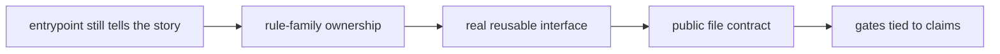
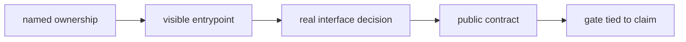

# Worked Example: Refactoring a Growing Workflow Without Hiding It

This file ties the whole module together around one realistic problem:

> a workflow still works, but every new rule makes the repository harder to review, teach, and change safely.

The question is not "how do we create more files?" The question is how to make growth
land in named places without hiding the graph.

## How to use this worked example

Treat this page like a repository refactor lab, not like a tidy after-action report.

For each repair step:

1. name the ownership or interface boundary you are changing
2. predict which review surface should prove the change stayed honest
3. keep the before-and-after evidence next to the structural decision

If you skip the ownership question, the example turns into folder choreography instead of
workflow design.

## If you are learning this without the live class

Use the example in five passes instead of trying to absorb the whole refactor in one read:

1. name the current owned concerns before you move any files
2. stop after the include split and check whether the entrypoint still tells the story
3. decide include versus module only after you can name the interface in plain language
4. write the public contract before you tighten any gate
5. finish by matching each structural claim to one review surface

If you cannot explain the entrypoint after pass 2, do not promote anything to a module
yet. Most Module 04 confusion starts when learners chase abstraction before they have
named ownership.

## The one-day teaching goal

By the end of this example, a learner should be able to refactor a growing workflow so
that:

- rule families land in named places
- the top-level graph stays visible
- only real interfaces become modules
- public paths stay distinct from internal state

That is the educational goal. The number of files is not the goal.

## The lab route

Work through the example in this order:

1. name the current rule families that already exist implicitly
2. split one concern into `workflow/rules/` without weakening the entrypoint
3. decide whether one candidate boundary is only an include or a true module
4. document the public file contract the refactor must preserve
5. finish by choosing gates that prove the new structure still tells the truth

Keep a small scaling packet as you go:

- one ownership note for each rule family you split out
- one before-and-after view of the top-level entrypoint
- one include-versus-module decision note for a real candidate boundary
- one short public file contract excerpt
- one gate table that ties each check to a structural claim

That packet is not overhead. It is the thing that turns "I moved files around" into
"another maintainer can review why this split improved trust."

## What to keep beside you while you work

Keep these four surfaces visible while you move through the example:

- the top-level `Snakefile`
- the current rule list or rulegraph
- the public file contract note
- the gate or review surface you are using for each claim

Those four views are enough to explain whether the repository became clearer or only more
abstract.

## The evidence packet you should keep visible

By the end of the example, keep one small packet that contains:

- one ownership map for the current rule families
- one before-and-after entrypoint view
- one include-versus-module decision with named inputs, outputs, and assumptions
- one public-contract note that separates stable paths from rebuildable ones
- one gate table showing which check protects which structural promise

If one of those pieces is missing, the repository may look more modular, but the learner
still cannot defend the refactor.

## The starting situation

Assume the repository already has:

- truthful rule contracts from Module 01
- disciplined dynamic discovery from Module 02
- explicit production policy from Module 03

What it does not yet have is a calm scaling story.

The maintainers currently live with:

- one `Snakefile` that mixes preprocessing, summarization, and publishing
- helper path logic and structural logic in the same place
- no clear public-versus-internal path note
- CI checks that run, but do not clearly defend any structural claim

That is a good Module 04 starting point because the workflow is not broken. It is merely
becoming exhausting to explain.

## What goes wrong when a learner trusts the starting situation

Use this card before you repair anything:

| If you notice... | The repository is hiding... | Smallest review surface |
| --- | --- | --- |
| every new rule is added near unrelated logic | owned concerns have not been named | one ownership map and current rule list |
| a proposed module still depends on globals or hidden helpers | the interface is not real yet | one explicit interface note naming inputs, outputs, and assumptions |
| paths look tidy but consumers still do not know what is stable | the public contract is undocumented | one short file-contract note |
| CI runs, but nobody can say what structural claim it defends | gates are generic ceremony | one gate table that ties checks to claims |

If you can name the hidden defect first, the structural repair stops feeling cosmetic.



The order matters. Splitting files before naming ownership, or tightening CI before
documenting the public contract, usually creates more ceremony without more clarity.

## Start with ownership, not abstraction

The first repair is a rule-family split, not a module promotion.

Read the large file and write one sentence of ownership for each cluster of rules. A
useful early outcome might look like this:

```text
workflow/rules/
  preprocess.smk
  summarize_report.smk
  publish.smk
```

Each file now owns one coherent concern:

- `preprocess.smk` prepares declared working data
- `summarize_report.smk` turns processed data into public summaries and report inputs
- `publish.smk` assembles and verifies the downstream contract

The repository improves because a reviewer can explain each boundary quickly, not because
the file count increased.

Capture that ownership explicitly:

| Boundary | Owned concern | What it should not absorb |
| --- | --- | --- |
| `preprocess.smk` | declared preparation of working data | publish semantics or report presentation policy |
| `summarize_report.smk` | transformation into reader-facing summaries | scheduler choices or unrelated path plumbing |
| `publish.smk` | final contract assembly and checks | ad hoc preprocessing helpers or silent side outputs |

## Why this first move matters educationally

Many learners jump straight to modules because modules sound more advanced.

Module 04 needs the opposite instinct:

- first name the owned concerns
- then split one visible graph by those concerns
- only then ask whether any boundary deserves reuse as an interface

## Keep the entrypoint short and honest

The top-level `Snakefile` should still reveal orchestration:

```python
configfile: "config/config.yaml"

include: "workflow/rules/preprocess.smk"
include: "workflow/rules/summarize_report.smk"
include: "workflow/rules/publish.smk"

rule all:
    input:
        "publish/v1/manifest.json"
```

This entrypoint still answers the most important questions:

- where configuration starts
- which major rule families exist
- what final contract the workflow promises

If the entrypoint becomes a maze of indirection, the split has already gone too far.

Capture evidence immediately:

```sh
snakemake --list-rules
snakemake --rulegraph mermaid-js > rulegraph.mmd
snakemake -n
```

The structural refactor is not successful unless those surfaces still tell the same
workflow story.

That is the immediate test after every split: the rule list, the graph, and the dry-run
should still let a new learner explain the workflow in the same order as before.

## The entrypoint audit before you celebrate

Before you call the include split healthy, make sure you can answer all four of these:

| Question | Healthy answer |
| --- | --- |
| What stayed visible? | configuration start, major concerns, and final promised contract |
| What moved safely? | one coherent rule family with named ownership |
| What would count as too much indirection? | an entrypoint that no longer teaches the workflow order quickly |
| What evidence proves the split stayed honest? | before-and-after rule list, graph, and dry-run for the same contract |

If any row stays vague, keep repairing. The split may still be hiding too much.

## A short checkpoint before you continue

Pause here and say one sentence like this:

> The entrypoint is shorter now, but it still explains configuration, major concerns, and
> the final promised contract.

If that sentence is hard to defend, the split may already be hiding too much.

## Promote only a real reusable boundary

Now inspect two candidate concerns instead of promoting the most impressive-looking one.

| Candidate | Evidence of reuse | Interface state | Decision |
| --- | --- | --- | --- |
| publication rules | used only by this workflow's final contract | depends on local manifest and publish helpers | keep as an include |
| QC transformation | needed for raw and trimmed inputs with the same implementation | caller can bind paths, logs, benchmarks, resources, and policy | promote to a module |

The publication file is long enough to split, but it remains part of one graph. The QC
transformation has two real callers and one stable implementation. That is an interface
reason.

### Write the implementation template

The module owns transformation mechanics:

```python
rule qc:
    input:
        fastq="unbound.fastq.gz"
    output:
        json="unbound.json",
        tsv="unbound.tsv",
    params:
        quality_floor="UNBOUND"
    shell:
        """
        qc-tool \
          --input '{input.fastq}' \
          --json '{output.json}' \
          --tsv '{output.tsv}' \
          --quality-floor '{params.quality_floor}'
        """
```

The placeholders make required surfaces visible. They are not the caller's paths.

### Pass only the owned configuration

Declare the module with one subtree:

```python
module qc:
    snakefile: "../modules/qc/Snakefile"
    config: config["qc"]
```

Do not use `config: config` merely because it avoids deciding which values the module may
read. Broad config makes every private read a possible interface dependency.

### Bind each caller explicitly

The raw caller owns its local graph identity:

```python
use rule qc from qc as qc_raw with:
    input:
        fastq=lambda wc: get_raw_fastq(wc)
    output:
        json=f"{RESULTS}/{{sample}}/qc_raw.json",
        tsv=f"{RESULTS}/{{sample}}/qc_raw.tsv",
    params:
        quality_floor=config["qc"]["quality_floor"]
    log:
        f"{LOGS}/{{sample}}/qc_raw.log"
    benchmark:
        f"{BENCH}/qc_raw_{{sample}}.txt"
```

The trimmed caller imports the same module rule under another local name:

```python
use rule qc from qc as qc_trimmed with:
    input:
        fastq=f"{RESULTS}/{{sample}}/trimmed.fastq.gz"
    output:
        json=f"{RESULTS}/{{sample}}/qc_trimmed.json",
        tsv=f"{RESULTS}/{{sample}}/qc_trimmed.tsv",
    params:
        quality_floor=config["qc"]["quality_floor"]
```

The module did not change when the second caller appeared. That is concrete evidence that
the boundary is reusable.

### Record the override matrix

| Surface | Module owns | Caller owns |
| --- | --- | --- |
| input/output shape | required names and types | repository paths and wildcards |
| policy | interpretation of `quality_floor` | selected value |
| implementation | QC command and publication method | none |
| graph identity | reusable rule name | local imported rule name |
| logs and benchmarks | whether evidence is required | local evidence paths |
| resources | algorithm's abstract needs | local values or functions |

This matrix is the module contract for the refactor. Without it, the code move is ahead of
the reasoning.

### Compare the tempting hidden repair

A smaller diff would pass the entire config:

```python
module qc:
    snakefile: "../modules/qc/Snakefile"
    config: config
```

and let module code select:

```python
params:
    quality_floor=config["private"]["quality_floor"]
```

Both callers could still run. Neither call site would explain why artifact meaning changes
when `private.quality_floor` changes.

Reject this version even if its current bytes match the explicit version. The refactor is
supposed to reduce the amount of private history a caller must know.

### Prove the distinction with the paired audit

Run:

```bash
make capstone-module-interface-audit
make capstone-module-interface-selftest
```

The executable specimens use a smaller normalization rule, but preserve the same boundary:

- the control passes a narrow config subtree and binds policy at the call site
- the counterexample passes broad config and reads private policy inside the module
- both list the same rules
- both dry-run successfully
- both publish an artifact
- rejection tests fail when the control broadens or the counterexample stops reproducing
  hidden coupling

Keep the two `summary.tsv` findings, source observations, dry-run traces, artifact lines,
and rejection results in the refactor packet.

## What the learner should notice now

The hard part of modularity is not moving code. It is assigning ownership so a second
caller can bind the rule without editing private implementation or learning hidden config
history.

## Write the public contract before the gate

The refactor is still incomplete if another engineer cannot answer which files are safe
for consumers.

So add or strengthen a contract note such as `FILE_API.md`:

| Path | Stability | Meaning |
| --- | --- | --- |
| `publish/v1/manifest.json` | public | inventory and checksums for the published bundle |
| `publish/v1/summary.json` | public | machine-readable summary with a defined schema |
| `results/staged/` | internal | rebuildable intermediate state with no compatibility promise |
| `.snakemake/` | engine state | private execution metadata |

This step matters because public trust should live in a small documented surface, not in
whoever happens to know the directory tree best.

This is where structural cleanup stops being private taste. Once the public contract is
named, path promises become reviewable and later refactors can be judged against something
more durable than preference.

## Add gates that defend the claim you just made

Only now should you tighten validation.

After the split, different questions need different proof routes:

- does the visible graph still make sense
- does the public file contract still verify
- did the plan for the final target remain stable

That leads to a gate set with separate responsibilities:

- `snakemake --list-rules` or rulegraph review for architecture visibility
- `snakemake -n` for target planning
- `capstone-module-interface-audit` for config and caller ownership
- `capstone-module-interface-selftest` for gate discrimination
- targeted schema or file-contract validation for public paths
- `snakemake --lint` for design smells that the split exposed

This is the difference between a meaningful gate and generic CI noise.

Tie each gate to the claim it protects:

| Gate | Claim defended |
| --- | --- |
| `snakemake --list-rules` or rulegraph review | the architecture is still legible after the split |
| `snakemake -n` | the final target plan has not changed accidentally |
| module interface audit | explicit and hidden models exhibit their promised ownership |
| module interface selftest | broad config and missing bindings are rejected |
| contract or schema validation | public outputs still match the published promise |
| `snakemake --lint` or focused structure checks | the refactor did not introduce hidden design debt |

## The gate audit before you move on

Do not just list more checks. Test whether each one answers a named structural question:

| Claim | Smallest honest review surface |
| --- | --- |
| the graph still tells the same workflow story | rule list or rulegraph comparison |
| the final target plan did not drift | `snakemake -n` |
| callers still own imported paths and policy | module interface audit |
| the interface gate can detect dishonest controls | module interface selftest |
| public outputs still match the repository promise | contract or schema validation |
| the split did not add hidden design debt | `snakemake --lint` or one focused structure check |

If you add a gate before you can fill this table, the gate is probably noise.

## Write the refactor acceptance record

Do not close with "the workflow is more modular." Record:

| Claim | Observation | Decision | Remaining limit |
| --- | --- | --- | --- |
| includes own coherent local concerns | entrypoint and rule-family map | accepted | future growth may change ownership |
| QC is a reusable boundary | two caller bindings and override matrix | accepted | remote version compatibility not tested |
| module config is bounded | source observation in audit report | accepted | capstone's current QC module still has broader legacy config |
| interface gate discriminates | seven mutation tests | accepted | scientific QC correctness is outside this gate |
| public outputs remain compatible | schema and publish verification | accepted | downstream migration not rehearsed |

This record separates the instructional control from the current capstone limitation. Do
not claim the existing capstone QC module is already as narrow as the teaching specimen:
it still receives the complete config and should be reviewed before any mechanical
rewrite.

## What a strong summary sounds like

Strong:

> The repository split by ownership first, promoted only explicit interfaces, documented
> the public contract, and chose gates that defend those exact structural claims.

Weak:

> We made it more modular and added some CI.

## Keep resource assumptions portable

One last review often appears during scaling: some rule families are heavier than others.

Keep that distinction visible, but keep executor policy out of the rules. The repository
should be able to say:

- which concern is heavier
- which resource declarations belong to the workflow
- which cluster or local mapping belongs to operating policy

If a rule hardcodes scheduler commands or node names, the structural cleanup has created a
new portability problem.

## The repaired scaling story

By the end of the refactor, the workflow can be described cleanly:

1. top-level orchestration stays visible
2. rule families are grouped by named ownership
3. only genuine interfaces become modules
4. public paths are documented separately from internal state
5. gates defend the structural promises the repository actually makes

That is what it means to refactor a growing workflow without hiding it.



Read that diagram literally. If one step is missing, the repository may still run, but
the scaling story is not yet teachable.

## Review questions for the repaired design

When you inspect a repository shaped like this, ask:

1. which split clarifies ownership and which only creates indirection
2. where is the public contract documented
3. which boundary, if broken, would fail first through validation
4. which candidate module still depends on hidden globals
5. how will the next growth change land without making the graph harder to teach

If those answers are visible, the module’s scaling story has landed.

## If the module still feels abstract

Do this recovery loop in order:

1. print the current owned concerns in one short table
2. point to the top-level entrypoint and say what story it still teaches
3. name one candidate interface and list the assumptions it would need to expose
4. mark one public path family and one internal path family
5. choose one gate and say which structural claim it would be the first to catch

Most Module 04 confusion is not about syntax. It is about losing track of which boundary
owns which future change.

Before leaving the module, make sure you can say all five of these out loud:

1. the split was justified by ownership, not by file-count aesthetics
2. the entrypoint still tells the workflow story quickly
3. an include and a module are different because reuse requires a real interface
4. the public contract is separate from internal rebuildable state
5. every gate now defends a structural claim instead of adding generic CI noise
