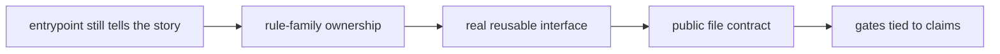

# Worked Example: Refactoring a Growing Workflow Without Hiding It

This file ties the whole module together around one realistic problem:

> a workflow still works, but every new rule makes the repository harder to review, teach, and change safely.

The question is not "how do we create more files?" The question is how to make growth
land in named places without hiding the graph.

## How to use this worked example

Treat this page like a repository refactor lab, not like a tidy after-action report.

For each repair step:

1. name the ownership or interface boundary you are changing
2. predict which review surface should prove the change stayed honest
3. keep the before-and-after evidence next to the structural decision

If you skip the ownership question, the example turns into folder choreography instead of
workflow design.

## The one-day teaching goal

By the end of this example, a learner should be able to refactor a growing workflow so
that:

- rule families land in named places
- the top-level graph stays visible
- only real interfaces become modules
- public paths stay distinct from internal state

That is the educational goal. The number of files is not the goal.

## The lab route

Work through the example in this order:

1. name the current rule families that already exist implicitly
2. split one concern into `workflow/rules/` without weakening the entrypoint
3. decide whether one candidate boundary is only an include or a true module
4. document the public file contract the refactor must preserve
5. finish by choosing gates that prove the new structure still tells the truth

Keep a small scaling packet as you go:

- one ownership note for each rule family you split out
- one before-and-after view of the top-level entrypoint
- one include-versus-module decision note for a real candidate boundary
- one short public file contract excerpt
- one gate table that ties each check to a structural claim

## What to keep beside you while you work

Keep these four surfaces visible while you move through the example:

- the top-level `Snakefile`
- the current rule list or rulegraph
- the public file contract note
- the gate or review surface you are using for each claim

Those four views are enough to explain whether the repository became clearer or only more
abstract.

## The starting situation

Assume the repository already has:

- truthful rule contracts from Module 01
- disciplined dynamic discovery from Module 02
- explicit production policy from Module 03

What it does not yet have is a calm scaling story.

The maintainers currently live with:

- one `Snakefile` that mixes preprocessing, summarization, and publishing
- helper path logic and structural logic in the same place
- no clear public-versus-internal path note
- CI checks that run, but do not clearly defend any structural claim

That is a good Module 04 starting point because the workflow is not broken. It is merely
becoming exhausting to explain.



The order matters. Splitting files before naming ownership, or tightening CI before
documenting the public contract, usually creates more ceremony without more clarity.

## Start with ownership, not abstraction

The first repair is a rule-family split, not a module promotion.

Read the large file and write one sentence of ownership for each cluster of rules. A
useful early outcome might look like this:

```text
workflow/rules/
  preprocess.smk
  summarize_report.smk
  publish.smk
```

Each file now owns one coherent concern:

- `preprocess.smk` prepares declared working data
- `summarize_report.smk` turns processed data into public summaries and report inputs
- `publish.smk` assembles and verifies the downstream contract

The repository improves because a reviewer can explain each boundary quickly, not because
the file count increased.

Capture that ownership explicitly:

| Boundary | Owned concern | What it should not absorb |
| --- | --- | --- |
| `preprocess.smk` | declared preparation of working data | publish semantics or report presentation policy |
| `summarize_report.smk` | transformation into reader-facing summaries | scheduler choices or unrelated path plumbing |
| `publish.smk` | final contract assembly and checks | ad hoc preprocessing helpers or silent side outputs |

## Why this first move matters educationally

Many learners jump straight to modules because modules sound more advanced.

Module 04 needs the opposite instinct:

- first name the owned concerns
- then split one visible graph by those concerns
- only then ask whether any boundary deserves reuse as an interface

## Keep the entrypoint short and honest

The top-level `Snakefile` should still reveal orchestration:

```python
configfile: "config/config.yaml"

include: "workflow/rules/preprocess.smk"
include: "workflow/rules/summarize_report.smk"
include: "workflow/rules/publish.smk"

rule all:
    input:
        "publish/v1/manifest.json"
```

This entrypoint still answers the most important questions:

- where configuration starts
- which major rule families exist
- what final contract the workflow promises

If the entrypoint becomes a maze of indirection, the split has already gone too far.

Capture evidence immediately:

```sh
snakemake --list-rules
snakemake --rulegraph mermaid-js > rulegraph.mmd
snakemake -n
```

The structural refactor is not successful unless those surfaces still tell the same
workflow story.

That is the immediate test after every split: the rule list, the graph, and the dry-run
should still let a new learner explain the workflow in the same order as before.

## A short checkpoint before you continue

Pause here and say one sentence like this:

> The entrypoint is shorter now, but it still explains configuration, major concerns, and
> the final promised contract.

If that sentence is hard to defend, the split may already be hiding too much.

## Promote only a real reusable boundary

Now inspect one candidate concern more closely.

Suppose the repository has a QC bundle used by two entrypoints. That *might* deserve
`workflow/modules/`, but only if the interface is explicit:

- named inputs
- named outputs
- parameters that callers can understand
- software and config assumptions

If the candidate still reaches into top-level globals, undeclared path conventions, or
shared hidden helpers, it is not ready.

That is the key distinction:

- includes group one graph by ownership
- modules expose a reusable boundary with an interface

Do not promote a module just because a file is long.

Make the decision explicit for at least one candidate:

| Candidate | Include? | Module? | Why |
| --- | --- | --- | --- |
| local preprocessing cluster | yes | no | it clarifies one graph but is not designed for reuse elsewhere |
| shared QC bundle used by multiple entrypoints | maybe | yes, if interface is explicit | reuse is real only when callers can name inputs, outputs, and assumptions |

## What the learner should notice now

The hard part of modularity is not moving code. The hard part is deciding whether another
caller could understand and trust the interface without knowing the private repository
story.

## Write the public contract before the gate

The refactor is still incomplete if another engineer cannot answer which files are safe
for consumers.

So add or strengthen a contract note such as `FILE_API.md`:

| Path | Stability | Meaning |
| --- | --- | --- |
| `publish/v1/manifest.json` | public | inventory and checksums for the published bundle |
| `publish/v1/summary.json` | public | machine-readable summary with a defined schema |
| `results/staged/` | internal | rebuildable intermediate state with no compatibility promise |
| `.snakemake/` | engine state | private execution metadata |

This step matters because public trust should live in a small documented surface, not in
whoever happens to know the directory tree best.

This is where structural cleanup stops being private taste. Once the public contract is
named, path promises become reviewable and later refactors can be judged against something
more durable than preference.

## Add gates that defend the claim you just made

Only now should you tighten validation.

After the split, different questions need different proof routes:

- does the visible graph still make sense
- does the public file contract still verify
- did the plan for the final target remain stable

That usually leads to a gate set like this:

- `snakemake --list-rules` or rulegraph review for architecture visibility
- `snakemake -n` for target planning
- targeted schema or file-contract validation for public paths
- `snakemake --lint` for design smells that the split exposed

This is the difference between a meaningful gate and generic CI noise.

Tie each gate to the claim it protects:

| Gate | Claim defended |
| --- | --- |
| `snakemake --list-rules` or rulegraph review | the architecture is still legible after the split |
| `snakemake -n` | the final target plan has not changed accidentally |
| contract or schema validation | public outputs still match the published promise |
| `snakemake --lint` or focused structure checks | the refactor did not introduce hidden design debt |

## What a strong summary sounds like

Strong:

> The repository split by ownership first, promoted only explicit interfaces, documented
> the public contract, and chose gates that defend those exact structural claims.

Weak:

> We made it more modular and added some CI.

## Keep resource assumptions portable

One last review often appears during scaling: some rule families are heavier than others.

Keep that distinction visible, but keep executor policy out of the rules. The repository
should be able to say:

- which concern is heavier
- which resource declarations belong to the workflow
- which cluster or local mapping belongs to operating policy

If a rule hardcodes scheduler commands or node names, the structural cleanup has created a
new portability problem.

## The repaired scaling story

By the end of the refactor, the workflow can be described cleanly:

1. top-level orchestration stays visible
2. rule families are grouped by named ownership
3. only genuine interfaces become modules
4. public paths are documented separately from internal state
5. gates defend the structural promises the repository actually makes

That is what it means to refactor a growing workflow without hiding it.

## Review questions for the repaired design

When you inspect a repository shaped like this, ask:

1. which split clarifies ownership and which only creates indirection
2. where is the public contract documented
3. which boundary, if broken, would fail first through validation
4. which candidate module still depends on hidden globals
5. how will the next growth change land without making the graph harder to teach

If those answers are visible, the module’s scaling story has landed.

Before leaving the module, make sure you can say all five of these out loud:

1. the split was justified by ownership, not by file-count aesthetics
2. the entrypoint still tells the workflow story quickly
3. an include and a module are different because reuse requires a real interface
4. the public contract is separate from internal rebuildable state
5. every gate now defends a structural claim instead of adding generic CI noise
