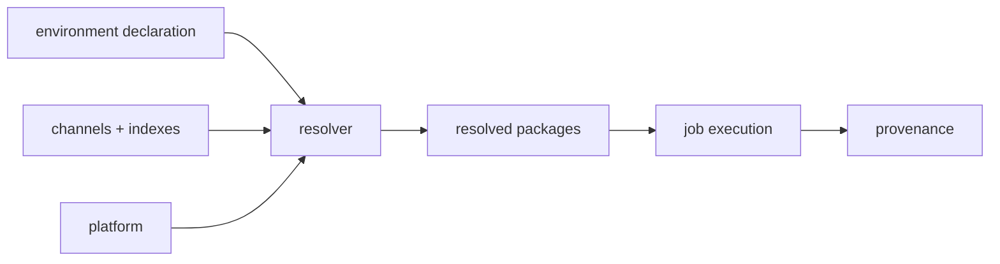
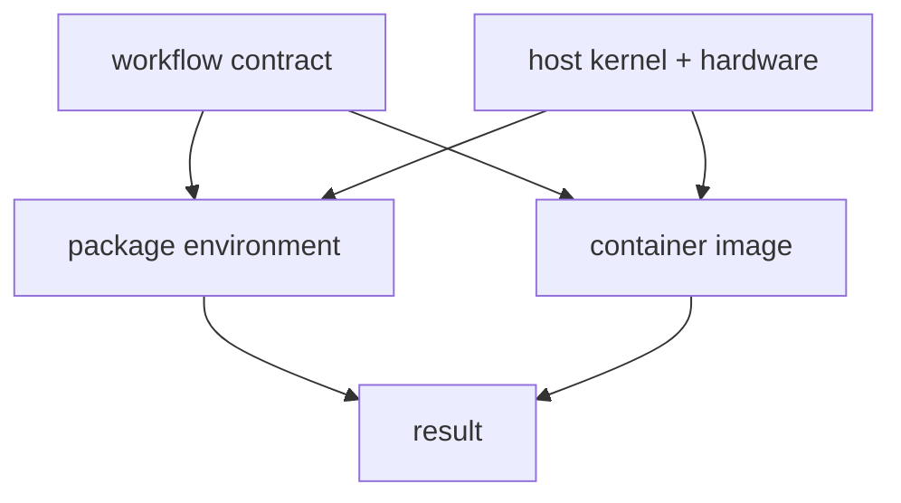

# Environments, Containers, and Runtime Contracts

An environment declaration names what may be installed. A lock identifies one resolution.
A container digest identifies one filesystem image. Provenance records what execution
observed. These are related surfaces, not interchangeable guarantees.

This lesson teaches you to state exactly how much runtime identity a workflow controls.

## Begin with the runtime question

For one job, ask:

1. Which interpreter and tools execute?
2. Which dependency resolution supplies them?
3. Which operating-system libraries and platform matter?
4. Where is this runtime bound to the rule?
5. How does a reviewer reproduce or compare the resolution?
6. What change invalidates artifacts built under the old runtime?

A `conda:` line answers the fourth question. It does not automatically answer the rest.



If the solver runs later against changed metadata, the same declaration may resolve
differently.

## Distinguish levels of exactness

| Surface | Example | What it constrains | Remaining uncertainty |
| --- | --- | --- | --- |
| compatibility range | `snakemake >=9.14,<9.24` | accepted versions | exact version and dependencies |
| environment declaration | `python=3.11` | interpreter family | patch, build, libraries |
| exact package lock | names, builds, hashes for a platform | one package resolution | kernel, hardware, external services |
| container tag | `tool:1.4` | mutable registry name | referenced image can move |
| container digest | `image@sha256:...` | immutable image bytes | host kernel, hardware, runtime policy |
| provenance receipt | observed versions and platform | what a run reports | whether future resolution is repeatable |

Use “pinned” carefully. Pinning a major/minor line is not the same as locking an exact
build.

## Read the capstone honestly

`workflow/envs/python.yaml` currently declares:

```yaml
name: capstone-python
channels:
  - conda-forge
dependencies:
  - python=3.11
```

This is a compatibility declaration for a Python 3.11 environment. It does not lock:

- Python patch release
- build string
- system libraries
- channel snapshot
- platform-specific resolution

The capstone package uses standard-library domain code, which limits dependency breadth.
That does not turn the environment into an exact lock.

## Separate repository toolchain from job environment

The capstone `pyproject.toml` declares:

```toml
dependencies = [
    "snakemake >= 9.14, < 9.24",
]
```

This supports the repository's Snakemake toolchain. The rule environment YAML selects the
runtime for jobs. Snakemake typically orchestrates outside each job environment.

Do not claim that the `pyproject.toml` dependency is automatically installed into every
`conda:` environment. Inspect the actual bootstrap and execution commands.

| Context | Capstone surface | Purpose |
| --- | --- | --- |
| workflow orchestrator | supported tools virtual environment | runs Snakemake, tests, lint |
| rule execution | `workflow/envs/python.yaml` | runs Python job commands |
| local package import | `PYTHONPATH=src` | exposes capstone source to the job |
| recorded execution | provenance JSON | reports selected runtime facts |

This split exposes a further risk: source made available through `PYTHONPATH` is not an
installed immutable package identity.

## Bind runtime close to the job

The rule should make the runtime discoverable:

```python
rule summarize:
    ...
    conda:
        config["_env_python"]
```

For reusable modules, the caller can pass a bounded runtime config key. The module should
not reach through the complete parent configuration merely to find an environment path.

Runtime ownership belongs near the job contract because:

- different rules may need different tools
- upgrades can be reviewed by affected artifacts
- dry-runs and reports can show environment associations
- failures can be traced to one runtime surface

## Decide when a container adds value

A container captures more userspace than a package environment:



A container helps when:

- native libraries are difficult to reproduce
- the same userspace must run across supported executors
- an immutable digest can be reviewed and retained
- a tool's installation is more reliable as an image

It does not eliminate:

- CPU or accelerator differences
- kernel behavior
- filesystem semantics
- locale, time, and external services unless controlled
- scientific algorithm nondeterminism

## Choose a contract proportional to the claim

| Claim | Minimum credible runtime evidence |
| --- | --- |
| learners can run the example on a supported workstation | tested compatibility declaration and bootstrap |
| rerunning next month uses the same packages | retained exact lock for the target platform |
| cluster and local jobs share userspace | same image digest or equivalent locked resolution |
| a published result can be audited | runtime identity plus source revision and artifact provenance |
| results are invariant across hardware | cross-hardware execution evidence and numerical tolerances |

Do not promise the final row merely because you use containers.

## Review channels and resolution

For package environments, record:

- channel or index order
- channel priority policy
- target platform
- resolver and version
- explicit package constraints
- exact resolution artifact if retained
- update procedure

An environment file without resolver context may be sufficient for teaching compatibility,
but not for exact reconstruction.

## Treat locks as governed outputs

A lock is generated evidence with maintenance cost. Review:

- source declaration
- generation command
- resolver version
- supported platforms
- update trigger
- diff readability
- retention and verification

Do not hand-edit a generated lock to make a check pass. Regenerate from the governed
declaration and inspect the resulting identity change.

## Connect runtime drift to rebuild policy

Even an exact lock is useful only if artifact policy observes it. Ask:

> If the lock or image digest changes while data and command text remain stable, what
> causes the old output to be considered stale?

Possible answers:

- Snakemake's software-environment rerun trigger
- environment file declared or associated with the rule
- a release policy that performs clean rebuilds
- an artifact manifest that includes runtime identity

Test the selected mechanism with a safe drift experiment. Do not assume.

## Diagnose runtime failures

| Symptom | Likely cause | First evidence |
| --- | --- | --- |
| solver chooses different builds on two machines | declaration is not locked by platform | resolved package lists |
| job cannot import local package | source not installed or `PYTHONPATH` differs | job command and environment |
| local succeeds, scheduler fails | host or deployment context differs | profile, image, mount, executable |
| provenance says one Python, job log shows another | receipt and job runtime are disconnected | executable paths and rule environment |
| image tag produces changed bytes | tag is mutable | registry digest history |
| lock changed but output stayed accepted | runtime identity is absent from rebuild policy | dry-run after controlled lock change |

## Runtime review worksheet

For one capstone job, record:

| Question | Evidence |
| --- | --- |
| environment declaration | path and relevant lines |
| exactness | range, family, lock, or digest |
| resolver context | tool, channels, platform |
| local source availability | installed artifact or path injection |
| orchestrator runtime | Snakemake and Python versions |
| job runtime | interpreter and packages inside execution |
| provenance | fields that report resolved facts |
| invalidation | experiment showing runtime change triggers rebuild |

Mark unknowns. Do not fill them with assumptions from your current shell.

## Exit checkpoint

You understand runtime contracts when you can:

1. distinguish compatibility ranges, declarations, locks, tags, digests, and receipts
2. explain the capstone's orchestrator and job runtime split
3. state exactly what `python=3.11` does and does not fix
4. choose environment or container evidence proportional to a claim
5. describe how a runtime identity change invalidates prior output
