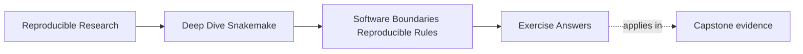

# Exercise Answers

<!-- page-maps:start -->
## Page Maps

<!-- page-maps:end -->

These answers are written as model explanations, not as the only acceptable wording.

The standard to aim for is clear ownership reasoning.

## Exercise 1: Decide what stays in the rule

What should stay in the rule:

- declared inputs and outputs
- any simple parameter wiring that helps a reviewer understand file meaning
- the visible execution boundary for the step

What should move into `workflow/scripts/`:

- the non-trivial transformation logic owned by this step
- code that makes the rule hard to read but is still tightly coupled to this step

What should move into `src/`:

- parsing logic that another reporting step will also need
- reusable helpers that deserve direct tests outside Snakemake

Why:

The rule should remain the place where the file contract is obvious. Step-local
implementation belongs in a script. Reusable logic belongs in the repository's package
surface.

## Exercise 2: Choose the right runtime boundary

Rule-scoped environment:

- declares the software needed by one step or a small cluster of closely related steps
- keeps the runtime boundary close to the rule that depends on it

Repository-level `environment.yaml`:

- gives contributors and workflow runners a shared baseline for working with the project
- supports authoring and whole-repository execution setup

Container definition:

- provides a stronger machine-level boundary when host differences are risky
- helps when OS tools, compiled dependencies, or infrastructure portability matter

Why they are not interchangeable:

They all describe software, but they protect different scopes. A repository environment is
too broad to explain every step. A rule-scoped environment is too narrow to replace a full
machine boundary. A container solves portability problems an environment file alone cannot.

## Exercise 3: Diagnose a hidden dependency

Why it is a software-boundary problem:

- the visible rule contract is smaller than the real behavior
- a reviewer cannot trust the declared execution story

Risks:

- the file graph is misleading
- rebuild behavior may ignore a meaningful input
- publication review becomes weaker because software behavior is partially hidden

Repair:

- declare `config/report-style.yaml` in the rule if it materially affects the output
- keep the script as implementation, not as a place to invent undeclared dependencies

The core principle is simple: meaningful inputs should stay visible at the rule boundary.

## Exercise 4: Review a wrapper adoption decision

A strong review comment would delay adoption for now:

> I would not merge this wrapper change yet. The shorter rule is not enough benefit unless
> we can explain the wrapper's tool version assumptions, runtime requirements, and visible
> file contract. Right now the wrapper reduces local readability but also reduces review
> confidence. If we can document what it runs and why that contract is acceptable, then the
> wrapper may become a net improvement.

Why this is the right reasoning:

- the question is whether the wrapper increases clarity
- if it hides behavior the team cannot review, it weakens the software boundary

## Exercise 5: Plan a rebuild after software drift

Why outputs may no longer be trustworthy:

- helper code under `src/capstone/` can change output meaning even with unchanged inputs
- a runtime change in `workflow/envs/python.yaml` can alter execution behavior

Evidence to request before approval:

- confirmation that affected outputs were rebuilt
- provenance showing the new repository revision and runtime context
- a review explanation connecting the software change to the rebuilt artifacts

What provenance should accompany the rebuilt outputs:

- repository revision or release identifier
- relevant runtime declaration or software versions
- execution timestamp
- any workflow configuration that materially affects meaning

The main lesson is that unchanged input datasets do not cancel software drift.

## Exercise 6: Extract a long rule into a script

The resulting rule should still reveal every meaningful input, output, parameter, runtime,
and log path. The script may transform those declared values but must not discover extra
files behind the rule. A focused run proves integration, while reviewing file access or
testing with an absent undeclared file helps establish that extraction did not hide a
dependency.

## Exercise 7: Promote reusable logic into tested code

The package API should accept ordinary values or paths and return ordinary values rather
than depending on the injected `snakemake` object. Both workflow scripts remain thin
adapters. Tests cover a valid record, an empty or boundary case, and malformed input.
Path wiring and publication remain workflow-owned; reusable parsing or calculation moves
to the package.

## Exercise 8: Reproduce a rule-scoped environment

A strong environment pins direct dependencies closely enough to reproduce the rule and is
created by running Snakemake with environment integration enabled. Record the resolved
package list or explicit versions alongside run evidence. The rule no longer succeeds
merely because a contributor happened to install a library globally.

## Exercise 9: Observe code and environment drift

The implementation change should mark outputs owned by that script as candidates for
rebuilding while unrelated branches remain current. Runtime declaration changes require
the same trust review even when source data is unchanged. After rebuilding, a dry-run
converges and provenance records the repository revision, resolved environment, semantic
configuration, and execution identity.

## Exercise 10: Review a complete software boundary

Prioritize undeclared meaningful inputs and unrecorded runtime drift over cosmetic file
placement. Remove duplicate implementation between scripts and packages, keep the file
contract in the rule, and test reusable code directly. A container is justified when OS
or compiled-runtime portability is part of the claim; if a rule-scoped environment
already satisfies the supported contexts, another image may add maintenance without
additional trust.

## Self-check

If your answers consistently explain:

- who owns the file contract
- where the implementation belongs
- which runtime boundary matters
- what evidence supports rebuilt trust

then you are using the module correctly.
