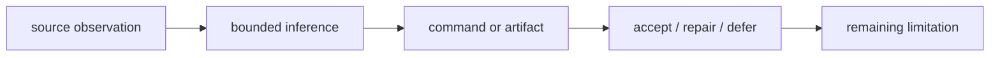
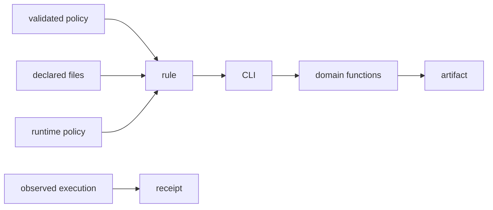

# Exercise Answers

These model answers use the capstone at the time of this course revision. Compare the
reasoning and evidence boundary, not only the conclusion. If repository source changes,
update the observation rather than preserving a stale answer.



## Exercise 1: Inventory a complete job contract

The trimming rule exposes:

| Surface | Observation |
| --- | --- |
| data input | raw FASTQ from `get_raw_fastq` |
| outputs | trimmed FASTQ and JSON statistics |
| scalar policy | quality, length, N fraction, adapter overlap, poly-run threshold |
| resources | memory derived from input size |
| runtime | Python environment YAML |
| evidence | named log and benchmark |
| implementation | `python3 -m capstone.trim_fastq` |

Opening the package reveals one important correction: adapter FASTA contents are read by
the implementation. In the current rule, the adapter path is passed under `params`, so the
file is explicit to the command but not represented as a graph input.

A suitable finding is:

> The rule explains most of the job, but its graph contract is smaller than its actual file
> influence because adapter contents affect trimming without an `input` edge.

The inventory does not yet prove whether changing the file plans a rerun. That requires
the controlled experiment in Exercise 4.

## Exercise 2: Assign ownership across rule, adapter, and package

Model assignment:

| Decision | Primary owner |
| --- | --- |
| sample-to-FASTQ mapping | workflow discovery and rule |
| output paths | rule |
| scalar trimming policy | validated config, bound by rule |
| adapter file identity | rule input |
| memory formula | rule resource policy |
| environment | rule/deployment policy |
| command translation | package CLI |
| FASTQ parsing | `fastqio.py` |
| trimming transformations | `trim_fastq.py` domain functions |
| log and benchmark paths | rule |
| Git and runtime receipt | provenance job |

The intended dependency direction is:



The package should not read workflow config or construct repository result paths. Git
revision belongs in provenance rather than in trimming semantics.

## Exercise 3: Prove reusable behavior without Snakemake

Existing direct tests cover behaviors such as:

- quality-tail clipping preserves sequence/quality alignment
- adapter clipping detects configured overlap
- trimming statistics match processed records
- FASTQ parsing rejects malformed structure

A useful additional edge case is a record whose adapter begins at position zero and
therefore yields an empty sequence before minimum-length filtering. The test should state
whether the record is removed and how statistics record the event.

Pure function tests do not prove:

- CLI argument names and file writes
- environment availability
- rule interpolation
- resources and logs
- source-drift invalidation

The test command establishes selected package behavior only. A CLI test should invoke
`python -m capstone.trim_fastq` with fixture files and assert exit status plus both outputs.
A workflow test must separately verify the Snakemake binding.

## Exercise 4: Promote a material file influence

Current path:

```text
config params.trim.adapters_fasta
→ rule params.adapters_fasta
→ --adapters-fasta CLI option
→ package reads file
```

Current visible graph:

```text
raw FASTQ → trimmed FASTQ + statistics
```

Required graph:

```text
raw FASTQ + adapter FASTA → trimmed FASTQ + statistics
```

Corrected rule shape:

```python
input:
    fastq=lambda wc: get_raw_fastq(wc),
    adapters=config["params"]["trim"]["adapters_fasta"]
params:
    q=config["params"]["trim"]["q"],
    min_len=config["params"]["trim"]["min_len"]
```

The command should use `{input.adapters}`.

The experiment must start after successful convergence. Modify only adapter contents and
run a dry-run. A sound contract should plan `trim_fastq` and every downstream artifact
whose meaning depends on trimmed reads. Restoring the adapter should restore the supported
repository state.

The file-contract audit demonstrates the same declared-versus-hidden cause with a smaller
policy file. It does not prove the capstone trimming rule is already repaired.

## Exercise 5: Classify runtime exactness

Model inventory:

| Context | Surface | Classification | Remaining uncertainty |
| --- | --- | --- | --- |
| orchestrator | `snakemake >=9.14,<9.24` | compatibility range | exact version and dependencies |
| job interpreter | `python=3.11` | environment declaration | patch, build, channel snapshot |
| local package | `PYTHONPATH=src` | source-location policy | immutable package identity |
| platform | provenance string | observed receipt | full host behavior |
| Python executable | provenance field | observed receipt | complete package set |
| Git commit | provenance field | observed revision | dirty state and installed-source match |

No exact package lock or container digest appears in these surfaces. The supported
bootstrap resolves a concrete toolchain for the run, but the declaration itself remains a
range.

A valid course claim is:

> The capstone has a tested compatibility route for Python 3.11 and a bounded Snakemake
> range. It records resolved facts, but does not promise an exact cross-platform package
> resolution from the environment YAML alone.

## Exercise 6: Reproduce observable and hidden source drift

Expected rows:

| Model | Changed dry-run | Artifact after invocation | Result / decision |
| --- | --- | --- | --- |
| script directive | plans `render` | `script-directive-v2` | `PASS / ACCEPT` |
| hidden package source | plans nothing | `hidden-package-source-v1` | `PASS / REJECT` |
| declared package source | plans `render` | `declared-package-source-v2` | `PASS / ACCEPT` |

The baseline dry-run must plan no render job. Otherwise missing output, not source drift,
could explain the later plan.

The hidden model passes because the audit reproduced the expected defect. Its design is
rejected because the old artifact remains accepted.

Declaring one package file works only for the bounded specimen. A real package may import
many modules and resources. A built artifact hash, exact installed package identity,
source bundle revision, or image digest scales better.

## Exercise 7: Review a wrapper adoption

A model review should not approve an unspecified current wrapper. It should require an
immutable reference and record:

| Question | Required evidence |
| --- | --- |
| which wrapper? | repository plus immutable revision |
| which tool? | tool version in wrapper environment |
| which files? | named wrapper inputs and outputs |
| which policy? | exposed params and defaults |
| which command? | resolved wrapper source or execution receipt |
| which comparison? | representative capstone artifact before and after |
| which rollback? | prior immutable revision and retained runtime |

For trimming, the existing package CLI is likely the narrower boundary because the
capstone already owns the educational implementation and direct tests. A wrapper would be
justified if the course intentionally adopted an external production tool and wanted a
shared, versioned tool adapter.

A Snakemake module would solve reuse of rules, not reuse of the trimming algorithm.

## Exercise 8: Diagnose a cross-context import failure

Evidence order:

1. capture the actual scheduler job command
2. print the Python executable
3. inspect the active environment
4. inspect `PYTHONPATH`
5. run `python -c "import capstone; print(capstone.__file__)"`
6. record working directory and mounts
7. compare profile or container bindings with local execution

The domain tests passing means the algorithm is not the first suspect. The error says the
deployment context cannot locate the package.

Possible repairs:

- install a built capstone package into the job environment
- bind an immutable package artifact into the container
- if path injection is intentionally supported, derive an absolute path from the workflow
  base and test it in every advertised context

Negative evidence should run the job from the scheduler or an equivalent isolated context
and confirm the expected package identity, not only a successful import from the
developer's shell.

## Exercise 9: Compare incremental and clean rebuild evidence

Model matrix:

| Run | Main question | Expected evidence |
| --- | --- | --- |
| converged incremental | is current output accepted? | no planned job |
| source-drift incremental | does identity change invalidate output? | planned job and v2 artifact |
| clean same-context | can declared source/runtime construct output? | successful build and equivalent meaning |
| clean second-context | does supported context preserve meaning? | successful build plus semantic comparison |

Deleting output before the drift run guarantees a job is planned. It cannot tell whether
software identity participated in invalidation.

Artifact byte identity may be inappropriate when provenance contains time or
platform-specific fields. Define semantic comparison separately for deterministic domain
artifacts and context receipts.

## Exercise 10: Conduct a software-boundary review

### Review boundary

The `trim_fastq` job from discovered raw FASTQ and adapter policy through the capstone
package, Python job environment, trimmed artifacts, and operational evidence.

### Accepted contracts

- scalar policy and output paths are visible at the rule
- domain functions are ordinary Python and directly testable
- the CLI receives explicit paths and values
- resources, logs, benchmark, and environment are associated with the rule
- provenance records bounded runtime and revision facts

### Required repairs

**Adapter file contract**

The adapter FASTA is a material file influence passed through params. Promote it to a
named input and add an incremental mutation test.

**Software identity**

Local package source is made available through `PYTHONPATH` without a scalable immutable
identity in the rule. Define a built package, source bundle, exact environment, or image
identity for release claims and prove invalidation.

### Deliberate limitations

- `python=3.11` is not an exact lock
- Git commit does not prove a clean tree or installed package match
- provenance explains a run but does not trigger a rebuild
- direct tests do not prove scheduler deployment

### Verification matrix

| Evidence | Claim |
| --- | --- |
| trim and FASTQ unit tests | selected domain semantics |
| CLI fixture run | argument and file binding |
| rule list and dry-run | parse and graph plan |
| bounded workflow execution | integrated job contract |
| software-boundary audit | source-drift contrast |
| cross-context import receipt | deployment binding |
| artifact comparison | preserved result meaning |

### Remaining risks

- transitive local package files are not represented by one implementation path
- exact cross-platform runtime resolution is not retained
- numerical or concurrency behavior outside trimming may need separate evidence

The review is complete when each accepted claim links to evidence and each remaining risk
is visible to the next maintainer.
