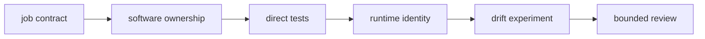
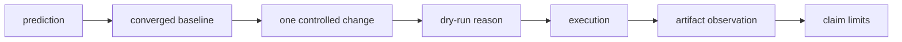

# Exercises

These ten exercises build one review packet for the capstone trimming job and its software
boundary. Work in order: later exercises depend on earlier inventories and predictions.

Store learner evidence under:

```text
artifacts/learning/snakemake-software-boundaries/
├── job-contract.md
├── ownership-map.md
├── direct-tests.md
├── file-influence.md
├── runtime-inventory.md
├── drift-audit.md
├── wrapper-review.md
├── failure-diagnosis.md
├── rebuild-matrix.md
└── software-review.md
```

The records follow this route:



Every empirical claim should climb an evidence ladder:



Do not delete outputs before a drift exercise. You need an existing artifact to detect
under-rebuild.

## Exercise 1: Inventory a complete job contract

Select `trim_fastq` in `workflow/rules/preprocess.smk`. Without opening package code, write
`job-contract.md` with:

- named inputs and outputs
- scalar policy
- resources
- environment
- log and benchmark
- command interface
- expected failure behavior

Add two columns:

```text
visible to Snakemake | visible only after opening implementation
```

Predict every file the package will open. Then inspect `src/capstone/trim_fastq.py` and
correct your inventory without erasing the prediction.

**Done when:** the record distinguishes graph-visible files from implementation-only
knowledge.

## Exercise 2: Assign ownership across rule, adapter, and package

Write `ownership-map.md`. Assign each trimming decision to:

- validated config
- Snakemake rule
- command adapter
- domain function
- runtime policy
- provenance or operational evidence

Include quality threshold, adapter parsing, memory formula, output paths, FASTQ parsing,
environment, log path, and Git revision.

Draw dependency arrows. Mark any arrow where package code reaches back into workflow or
repository state.

**Done when:** every decision has one primary owner and dependency direction points from
workflow policy toward software.

## Exercise 3: Prove reusable behavior without Snakemake

Read `tests/test_trim.py` and `tests/test_fastqio.py`. Write `direct-tests.md` with:

- three domain invariants already tested
- one edge case that deserves another test
- one CLI behavior not covered by pure function tests
- one workflow binding no direct test can prove

Run:

```bash
pytest -q tests/test_trim.py tests/test_fastqio.py
```

Add one bounded test in a disposable learner copy or describe it precisely with input and
expected output.

**Done when:** you can explain what direct tests prove and which seams still need CLI or
workflow evidence.

## Exercise 4: Promote a material file influence

Trace the adapter FASTA from config through the trimming rule into package code. Write
`file-influence.md` with:

- current path binding
- actual file open
- graph edge currently visible
- graph edge computation requires
- corrected rule snippet
- controlled change experiment

Your experiment must begin from convergence, change only adapter contents, and predict
which downstream jobs should be planned.

Compare the issue with:

```bash
gmake capstone-file-contract-audit
```

**Done when:** you can explain why an explicit path under `params` is not a declared file
dependency.

## Exercise 5: Classify runtime exactness

Read:

- `workflow/envs/python.yaml`
- `pyproject.toml`
- capstone bootstrap commands
- provenance script

Write `runtime-inventory.md` with:

| Context | Declaration | Resolver | Exactness | Observed receipt | Remaining uncertainty |
| --- | --- | --- | --- | --- | --- |

Include orchestrator, job interpreter, local package source, and operating context.

Classify each surface as compatibility range, environment declaration, exact lock, tag,
digest, or provenance receipt.

**Done when:** no range or major/minor pin is described as an exact resolution.

## Exercise 6: Reproduce observable and hidden source drift

Before running the audit, predict all three rows:

- script directive
- hidden package source
- declared package source

Run:

```bash
gmake capstone-software-boundary-audit
gmake capstone-software-boundary-selftest
```

Write `drift-audit.md` with:

- baseline convergence evidence
- changed software surface
- changed dry-run behavior
- artifact marker after invocation
- result, decision, and finding
- why the one-file declared-source repair does not scale automatically

**Done when:** the rejected model is described as `PASS / REJECT`, not simply “passing.”

## Exercise 7: Review a wrapper adoption

Choose a real Snakemake wrapper relevant to one capstone transformation, but do not modify
the capstone. Write `wrapper-review.md` with:

- wrapper revision or immutable reference
- tool and environment identity
- required inputs and outputs
- exposed options
- policy hidden by the wrapper
- source inspection route
- representative comparison needed before adoption
- rollback route

Compare wrapper, package CLI, and Snakemake module ownership for this use case.

**Done when:** adoption is justified by a reviewed interface rather than shorter rule
syntax.

## Exercise 8: Diagnose a cross-context import failure

Use this scenario:

> Unit tests pass and local workflow execution succeeds. On the scheduler,
> `python -m capstone.trim_fastq` fails with `No module named capstone`.

Write `failure-diagnosis.md`. Order the evidence you would inspect:

- actual job command
- executable
- environment
- `PYTHONPATH` or installed package
- working directory
- import location
- profile or container binding

Separate domain correctness from deployment binding. Propose a repair and a cross-context
rejection test.

**Done when:** the algorithm is not rewritten to repair an import policy failure.

## Exercise 9: Compare incremental and clean rebuild evidence

Write `rebuild-matrix.md` for four runs:

1. converged incremental run
2. source-drift incremental run
3. clean rebuild under the same identity
4. clean rebuild under a second supported context

For each, record:

- software identity
- runtime identity
- planned jobs
- artifact identity
- semantic comparison
- provenance receipt
- claim supported

Explain why deleting output before the source-drift run would hide an under-rebuild defect.

**Done when:** incremental invalidation and clean construction support distinct claims.

## Exercise 10: Conduct a software-boundary review

Assemble `software-review.md` with:

### Review boundary

Name the trimming artifact, source revision, and runtime context.

### Accepted contracts

Cite source and evidence for rule, package, runtime, and provenance boundaries that are
adequate for the stated claim.

### Required repairs

For each defect, name:

- hidden dependency or identity
- stale or irreproducible behavior
- correct owner
- preservation evidence
- negative test

### Deliberate limitations

State what the current environment declaration, path-based package import, and provenance
receipt do not prove.

### Verification matrix

Separate direct function, CLI, parse, plan, execution, drift, artifact, and cross-context
evidence.

### Remaining risks

Name at least one risk outside the review boundary.

Give the packet to another learner. They should be able to identify the job contract,
software identity, runtime exactness, stale-output experiment, and remaining risk without
oral explanation.

**Done when:** the review is independently challengeable and does not rely on “the tests
passed” as a complete claim.

## Completion standard

The exercise set is complete only when:

- all ten records exist
- predictions remain visible beside observations
- at least one hidden dependency is tied to a controlled experiment
- source identity and runtime identity are treated separately
- direct tests and workflow evidence are not conflated
- the rejected audit row retains its decision
- unresolved uncertainty is recorded rather than smoothed over
