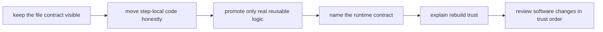

# Exercises

Use these after reading the five core lessons and the worked example. The goal is to make
your software-boundary decisions visible through rule diffs, runtime evidence, direct
tests, and rebuild notes, not through vague talk about “cleaner code.”

## How to work through this set

Treat the ten exercises as one long software-ownership lab.

Before each answer:

1. name the boundary you are moving or defending
2. choose the smallest evidence route that proves the move was honest
3. keep the rule contract visible while you change the implementation surface

If you skip the ownership question, the day turns into code motion instead of
reproducibility practice.

Do them in order. The set is one day-long progression:

- Exercises 1-3 separate orchestration from implementation.
- Exercises 4-6 place runtime and reusable code deliberately.
- Exercises 7-8 defend hidden-dependency and rebuild boundaries.
- Exercises 9-10 review the whole software stack like a maintainer.

For every answer, keep three things:

- the boundary you are naming
- the evidence route you actually used
- one short sentence explaining why the placement decision improves trust rather than only aesthetics

## Recommended working layout

If you want one small repository shape that can support the whole day, use a lab like
this:

```text
module05-lab/
├── Snakefile
├── workflow/
│   ├── scripts/
│   └── envs/
├── src/
├── tests/
├── config/
├── publish/
└── artifacts/
```

That layout makes it easier to compare rule contracts, workflow-adjacent scripts,
reusable package code, and runtime evidence without rebuilding the project for every
prompt.

Build one small software-boundary review packet as you go:

- one ownership map that labels rule contract, step-local implementation, reusable logic,
  and runtime assumptions
- one before-and-after rule view showing what still stays visible at the boundary
- one script-versus-package decision note for shared code
- one runtime contract note distinguishing rule, repository, and machine-level surfaces
- one rebuild note connecting code or runtime drift to output trust
- one maintainer-style review note for a mixed software-boundary change

If those six artifacts are missing, the day usually turns into code motion instead of
trustworthy software-boundary judgment.



Use that order deliberately. It prevents the day from collapsing into "make the code look
cleaner" instead of "make the workflow boundary more truthful."

## Exercise 1: Map one long rule by ownership

Take a rule with a long `run:` block or shell pipeline and label each part as one of
these:

- file contract
- step-local implementation
- reusable logic
- runtime assumption

What to hand in:

- the original rule
- the ownership labels
- one section that should stay in the rule
- one section that should move elsewhere and why

Study note:
This is not a cleanup exercise first. It is an ownership-mapping exercise first.

## Exercise 2: Extract step-local logic into a script

Move one rule’s implementation behind `script:` while keeping all inputs, outputs,
parameters, logs, and resources visible at the rule boundary.

What to hand in:

- the before and after rule
- the script file
- one focused successful run
- one check showing no hidden input was introduced
- one short sentence explaining which facts still belong at the rule boundary after the move

Study note:
If the rule gets shorter by hiding a meaningful input, the extraction failed.

## Exercise 3: Diagnose a hidden dependency

Choose or construct a rule whose implementation reads an undeclared config, lookup, or
auxiliary file.

What to hand in:

- the declared rule contract
- the hidden dependency
- the risk it creates for review or rebuild behavior
- the repair that makes the dependency explicit

Study note:
This is where software-boundary mistakes often first become visible: the code works, but
the rule contract lies.

## Exercise 4: Decide whether code belongs in `workflow/scripts/` or `src/`

Find logic used in two places and decide which portion is still workflow-adjacent and
which portion is truly reusable.

What to hand in:

- the two call sites
- the code that remains workflow-specific
- the code that becomes package-owned
- one reason you did not move even more code into `src/`
- one sentence saying what would become harder to review if too much code moved at once

Study note:
Do not move code into `src/` just because package code sounds more prestigious.

## Exercise 5: Write a runtime contract

Give one rule a pinned environment and compare that with the repository-level runtime
surface and, if relevant, a container surface.

What to hand in:

- the rule-scoped environment declaration
- the repository-level environment or toolchain surface
- one sentence explaining how a container would change the portability boundary
- one ambient host dependency the rule no longer relies on
- one short classification of which layer owns step execution, contributor setup, and
  machine portability

Study note:
This exercise is about making runtime meaning explicit, not about using the most elaborate
 packaging surface available.

## Midday self-check

Before you move into rebuilds and full-boundary review, make sure your packet can already
answer all of these:

- which facts must remain visible in the rule even after extraction
- which code is still workflow-adjacent and which code is genuinely reusable
- which runtime layer owns step execution and which layer owns broader portability
- which hidden dependency would still make a rebuilt output untrustworthy

If you cannot answer those four questions cleanly, return to the earlier exercises and
make the ownership packet more explicit before moving on.

## Exercise 6: Test reusable code directly

Move shared logic into package code and test it without running Snakemake.

What to hand in:

- the package API
- at least three focused tests covering normal, boundary, and invalid input
- the command used to run those tests
- one workflow-specific detail that intentionally stayed outside the package

Study note:
If the code still needs the injected `snakemake` object to test it, it probably is not
reusable package code yet.

## Exercise 7: Observe code and runtime drift

Run a small workflow to convergence, then change the script implementation and the rule’s
runtime declaration.

What to hand in:

- `--list-changes code` or equivalent evidence
- your prediction about which outputs should rebuild
- post-rebuild confirmation
- a provenance note connecting the rebuilt output to both changes
- one sentence explaining why unchanged data does not cancel software drift

Study note:
This is where rebuild trust becomes real. The point is not only that something reran. The
point is that you can explain why it reran.

## Exercise 8: Review one wrapper or abstraction adoption

Evaluate a wrapper, helper layer, or utility abstraction that shortens the visible rule
surface.

What to hand in:

- the abstraction being proposed
- what it hides
- whether it strengthens or weakens ownership
- the evidence you would demand before accepting it

Study note:
Shorter visible code is not enough. The abstraction must still preserve reviewable meaning.

## Exercise 9: Rebuild a published artifact honestly

Choose a publish-facing output and rebuild it after either code drift or runtime drift.
Explain why the earlier artifact should no longer be trusted without rerunning.

What to hand in:

- the changed software surface
- the affected output
- the provenance artifact or rebuild note
- the reason the old output became stale even though the input data did not change

Study note:
Published outputs need stronger rebuild explanations than internal scratch outputs do.

## Exercise 10: Review a complete software boundary

Review a change that touches a rule, a workflow script, package code, an environment, and
possibly a container or provenance artifact.

What to hand in:

- findings ordered by trust impact
- one corrected ownership diagram
- the narrow verification route for each correction
- one boundary that should be simplified, postponed, or split further

Study note:
Review this like a maintainer handoff, not like a style critique. The question is which
boundary became harder or easier to trust, not which file became shorter.

## What weak completion looks like

Do not call the day complete if your answers do any of these:

- treat a shorter rule as automatically better without checking what disappeared
- move code into `src/` because it feels more serious, not because reuse is real
- talk about environments and containers without naming which scope each one governs
- rebuild outputs after software drift without explaining why the earlier outputs became stale
- review a mixed software change without ordering findings by trust impact

## Exit standard for the exercise day

Do not count the day complete unless you can do all of this without leaning on the answer
page as a refactoring script:

- keep the file contract visible while moving implementation
- justify one workflow script and one `src/` extraction clearly
- explain one runtime declaration as part of workflow meaning
- connect one rebuild to concrete software drift evidence
- review one software-boundary change in trust order

## Mastery standard for this exercise set

Across all ten answers, Module 05 wants the same habits:

- you keep file contracts visible at the rule boundary
- you move code according to ownership, not prestige
- you treat runtime declarations as part of workflow meaning
- you leave enough provenance behind to explain rebuild trust later

If your answer says only "this code should be cleaner," keep going.
