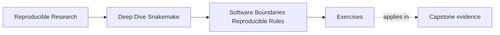

# Exercises

<!-- page-maps:start -->
## Page Maps

<!-- page-maps:end -->

Use these exercises to practice the judgments behind the module, not only the vocabulary.

The strongest answers will name ownership, runtime, and rebuild implications clearly.

## Exercise 1: Decide what stays in the rule

You inherit a rule with a 90-line `run:` block that:

- reads one declared input file
- performs several data transformations
- writes one declared output file
- contains parsing logic that would also help another reporting step later

Write a short redesign note that explains:

- what should stay in the rule
- what should move into `workflow/scripts/`
- what should move into `src/`

Your answer should justify each placement decision.

## Exercise 2: Choose the right runtime boundary

A step uses a Python script that imports two libraries not guaranteed to exist on a fresh
machine. The team also wants contributors to have a stable way to run Snakemake and edit
the repository. Later, the workflow may need to move onto stricter infrastructure where
host packages cannot be trusted.

Explain the role of:

- a rule-scoped environment
- the repository-level `environment.yaml`
- a container definition

Your answer should make clear why these three surfaces are related but not interchangeable.

## Exercise 3: Diagnose a hidden dependency

A rule declares:

- input: `results/sample.tsv`
- output: `publish/v1/report.json`

The script launched by the rule also reads `config/report-style.yaml`, but that file is
not declared anywhere in the rule.

Explain:

- why this is a software-boundary problem rather than a minor implementation detail
- what risks it creates for review and rebuild behavior
- how you would repair the design

## Exercise 4: Review a wrapper adoption decision

Your team wants to replace a visible shell command with a wrapper. The wrapper shortens the
rule, but nobody on the team can yet explain:

- which external tool version it assumes
- which extra runtime requirements it introduces
- whether it hides meaningful file relationships

Write a review comment that argues for either delaying or accepting the wrapper adoption.

Your answer should focus on clarity and ownership rather than style preference.

## Exercise 5: Plan a rebuild after software drift

After publication outputs are generated, the team changes:

- a helper function under `src/capstone/`
- `workflow/envs/python.yaml`
- nothing in the declared input datasets

Describe:

- why the published outputs may no longer be trustworthy
- what evidence you would want before approving the outputs again
- what provenance information should accompany the rebuilt publication artifacts

## Exercise 6: Extract a long rule into a script

Take a rule with at least thirty lines of transformation logic. Keep its inputs, outputs,
parameters, log, and runtime visible while moving step-local implementation behind
`script:`.

What to hand in:

- the before and after rule
- the script and its declared data access
- a focused successful run
- evidence that no hidden input was introduced

## Exercise 7: Promote reusable logic into tested code

Find logic needed by two workflow scripts. Move only that logic into a package module and
write direct tests for normal, boundary, and invalid input.

What to hand in:

- the package API and both script call sites
- three focused tests
- an explanation of what remained workflow-specific
- the command used to run tests without Snakemake

## Exercise 8: Reproduce a rule-scoped environment

Give one rule a pinned environment, create it from a clean cache or location, and record
the resolved tool versions.

What to hand in:

- the environment declaration
- the command that activates environment use
- resolved version evidence
- one ambient-host dependency the environment eliminates

## Exercise 9: Observe code and environment drift

Run a workflow to convergence, change its script implementation, then change its
environment declaration. Inspect the reported change causes before rebuilding.

What to hand in:

- `--list-changes code` or equivalent evidence
- predictions for affected and unaffected outputs
- post-rebuild convergence evidence
- provenance connecting the rebuilt output to both changes

## Exercise 10: Review a complete software boundary

Review a rule, script, shared package, environment, and container definition as one
system. Identify hidden dependencies, duplicated ownership, and missing provenance.

What to hand in:

- findings ordered by trust impact
- a corrected ownership diagram
- the narrow verification route for each correction
- a decision about whether the container adds necessary portability or redundant weight

## Mastery check

You have a strong grasp of this module if you can answer all ten exercises while keeping
four ideas visible:

- the rule owns the file contract
- software placement expresses ownership
- runtime declarations shape workflow meaning
- provenance is part of publication trust
