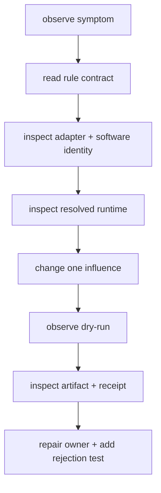
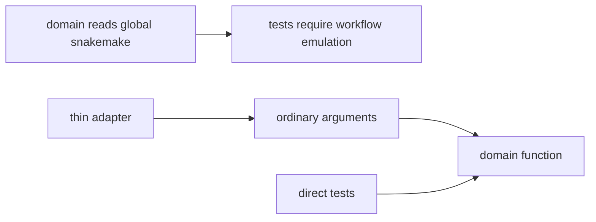

# Failure Modes at the Software Boundary

Software-boundary failures often look like ordinary workflow failures:

- nothing reruns
- an import breaks
- local execution differs from a scheduler
- an artifact exists but records old behavior
- a wrapper upgrade changes output

Diagnose them by asking which identity or dependency crossed the rule, adapter, package,
runtime, and provenance boundaries invisibly.

## Use a causal diagnostic route



Do not begin by deleting all outputs. That removes the stale-state evidence needed to
diagnose under-rebuild.

## Hidden package source drift

**Symptom:** package code changed, but the dry-run reports nothing to do and output keeps
old behavior.

**Cause:** the rule's shell command is unchanged and the package identity is absent from
the rebuild contract.

**Experiment:**

1. converge the output under a source marker
2. change only package source
3. run a dry-run
4. invoke the workflow without forcing
5. inspect the artifact marker

The software-boundary audit performs this experiment.

**Repair:** expose a scalable software identity: declared bounded source, built package
hash, lock, source bundle revision, or image digest. Prove that changing it invalidates
the output.

## Files passed as parameters

**Symptom:** a reference, model, adapter list, or policy file changes but dependent output
does not rerun.

**Cause:** the file path appears under `params` or inside package code instead of under
`input`.

**Experiment:** converge, modify only file contents, and inspect the dry-run.

**Repair:** declare the material file as a named input and pass that same path through the
software interface.

This is a file-contract failure even when the package boundary is otherwise clean.

## Import-time repository coupling

**Symptom:** importing a package fails from another working directory, scans data, creates
directories, or reads config before a function is called.

**Cause:** module import performs workflow or repository work.

Warning pattern:

```python
CONFIG = load_config("config/config.yaml")
SAMPLES = list(Path("data").glob("*.fastq.gz"))
```

**Experiment:** import the package from an empty working directory with only the installed
artifact available.

**Repair:** move I/O behind explicit functions, pass paths or values, and let the workflow
own discovery and policy.

## Adapter and domain logic fused together

**Symptom:** every unit test must create a fake global `snakemake` object even to test a
small transformation.

**Cause:** domain behavior reads injected workflow state directly.

**Repair:** keep a thin workflow adapter that translates named inputs, outputs, and params
into ordinary function arguments. Test the domain function directly and the adapter
through a bounded rule execution.



## Runtime declaration mistaken for exact identity

**Symptom:** the same environment YAML resolves different builds or behaves differently
across platforms.

**Cause:** a compatibility declaration is being described as an exact lock.

**Experiment:** record resolved package lists, solver, channels, and platform in both
contexts.

**Repair:** narrow the claim or retain exact platform locks or image digests. Add
cross-context evidence only for contexts the course or project supports.

## Local package path hidden in runtime setup

**Symptom:** local execution imports `src/`, but cluster or container execution cannot find
the package.

**Cause:** `PYTHONPATH`, editable installation, or current directory is ambient rather than
part of deployment policy.

**Experiment:** print the executable, import location, current directory, and command in
the actual job context.

**Repair:** install an immutable package into the environment or make the supported path
injection explicit and test it across execution contexts.

## Wrapper treated as a black box

**Symptom:** a wrapper revision changes command options, files, or tool version and
downstream output changes unexpectedly.

**Cause:** adoption relied on wrapper name rather than a reviewed interface and immutable
revision.

**Experiment:** compare resolved wrapper source, command, environment, and artifacts across
revisions.

**Repair:** pin the wrapper revision, document exposed policy, and add a representative
artifact comparison before upgrading.

## Partial outputs survive software failure

**Symptom:** a failed package invocation leaves a file that another process or later run
treats as trusted.

**Cause:** implementation writes directly to the final path or validates too late.

**Experiment:** preload a trusted final, force failure during writing, and inspect the
final and candidate paths.

**Repair:** write a sibling candidate, validate it, and rename after success under tested
filesystem assumptions. Declare Snakemake outputs honestly and test failure behavior.

## Broad exception handling erases evidence

**Symptom:** provenance reports `unknown`, a command continues, or malformed data is skipped
without a visible decision.

**Cause:** exception handling catches more than the contract permits.

Broad fallback can be justified for nonessential provenance facts, but it must not turn a
material software or data failure into success.

Review:

- which exception types are expected
- whether fallback changes artifact meaning
- whether a log records the failure
- whether the result remains suitable for publication

## Nondeterministic software behavior

**Symptom:** clean rebuilds under apparently identical inputs and runtime produce different
artifacts.

Possible causes:

- unseeded randomness
- unordered iteration or concurrency
- clock or locale
- nondeterministic tool implementation
- hardware-sensitive floating point
- unstable external service

**Experiment:** repeat clean builds while recording source, runtime, policy, platform, and
output identities.

**Repair:** control the source of variation, define a semantic equivalence test, or narrow
the reproducibility claim.

## Provenance overclaims

**Symptom:** a report lists versions and commit but cannot reconstruct the actual job
environment or explain why an artifact remained accepted.

**Cause:** provenance receipt is being used as a substitute for rebuild and release policy.

**Repair:** connect:

- reviewed software identity
- observable invalidation mechanism
- clean build route
- execution receipt
- artifact manifest

Each has a different owner.

## Fast diagnostic table

| Observation | Boundary to inspect first | Useful command or receipt |
| --- | --- | --- |
| source changed, output stayed old | software identity | changed-source dry-run |
| reference changed, output stayed old | rule inputs | file-contract audit |
| package works only from repository root | package interface | cross-directory CLI test |
| local works, cluster import fails | deployment/runtime | job executable and import path |
| same declaration resolves differently | environment exactness | resolved package inventory |
| wrapper upgrade changes command | external adapter | pinned source and command diff |
| failed run corrupts final | publication behavior | forced-failure filesystem evidence |
| repeat builds differ | nondeterminism | paired clean-build manifests |

## Write a repair claim

Use:

> Because **observed dependency** is hidden from **boundary owner**, **stale or
> irreproducible behavior** can occur. Expose **identity or input** at **named surface**,
> preserve **existing contract**, and reject recurrence with **controlled experiment**.

Example:

> Because local package source is hidden behind an unchanged shell command, Snakemake can
> accept v1 output after source reaches v2. Bind an immutable package identity to the job,
> preserve files and CLI behavior, and reject any changed identity that yields a quiet
> dry-run.

## Exit checkpoint

You can diagnose software boundaries when you can:

1. preserve stale-state evidence instead of deleting it
2. distinguish hidden file, source, runtime, and ambient dependencies
3. choose a repair owned by the correct boundary
4. pair successful behavior with a deliberate failure or drift experiment
5. state what remains unproved after the repair
