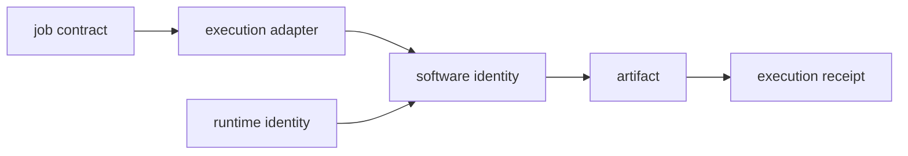
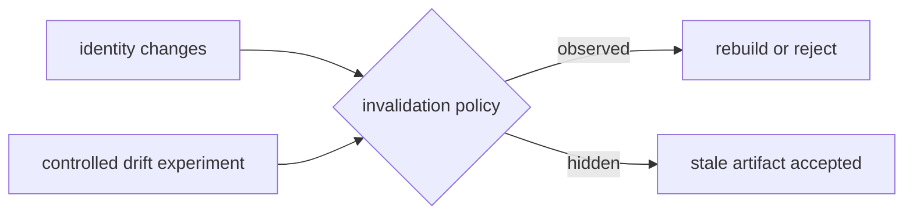

# Glossary

Use these terms to distinguish graph truth, software identity, runtime identity, and
execution receipts. The distinctions matter because a workflow can satisfy one while
failing another.

## Workflow and software ownership

**Job contract**

The rule-level declaration of files, scalar policy, capacity, runtime, implementation, and
operational evidence for one kind of job.

**Execution adapter**

Code or command translation that connects Snakemake's named values to ordinary software.
A `script:` file, wrapper, or CLI invocation can serve as an adapter.

**Workflow-adjacent script**

An implementation owned by one workflow job, commonly under `workflow/scripts/`. It may
use the injected `snakemake` object and therefore is not automatically a reusable package.

**Domain function**

An ordinary function that receives domain values and returns domain values without reading
workflow globals, config, or repository paths.

**Package CLI**

A command-line interface over package behavior. It separates ordinary software invocation
from Snakemake binding, but its source identity may still be hidden from the workflow.

**Wrapper**

A versioned adapter around a tool invocation, environment, and file contract. A wrapper
must be reviewed by immutable revision and interface, not trusted from its name.

**Snakemake module**

A reusable rule or workflow boundary imported through `module` and `use rule`. It reuses
workflow declarations, whereas a package reuses software behavior.

## Identity and runtime

**Software identity**

The source revision, package artifact, source bundle, wrapper revision, lock, or image
digest selected to represent the implementation that produced an artifact.

**Runtime identity**

The resolved interpreter, packages, libraries, image, platform, and execution context
relevant to a job.

**Compatibility range**

A set of allowed versions, such as `>=9.14,<9.24`. It does not identify the exact version
used.

**Environment declaration**

Inputs to a package resolver, such as channels and `python=3.11`. It can select a family
without fixing an exact resolution.

**Exact lock**

A retained resolution containing precise versions and, where supported, builds and hashes
for a target platform.

**Container tag**

A registry name that may refer to different image content over time unless registry policy
guarantees immutability.

**Container digest**

A content-addressed image identity. It fixes image bytes but not host kernel, hardware,
external services, or scientific validity.

**Path injection**

Making local source importable through a path such as `PYTHONPATH=src`. It identifies a
location, not an immutable built package.

**Resolver context**

The solver, version, channels or indexes, priority policy, and target platform that turn an
environment declaration into installed packages.

## Drift and rebuilds

**Software drift**

A material change to implementation or runtime while declared data and requested output
remain stable.

**Observable identity**

A software or runtime identity that Snakemake or the surrounding release process can use
to invalidate existing artifacts.

**Hidden package source**

Local package implementation invoked behind an unchanged shell command without source,
package, lock, or image identity in rebuild policy.

**Rerun trigger**

A class of change Snakemake uses when deciding whether output is stale, such as input,
params, code, or software environment changes.

**Converged workflow**

A state where an immediate invocation or dry-run plans no relevant work. Drift experiments
need convergence so missing output does not explain a later rerun.

**Incremental rebuild**

An invocation that begins with existing artifacts. It can test whether a changed influence
invalidates prior output.

**Clean rebuild**

Construction from absent generated outputs. It tests whether declared source and runtime
can produce the artifact, but cannot by itself expose under-rebuild.

**Under-rebuild**

Failure to plan a job after a material influence changes, leaving stale output accepted.

**Controlled drift experiment**

A comparison that converges output, changes one software or runtime identity, inspects the
plan, invokes the workflow, and checks artifact meaning.

## Evidence and review

**Provenance receipt**

A record of source, runtime, config, platform, and time observed by an execution. It helps
explain a run but does not cause invalidation or guarantee reconstruction.

**Artifact identity**

A checksum, semantic digest, schema-aware comparison, or other evidence used to distinguish
artifact content or meaning.

**Preservation evidence**

Evidence that extraction or migration retained graph files, software behavior, runtime
support, failures, and artifact meaning.

**Negative evidence**

Evidence that a deliberate hidden dependency, drift, or invalid runtime is rejected for
the expected reason.

**Result**

Whether an audit experiment observed its expected behavior.

**Decision**

Whether the demonstrated design should be accepted or rejected. A defect-reproduction
model may report `PASS / REJECT`.

**Finding**

A specific named observation such as `HIDDEN_PACKAGE_DRIFT_MISSES_RERUN`. It prevents a
bare pass result from losing meaning.

**Claim boundary**

The explicit limit on what evidence establishes. For example, one declared source file
proves the specimen's drift edge, not a whole package's transitive identity.

## Confusion pairs

| Do not collapse | Distinction |
| --- | --- |
| explicit command / observable source | a CLI can be explicit while its implementation remains hidden from rebuild policy |
| version range / exact version | a range allows several resolutions |
| environment declaration / lock | one feeds a resolver; the other records a resolution |
| image tag / image digest | a tag can move; a digest identifies content |
| software identity / provenance | identity drives selection or invalidation; provenance records observation |
| unit test / workflow test | one checks software behavior; the other checks orchestration binding |
| clean rebuild / incremental drift | one proves construction; the other can expose stale acceptance |
| `PASS` / `ACCEPT` | experiment success does not approve a defect model |
| package / Snakemake module | one reuses software; the other reuses rules |
| runtime reproducibility / scientific validity | identical software does not prove the method answers the right question |

## Retrieval check

Explain without returning to the definitions:

1. why `python -m package` can hide source drift
2. why `python=3.11` is not an exact lock
3. why deleting output weakens an under-rebuild experiment
4. why provenance cannot substitute for invalidation policy
5. why `PASS / REJECT` is the correct result for a reproduced stale-output design
