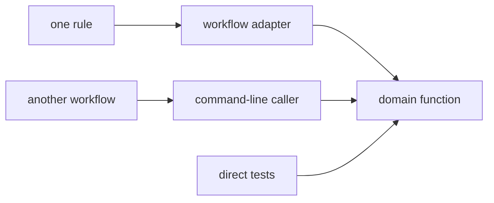
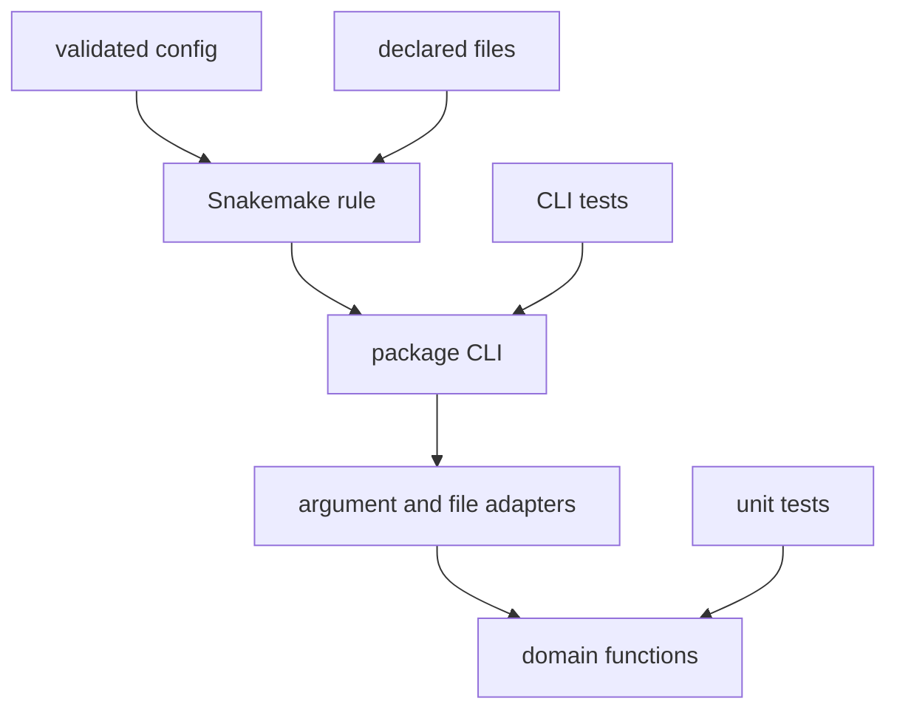

# Workflow Adapters, Packages, and Reusable Boundaries

Reuse is not achieved by moving code into `src/`. Reuse exists when a caller can supply
ordinary inputs, receive ordinary outputs, and understand behavior without importing
workflow state.

This lesson develops that boundary from a one-job script to a tested package API and shows
where wrappers fit.

## Start from callers

Ask who needs the behavior:

| Caller | Useful boundary |
| --- | --- |
| one rule in one workflow | workflow-owned script |
| several rules in the same repository | shared package function with a local API |
| command line and workflow | package CLI over domain functions |
| several workflows with consistent orchestration | versioned wrapper or workflow module |
| downstream Python program | installable package API |

Do not promote code for prestige. Promote when another real caller needs a stable
interface or when direct tests require separation from workflow state.



The function becomes reusable because several callers can reach it without pretending to
be Snakemake.

## Distinguish adapter and domain API

A workflow adapter translates:

- named Snakemake inputs and outputs
- wildcards
- params
- threads and resources
- logs

into a package call.

Domain code owns:

- parsing domain formats
- transformations
- validation of domain invariants
- deterministic serialization
- meaningful exceptions

The adapter should be thin enough that a reader can compare it with the rule. The domain
API should be independent enough that tests can call it with ordinary objects.

## Read the capstone package structure

The capstone uses names that describe durable responsibilities:

| Module | Owned behavior |
| --- | --- |
| `fastqio.py` | FASTQ records, iteration, qualities, writing |
| `trim_fastq.py` | trimming policy and statistics |
| `dedup_fastq.py` | duplicate handling |
| `kmer_profile.py` | k-mer signature computation |
| `screen_panel.py` | panel comparison |
| `summarize.py` | aggregation |
| `manifest.py` | publish inventory and hashes |

This is stronger than one broad helper module because imports reveal domain relationships.
Names alone do not prove independence. Inspect whether modules read:

- current working directory
- global config
- environment variables
- Snakemake objects
- undeclared repository files

## Design a package function before the CLI

A useful domain function receives domain values:

```python
def trim_3prime(record: FastqRecord, qmin: int) -> FastqRecord:
    ...
```

It does not parse command-line flags, inspect config, or construct repository paths. A
test can create a `FastqRecord`, call the function, and compare the result.

The CLI owns translation:

```text
--in-fastq path
--out-fastq path
--out-json path
--q integer
--min-len integer
```

The rule owns which concrete workflow paths and policy values become those options.



## Test at the seam you claim

Different tests protect different seams:

| Test | Useful assertion | Does not prove |
| --- | --- | --- |
| pure function | exact transformation and edge cases | file or CLI binding |
| file adapter | parser and serializer invariants | workflow paths |
| CLI | options, exit status, and artifacts | Snakemake scheduling |
| rule execution | workflow binding and environment | broad domain coverage |
| drift audit | source identity invalidates output | semantic correctness |

If the package has only end-to-end workflow tests, the reusable interface is not being
reviewed directly.

## Use exceptions as part of the software contract

Reusable code should reject invalid domain input predictably. Prefer:

- a specific exception type or nonzero CLI exit
- a message naming the violated invariant
- no partially trusted final artifact
- log context sufficient to reproduce the call

Do not let the package silently skip malformed records while the rule declares success
unless that policy is explicit and tested.

## Decide when a wrapper helps

A wrapper can package a known tool invocation, version, environment, and expected file
interface. It helps when:

- several workflows need the same tool binding
- tool options and output conventions are stable enough to name
- wrapper provenance is reviewable
- callers retain control of workflow-specific paths and policy

A wrapper is not trustworthy merely because it comes from a registry.

Review:

1. wrapper version or revision
2. tool version and environment
3. required inputs and produced files
4. exposed and hidden options
5. command or source inspection route
6. update and rollback policy

## Compare package, wrapper, and module reuse

| Boundary | Reuses | Caller controls |
| --- | --- | --- |
| package | functions or command-line software | files and scalar arguments |
| wrapper | one tool invocation contract | rule-level files, params, resources |
| Snakemake module | rules or a workflow fragment | imports, aliases, local bindings, config |

Do not use a module to solve a domain-code problem. Do not build a package merely to share
two rule declarations.

## Detect premature abstraction

Suppose two rules each contain a four-line command. They differ in:

- input format
- scientific threshold
- output schema
- failure policy

A common helper that accepts many flags may reduce line count while erasing meaning. Keep
the rules explicit until a stable shared behavior emerges.

Signals that extraction is ready:

- the same domain transformation has two real callers
- arguments can be named without workflow-specific globals
- direct tests express a coherent contract
- failures have one owner
- versioning the software boundary would help consumers

## Make software identity part of reuse

A package call can be explicit and still hide implementation drift:

```python
shell:
    "python -m analysis.normalize ..."
```

If local package source changes while the shell string and declared inputs remain the
same, Snakemake may accept old output. The software-boundary audit reproduces this.

Scalable identities include:

- immutable package artifact plus version and hash
- locked environment
- container image digest
- reviewed source bundle revision

The caller or release route must make that identity observable. A version string inside
source is not enough if nothing checks it.

## Audit a package boundary

For `src/capstone/trim_fastq.py`, answer:

- Which functions can be called directly?
- Which code parses files and which transforms records?
- Does the CLI accept every workflow-selected value?
- Does any import inspect repository or workflow state?
- Which dependency versions does execution require?
- What identity invalidates output after package source changes?
- Which direct and workflow tests protect the boundary?

Record evidence from source and commands, not only the intended design.

## Common failure diagnoses

| Symptom | Likely boundary problem | Repair |
| --- | --- | --- |
| tests need a fake global `snakemake` object for domain behavior | workflow adapter and domain code are fused | extract ordinary functions |
| package opens `config.yaml` itself | caller policy leaked inward | pass validated values |
| CLI reconstructs repository paths | workflow graph ownership leaked inward | pass named paths |
| one generic utility module attracts unrelated code | no domain owner | split by durable behavior |
| wrapper update silently changes output | external adapter identity is vague | pin revision and compare artifacts |
| package source changes but dry-run is quiet | software identity is hidden | declare or release an observable identity |

## Exit checkpoint

You understand reusable boundaries when you can:

1. describe the adapter/domain split for one capstone command
2. test domain behavior without Snakemake
3. choose package, wrapper, or module reuse for the correct layer
4. reject a premature abstraction by naming hidden differences
5. state how package identity participates in rebuild policy
