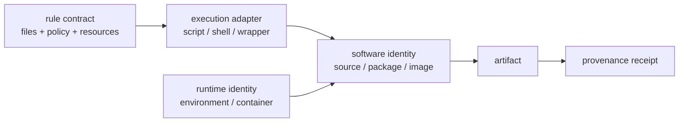
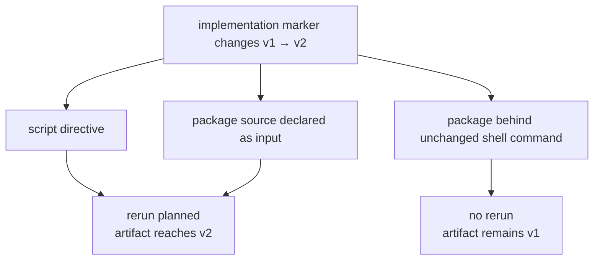

# Module 05: Software Boundaries and Reproducible Rules

A rule can declare every data file correctly and still accept stale output after its
implementation changes. This module asks a more demanding question than “does the command
run?”:

> Which software identity produced the artifact, where is that identity visible, and what
> causes the artifact to become invalid when the software changes?

You will answer through the capstone's real rule, script, package, environment, and
provenance surfaces. You will also run a paired experiment that demonstrates a package
source change Snakemake cannot see.

## The boundary model

A reproducible job has several connected contracts:



Each arrow creates a review question:

- Does the rule expose every material file and parameter?
- Does the adapter reveal which program runs?
- Is the software identity observable to Snakemake or release policy?
- Does the runtime declaration select a compatible family or an exact resolution?
- Does provenance record what actually ran without pretending it caused reproducibility?

No single YAML file, lock, container, or provenance JSON answers all five.

## Learning outcomes

By the end of this session, you should be able to:

1. separate workflow orchestration, execution adaptation, domain code, and runtime policy
2. choose among inline logic, `script:`, a package command, and a wrapper from ownership
3. explain why a stable shell command can hide changed package source
4. make software drift observable through an appropriate identity
5. distinguish a version range, environment declaration, exact lock, and image digest
6. test package logic directly without constructing a workflow
7. interpret provenance as an execution receipt rather than a rebuild trigger
8. diagnose stale artifacts, import coupling, black-box wrappers, and runtime drift
9. design a negative experiment that proves old artifacts are invalidated
10. hand another learner a software-boundary packet they can review independently

## The capstone surfaces

Use these together:

| Surface | What it teaches | Question to carry |
| --- | --- | --- |
| `Snakefile` and `workflow/rules/` | graph and execution contracts | what does Snakemake know? |
| `workflow/scripts/provenance.py` | workflow-adjacent implementation | which ambient context is intentional? |
| `src/capstone/` | reusable domain and CLI code | can it run and test without Snakemake? |
| `workflow/envs/python.yaml` | job runtime declaration | how exact is the resolved runtime? |
| `pyproject.toml` | package and repository tool constraints | which context does this constrain? |
| `publish/v1/provenance.json` | observed execution identity | what can it explain after a run? |
| software-boundary audit | causal drift contrast | what change invalidates existing output? |

Do not infer that placement is correct because the directory name looks deliberate.
Trace dependencies from the rule into the implementation.

## The executable contrast

The capstone audit contains three small workflows:



The hidden-package row reports `PASS / REJECT`. The experiment passed because it
successfully reproduced stale output. The design is rejected.

Run:

```bash
gmake capstone-software-boundary-audit
gmake capstone-software-boundary-selftest
```

Read the generated route before the full report.

## Build one evidence packet

Keep these records as you progress:

| Record | Required content |
| --- | --- |
| job contract | one rule's files, policy, runtime, implementation, and evidence |
| ownership map | decisions owned by rule, adapter, package, and runtime |
| source identity | source, package, bundle, lock, or image that represents implementation |
| drift prediction | what should rerun after that identity changes |
| audit receipt | result, decision, finding, and relevant traces |
| package test | direct test that does not construct Snakemake |
| runtime inventory | declaration, resolver, exactness, and platform assumptions |
| provenance interpretation | recorded facts and unsupported claims |
| failure diagnosis | symptom, hidden boundary, repair, and rejection test |
| handoff review | remaining risks and commands another learner can repeat |

Store learner-generated evidence under the repository's `artifacts/` tree rather than
inside course source.

## Study route

Follow the pages in order:

1. **Rule Logic, Scripts, and Software Ownership** establishes the job contract.
2. **Helper Code, Packages, and Reusable Boundaries** separates adapter from domain API.
3. **Environments, Containers, and Runtime Contracts** distinguishes compatibility from
   identity.
4. **Software Provenance, Drift, and Rebuild Evidence** runs the causal drift experiment.
5. **Failure Modes at the Software Boundary** diagnoses boundary-specific failures.
6. **Worked Example** repairs one transformation while preserving graph and evidence.
7. **Exercises and answers** produce and review the complete packet.

Skipping directly to containers will not repair a hidden source dependency. Skipping
direct tests will not prove the package API. The sequence matters because each boundary
adds a different kind of evidence.

## A session plan for independent study

### Establish the contract

Read the first lesson and select one capstone rule. Inventory what Snakemake can see before
opening the implementation.

### Separate ownership

Trace the command into `workflow/scripts/` or `src/capstone/`. Decide which code is
workflow-specific and which is ordinary software.

### Inspect runtime identity

Compare the environment YAML, package constraints, installed versions, and provenance
fields. Mark every place where a range or family is not an exact resolution.

### Run the drift experiment

Predict all three audit rows, execute them, and explain why the rejected design reports
`PASS`.

### Diagnose and review

Complete the failure lesson, worked example, and exercises. Finish with a review someone
else can challenge without oral context.

## Prerequisite check

You are ready when you can:

- read a rule's named inputs, outputs, parameters, environment, and implementation
- distinguish dry-run from execution
- run the capstone's supported local toolchain
- explain why a file that affects output normally belongs in the graph

If direct Python tests are new, begin with the worked example and follow its commands
exactly before attempting the exercises.

## Commands to keep close

From the program directory:

```bash
gmake capstone-software-boundary-audit
gmake capstone-software-boundary-selftest
gmake capstone-check
```

From the capstone directory:

```bash
snakemake --list-rules
snakemake -n -p
pytest -q tests/test_trim.py
```

Before each command, write the observation you expect. Afterward, record what the command
cannot prove.

## Evidence limits

This module does not claim:

- listing one package source file scales to every real dependency
- a container digest proves scientific validity
- a lock makes results portable across hardware
- provenance causes stale output to rebuild
- unit tests prove the workflow binding
- workflow success proves software identity was exact

Advanced practice means narrowing claims, not collecting impressive tooling words.

## Exit standard

You are ready to leave Module 05 when you can:

1. explain one job from declared input through software and runtime to artifact
2. identify the software identity the rebuild policy observes
3. reproduce hidden package drift and explain the stale artifact
4. distinguish environment declaration, exact resolution, and provenance receipt
5. test reusable code directly and its workflow binding separately
6. propose a repair with preservation evidence and a negative drift test
7. name at least one software risk that remains outside your review
