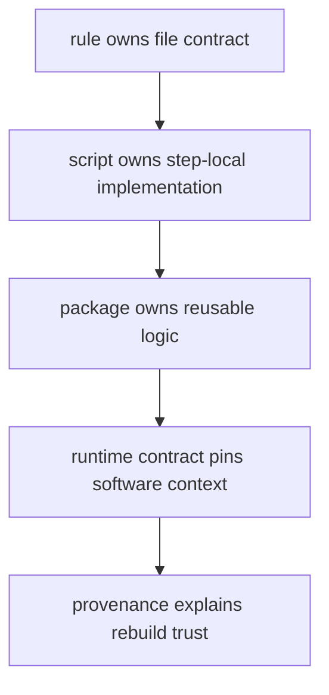
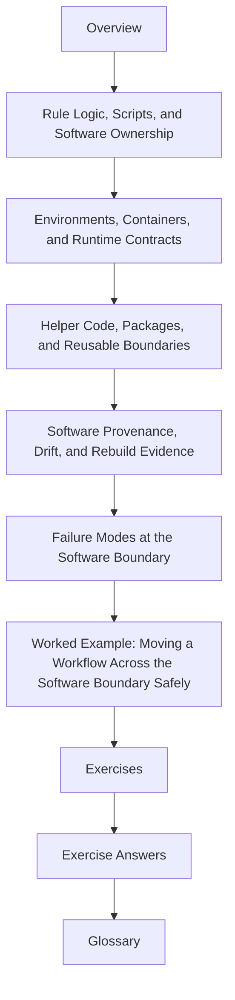

# Module 05: Software Boundaries and Reproducible Rules

Modules 01 to 04 teach workflow truth, disciplined dynamic behavior, production policy,
and structural scaling. Module 05 asks the next boundary question:

> where does Snakemake stop, and where should software implementation begin?

This module is about making that line explicit. Scripts, packages, environments,
containers, and provenance matter only when another engineer can still explain what the
workflow owns, what the software owns, and what changed when reproducibility breaks.

## What this day must accomplish

By the end of Module 05, you should be able to do five things without hiding workflow
meaning:

- keep rule files focused on orchestration and file contracts
- move step-local implementation into scripts without introducing hidden inputs
- promote truly reusable logic into package code with direct tests
- treat environments and containers as named runtime contracts rather than conveniences
- explain one rebuild using software provenance instead of guesswork

## The software boundary ladder for the whole module

Keep this order in front of you all day:



If a rule stops revealing its inputs and outputs, the software boundary has gone too far.
If reusable logic stays trapped in step-local code, the boundary has not gone far enough.

## The running lab for the whole day

Use one repository story all day instead of several unrelated coding anecdotes:

- one rule currently hides too much logic in a long `run:` block
- one script extraction should shorten the rule without changing its contract
- one helper is reused by two steps and deserves package ownership
- one rule-scoped environment should eliminate an ambient host dependency
- one provenance artifact should explain a rebuild after code or runtime drift

Every page should help you answer one concrete ownership question about that workflow.

## Plan for the day

| Session | What you do | Evidence you keep |
| --- | --- | --- |
| ownership audit | annotate a long rule by contract, implementation, and reusable logic | placement map |
| script extraction | move step-local logic behind `script:` while keeping every declared boundary visible | before/after rule and focused run |
| package boundary | extract shared logic into `src/` and test it directly | package API and tests |
| runtime contract | pin one rule to an environment and compare it with repository-level tooling | environment evidence |
| rebuild trust | inspect code and runtime drift, then explain the rebuild with provenance | rebuild note plus provenance record |
| independent practice | complete all ten exercises | software-boundary review packet |

The day is successful when the rule becomes shorter because ownership became clearer, not
because the important behavior disappeared behind another file.

## Study route



Read the module in that order the first time.

The route matters:

- start with rule ownership before you talk about containers
- separate step-local code from reusable code before you generalize either one
- use provenance after you can already explain the runtime contract

## The ten files in this module

1. Overview (`index.md`)
2. [Rule Logic, Scripts, and Software Ownership](rule-logic-scripts-and-software-ownership.md)
3. [Environments, Containers, and Runtime Contracts](environments-containers-and-runtime-contracts.md)
4. [Helper Code, Packages, and Reusable Boundaries](helper-code-packages-and-reusable-boundaries.md)
5. [Software Provenance, Drift, and Rebuild Evidence](software-provenance-drift-and-rebuild-evidence.md)
6. [Failure Modes at the Software Boundary](failure-modes-at-the-software-boundary.md)
7. [Worked Example: Moving a Workflow Across the Software Boundary Safely](worked-example-moving-a-workflow-across-the-software-boundary-safely.md)
8. [Exercises](exercises.md)
9. [Exercise Answers](exercise-answers.md)
10. [Glossary](glossary.md)

## How to use the file set

| If you need to... | Start here |
| --- | --- |
| decide what belongs in the rule and what belongs in software | [Rule Logic, Scripts, and Software Ownership](rule-logic-scripts-and-software-ownership.md) |
| treat environments and containers as real workflow inputs | [Environments, Containers, and Runtime Contracts](environments-containers-and-runtime-contracts.md) |
| decide whether helper logic belongs beside the workflow or inside `src/` | [Helper Code, Packages, and Reusable Boundaries](helper-code-packages-and-reusable-boundaries.md) |
| explain what changed after code or runtime drift | [Software Provenance, Drift, and Rebuild Evidence](software-provenance-drift-and-rebuild-evidence.md) |
| diagnose failures at the workflow-versus-software seam | [Failure Modes at the Software Boundary](failure-modes-at-the-software-boundary.md) |
| see the whole module as one ownership repair | [Worked Example: Moving a Workflow Across the Software Boundary Safely](worked-example-moving-a-workflow-across-the-software-boundary-safely.md) |
| test your own understanding | [Exercises](exercises.md) |
| compare your reasoning against a reference answer | [Exercise Answers](exercise-answers.md) |
| stabilize the module vocabulary | [Glossary](glossary.md) |

## The running question

Carry this question through every page:

> if this rule behaves differently on another machine, which exact software boundary moved and where is that movement recorded?

Good Module 05 answers usually mention one or more of these:

- a rule that owns only orchestration while a script owns implementation
- a reusable helper that graduated from workflow-adjacent code into package code
- an environment or image that changed runtime meaning
- provenance that explains why earlier outputs should no longer be trusted
- a failure showing the workflow and software boundary were drawn in the wrong place

## What the module should change in your head

If the day is working, you should feel these transitions:

- long `run:` blocks stop looking normal
- `script:` stops sounding like indirection and starts sounding like ownership
- `src/` stops being a prestige move and starts being a reusable-code boundary
- environments stop feeling optional once you care about reruns on another machine
- provenance stops sounding decorative once a published output must be defended later

## Commands to keep close

These commands form the evidence loop for Module 05:

```bash
snakemake -n -p
snakemake --summary
snakemake --list-changes code
make proof
```

They answer different questions:

- what the visible rule surface currently promises
- what the repository believes about outputs and freshness
- which code changes now justify rebuilds
- how the capstone packages software trust into one stronger proof route

## Exit standard

Do not move on until all of these are true:

- you can explain one case where logic should stay in a rule and one where it should move into software
- you can name one helper that belongs in `workflow/scripts/` and one that belongs in `src/`
- you can describe one runtime change that counts as semantic rebuild drift
- you can show one provenance artifact that explains a rebuilt output later
- you can classify one failure as a workflow-boundary problem or a software-boundary problem
- you have completed all ten exercises and reproduced at least one code- or runtime-driven rebuild

When those become ordinary, Module 05 has done its job.
